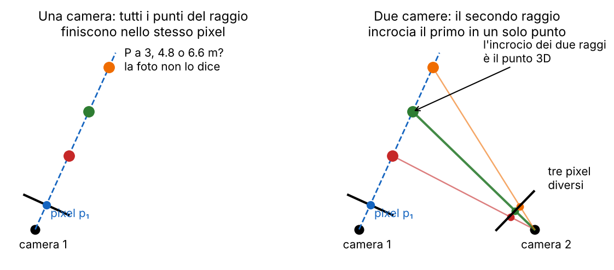
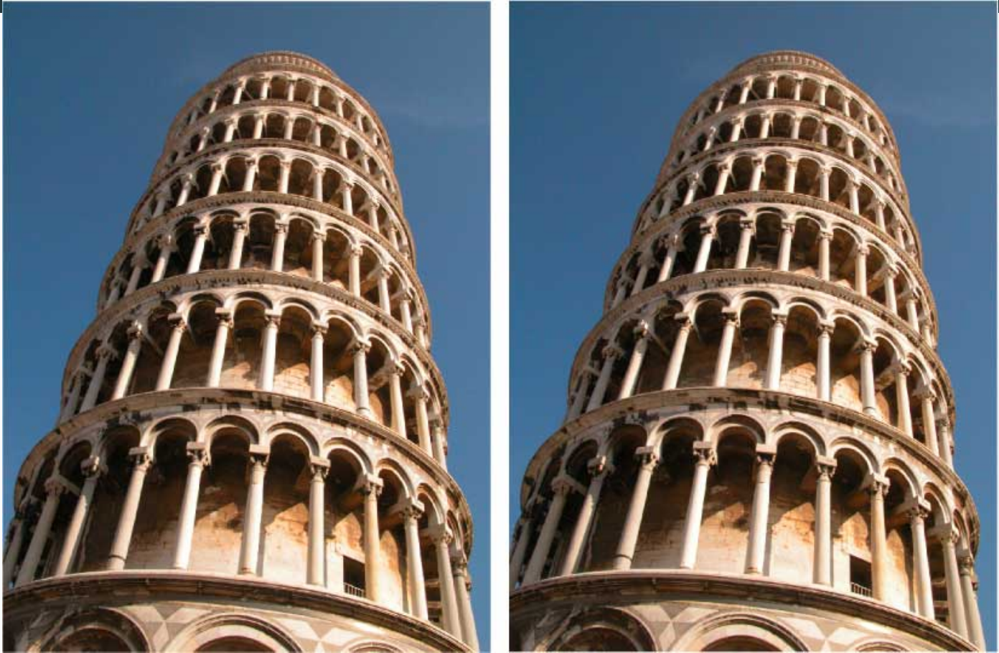
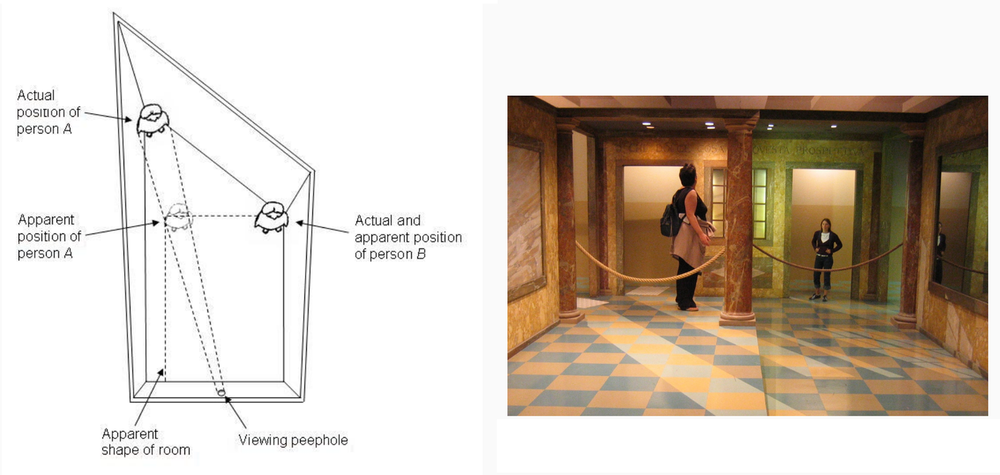
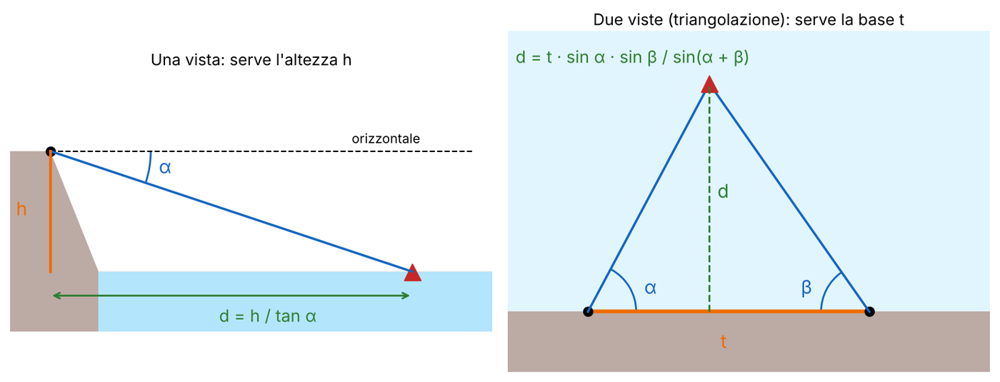
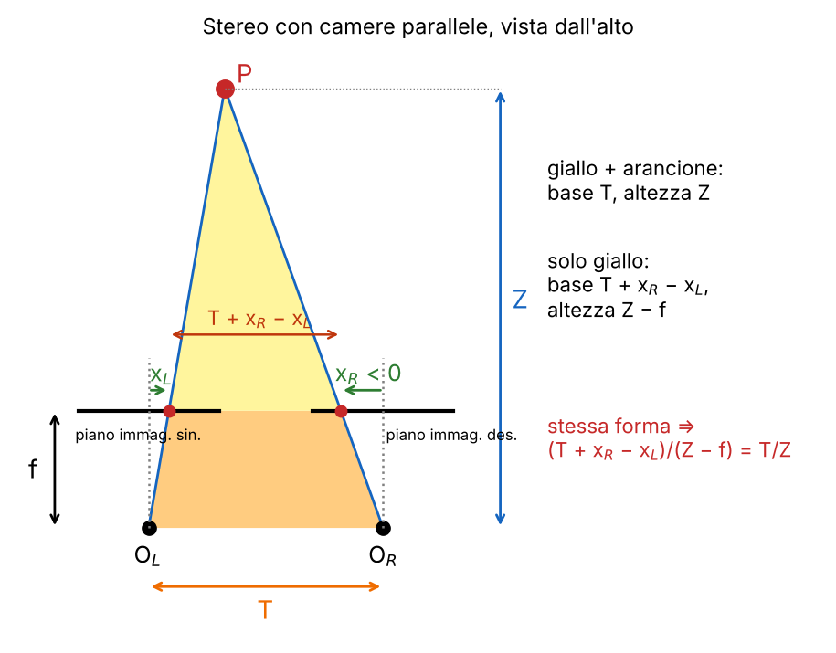
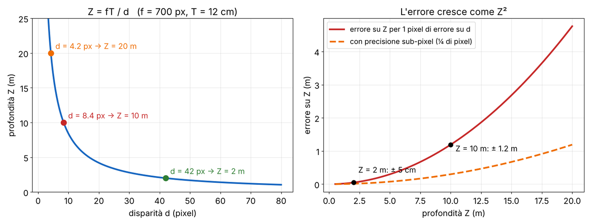
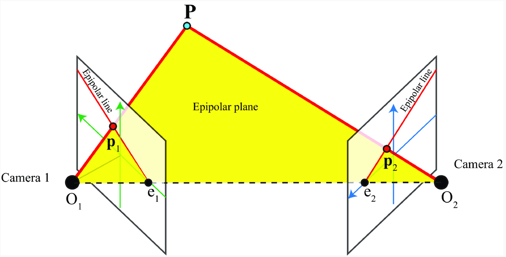

# L13 · Stereo e profondità

*Lezione 13 · Antonio Carta · 13 ottobre 2026*

[Versione interattiva sul sito, con videolezione](https://gabriele-marsili.github.io/appunti-magistrale-ai/anno-2/computer-vision/sito/#L13) · [Indice della dispensa](README.md)

**In una frase:** **una foto sola non dice a che distanza sono le cose**, ma la indovina con gli indizi (prospettiva, tessitura, foschia, occlusione, dimensioni note); **con due foto da punti di vista diversi la distanza si misura per triangolazione**: si trova per ogni pixel il suo corrispondente nell'altra immagine, lo spostamento (la **disparità** d) dà la profondità con **Z = fT/d**, e la geometria epipolare (matrici E ed F) riduce la ricerca del corrispondente a una sola riga; oggi le reti neurali fanno lo stesso lavoro, con due viste o perfino con una.

### Prima di iniziare

Questa lezione usa quasi tutto quello che hai visto finora. Ti servono:

  - dalla [L2](https://gabriele-marsili.github.io/appunti-magistrale-ai/anno-2/computer-vision/sito/#L2): la camera pinhole, un punto (X, Y, Z) finisce in (fX/Z, fY/Z). La divisione per Z è proprio il motivo per cui la profondità si perde;
  - dalla [L8](https://gabriele-marsili.github.io/appunti-magistrale-ai/anno-2/computer-vision/sito/#L8) e dalla [L9](https://gabriele-marsili.github.io/appunti-magistrale-ai/anno-2/computer-vision/sito/#L9): keypoint (Harris, SIFT), descrittori, matching con il ratio test di Lowe, RANSAC, la DLT (A h = 0 risolto con la SVD) e le omografie;
  - dalla [L11](https://gabriele-marsili.github.io/appunti-magistrale-ai/anno-2/computer-vision/sito/#L11) e dalla [L12](https://gabriele-marsili.github.io/appunti-magistrale-ai/anno-2/computer-vision/sito/#L12): le coordinate omogenee, gli intrinseci K, la rotazione R e la traslazione fra due sistemi di riferimento;
  - di algebra lineare: il prodotto vettoriale a × b (perpendicolare a entrambi), il nucleo di una matrice, la SVD.

I numeri degli esempi su immagini vere vengono dalla riesecuzione dei due notebook della lezione (OpenCV 5.0) e da un block matching scritto in numpy; la disparità vera della coppia Tsukuba è quella pubblicata dal benchmark di Middlebury. Le slide sono numerate come le schede qui sotto (pagina del PDF).

### Guarda prima questi video

  - [Simple Stereo | Camera Calibration](https://www.youtube.com/watch?v=hUVyDabn1Mg) (Video). Shree Nayar, First Principles of Computer Vision. Due camere parallele, la disparità e la formula della profondità con i triangoli simili. Corrisponde alle sezioni 4–5.
  - [Finding Correspondences | Uncalibrated Stereo](https://www.youtube.com/watch?v=erpiFudDBlg) (Video). Shree Nayar. Il confronto fra finestre lungo una riga, SSD e correlazione normalizzata, e perché la dimensione della finestra è un compromesso. Sezioni 6–8.
  - [Epipolar Geometry | Uncalibrated Stereo](https://www.youtube.com/watch?v=6kpBqfgSPRc) (Video). Shree Nayar. Piano epipolare, epipoli e la derivazione della matrice essenziale con il prodotto vettoriale, poi la fondamentale. Sezioni 10–11.
  - [Estimating Fundamental Matrix | Uncalibrated Stereo](https://www.youtube.com/watch?v=izpYAwJ0Hlw) (Video). Shree Nayar. La stima di F da almeno 8 corrispondenze, con la stessa tecnica della DLT (sistema omogeneo e SVD). Sezione 12.

### 1\. Il problema: una foto non basta

**Il problema.** Un'auto a guida autonoma vede un pedone. Deve frenare adesso o ha tempo? Un robot deve afferrare una tazza: quanto deve allungare il braccio? Serve la **profondità**, cioè la distanza di ogni punto dalla camera. Ma una foto è una proiezione: dalla [L2](https://gabriele-marsili.github.io/appunti-magistrale-ai/anno-2/computer-vision/sito/#L2) sai che un punto (X, Y, Z) finisce nel pixel (fX/Z, fY/Z), e **tutti i punti dello stesso raggio danno lo stesso pixel** (slide 4). Raddoppia X, Y e Z: il pixel non cambia.

**L'idea.** Ci sono due vie d'uscita. La prima è indovinare: noi lo facciamo continuamente usando **indizi** e conoscenze sul mondo (i binari sono paralleli, le persone sono alte più o meno 1.7 m). La seconda è misurare: con **una seconda camera, il raggio del pixel nella prima e quello nella seconda si incrociano in un solo punto**, e il punto 3D è determinato.

Anche il nostro sistema visivo usa tre fonti (slide 9): **indizi in una singola immagine, il moto e la visione binoculare**. In visione artificiale: capire quando gli indizi di una sola immagine funzionano, scrivere i vincoli geometrici per più viste, e trattare il moto come viste multiple nel tempo. La slide 5 mostra una rete (DINOv3) che separa il gatto dallo sfondo da una sola foto, grazie agli indizi e alla conoscenza a priori.

> **Il punto**
> 
> **La proiezione butta via la profondità**: da una foto si può solo stimarla con indizi e conoscenze; con due foto si può calcolarla, perché due raggi si incrociano in un punto.

### 2\. Gli indizi di profondità in una singola immagine

**Il problema.** Chiudi un occhio: il mondo non diventa piatto. Il cervello usa gli **indizi pittorici (o monoculari)**: regolarità delle immagini naturali che, di solito, sono legate alla distanza. I pittori li usano da secoli per dare profondità a una tela. La slide 14 li elenca; il libro ne parla nel cap. 43 (§ 43.2) e la prospettiva lineare ha un capitolo tutto suo, il 42.

  - **Prospettiva lineare** (a): **rette parallele nel mondo convergono a un punto di fuga**. Una retta con direzione D = (DX, DY, DZ) ha punto di fuga `v = (f DX/DZ,  f DY/DZ)` (visionbook eq. 42.3): dipende solo dalla direzione, non da dove passa la retta. Per questo i binari, o le righe delle piastrelle, puntano tutti allo stesso punto.
  - **Gradiente di tessitura** (b): una superficie con una tessitura uniforme (erba, piastrelle, ghiaia) si proietta in una tessitura sempre più fitta e piccola con la distanza. Il gradiente dice sia la distanza sia l'inclinazione della superficie.
  - **Dimensione relativa e familiare** (c): due oggetti uguali, quello più piccolo nell'immagine è più lontano. Se conosci la dimensione vera dell'oggetto (familiare), ottieni la **distanza assoluta**: con focale a = 500 pixel, una persona alta 1.7 m che nell'immagine è alta 85 pixel è a Z = a · 1.7 / 85 = **10 m**. È l'unico indizio di questa lista che dà una scala in metri.
  - **Occlusione** (d): **ciò che copre è più vicino di ciò che è coperto**. Dà solo l'ordine, non la distanza.
  - **Ombreggiatura** (e): se sai da dove arriva la luce, quanto è chiara una superficie vincola il suo orientamento locale (la *shape from shading*).
  - **Prospettiva aerea o foschia** (f): l'aria diffonde la luce, quindi gli oggetti lontani hanno **meno contrasto e colori spostati verso l'azzurro**. Funziona solo su grandi distanze (montagne, città).

Le slide 10–13 mostrano gli stessi indizi su immagini del libro: un disegno a sole linee che sembra una città 3D (fig. 42.2), una piazza con le rette che vanno ai punti di fuga, una superficie a bugne e una valle alpina con la foschia.

L'illusione della torre dice una cosa importante: **il cervello non misura, interpreta**. Gli indizi sono ipotesi sul mondo, e quando l'ipotesi è falsa la percezione sbaglia.

> **Il punto**
> 
> Gli indizi monoculari sono **regolarità statistiche**: rette parallele, tessiture uniformi, dimensioni note, luce dall'alto. Danno quasi sempre una profondità *relativa*; solo la dimensione familiare dà i metri.

### 3\. Quando gli indizi ingannano: la stanza di Ames

**Il problema.** Se gli indizi sono ipotesi, si può costruire una scena che le viola apposta. La **stanza di Ames** (Adelbert Ames, 1946; slide 6–7, visionbook § 42.2) è una stanza trapezoidale storta: la parete di fondo è obliqua e un angolo è molto più lontano dell'altro. Pavimento, soffitto e parete di fondo sono deformati in modo che, **visti da un unico foro**, si proiettino esattamente come una normale stanza rettangolare.

Il cervello **assume che la stanza sia rettangolare**, quindi crede che le due persone siano alla stessa distanza. Allora quella più lontana, che è più piccola nell'immagine, viene percepita più piccola davvero. Fra due indizi in conflitto (stanza rettangolare contro persone di altezza normale) vince quello della stanza. Se una persona cammina lungo la parete di fondo, sembra crescere o rimpicciolire.

Da un solo punto di vista l'inganno è perfetto, ed è proprio il punto: **da una sola immagine la geometria non è determinata**. Basta spostare l'occhio dal foro, o guardare con due occhi, e l'illusione si rompe.

> **Il punto**
> 
> La stanza di Ames produce la stessa immagine di una stanza rettangolare: gli indizi portano alla geometria sbagliata. **Una seconda vista aggiunge un vincolo geometrico che nessuna ipotesi può falsificare**.

### 4\. Triangolazione: quanto è lontana la barca?

**Il problema.** Sei sulla costa e vuoi sapere a che distanza è una barca. È il primo esempio del cap. 40 del libro (§ 40.2.1, slide 17), e contiene già tutta l'idea dello stereo.

**Una vista.** Se sei a un'altezza nota h e misuri l'angolo α fra l'orizzontale e la barca, il triangolo rettangolo dà `d = h / tan α`. Funziona, ma solo perché conosci h (è un caso di "dimensione nota").

**Due viste.** Due osservatori lungo la costa a distanza nota t misurano gli angoli α e β fra la costa e la barca. La barca è dove le due linee di vista si incrociano: questa è la **triangolazione**. La distanza dalla costa è

`d = t · sin α · sin β / sin(α + β)`

Si ricava così: il piede della perpendicolare dalla barca alla costa divide t in due pezzi, d / tan α e d / tan β. Quindi t = d (cot α + cot β) = d · sin(α + β) / (sin α sin β). La formula della slide 17 è giusta.

**Esempio.** t = 100 m, α = 80°, β = 85°: d = 100 · 0.985 · 0.996 / sin 165° = 98.1 / 0.259 ≈ **379 m**. Se sbagli α di mezzo grado (80.5°) ottieni 392 m: 13 m di errore. Con una vista sola, h = 20 m e α = 2°, d = 20 / tan 2° ≈ 573 m; un errore di 0.1° (α = 2.1°) porta a 545 m. **Quando gli angoli sono piccoli (o le linee di vista quasi parallele), piccoli errori di angolo diventano grandi errori di distanza**: per questo il libro dice che servono h o t grandi.

> **Il punto**
> 
> Triangolare = **trovare un punto come incrocio di due linee di vista da posizioni note**. La precisione dipende dalla base: più è lunga rispetto alla distanza, meglio è.

### 5\. Due camere parallele: la disparità

**Il problema.** Ora le due "persone sulla costa" sono due camere. Qual è la formula della profondità? Partiamo dal caso più semplice (visionbook § 40.3.1, slide 18–19): **due camere identiche (stessa focale f), con gli assi ottici paralleli, spostate solo orizzontalmente di una distanza T** (la **base**, *baseline*). Con questa geometria un punto ha la stessa y in tutte e due le immagini, yL = yR, quindi basta guardare la scena dall'alto.

**La matematica.** xL e xR sono le coordinate orizzontali del punto nelle due immagini, misurate ciascuna dal proprio asse ottico (dal centro dell'immagine). Il triangolo grande ha vertici OL, OR, P: base T, altezza Z. Il triangolo giallo ha vertici nei due pixel e in P: la base è la distanza fra i due pixel, T + xR − xL, e l'altezza è Z − f. Triangoli simili hanno lo stesso rapporto base/altezza:

`(T + xR − xL) / (Z − f) = T / Z`

Moltiplicando in croce: TZ + Z(xR − xL) = TZ − Tf, cioè Z(xL − xR) = fT, e quindi

`Z = f T / (xL − xR) = f T / d`

dove **d = xL − xR è la disparità**: di quanti pixel si sposta il punto passando dall'immagine sinistra alla destra. La stessa cosa si vede anche senza triangoli: con la camera sinistra nell'origine, xL = fX/Z e xR = f(X − T)/Z, quindi xL − xR = fT/Z.

Cosa dice la formula: **la disparità è inversamente proporzionale alla profondità**. Punti vicini si spostano molto, punti lontani poco, punti all'infinito per niente (d = 0). Prova: tieni un dito davanti al naso e chiudi alternativamente un occhio e l'altro. Il dito salta, il muro in fondo quasi no.

**Esempio svolto.** Una camera stereo con f = 700 pixel e T = 12 cm (fT = 84 pixel · m). Un punto a 2 m ha d = 84 / 2 = **42 pixel**; a 10 m, d = 8.4 pixel; a 20 m, 4.2 pixel. Al contrario, se misuri d = 21 pixel, il punto è a Z = 84 / 21 = 4 m.

**Quanto è precisa.** Derivando Z = fT/d: |dZ/dd| = fT/d2 = Z2/(fT). Quindi `ΔZ ≈ Z2 Δd / (f T)`: **l'errore cresce con il quadrato della distanza**. Con un errore di 1 pixel, a 2 m sbagli di 4/84 m ≈ 5 cm, a 10 m di 100/84 ≈ 1.2 m. Per migliorare servono **una base più lunga, una focale più lunga o una disparità sub-pixel**. È la versione "camera" dell'osservazione sulla barca.

La slide 19 nota che f e T dipendono dalle camere, mentre la disparità si misura nelle immagini: **per misurare d in pixel non serve conoscere f e T**, per trasformarla in metri sì. L'anaglifo del Titanic della slide 16 (rosso per un occhio, ciano per l'altro) sfrutta lo stesso principio: il cervello ricava la profondità dalle disparità.

#### La ricetta

La slide 20 riassume cosa serve per stimare la profondità per triangolazione, e il resto della lezione segue questi tre passi:

1.  **Rettificazione**: rendere le due immagini come se venissero da due camere parallele, legate solo da una traslazione orizzontale (sezione 13);
2.  **Stereo matching**: per ogni punto pL della sinistra trovare il corrispondente pR nella destra (sezioni 6–9);
3.  **Calcolo della profondità**: d = xL − xR e Z = fT/d.

> **Il punto**
> 
> Con camere parallele, triangoli simili danno **Z = fT/d**: profondità inversamente proporzionale alla disparità, errore che cresce come Z2. Tutto il problema si riduce a misurare d per ogni pixel.

### 6\. Lo stereo matching: trovare il pixel corrispondente

**Il problema.** La formula è facile; trovare d no. Per ogni pixel della sinistra bisogna capire dove è finito lo stesso punto della scena nella destra. È il problema della **corrispondenza**, e il libro lo chiama la parte difficile dello stereo.

**L'idea.** Dopo la rettificazione, un punto 3D ha immagini pL = (xL, y) e pR = (xR, y) **sulla stessa riga** (slide 24). Quindi il corrispondente si cerca solo sulla stessa riga, e solo a sinistra di xL (xR = xL − d con d ≥ 0), fino a una disparità massima. **Da un problema 2D (dove sta in tutta l'immagine?) si passa a uno 1D.**

**Il tentativo ingenuo** (visionbook § 40.3.2, slide 26 e 29): per ogni pixel della sinistra prendi il pixel della stessa riga, nella destra, con l'intensità più simile. Per visualizzarlo si costruisce la **disparity space image** (DSI) di una riga: un'immagine con la colonna x in orizzontale, la disparità candidata d in verticale e, in ogni cella, l'errore fra il pixel (x, y) della sinistra e il pixel (x − d, y) della destra. La disparità stimata in x è la riga d con l'errore minimo.

Il singolo pixel **non funziona**: **un'intensità di 120 compare in decine di posti della stessa riga**, e il rumore, i riflessi che si spostano fra le viste e le zone uniformi fanno il resto. Nell'esempio della figura, il 56% dei pixel di Tsukuba ha una disparità sbagliata di più di un pixel. Il libro mostra la stessa cosa (fig. 40.7, slide 29) e la risolve **sfocando la DSI con un filtro che preserva i bordi**: si mediano i costi dei vicini, ma senza mescolare i due lati di un bordo. Il modo più semplice di mediare i costi dei vicini è il block matching, la prossima sezione.

> **Il punto**
> 
> Dopo la rettificazione il corrispondente si cerca **sulla stessa riga, fra xL − dmax e xL**. Il confronto di singoli pixel è troppo ambiguo: bisogna confrontare intorni.

### 7\. Il cost volume e il block matching

**Il problema.** Un pixel da solo è ambiguo; un quadratino di 15 × 15 pixel con la sua tessitura lo è molto meno. Come si organizza il calcolo per tutti i pixel e tutte le disparità?

**L'idea** (slide 27). Si costruisce il **cost volume C(x, y, d)**: per ogni pixel (x, y) e ogni disparità candidata d da 0 a dmax, un numero che dice quanto la finestra intorno a (x, y) nella sinistra è *diversa* dalla finestra intorno a (x − d, y) nella destra. È una pila di dmax + 1 immagini di costo, una per disparità: la DSI della sezione 6 è una sua fetta orizzontale. Poi, per ogni pixel, si prende la disparità con il costo minimo:

`d̂(x, y) = argmind C(x, y, d)`

Il **block matching** è la scelta più semplice di C: **confronta finestre di dimensione fissa con una misura di somiglianza veloce**. Chiamiamo W la finestra intorno a (x, y), IL e IR le due immagini:

  - **SAD** (somma delle differenze assolute): C = ∑(u,v)∈W |IL(u, v) − IR(u − d, v)|;
  - **SSD** (somma dei quadrati delle differenze): come la SAD con il quadrato al posto del valore assoluto. Pesa di più le differenze grandi, quindi è più sensibile agli outlier;
  - **NCC** (correlazione incrociata normalizzata): si toglie a ogni finestra la sua media e si divide per la sua deviazione standard, poi si fa il prodotto scalare. Vale fra −1 e 1, e 1 vuol dire "uguali a meno di luminosità e contrasto". Qui si cerca il **massimo** (o il minimo di −NCC).

`NCC = ∑W (IL − μL)(IR − μR) / √( ∑W (IL − μL)2 · ∑W (IR − μR)2 )`

con μL, μR le medie delle due finestre.

**Esempio piccolo.** Finestra sinistra (1D, tre pixel): \[10, 50, 30\]. Nella destra due candidati: quello giusto \[12, 48, 33\] e uno sbagliato \[20, 30, 35\]. SAD: 2 + 2 + 3 = 7 contro 10 + 20 + 5 = 35, vince quello giusto. Ora la camera destra ha meno contrasto ed è più chiara: ogni suo pixel diventa 0.5 · I + 60. I candidati diventano \[66, 84, 76.5\] e \[70, 75, 77.5\], e la SAD vale 136.5 per quello giusto e 132.5 per quello sbagliato: **vince il candidato sbagliato**. La NCC invece vale 0.995 per il giusto e 0.65 per lo sbagliato, prima e dopo la modifica, perché media e scala si tolgono.

    import numpy as np, cv2 as cv
    def cost_volume_sad(L, R, dmax=16, w=15):
        H, W = L.shape
        C = np.full((dmax, H, W), np.inf, np.float32)
        for d in range(dmax):
            diff = np.abs(L[:, d:] - R[:, :W - d])          # pixel (x, y) contro (x - d, y)
            C[d, :, d:] = cv.boxFilter(diff, -1, (w, w))      # media sulla finestra w x w
        return C
    disp = np.argmin(cost_volume_sad(L, R), axis=0)          # d stimata per ogni pixel

**La dimensione della finestra è un compromesso.** **Piccola: poca informazione, molte ambiguità.** Grande: più robusta, ma **ai bordi degli oggetti la finestra contiene due profondità diverse** e il bordo si "gonfia" (l'oggetto vicino sembra più largo), mentre le strutture sottili spariscono.

**Perché la NCC.** Due camere non vedono mai la stessa luminosità: esposizione, guadagno, vignettatura e riflessi cambiano. La SAD e la SSD confrontano valori assoluti; la NCC **è invariante a cambi affini di luminosità e contrasto** (I → aI + b) dentro la finestra.

> **Il punto**
> 
> Cost volume: **un costo per ogni pixel e ogni disparità, poi argmin su d**. Block matching = costo calcolato su finestre (SAD, SSD, NCC). La finestra grande riduce il rumore ma sbava i bordi; la NCC regge le differenze di luminosità fra le camere.

### 8\. Quando il matching fallisce, e i metodi semi-globali

**Il problema.** Anche con le finestre, ci sono pixel per cui il minimo del costo non esiste o è sbagliato. La slide 28 elenca tre casi tipici, e conviene vederli sulle curve del costo.

  - **Regioni senza tessitura** (muri bianchi, cielo, l'asfalto): il costo è piatto su tutte le d, nessun minimo unico.
  - **Motivi ripetuti** (strisce, piastrelle, finestre di un palazzo): molti minimi ugualmente buoni, a distanza di un periodo.
  - **Occlusioni**: punti visibili in una vista e nascosti nell'altra, tipicamente lo sfondo accanto al bordo di un oggetto vicino. Il corrispondente giusto non esiste.

A questi si aggiungono **riflessi speculari** (si spostano con il punto di vista) e superfici trasparenti.

**L'idea dei metodi globali.** Un pixel da solo non può decidere; ma **i pixel vicini, di solito, hanno disparità simili**, perché le superfici sono per lo più lisce. Allora non si sceglie d pixel per pixel, ma si cerca l'intera mappa di disparità D che minimizza un'energia con due termini (slide 28): il costo dei dati più un termine di **regolarità** (*smoothness*) che penalizza i salti fra vicini. Nel **Semi-Global Matching** (SGM, Hirschmüller 2008):

`E(D) = ∑p C(p, Dp) + ∑p ∑q vicino di p ( P1 · [|Dp − Dq| = 1] + P2 · [|Dp − Dq| > 1] )`

Le parentesi quadre valgono 1 se la condizione è vera. P1 piccolo permette le pendenze dolci (superfici inclinate), P2 grande scoraggia i salti, che però restano possibili ai bordi degli oggetti. Minimizzare E su tutta l'immagine è un problema difficile (NP-difficile in 2D); lungo una sola riga si risolve esattamente con la programmazione dinamica. SGM fa la programmazione dinamica lungo 8 o 16 direzioni e somma i risultati: è una **soluzione approssimata**, come dice la slide, che **gestisce molto meglio le zone ambigue** e costa più tempo del block matching (visionbook § 40.3.2.3). Nelle zone senza tessitura **la disparità viene "propagata" dai bordi**, dove il costo è informativo.

#### In pratica: il notebook con StereoBM

Il notebook `depth_prediction` usa il block matching di OpenCV sulla coppia Tsukuba:

    stereo = cv.StereoBM.create(numDisparities=16, blockSize=15)
    disparity = stereo.compute(imgL, imgR)       # int16, disparità × 16
    disp_px = disparity.astype(np.float32) / 16  # in pixel; i valori < 0 sono "non trovato"

  - `numDisparities` = dmax, il numero di disparità provate (multiplo di 16); `blockSize` il lato della finestra (dispari);
  - **compute restituisce la disparità in virgola fissa, moltiplicata per 16**: i valori vanno da −16 a 240, e −16 vuol dire "nessuna disparità affidabile" (minDisparity − 1, moltiplicato per 16). Il notebook mostra l'immagine senza dividere per 16, quindi la barra dei colori va fino a 240: va letta divisa per 16;
  - StereoBM filtra già le risposte poco affidabili (poca tessitura, minimo non abbastanza netto) e lascia una fascia vuota a sinistra larga numDisparities, dove la ricerca uscirebbe dall'immagine.

> **Il punto**
> 
> Il block matching fallisce su **zone uniformi, motivi ripetuti e occlusioni**. I metodi semi-globali aggiungono un termine che vuole disparità simili fra vicini e lo minimizzano in modo approssimato: più lenti, più accurati. In OpenCV la disparità esce moltiplicata per 16.

### 9\. Matching sparso con i keypoint

**Il problema.** Se il problema sono le zone ambigue, perché non lavorare solo dove l'immagine è chiaramente riconoscibile? È il secondo dei due approcci del libro (§ 40.3.2.1–40.3.2.3, slide 30–31): **si calcola la disparità solo nei keypoint, poi si interpola**.

**L'idea.** È lo stesso procedimento della [L9](https://gabriele-marsili.github.io/appunti-magistrale-ai/anno-2/computer-vision/sito/#L9) per i panorami:

1.  si estraggono i keypoint nelle due immagini (Harris o SIFT, [L8](https://gabriele-marsili.github.io/appunti-magistrale-ai/anno-2/computer-vision/sito/#L8)) con i loro descrittori;
2.  si accoppiano con il vicino più vicino nello spazio dei descrittori e il **ratio test** di Lowe (il migliore deve essere nettamente meglio del secondo);
3.  novità: in una coppia rettificata **le corrispondenze giuste stanno sulla stessa riga**, quindi si scartano quelle con |yR − yL| più grande di un pixel o con disparità negativa. È un controllo geometrico gratuito, il ruolo che in L9 aveva RANSAC;
4.  dalle disparità dei keypoint si ricava una mappa densa per interpolazione (il libro cita la propagazione delle credenze e la programmazione dinamica).

Due cose da notare (slide 31): **i keypoint trovati nelle due immagini non sono gli stessi** (non ogni punto rilevato a sinistra lo è anche a destra), e la mappa densa è buona solo quanto l'interpolazione. Il vantaggio è che **le poche disparità calcolate sono affidabili**; per questo le corrispondenze sparse sono il punto di partenza naturale anche quando le camere *non* sono rettificate, come vedremo ora.

> **Il punto**
> 
> Stereo sparso: keypoint + descrittori + ratio test, poi **il vincolo "stessa riga" scarta i match sbagliati**, poi interpolazione. Poche disparità ma affidabili; la mappa densa dipende dall'interpolazione.

### 10\. Due camere qualsiasi: la geometria epipolare

**Il problema.** Finora le camere erano parallele e la ricerca avveniva lungo una riga. Nella realtà le due camere sono ruotate una rispetto all'altra (slide 33): dove si cerca il corrispondente di p1? In tutta l'immagine 2?

**L'idea** (visionbook § 40.3.3, slide 34–35). Il pixel p1 corrisponde a un raggio 3D, quello che parte dal centro O1 della camera 1 e passa per p1. Il punto P sta da qualche parte su quel raggio. Allora p2 sta sull'immagine di quel raggio nella camera 2, che è una retta: **il corrispondente si cerca lungo una retta, non in tutta l'immagine**. La ricerca torna 1D anche per camere qualsiasi.

I nomi da sapere:

  - **piano epipolare**: il piano che contiene i due centri O1, O2 e il punto P;
  - **linee epipolari**: le intersezioni del piano epipolare con i due piani immagine. p1 sta sulla sua, p2 sulla corrispondente. Cambiano al variare di P;
  - **epipoli** e1, e2: dove la retta O1O2 (la base) buca i due piani immagine. In altre parole, e2 è il punto dove la camera 2 vede il centro della camera 1. Non dipendono da P, quindi **tutte le linee epipolari di un'immagine passano per lo stesso epipolo**.

Il **vincolo epipolare** (slide 36) è la frase "il corrispondente di p1 sta sulla linea epipolare di p1". Prima di scriverlo in formule, conviene vedere che forma hanno le linee epipolari in configurazioni diverse (il "gioco" del § 40.3.4.4 del libro).

![Gli stessi nove punti 3D visti da tre coppie di camere (calcolate con F = K−⊤\[T\]×RK−1, sezione 12). Traslazione orizzontale: linee orizzontali, epipolo all'infinito. Moto in avanti: linee radiali dall'epipolo al centro. Camere convergenti: linee che si incontrano fuori dall'immagine.](../sito-src/L13/disp2_casi_epipolari.png)

Il caso a sinistra è lo stereo parallelo: **le linee epipolari sono le righe dell'immagine**, ed è per questo che prima bastava cercare sulla riga. Il caso al centro (una camera che avanza, come un'auto) mostra che **una traslazione non basta: deve essere parallela alle righe**.

> **Attenzione: "solo una traslazione" non basta (slide 22)**
> 
> La slide dice che se le due viste sono legate solo da una traslazione le linee epipolari sono le righe della griglia di pixel. È vero solo se la traslazione è **orizzontale**, cioè parallela all'asse x delle immagini (e le due camere hanno gli stessi intrinseci). Con una traslazione in avanti le linee sono radiali (figura sopra, al centro); con una traslazione verticale sarebbero le colonne. La rettificazione (sezione 13) deve quindi anche ruotare le camere finché la base è parallela alle righe.

> **Il punto**
> 
> Il corrispondente di p1 sta sulla **linea epipolare**, intersezione del piano (O1, O2, P) con l'immagine 2; tutte le linee epipolari passano per l'epipolo. Con camere parallele e base orizzontale le linee sono le righe.

### 11\. Il vincolo epipolare e la matrice essenziale

**Il problema.** Vogliamo una formula che, data p1, dica quali p2 sono ammessi. La derivazione è di Longuet-Higgins (1981) ed è nel § 40.3.4 del libro (slide 36–37).

**Le notazioni.** Lo stesso punto P ha coordinate **P1** nel sistema della camera 1 e **P2** in quello della camera 2, legate da una rotazione R e una traslazione T:

`P2 = R P1 + T`

Attenzione al significato di T: **qui non è la posizione della camera nel mondo** come nella [L11](https://gabriele-marsili.github.io/appunti-magistrale-ai/anno-2/computer-vision/sito/#L11) (dove Pc = R(Pw − T)), ma la traslazione da aggiungere dopo la rotazione. Il centro della camera 1 (P1 = 0) ha coordinate T nella camera 2. Con focale normalizzata f = 1, il punto immagine è p1 = P1/Z1 = (X1/Z1, Y1/Z1, 1), e lo stesso per p2.

**L'idea geometrica.** I tre vettori P2 (da O2 a P), T (da O2 a O1) e R P1 (da O1 a P, espresso negli assi della camera 2) stanno tutti nel piano epipolare. **Tre vettori in un piano: il primo è perpendicolare al prodotto vettoriale degli altri due.**

**La derivazione**, in due passi:

1.  fai il prodotto vettoriale di T con entrambi i lati: T × P2 = T × R P1 + T × T = T × R P1 (perché T × T = 0);
2.  fai il prodotto scalare con P2: a sinistra P2 · (T × P2) = 0, perché T × P2 è perpendicolare a P2. Resta P2⊤(T × R P1) = 0.

Il prodotto vettoriale con un vettore fisso è lineare, quindi si scrive come una matrice: a × b = \[a\]× b con

`[a]× = [[0, −a3, a2], [a3, 0, −a1], [−a2, a1, 0]]`

una matrice antisimmetrica di rango 2. Definendo la **matrice essenziale**

`E = [T]× R,     P2⊤ E P1 = 0`

e dividendo per Z1Z2 (che sono positivi) si passa ai punti immagine:

`p2⊤ E p1 = 0`

Questo è il **vincolo epipolare**. Cosa dice a parole: fissato p1, il vettore l2 = E p1 = (a, b, c) definisce la retta a x + b y + c = 0 nell'immagine 2, e p2 deve starci sopra. **E p1 è la linea epipolare di p1**; simmetricamente E⊤p2 è quella di p2 nell'immagine 1.

**Esempio svolto: ritroviamo lo stereo parallelo.** R = I e T = (−0.5, 0, 0) (camera 2 spostata di 0.5 a destra). Allora

`E = [T]× = [[0, 0, 0], [0, 0, 0.5], [0, −0.5, 0]]`

e per p1 = (x1, y1, 1): E p1 = (0, 0.5, −0.5 y1), cioè la retta 0.5 y − 0.5 y1 = 0, ovvero **y2 = y1**: la stessa riga, come nella sezione 5. Un punto concreto: P1 = (1, 0.5, 5) dà p1 = (0.2, 0.1, 1); P2 = P1 + T = (0.5, 0.5, 5) dà p2 = (0.1, 0.1, 1). Stessa y, e disparità 0.2 − 0.1 = 0.1 = fT/Z = 1 · 0.5 / 5.

**Le proprietà di E** (§ 40.3.4):

  - **5 gradi di libertà**: 3 della rotazione, 3 della traslazione, meno 1 perché la scala di T non si vede (un mondo grande il doppio, con camere a distanza doppia, dà le stesse immagini);
  - **rango 2**, perché \[T\]× ha rango 2 (det E = 0);
  - valori singolari della forma (σ, σ, 0): nei tre esempi della figura della sezione 10 la SVD dà (0.5, 0.5, 0), (1, 1, 0), (1.2, 1.2, 0), cioè la lunghezza di T due volte e uno zero;
  - non ogni matrice 3 × 3 è essenziale: questo conta quando la si stima (sezione 12). Una volta stimata, dalla SVD di E si ricavano R e T (a meno della scala di T).

> **Il punto**
> 
> **P2, T e RP1 stanno nel piano epipolare**; con un prodotto vettoriale e uno scalare si ottiene p2⊤Ep1 = 0 con E = \[T\]×R. E p1 è la linea epipolare; E ha rango 2 e 5 gradi di libertà.

### 12\. La matrice fondamentale e come si stima

**Il problema.** E lavora con coordinate "normalizzate" (focale 1, origine nel centro ottico), cioè **richiede camere calibrate**. Noi però misuriamo pixel. Come si scrive il vincolo in pixel?

**La matematica.** Dalla [L11](https://gabriele-marsili.github.io/appunti-magistrale-ai/anno-2/computer-vision/sito/#L11): il pixel in omogenee è c = K p, quindi p = K−1c. Sostituendo nel vincolo, con K1 e K2 gli intrinseci delle due camere:

`(K2−1c2)⊤ E (K1−1c1) = c2⊤ K2−⊤ E K1−1 c1 = 0` `F = K2−⊤ E K1−1,     c2⊤ F c1 = 0`

La **matrice fondamentale** F fa in pixel quello che E fa in coordinate normalizzate: F c1 è la linea epipolare di c1 nell'immagine 2, misurata in pixel. Ha **rango 2** e **7 gradi di libertà** (9 entrate, meno la scala, meno il vincolo det F = 0). Il vantaggio enorme: **F si stima dalle sole corrispondenze di pixel, senza conoscere K, R, T**. Per questo il modulo di Nayar si chiama "uncalibrated stereo".

> **Attenzione: nel libro F = K−⊤EK⊤ è un refuso**
> 
> La slide 37 non scrive il legame fra E ed F e rimanda al libro. Nel § 40.3.4.1 (versione online) la formula compare come F = K−⊤E K⊤: il secondo fattore deve essere **K−1**, come si vede sostituendo p = K−1c (due righe sopra). Il libro usa una sola K, cioè assume due camere con gli stessi intrinseci; in generale servono K1 e K2.

#### La stima con l'algoritmo degli 8 punti

**L'idea** (slide 37: "con un metodo simile alla DLT"). Come per l'omografia ([L9](https://gabriele-marsili.github.io/appunti-magistrale-ai/anno-2/computer-vision/sito/#L9)) e la matrice della camera ([L12](https://gabriele-marsili.github.io/appunti-magistrale-ai/anno-2/computer-vision/sito/#L12)): il vincolo è **lineare nelle 9 entrate di F**. Con c1 = (x1, y1, 1) e c2 = (x2, y2, 1), sviluppando c2⊤Fc1 = 0 ogni corrispondenza dà una riga:

`[x2x1, x2y1, x2, y2x1, y2y1, y2, x1, y1, 1] · f = 0`

dove f è il vettore delle 9 entrate di F riga per riga. Impilando N corrispondenze: **A f = 0 con A di dimensione N × 9**. F è definita a meno di scala, quindi bastano **8 corrispondenze** (8 equazioni per 8 incognite): è l'**algoritmo degli 8 punti**. Il libro non lo nomina ma descrive esattamente questo (§ 40.3.4.2). I passi:

1.  **normalizza** i punti (centrati in zero, distanza media √2 dall'origine, la normalizzazione di Hartley vista in [L10](https://gabriele-marsili.github.io/appunti-magistrale-ai/anno-2/computer-vision/sito/#L10)): senza, le colonne di A hanno ordini di grandezza diversissimi (x1x2 \~ 105 contro 1) e la soluzione è instabile;
2.  risolvi A f = 0 con la SVD: f = ultimo vettore singolare destro di A, con ‖f‖ = 1;
3.  **imponi il rango 2**: la F trovata con dati rumorosi ha rango 3 (e allora le linee epipolari non passano per un unico epipolo). Fai la SVD di F, azzera il valore singolare più piccolo e ricomponi. Per E, in più, rendi uguali i primi due;
4.  torna alle coordinate originali (togli la normalizzazione).

Con molte corrispondenze rumorose e qualche match sbagliato si mette tutto dentro **RANSAC** o **LMedS** (minima mediana dei quadrati), come in [L9](https://gabriele-marsili.github.io/appunti-magistrale-ai/anno-2/computer-vision/sito/#L9). Esistono anche algoritmi a 7 punti per F e a 5 punti per E, che sfruttano i gradi di libertà veri; OpenCV li offre come opzioni di `findFundamentalMat` e `findEssentialMat`.

**Gli epipoli** (§ 40.3.4.3). L'epipolo e1 sta su tutte le linee epipolari dell'immagine 1, quindi **F e1 = 0 e e2⊤F = 0**: gli epipoli sono i nuclei di F e di F⊤, cioè l'ultimo vettore singolare destro e sinistro.

#### In pratica: il notebook epipolar\_lines

    sift = cv.SIFT_create()
    kp1, des1 = sift.detectAndCompute(img1, None)
    kp2, des2 = sift.detectAndCompute(img2, None)
    matches = cv.FlannBasedMatcher(...).knnMatch(des1, des2, k=2)
    good = [m for m, n in matches if m.distance < 0.8 * n.distance]      # ratio test
    F, mask = cv.findFundamentalMat(pts1, pts2, cv.FM_LMEDS)              # stima robusta di F
    lines2 = cv.computeCorrespondEpilines(pts1.reshape(-1, 1, 2), 1, F)  # F c1: linee nell'immagine 2

Nella nostra esecuzione: 815 e 917 keypoint, 165 coppie dopo il ratio test, 117 inlier di LMedS. La F trovata ha valori singolari (1.0, 6 · 10−5, 0): rango 2. Le distanze dei punti dalle loro linee epipolari sono in media 0.7 pixel. (FLANN è casuale: la F stampata nel notebook è un po' diversa.) Il `1` di `computeCorrespondEpilines` dice che i punti vengono dall'immagine 1.

> **Il punto**
> 
> **F = K2−⊤EK1−1 lega direttamente i pixel: c2⊤Fc1 = 0**. Si stima senza calibrazione: 8 corrispondenze, A f = 0 con la SVD, rango 2 imposto, punti normalizzati, RANSAC o LMedS contro gli outlier. Gli epipoli sono i nuclei di F e F⊤.

### 13\. La rettificazione

**Il problema.** Ora sappiamo dove cercare: sulle linee epipolari. Ma inseguire rette oblique, diverse per ogni pixel, è scomodo e lento, e tutti gli algoritmi densi delle sezioni 6–8 assumono le righe. La soluzione (slide 22): **deformare le due immagini una volta per tutte, in modo che le linee epipolari diventino righe**.

**L'idea.** La **rettificazione** trasforma le immagini in modo che (1) le linee epipolari siano orizzontali e (2) linee corrispondenti stiano sulla stessa riga nelle due immagini. È come se avessimo ruotato le due camere, attorno ai loro centri, fino a renderle parallele con la base orizzontale. E dalla [L9](https://gabriele-marsili.github.io/appunti-magistrale-ai/anno-2/computer-vision/sito/#L9) sai che **ruotare una camera attorno al suo centro trasforma l'immagine con un'omografia** (H = K R K−1): quindi la rettificazione è un warping con due omografie, una per immagine (visionbook § 40.3.5). La procedura standard del libro:

1.  ruota le due camere in modo che gli assi ottici siano paralleli e perpendicolari alla base O1O2;
2.  ruota ciascuna attorno al proprio asse ottico in modo che le righe siano parallele alla base;
3.  se serve, scala un'immagine per avere la stessa dimensione dell'altra;
4.  applica le omografie con il warping all'indietro e l'interpolazione bilineare ([L11](https://gabriele-marsili.github.io/appunti-magistrale-ai/anno-2/computer-vision/sito/#L11)).

Con le camere calibrate (K, R, T noti) si usa `cv.stereoRectify`. **Basta anche la sola F**: `cv.stereoRectifyUncalibrated` cerca due omografie che mandano gli epipoli all'infinito in orizzontale, ma senza calibrazione la deformazione può essere forte.

Dopo la rettificazione **la ricerca del corrispondente è una ricerca 1D lungo la stessa riga** (slide 22): si può fare block matching o SGM esattamente come sulla coppia Tsukuba.

> **Il punto**
> 
> Rettificare = **due omografie che rendono le linee epipolari orizzontali e allineate**, come se le camere fossero parallele con base orizzontale. Si fa una volta, prima del matching; con le camere calibrate la deformazione è minima.

### 14\. Stereo con le reti neurali

**Il problema.** I metodi classici fanno a mano due cose: un costo di matching (SAD, NCC) e una regolarizzazione (le finestre, SGM). Entrambe sono scelte rigide. E se le imparassimo dai dati? Oggi **i metodi appresi sono i più accurati, soprattutto nelle zone difficili**; il block matching classico resta di solito più veloce (slide 39).

**Cosa predire** (visionbook § 40.4.1, slide 39). **Le reti predicono la disparità, non la profondità**:

  - **la disparità non dipende dai parametri delle camere** (f, T): la stessa rete funziona per coppie diverse; la profondità si ottiene dopo, con Z = fT/d;
  - il rumore sulla disparità è più o meno uniforme, mentre l'errore sulla profondità cresce con la distanza (sezione 5);
  - su una superficie piana la disparità varia linearmente nell'immagine (derivata seconda nulla), la profondità no: un regolarizzatore che preferisce le superfici piane si scrive facilmente.

**L'addestramento supervisionato** (§ 40.4.2, slide 40). La rete fθ con parametri θ prende le due viste v1, v2 e restituisce una mappa di disparità:

`d̂ = fθ(v1, v2),     J(θ) = ∑t ‖dt − fθ(v1,t, v2,t)‖2`

dove t scorre sulle coppie del training set e dt è la disparità vera. Si minimizza J con discesa del gradiente stocastica, come ogni rete. Le slide e il libro scrivono d e v senza l'indice t: va sottinteso. Le disparità vere vengono da dataset come KITTI (auto con LiDAR) e Scene Flow (sintetico, generato al computer).

**L'architettura a due stadi**: `f(v1, v2) = c(g(v1), g(v2))` dove **g estrae feature da ciascuna vista separatamente, con gli stessi pesi per le due** (rete siamese), e c le confronta e produce la disparità.

**La pipeline tipica** (slide 42), da confrontare passo per passo con quella classica:

1.  **rettifica** la coppia, come prima;
2.  **estrai le feature** da ogni immagine con due CNN a pesi condivisi: al posto dei pixel grezzi, un vettore di feature per pixel, più robusto a luce e rumore;
3.  **forma un cost volume 3D**: per ogni posizione (x, y) e ogni disparità d, un'evidenza locale di match fra le feature di (x, y) a sinistra e di (x − d, y) a destra. È lo stesso C(x, y, d) della sezione 7, solo che invece di un numero (SAD) di solito si mettono le due feature affiancate, e la "misura di somiglianza" la impara la rete dopo;
4.  **una CNN 3D aggrega i costi** sul volume (convoluzioni su x, y e d insieme) e restituisce una disparità per pixel. È il passo che **sostituisce la regolarizzazione dei metodi classici** (le finestre, il filtro sulla DSI, SGM), e lo fa meglio.

> **Approfondimento: come si estrae d dal volume in modo derivabile**
> 
> L'argmin non è derivabile, quindi non si può addestrare con il gradiente. Le reti come GC-Net (Kendall et al. 2017, citata dal libro) usano la *soft argmin*: si trasformano i costi in probabilità con un softmax di −C e si prende la media pesata, d̂ = ∑d d · softmax(−C(x, y, ·))d. In più dà disparità con decimali (sub-pixel).

**I problemi aperti** (slide 43–44, fine del § 40.4.2):

  - **generalizzazione**: una rete addestrata su un dominio (per esempio scene sintetiche) può funzionare male su immagini molto diverse. Le slide 43–44 mostrano DSMNet (Zhang et al., ECCV 2020), progettata per essere invariante al dominio: addestrata su dati sintetici, produce buone disparità su immagini reali (Middlebury, Cityscapes), dove altre reti mostrano artefatti;
  - **costo**: le convoluzioni 3D sul volume H × W × D richiedono molta memoria e tempo; metodi iterativi come RAFT-Stereo le evitano.

Per confrontare gli algoritmi c'è il benchmark di Middlebury (slide 49, § 40.5), da cui viene anche la coppia Tsukuba.

> **Il punto**
> 
> Lo stereo appreso **predice la disparità con la stessa struttura dei metodi classici**: rettifica, feature (siamesi, imparate), cost volume, aggregazione con una CNN 3D al posto di SGM. Più accurato, più costoso, e non sempre generalizza a domini nuovi.

### 15\. Profondità da una sola immagine

**Il problema.** Torniamo all'inizio: noi stimiamo la profondità anche con un occhio chiuso, grazie agli indizi. Una rete può impararli? Sì (slide 45, visionbook cap. 43): **la stima della profondità diventa una regressione pixel per pixel**. Una rete hθ prende un'immagine e restituisce una mappa ẑ\[n, m\] della profondità (o della disparità) in ogni pixel.

**L'architettura** (slide 46, figura sopra (b)): un **encoder-decoder**. L'encoder riduce la risoluzione con convoluzioni, non linearità e downsampling, e così "vede" contesti sempre più ampi (serve per capire che quella è una strada, quello un muro); il decoder risale alla risoluzione piena con l'upsampling. I **collegamenti diretti** fra livelli di pari risoluzione riportano i dettagli fini, che servono per bordi netti. Il libro sottolinea che **non serve un'architettura speciale: decidono i dati e la loss**.

**I dati**: coppie (immagine, mappa di profondità) raccolte con sensori di profondità: Kinect (luce strutturata o tempo di volo, al chiuso; dataset NYUv2) e LiDAR (laser a tempo di volo su un'auto; dataset KITTI), oppure ricostruite da stereo o da molte viste (§ 43.4.1).

**La loss.** La più semplice è l'errore quadratico pixel per pixel:

`L(ẑ, z) = ∑n,m (ẑ[n, m] − z[n, m])2`

con ẑ la profondità stimata e z quella vera. Ma c'è un problema di fondo: **da una sola immagine la scala assoluta è ambigua**. Una stanza e il suo modellino in scala 1:2 fotografati da una camera a distanza dimezzata danno la stessa foto (sezione 1). Se la rete sbaglia solo la scala globale, ma la forma è giusta, vorremmo non punirla troppo. Serve una **loss invariante di scala**.

**La versione corretta** (Eigen, Puhrsch, Fergus, NIPS 2014, § 3.2). **Si lavora sui logaritmi della profondità**: r\[n, m\] = log ẑ\[n, m\] − log z\[n, m\]. Un errore di scala ẑ = s · z diventa uno spostamento costante, r = log s in ogni pixel. Togliendo la media di r, lo spostamento sparisce:

`L(ẑ, z) = (1/NM) ∑n,m (log ẑ[n, m] − log z[n, m] − α)2,     α = (1/NM) ∑n,m (log ẑ[n, m] − log z[n, m])`

dove N × M è il numero di pixel. α è proprio il logaritmo della scala che meglio allinea ẑ a z (eα è il fattore di scala). **Moltiplicare ẑ per qualunque s lascia L invariata.** Nell'articolo la loss di addestramento è un compromesso: (1/n)∑ri2 − (λ/n2)(∑ri)2 con λ = 0.5; con λ = 1 è esattamente la formula sopra.

> **Attenzione: la loss della slide 45 non è invariante di scala**
> 
> La slide (come il § 43.4.2 del libro) scrive L(ẑ, z) = ∑(ẑ\[n, m\] − z\[n, m\] − α)2 con α la media di ẑ − z, **sulla profondità lineare**. Così si toglie una costante *additiva*: la loss è invariante agli **spostamenti** (ẑ = z + 1 m dà zero), non alla scala (ẑ = 2z dà un errore grande). È invariante di scala solo se ẑ e z sono i **logaritmi** della profondità, come in Eigen et al. 2014, perché log(s z) = log s + log z. Errore di battitura minore nella slide: "groud-truth".

Il libro aggiunge due consigli (§ 43.4.2): lavorare sul logaritmo o sulla disparità 1/z evita che i punti lontani, con errori assoluti grandi, dominino la loss; e aggiungere termini sulle derivate della profondità (regolarità) migliora la coerenza globale. La slide 45 lo riassume con "priori espliciti di regolarità aggiunti come loss".

Dalla mappa di profondità e da K si ottiene una nuvola di punti, P = z · K−1c per ogni pixel c (§ 43.3). Il libro mostra anche una variante **non supervisionata** (§ 43.5): la rete si addestra su video, chiedendo che con la profondità e il moto stimati un fotogramma si deformi nel successivo.

> **Il punto**
> 
> Profondità da una vista = **regressione pixel per pixel con un encoder-decoder**, addestrata su dati di Kinect o LiDAR. La scala è ambigua: la loss invariante di scala si calcola **sui logaritmi** togliendo la media della differenza (la slide la scrive su z lineare: sbagliato).

### Il riassunto in 10 righe

1.  Una foto perde la profondità: tutti i punti di un raggio danno lo stesso pixel.
2.  Gli indizi monoculari (prospettiva, tessitura, dimensione, occlusione, ombreggiatura, foschia) sono ipotesi sul mondo; la stanza di Ames le viola e inganna.
3.  Triangolazione: il punto è l'incrocio di due linee di vista da posizioni note; più lunga la base, più precisa la misura.
4.  Camere parallele: Z = fT/d con d = xL − xR (triangoli simili); l'errore su Z cresce come Z2.
5.  Dopo la rettificazione il corrispondente sta sulla stessa riga: cost volume C(x, y, d) e d̂ = argmind C.
6.  Block matching con SAD, SSD o NCC (invariante a luminosità e contrasto); la finestra è un compromesso fra rumore e bordi.
7.  Fallisce su zone uniformi, motivi ripetuti, occlusioni; SGM aggiunge un termine di regolarità e lo minimizza in modo approssimato.
8.  Geometria epipolare: il corrispondente sta sulla linea epipolare; p2⊤Ep1 = 0 con E = \[T\]×R, c2⊤Fc1 = 0 con F = K2−⊤EK1−1.
9.  F si stima da 8 corrispondenze (A f = 0, SVD, rango 2, normalizzazione, RANSAC); la rettificazione usa due omografie per rendere le linee epipolari righe.
10. Le reti predicono la disparità (feature siamesi, cost volume, CNN 3D) o, da una sola immagine, la profondità con un encoder-decoder e una loss invariante di scala sui logaritmi.

### Verifica di aver capito

**Una camera stereo ha f = 800 pixel e base T = 10 cm. Un punto ha disparità 16 pixel. A che distanza è? E di quanto sbagli se la disparità ha un errore di un pixel?**

Z = fT/d = 800 · 0.1 / 16 = 5 m. ΔZ ≈ Z2Δd/(fT) = 25 · 1 / 80 ≈ 0.31 m (con d = 15 o 17 si ottiene 5.33 o 4.71 m). A 10 m l'errore sarebbe quattro volte più grande.

**Perché nella stanza di Ames due persone uguali sembrano una gigante e una minuscola? Che cosa rompe l'illusione?**

Dal foro la stanza trapezoidale produce la stessa immagine di una stanza rettangolare, e il cervello assume la rettangolarità: crede che le due persone siano alla stessa distanza, quindi interpreta la differenza di dimensione nell'immagine come differenza di altezza vera. Basta una seconda vista (spostare l'occhio, usare due occhi o una seconda camera): la triangolazione dà la geometria vera indipendentemente dalle ipotesi.

**Nel block matching, cosa succede a un pixel su un muro bianco, su una ringhiera a sbarre regolari e sullo sfondo appena a sinistra di un oggetto vicino?**

Muro bianco: il costo è piatto su tutte le d, il minimo è deciso dal rumore. Ringhiera: il costo ha minimi quasi uguali ogni periodo delle sbarre, la scelta è ambigua. Sfondo accanto all'oggetto: è occluso nella vista destra, il corrispondente non esiste e il minimo è alto e sbagliato. I metodi semi-globali (SGM) aiutano nei primi due casi propagando la disparità dai vicini; per le occlusioni si usa il controllo di coerenza sinistra-destra o si marca il pixel come non valido.

**Ricava il vincolo epipolare partendo da P2 = RP1 + T. Che cosa rappresenta il vettore E p1?**

Prodotto vettoriale con T: T × P2 = T × RP1. Prodotto scalare con P2: il lato sinistro si annulla, quindi P2⊤\[T\]×RP1 = 0, cioè P2⊤EP1 = 0 con E = \[T\]×R; dividendo per Z1Z2 si ottiene p2⊤Ep1 = 0. E p1 = (a, b, c) sono i coefficienti della linea epipolare ax + by + c = 0 nell'immagine 2, su cui deve stare p2.

**Perché bastano 8 corrispondenze per stimare F, e perché dopo la SVD si azzera il valore singolare più piccolo?**

Ogni corrispondenza dà un'equazione lineare nelle 9 entrate di F; F è definita a meno di scala, quindi le incognite sono 8. La soluzione di A f = 0 con dati rumorosi ha in generale rango 3, mentre una vera F ha rango 2 (det F = 0, gli epipoli sono il suo nucleo): azzerando il valore singolare più piccolo si ottiene la matrice di rango 2 più vicina, e le linee epipolari tornano a passare per un unico epipolo.

**StereoBM restituisce in un pixel il valore 224. Qual è la disparità? E il valore −16?**

StereoBM dà la disparità in virgola fissa moltiplicata per 16: 224/16 = 14 pixel (sulla coppia Tsukuba, la lampada). −16 vuol dire disparità non trovata o non affidabile (minDisparity − 1 = −1, per 16).

**Una rete per la profondità da una vista predice ẑ = 2z in ogni pixel. Quanto vale la loss della slide 45? E quella di Eigen et al.?**

Con la formula della slide su z lineare: ẑ − z = z, α è la media di z, e la loss è la varianza di z per il numero di pixel: diversa da zero (non è invariante di scala). Con la versione sui logaritmi: log ẑ − log z = log 2 in ogni pixel, α = log 2, e la loss è 0.

### Come proseguire

  - Visionbook, cap. 40 [Stereo Vision](https://visionbook.mit.edu/3d_scene_understanding_stereo.html): § 40.2 (la barca, gli stereogrammi a punti casuali), § 40.3 (triangolazione, matching, epipolare, E ed F, rettificazione), § 40.4 (metodi appresi). Nel § 40.3.4.1 leggi F = K−⊤EK−1.
  - Visionbook, cap. 42 [Single View Metrology](https://visionbook.mit.edu/3d_scene_understanding_single_view.html): § 42.2 (stanza di Ames) e § 42.3 (punti di fuga, orizzonte, torre di Pisa). Cap. 43 [Learning to Estimate Depth from a Single Image](https://visionbook.mit.edu/3d_learning.html): § 43.2 (indizi), § 43.4 (dati, loss, architettura), § 43.5 (non supervisionato).
  - Eigen, Puhrsch, Fergus, "Depth Map Prediction from a Single Image using a Multi-Scale Deep Network", NIPS 2014, § 3.2–3.3: la loss invariante di scala vera. Hirschmüller, "Stereo Processing by Semiglobal Matching and Mutual Information", TPAMI 2008: SGM.
  - Hartley-Zisserman, *Multiple View Geometry*, cap. 9 (geometria epipolare, F) e cap. 11 (stima di F, 8 punti normalizzato). Szeliski 2a ed., cap. 12 (stereo, denso e semi-globale). Tutorial OpenCV [Epipolar Geometry](https://docs.opencv.org/4.x/da/de9/tutorial_py_epipolar_geometry.html) e [Depth Map from Stereo Images](https://docs.opencv.org/4.x/dd/d53/tutorial_py_depthmap.html), da cui vengono i notebook. Il benchmark [Middlebury](https://vision.middlebury.edu/stereo/eval3/).

Ora ripassa con le schede qui sotto, slide per slide e poi i notebook. I riquadri Attenzione di questa dispensa riguardano la traslazione che deve essere orizzontale (slide 22), il refuso del libro su F (slide 37) e la loss invariante di scala scritta sulla profondità lineare (slide 45).
