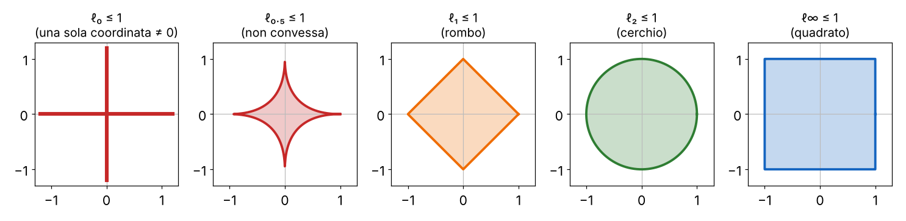
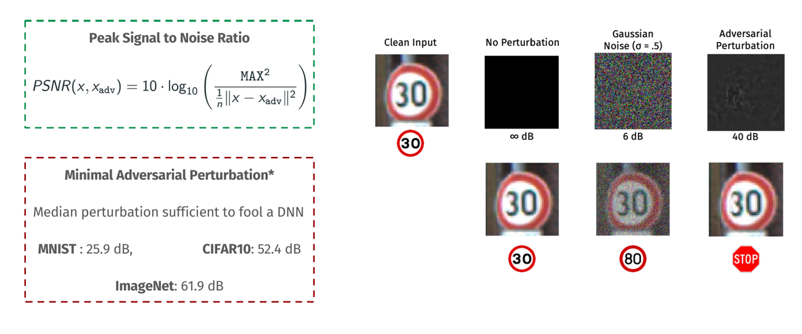
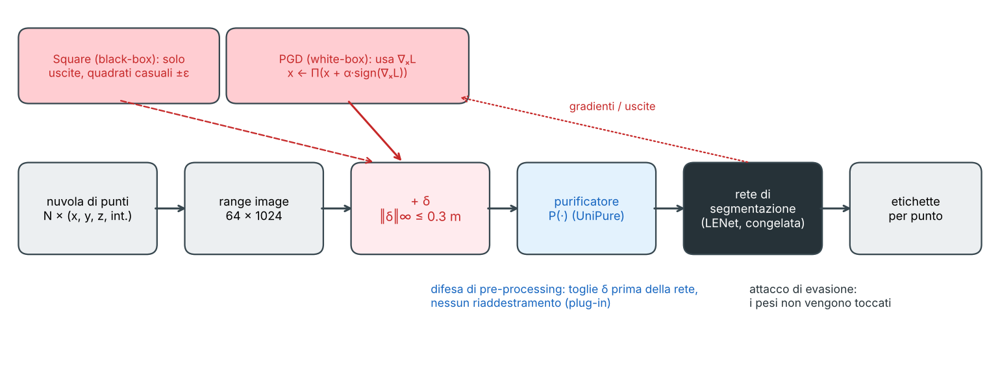
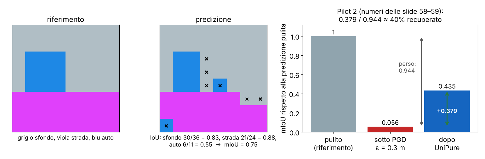
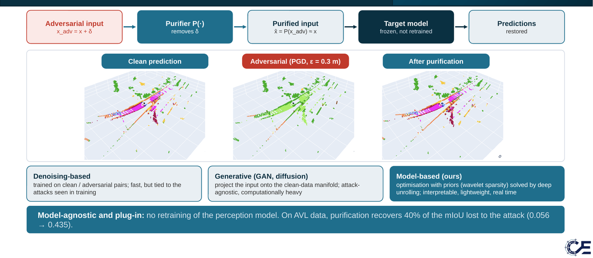

# L14 · Attacchi avversari

*Lezione 14 · Seminario (N. Koroniotis, F. Brau, team Pilot 2) · materiale del 16 ottobre 2026*

[Versione interattiva sul sito, con videolezione](https://gabriele-marsili.github.io/appunti-magistrale-ai/anno-2/computer-vision/sito/#L14) · [Indice della dispensa](README.md)

**In una frase:** **una rete che classifica benissimo si può ingannare aggiungendo all'immagine una perturbazione piccolissima, scelta apposta** (un **esempio avversario**); la perturbazione si trova risolvendo un problema di ottimizzazione sull'*input* a pesi fissi (FGSM, L-BFGS, Carlini-Wagner, PGD, o a scatola chiusa con lo Square attack), ci si difende in parte con l'**adversarial training**, cioè addestrando sul caso peggiore (un problema min-max), e nei sistemi reali, come la percezione LiDAR di un'auto a guida autonoma, gli attacchi all'input sono solo una delle minacce di tutta la catena di fornitura dell'AI.

### Prima di iniziare

Questa lezione è un seminario ospite in tre parti, unite in un solo PDF di 66 pagine (le slide sono numerate come le schede qui sotto, cioè con la pagina del PDF):

  - slide 1–16: il progetto europeo **CoEvolution** (Nikolaos Koroniotis, NTUA/ICCS) sulla sicurezza dell'AI;
  - slide 17–51: **Adversarial Examples** (Fabio Brau, Università di Cagliari): il cuore tecnico della lezione. Il deck è un estratto, quindi i numeri stampati in basso saltano (…28, 30, 35, 36, 47…);
  - slide 52–66: il **Pilot 2** di CoEvolution, sulla percezione dei veicoli autonomi, con attacchi alla segmentazione LiDAR e una difesa per purificazione.

Ti servono:

  - una rete di classificazione: uscita un vettore di **logit** z (un numero per classe), softmax, loss di **entropia incrociata** L(f(x), y) = −log py, discesa del gradiente sui pesi θ;
  - il **gradiente rispetto all'input** ∇xL: le derivate della loss rispetto a ogni pixel, cioè la direzione in cui la loss cresce più in fretta. La backpropagation lo calcola come quello rispetto ai pesi;
  - le norme di vettore e un minimo di ottimizzazione vincolata (vincoli, penalità);
  - dalla [L6](https://gabriele-marsili.github.io/appunti-magistrale-ai/anno-2/computer-vision/sito/#L6): aliasing e sottocampionamento, che torneranno come una delle porte d'ingresso degli attacchi.

Tutti i numeri degli esempi "veri" di questa dispensa vengono da un piccolo esperimento rieseguito per scriverla: una rete MLP 64-128-10 in numpy addestrata in meno di un secondo sul dataset `digits` di scikit-learn (1797 cifre 8 × 8, 1257 per l'addestramento e 540 per il test, pixel scalati in \[0, 1\]), con accuratezza pulita del 98.0%. I numeri del Pilot 2 sono invece quelli delle slide.

### Guarda prima questi video

  - ['How neural networks learn' - Part II: Adversarial Examples](https://www.youtube.com/watch?v=4rFOkpI0Lcg) (Video · 17 min). Arxiv Insights. Introduzione visiva: il panda che diventa gibbone, perché succede, attacchi nel mondo fisico, prime difese. Guardalo tutto prima di leggere: corrisponde alle sezioni 1–5.
  - [Lecture 16 | Adversarial Examples and Adversarial Training](https://www.youtube.com/watch?v=CIfsB_EYsVI) (Video). Stanford CS231n (2017), lezione tenuta da Ian Goodfellow, l'autore di FGSM. La spiegazione "lineare" degli esempi avversari, FGSM, trasferibilità, black-box e adversarial training. È lunga: guarda la prima metà (fino alla parte sulle difese) dopo le sezioni 4–7.
  - [Fooling Neural Networks in the Physical World](https://www.youtube.com/watch?v=qPxlhGSG0tc) (Video). LabSix (MIT). Una tartaruga stampata in 3D classificata come fucile da quasi ogni angolo: l'attacco "fisico" della slide 32, che deve sopravvivere a rotazioni, luce e camera. Breve, per vedere che non è solo teoria.

### 1\. Il problema: reti bravissime che sbagliano in modo strano

**Il problema.** Dal 1998 (LeNet sulle cifre) al 2016 (YOLO che trova cane, bici e auto in una foto) le reti sono arrivate a prestazioni umane nella classificazione e nella detection (slide 19). Eppure fanno errori che nessun umano farebbe (slide 20–21). Il caso più famoso è nell'articolo di Goodfellow et al. del 2014: una foto di panda, classificata "panda" con confidenza 57.7%, più 0.007 volte un rumore colorato, diventa "gibbone" con confidenza 99.3%. Per noi le due foto sono identiche.

**L'idea.** **Un esempio avversario è un input costruito di proposito per far sbagliare un modello, che resta quasi identico a un input normale** (slide 21). La parola chiave è "di proposito": non è rumore a caso, è un rumore scelto guardando dentro la rete. Lo stesso fenomeno c'è nell'audio (slide 22: a una frase registrata si somma un rumore a −30 dB e il sistema di trascrizione sente "okay google browse to evil dot com"), nei filtri antispam (slide 20) e nelle auto (slide 24: DeepXplore rende un'immagine un po' più scura e il modello di guida DAVE-2 sterza a destra invece di seguire la curva).

Perché studiarli (slide 24)? Due motivi. Il primo è la **sicurezza**: le reti decidono sempre più cose (guida, riconoscimento facciale, malware), e un avversario che le può ingannare è un rischio reale. Il secondo è **scientifico: una perturbazione maliziosa piccolissima basta a ingannare il modello, mentre un rumore gaussiano molto più grande no**. Questo dice qualcosa di profondo su come la rete "vede", e la figura sopra lo mostra in piccolo.

> **Il punto**
> 
> Le reti per la visione sono accurate in media ma fragili nel caso peggiore: **esistono, vicinissimi a quasi ogni input, punti classificati male**, e un attaccante li sa trovare.

### 2\. La definizione: piccolo, ma piccolo in che senso?

**Il problema.** "Quasi identico" va reso preciso. Una rete di classificazione (slide 27) è una funzione f: ℝn → ℝC che a un'immagine di n numeri (pixel per canali) associa C punteggi, uno per classe; la classe predetta è `𝒦(x) = argmaxj fj(x)`. Geometricamente (slide 28) il classificatore **divide lo spazio degli input in regioni, una per classe, separate da frontiere di decisione**: ogni immagine è un punto, e un esempio avversario è un punto spostato di poco oltre la frontiera.

**La definizione** (slide 30). Una perturbazione δ ∈ ℝn produce un esempio avversario per x se

`𝒦(x + δ) ≠ 𝒦(x)   e   ‖δ‖p ≈ 0`

cioè cambia la classe predetta e ha una norma ℓp piccola. Quale norma? Le norme ℓp (o distanze di Minkowski) misurano la "grandezza" di δ in modi diversi:

  - **ℓ2**: ‖δ‖2 = √(∑i δi2), l'energia totale della perturbazione;
  - **ℓp** in generale: ‖δ‖p = (∑i |δi|p)1/p; per p = 1 è la somma dei valori assoluti;
  - **ℓ∞**: ‖δ‖∞ = maxi |δi|, **il cambiamento massimo di un singolo pixel**. "‖δ‖∞ ≤ ε" vuol dire: ogni pixel si sposta al più di ε;
  - **ℓ0**: ‖δ‖0 = \#{i : δi ≠ 0}, **quanti pixel cambiano**, non importa di quanto.

**Esempio.** δ = (0.3, −0.4, 0, 0): ‖δ‖0 = 2, ‖δ‖1 = 0.7, ‖δ‖2 = 0.5, ‖δ‖∞ = 0.4. Nella perturbazione FGSM della figura della sezione 1: ‖δ‖∞ = 0.08, ‖δ‖2 = 0.54 e ‖δ‖0 = 46 su 64 pixel (i 18 restanti sono pixel neri che FGSM voleva scurire ancora, impossibile sotto 0).

La slide 30 chiama le palle con p \< 1 "non convesse (pseudo-norma)": giusto, **per p \< 1 la disuguaglianza triangolare non vale**, e l'ℓ0 non è nemmeno omogenea (‖2δ‖0 = ‖δ‖0). Gli attacchi ℓ0 sono quindi problemi combinatori.

Norme diverse danno attacchi che **si vedono in modo molto diverso** (slide 31, su MNIST): ℓ0 sposta pochi pixel anche di molto (sembra sale e pepe), ℓ1 pochi pixel con valori limitati, ℓ∞ tutti i pixel ma di poco (una specie di nebbia uniforme). **Le definizioni che seguono valgono per qualunque norma** (slide 35): cambia solo l'effetto visivo e il modo di proiettare.

> **Il punto**
> 
> Esempio avversario: **classe diversa, perturbazione di norma piccola**. La norma decide che cosa vuol dire "piccola": ℓ∞ = nessun pixel cambia più di ε, ℓ2 = poca energia, ℓ0 = pochi pixel.

### 3\. Quanto è piccola una perturbazione: il PSNR

**Il problema.** La slide 25 confronta perturbazioni di natura diversa e usa una misura in decibel, il **PSNR** (Peak Signal to Noise Ratio):

`PSNR(x, xadv) = 10 · log10( MAX2 / ( (1/n) ‖x − xadv‖22 ) )`

MAX è il valore massimo di un pixel (1 se i pixel sono in \[0, 1\]) e (1/n)‖x − xadv‖2 è l'errore quadratico medio per pixel (MSE). **Più dB vuol dire perturbazione più piccola**: ogni 10 dB in più l'MSE si divide per 10; nessuna perturbazione dà ∞ dB.

**Facciamo i conti.** Rumore gaussiano con σ = 0.5: MSE = 0.25, PSNR = 10 log10(1/0.25) = 6.0 dB, giusto. 40 dB vuol dire MSE = 10−4, cioè uno scarto tipico di 0.01 per pixel, circa 2.5 livelli di grigio su 255. Il riquadro rosso dice quanto basta, in mediana, per ingannare una rete (valori ricavati da Rony et al. 2019). Per MNIST (n = 784 pixel) 25.9 dB vuol dire MSE = 10−2.59 ≈ 0.0026, cioè ‖δ‖2 ≈ √(0.0026 · 784) ≈ 1.4. Per ImageNet, 61.9 dB è uno scarto tipico di 0.0008 per pixel: **un quinto di livello di grigio, invisibile e perfino sotto la quantizzazione a 8 bit**. Più l'immagine è grande, più piccola (per pixel) basta la perturbazione: la sezione 4 spiega perché.

> **Il punto**
> 
> PSNR alto = perturbazione piccola. Le reti si ingannano con perturbazioni da 26 dB (MNIST) a 62 dB (ImageNet), **molto più piccole del rumore casuale che invece tollerano**.

### 4\. Perché bastano perturbazioni così piccole

**Il problema.** Una rete che resiste a un rumore gaussiano visibile cade per una perturbazione invisibile. Come è possibile? La spiegazione più semplice è quella di Goodfellow, Shlens e Szegedy (2014), ed è sorprendente: **la colpa non è della non-linearità della rete, ma del suo comportamento quasi lineare in uno spazio di dimensione enorme**.

**L'idea.** Prendi un singolo neurone lineare, a = w⊤x. Se aggiungi δ, l'attivazione cambia di w⊤δ. Con il vincolo ‖δ‖∞ ≤ ε, qual è il δ che la fa cambiare di più? Ogni termine wiδi è massimo con δi = ε · sign(wi), e allora

`w⊤δ = ε ∑i |wi| = ε ‖w‖1 ≈ ε · m · n`

dove m è il valore assoluto medio dei pesi e n la dimensione. **Il cambiamento cresce linearmente con n, anche se ogni pixel cambia solo di ε**. Un rumore casuale ±ε invece ha segni a caso: i termini si compensano e la somma cresce solo come ε√n (è una passeggiata casuale).

**Esempio piccolo.** Tre pixel, w = (1, −2, 0.5), x = (0.2, 0.5, 0.8): il punteggio è s = 0.2 − 1.0 + 0.4 = −0.4 (classe "negativa"). Con δ = ε · sign(w) = ε · (1, −1, 1) il punteggio sale di ε · (1 + 2 + 0.5) = 3.5 ε. Con ε = 0.1 si arriva a −0.05, con ε = 0.12 a +0.02: la classe cambia. Ogni pixel si è mosso di 0.12, ma i tre contributi si sono sommati tutti nello stesso verso. Con migliaia di pixel lo stesso trucco funziona con ε minuscoli.

Le reti con ReLU sono lineari a tratti, quindi l'argomento vale localmente per tutta la rete. E risponde alla domanda della slide 24 ("perché il rumore gaussiano no?"): **in alta dimensione una direzione casuale è quasi ortogonale al gradiente**, mentre l'attaccante sceglie quella allineata.

> **Dal libro · Prince § 20.4.6 e Szeliski § 5.4.6**
> 
> Prince descrive gli esempi avversari come punti vicini al manifold dei dati (la superficie sottile su cui stanno le immagini naturali) ma non su di esso, e riporta la spiegazione oggi più accreditata (Ilyas et al. 2019): le perturbazioni sfruttano *feature non robuste*, regolarità vere dei dati, molto predittive ma di norma piccola e invisibili per noi. Szeliski aggiunge che gli esempi avversari **si trasferiscono** fra reti diverse: è ciò che rende possibili gli attacchi black-box con un modello sostituto (slide 34).

> **Il punto**
> 
> In dimensione n, una perturbazione di ampiezza ε allineata ai pesi sposta l'uscita di circa ε·n, una casuale di circa ε·√n. **L'alta dimensione, non la complessità, rende le reti fragili**.

### 5\. Tassonomia: che cosa vuole e che cosa sa l'attaccante

**Il problema.** "Attaccare una rete" può voler dire cose molto diverse. La slide 35 riassume la tassonomia minima in tre assi, più uno sul mondo fisico (slide 32).

  - **Digitale o fisico** (slide 32). L'attacco **digitale** modifica direttamente i pixel del file (il "30" diventa "80" con δ invisibile). Quello **fisico** modifica l'oggetto reale (adesivi, patch, poster su un cartello STOP) e deve sopravvivere a camera, distanza, luce e angolo. Il seminario si concentra sul digitale.
  - **Obiettivo: non mirato o mirato** (slide 33). **Non mirato (untargeted): basta una classe sbagliata qualsiasi. Mirato (targeted): l'attaccante sceglie la classe di arrivo** (per esempio "qualunque cartello diventi STOP").
  - **Conoscenza: white-box o black-box** (slide 34). **White-box: l'attaccante conosce architettura e pesi, quindi può calcolare i gradienti. Black-box: vede solo le risposte del modello**, come un oracolo. Può interrogarlo, oppure addestrare un modello sostituto sulle sue risposte, attaccare quello e sperare nella trasferibilità. Ci sono vie di mezzo.
  - **Norma della perturbazione**: ℓ1, ℓ2, ℓ∞ (sezione 2).

Nella sezione 14 vedremo che il progetto CoEvolution allarga ancora la tassonomia: oltre agli attacchi all'input al momento dell'uso (**evasione**), ci sono quelli ai dati di addestramento (**poisoning**, **backdoor**) e al modello stesso (**estrazione**, manomissione degli aggiornamenti).

> **Il punto**
> 
> Un attacco si classifica per **dove agisce (digitale o fisico), cosa vuole (qualsiasi errore o una classe precisa), cosa sa (white-box o black-box) e quale norma usa**.

### 6\. L'attacco come problema di ottimizzazione

**Il problema.** Come si trova δ? Non lo si disegna a mano (salvo in casi giocattolo, vedi la sezione 13): lo si ottimizza. È la stessa macchina dell'addestramento, ma **si tengono fermi i pesi θ e si ottimizza l'input**. Il visionbook lo dice in generale nel § 12.4: tutto quello che si fa con i parametri si può fare con le attivazioni, e gli attacchi avversari sono uno di questi trucchi, insieme alla visualizzazione delle reti e al prompting.

La slide 37 scrive gli attacchi **basati sulla loss** (*loss-based*): si tiene la norma sotto un budget ε e si peggiora la loss.

`non mirato:  maxδ L(f(x + δ), ltrue)    mirato:  minδ L(f(x + δ), ltarget)    con ‖δ‖p ≤ ε`

Non mirato: **aumentare la loss rispetto alla classe vera**. Mirato: diminuirla rispetto alla classe bersaglio. La slide 38 scrive invece gli attacchi **basati sulla distanza** (*distance-based*, o di perturbazione minima): si chiede che l'attacco riesca e si minimizza la norma.

`minδ ‖δ‖p   con  𝒦(x + δ) ≠ ltrue  (non mirato)  oppure  𝒦(x + δ) = ltarget  (mirato)`

Le due domande sono: "quanto danno faccio con budget ε?" e "qual è la perturbazione più piccola che basta?". In entrambe ci sono due vincoli in più (slide 37–38):

  - **vincolo di box**: 0 ≤ x + δ ≤ 1, l'immagine perturbata deve avere pixel validi;
  - **vincolo intero**: Q · (x + δ) ∈ {0, …, Q} con Q = 255, cioè i pixel devono essere ancora valori a 8 bit, altrimenti l'immagine salvata su file perde l'attacco.

> **Attenzione: un segno da correggere nel libro (visionbook § 35.6.1)**
> 
> Il libro scrive l'attacco gatto → struzzo come argmaxε H(ystruzzo, f(x + ε)) con ‖ε‖ \< r, dove H è l'entropia incrociata e ystruzzo il vettore one-hot dello struzzo. Massimizzare l'entropia incrociata rispetto allo struzzo vorrebbe dire allontanarsi dallo struzzo. Per farlo diventare uno struzzo si deve **minimizzare** H(ystruzzo, f(x + ε)), come nel caso mirato della slide 37. Nel libro ε è la perturbazione e r il raggio: nelle slide sono δ ed ε.

> **Il punto**
> 
> Attaccare = ottimizzare l'input a pesi fissi. **Loss-based: budget fisso, loss peggiore. Distance-based: attacco riuscito, norma minima.** Box e interi garantiscono un'immagine vera.

### 7\. FGSM: un solo passo nella direzione del segno del gradiente

**Il problema.** Risolvere davvero max L(f(x + δ)) con ‖δ‖∞ ≤ ε è difficile (la rete non è convessa). Goodfellow et al. (2014) propongono la scorciatoia più semplice possibile: il **Fast Gradient Sign Method** (slide 39).

**L'idea.** Per ε piccolo la loss è quasi lineare attorno a x: L(x + δ) ≈ L(x) + g⊤δ, con g = ∇xL(f(x), ltrue). Massimizzare g⊤δ con |δi| ≤ ε è lo stesso problema della sezione 4: si prende δi = ε · sign(gi). Quindi

`δ* = ε · sign(∇xL(f(x), ltrue)),    x* = x + δ*`

Simbolo per simbolo: ε è l'ampiezza voluta in norma ℓ∞; il gradiente dà, pixel per pixel, in che verso la loss cresce; sign(·) tiene solo quel verso (+1 o −1). **Basta una sola backpropagation**, e ‖δ\*‖∞ = ε esattamente (se nessuna componente del gradiente è nulla). Nella versione **mirata** si usa la loss rispetto a ltarget e si va nel verso opposto, x\* = x − ε · sign(∇xL(f(x), ltarget)), perché quella loss va fatta scendere. In pratica si taglia anche il risultato in \[0, 1\] (vincolo di box).

Nell'esperimento su `digits` FGSM con ε = 0.1 fa scendere l'accuratezza dal 98.0% al 48.7%; un rumore ±0.1 a segni casuali la lascia al 97.4% (figura della sezione 10). Pro e contro, dalla slide 40:

  - **facile da implementare, velocissimo (un gradiente), con norma ℓ∞ controllata**: per questo si usa anche dentro l'addestramento;
  - **un solo passo lineare: spesso serve un ε grande (a volte visibile) e non sempre trova un esempio avversario**, perché la loss vera non è lineare. PGD (sezione 10) risolve questo problema.

<!-- end list -->

    def fgsm(model, x, y, eps):
        x = x.clone().requires_grad_(True)
        loss = torch.nn.functional.cross_entropy(model(x), y)
        loss.backward()                                  # gradiente rispetto all'input, non ai pesi
        return (x + eps * x.grad.sign()).clamp(0, 1).detach()

> **Il punto**
> 
> FGSM linearizza la loss e fa **un solo passo di ampiezza ε nella direzione sign(∇xL)**: il passo ottimo in ℓ∞ per una loss lineare. Veloce ma approssimato.

### 8\. L-BFGS: la perturbazione minima con una penalità

**Il problema.** Il primo attacco (Szegedy et al. 2013, "Intriguing properties of neural networks", slide 41–42) cerca la perturbazione **minima** che porta a una classe bersaglio: min ‖δ‖p con 𝒦(x + δ) = ltarget e 0 ≤ x + δ ≤ 1. Il vincolo 𝒦(x + δ) = ltarget è un argmax: non è derivabile e non si sa trattare.

**L'idea.** Si sostituisce il vincolo scomodo con una **penalità** nella funzione obiettivo:

`minδ  c · ‖δ‖p + L(f(x + δ), ltarget)    con  0 ≤ x + δ ≤ 1`

La costante c \> 0 bilancia i due desideri. Con c = 0 conta solo la loss, e la soluzione può essere grande quanto vuole; con c molto grande conta solo la norma, e la soluzione è δ ≈ 0, che non inganna nessuno (slide 41). Il vincolo di box rimasto è semplice, e lo gestisce un ottimizzatore quasi-Newton con vincoli di box: il **L-BFGS-B** (Limited memory Broyden-Fletcher-Goldfarb-Shanno, slide 42). Poi si cerca c con una ricerca lineare: con c davanti alla norma, **si vuole il c più grande (quindi la δ più piccola) per cui l'attacco riesce ancora**.

Le immagini della slide 42 (lo scuolabus giallo e gli altri attacchi ad AlexNet) sono i primi esempi avversari mostrati alla comunità: **perturbazioni bassissime, vicine a quella minima, e convergenza quasi sempre**; ma **lento: circa 20 000 passaggi in avanti della rete per ogni ricerca di c**.

> **Attenzione: il "teorema" della slide 41 vale solo per loss convesse**
> 
> La slide enuncia: se L(f(x + δ), ltarget) è convessa in x, allora per ogni c il problema ha soluzione δ(c) e c si trova per ricerca lineare. È vero sotto quell'ipotesi, ma **una rete neurale non è convessa** rispetto all'input, quindi per le reti il risultato non garantisce nulla: L-BFGS trova un minimo locale e una buona approssimazione, non la perturbazione minima. Lo dicono gli stessi Szegedy et al.: il metodo sarebbe esatto per loss convesse, per le reti dà un'approssimazione. Nella slide i due punti sono numerati "1." e "1.".

> **Il punto**
> 
> L-BFGS rende trattabile la perturbazione minima **spostando il vincolo di classificazione nella loss con un peso c**, e cerca c per tentativi. Preciso ma costoso, e senza garanzie per reti non convesse.

### 9\. Carlini-Wagner: via anche il vincolo di box

**Il problema.** Nell'L-BFGS resta il vincolo di box, e l'entropia incrociata non è la loss più adatta: continua a spingere anche quando l'attacco è già riuscito, sprecando "norma". Carlini e Wagner (2017) fanno due semplificazioni (slide 43–44).

**Semplificazione 1: cambio di variabile.** Invece di δ si ottimizza una variabile libera w ∈ ℝn, e si pone

`x + δ = ½ (tanh(w) + 1),   cioè   δ = ½ (tanh(w) + 1) − x`

Siccome tanh va da −1 a 1, ½(tanh w + 1) sta sempre fra 0 e 1: **il vincolo di box è soddisfatto automaticamente, per qualunque w**, e si può usare un ottimizzatore senza vincoli (Adam).

**Semplificazione 2: una loss di margine sui logit.** Siano zj i logit (le uscite prima del softmax) e t la classe bersaglio. Si usa

`L(z, t) = max( maxj≠t zj − zt,  −κ )`

che è positiva finché un'altra classe batte il bersaglio, e smette di scendere appena il bersaglio vince con margine κ (κ = 0 è la "parte positiva" della slide 43). Il problema finale (slide 44) è senza vincoli:

`minw  ‖½(tanh(w) + 1) − x‖p + c · L(f(½(tanh(w) + 1)), t)`

e c si cerca di nuovo con una ricerca (qui c sta davanti alla loss, quindi si cerca il c più piccolo che basta).

**Esempio.** Logit z = (3.0, 1.0, 2.5) per (gatto, cane, struzzo), bersaglio struzzo: L = max(3.0 − 2.5, 0) = 0.5. Basta portare lo struzzo sopra il gatto: con z = (2.4, 1.0, 2.6) la loss è 0 e l'ottimizzazione pensa solo a ridurre ‖δ‖. La slide 45 mostra attacchi CW su MNIST per ogni coppia (cifra, bersaglio), con perturbazioni ℓ2 e ℓ0 minime. **CW è stato per anni il riferimento per valutare la robustezza**.

> **Attenzione: il segno della loss di margine nella slide 43**
> 
> La slide scrive L(y, l) = \[yl − maxj≠l yj\]+ e la slide 44 la usa con l = ltarget dentro un **min**. Minimizzare yt − maxj≠t yj abbassa il logit del bersaglio: è il contrario di quello che si vuole. Per l'attacco mirato la loss giusta (Carlini-Wagner, funzione f6) è **\[maxj≠t yj − yt\]+** (o con −κ al posto dello zero). La forma della slide è corretta per l'attacco **non mirato**, con l = ltrue: minimizzare ytrue − maxj≠true yj fa perdere la classe vera. Inoltre i yj vanno intesi come logit (prima del softmax), come dice la nota rossa.

> **Il punto**
> 
> CW = perturbazione minima con **tanh per togliere il vincolo di box e loss di margine sui logit** che si ferma appena il bersaglio vince. Attacco forte e preciso, ma più lento di FGSM e PGD.

### 10\. PGD: FGSM ripetuto, con proiezione

**Il problema.** FGSM fa un passo solo e si fida della linearità; L-BFGS e CW sono lenti. Madry et al. (2018) propongono un metodo semplice e forte per il problema loss-based (slide 46): massimizzare L(f(x + δ), ltrue) con ‖δ‖p ≤ ε, box e interi.

**L'idea.** È salita del gradiente proiettata (*Projected Gradient Ascent*, anche se tutti la chiamano PGD, "descent"): tanti piccoli passi FGSM, e dopo ogni passo si riporta il punto dentro la palla ammessa.

`x̃(t) = x(t−1) + α · sign(∇xL(f(x(t−1)), ltrue)),    x(t) = ΠBp(x, ε)(x̃(t))`

α è il passo (il "learning rate" della salita, più piccolo di ε), t il numero dell'iterazione, Bp(x, ε) la palla ℓp di raggio ε attorno all'immagine **originale** x, e Π la proiezione, cioè il punto della palla più vicino. Per ℓ∞ la proiezione è semplicissima: **si taglia ogni pixel nell'intervallo \[xi − ε, xi + ε\]** (e poi in \[0, 1\]). Per ℓ2 si riscala δ alla lunghezza ε se la supera. La ricetta della slide 46: partire da un punto casuale nella palla, fare qualche passo di salita, proiettare, ripetere; spesso si riparte da più punti casuali e si tiene il migliore. L'ordine "passo, poi proiezione" della slide è quello giusto, e coincide con la formula del Pilot 2 (slide 58): x ← Πε(x + α · sign(∇xL)).

    def pgd_linf(model, x, y, eps, alpha, steps):
        xa = (x + torch.empty_like(x).uniform_(-eps, eps)).clamp(0, 1)   # partenza casuale
        for _ in range(steps):
            xa.requires_grad_(True)
            loss = torch.nn.functional.cross_entropy(model(xa), y)
            g, = torch.autograd.grad(loss, xa)
            xa = xa.detach() + alpha * g.sign()                          # passo FGSM
            xa = torch.min(torch.max(xa, x - eps), x + eps).clamp(0, 1)  # proiezione + box
        return xa

Il disegno della slide 46 usa una palla ℓ2 con passi sign(·): **a rigore il passo sign è quello adatto a ℓ∞**; con ℓ2 il passo naturale è α · ∇xL / ‖∇xL‖2 (figura della sezione 7, a destra). L'idea, comunque, è la stessa.

> **Il punto**
> 
> PGD = **passi FGSM piccoli + proiezione nella palla di raggio ε**, da una partenza casuale. È l'attacco white-box standard per misurare la robustezza ed è il motore dell'adversarial training.

### 11\. Senza gradienti: lo Square attack (black-box)

**Il problema.** FGSM, CW e PGD sono white-box: servono i gradienti, quindi i pesi. Un attaccante reale spesso vede solo le risposte, per esempio chiamando un servizio. La slide 58 del Pilot 2 usa lo **Square attack** (Andriushchenko et al., ECCV 2020) proprio come "attaccante realistico senza accesso al modello".

**L'idea.** È una ricerca casuale molto furba. Si parte da una perturbazione a strisce verticali ±ε. A ogni passo si sceglie un **quadratino a caso dell'immagine e gli si assegna un nuovo valore +ε o −ε**; si interroga il modello e si tiene la modifica solo se la loss (di margine, come in CW) è salita. La perturbazione resta sempre nella palla ℓ∞, il lato dei quadrati si riduce col tempo. Si conta il numero di interrogazioni (*query*), che è il costo dell'attacco.

> **Il punto**
> 
> **Nascondere i pesi non basta**: con poche centinaia di interrogazioni e modifiche casuali accettate solo se peggiorano la loss, un attacco black-box si avvicina a uno white-box.

### 12\. Difendersi: l'adversarial training come problema min-max

**Il problema.** L'addestramento normale minimizza il **rischio empirico**, la loss media sui dati. Il libro (visionbook § 35.6.2) lo dice in una frase: **l'analisi avversaria è un'analisi del caso peggiore**, e poiché ci occupiamo solo della media, il caso peggiore può essere arbitrariamente cattivo.

**L'idea.** Si addestra sul caso peggiore. Il libro ci arriva dalla data augmentation (§ 36.2–36.3): invece di applicare a ogni esempio trasformazioni casuali T(x; θ) e minimizzare la loss attesa, si applica la trasformazione **peggiore**, quella con la loss più alta. Se le "trasformazioni" sono le perturbazioni additive in una palla, si ottiene la formulazione di Madry et al. (slide 47; visionbook eq. 36.2):

`minθ ρ(θ),    ρ(θ) = 𝔼(x, l) [ max‖δ‖p ≤ ε L(fθ(x + δ), l) ]`

Letta da dentro a fuori: per ogni esempio (x, l) del dataset, il **max interno** è l'attaccante, che cerca la perturbazione peggiore nella palla (in pratica con PGD); il **min esterno** è il difensore, che sceglie i pesi θ per rendere piccola anche quella loss peggiore. È un gioco a due, un problema **min-max** (in ottimizzazione si chiama *robust optimization*). In pratica: per ogni mini-batch si generano gli esempi avversari con qualche passo di PGD sulla rete attuale, poi si fa un passo di discesa del gradiente sui pesi usando quegli esempi.

Sulle cifre, la MLP addestrata con PGD (ε = 0.1, 7 passi) ha la **stessa accuratezza pulita (98.0%) e resiste molto meglio**: sotto PGD con ε = 0.1 passa dal 42.6% al 78.0%, con ε = 0.15 dall'8.5% al 51.9% (curva blu della sezione 10). Ma **oltre l'ε usato in addestramento la protezione svanisce** (18% a ε = 0.2), e l'addestramento costa diverse volte di più: qui 4.7 secondi contro 0.6.

La versione più vecchia (Goodfellow et al., slide 40) usa FGSM e mescola le due loss: `L̃(f(x), l) = α · L(f(x), l) + (1 − α) · L(f(x + δ*), l)`, con δ\* l'attacco FGSM sul modello corrente (α = 0.5 nell'articolo). Costa poco, ma **una rete addestrata solo contro FGSM può cadere sotto PGD**: per questo oggi si usa la versione min-max con PGD.

> **Dal libro · visionbook § 36.3 e Prince § 9.3.4**
> 
> Il visionbook presenta l'adversarial training come il caso estremo della data augmentation: augmentation casuale = media sulle trasformazioni, adversarial training = massimo (eq. 36.1); con le palle di raggio r si ottiene l'eq. 36.2, la formula della slide 47. La stessa idea min-max serve per le GAN (cap. 32): non confondere le reti generative *avversarie* con gli *attacchi* avversari. Prince (§ 9.3.4) la mette fra le regolarizzazioni: rumore sull'input, ma il peggiore possibile.

> **Il punto**
> 
> Adversarial training = **min sui pesi del max sulle perturbazioni**: si addestra sugli esempi avversari generati al volo (PGD). Aumenta molto la robustezza entro ε, costa di più e non protegge oltre ε.

### 13\. Altre porte d'ingresso: aliasing e feature invisibili

**Il problema.** L'argomento lineare della sezione 4 non è l'unico. Il visionbook mostra altre due cause, legate a cose già viste nel corso.

**Aliasing** (visionbook § 21.2; [L6](https://gabriele-marsili.github.io/appunti-magistrale-ai/anno-2/computer-vision/sito/#L6)). Un sistema giocattolo: convoluzione con un filtro derivata, poi **decimazione** (un pixel ogni due: è una convoluzione con stride 2, comunissima nelle CNN), poi ReLU. La decimazione guarda solo i pixel pari: **un attaccante può nascondere un segnale nelle alte frequenze** che, dopo il campionamento, si ripiega (aliasing) e cambia completamente l'uscita, mentre l'input resta identico a occhio. Le alte frequenze sono proprio quelle che vediamo meno.

![Una versione 1D dell'esempio del § 21.2. La perturbazione (|δ| ≤ 0.03) alterna i segni pixel per pixel, cioè sta alla frequenza di Nyquist; la derivata con passo 2 la trasforma in due "barre" alte 0.06, più alte del vero bordo (0.05). Con una sfocatura \[¼ ½ ¼\] prima della decimazione, che azzera la frequenza di Nyquist, l'effetto scende sotto 0.01.](../sito-src/L14/disp_aliasing.png)

La difesa naturale è quella della [L6](https://gabriele-marsili.github.io/appunti-magistrale-ai/anno-2/computer-vision/sito/#L6): **filtrare passa-basso prima di sottocampionare**. Il libro cita Rodríguez-Muñoz e Torralba (2022), "Aliasing is a driver of adversarial attacks".

**Esempi fatti a mano** (visionbook § 24.5.4). Una piccola rete addestrata a distinguere linee verticali e orizzontali in realtà guarda dove sta l'energia nello spettro di Fourier. Moltiplicando un'immagine di linee orizzontali per una sinusoide (la **modulazione** della [L3](https://gabriele-marsili.github.io/appunti-magistrale-ai/anno-2/computer-vision/sito/#L3)), le linee restano orizzontali per noi ma il loro spettro si sposta nella zona del rivelatore verticale: la rete sbaglia tutte le immagini. Il libro commenta: abbiamo appena progettato un esempio avversario a mano; per reti complesse lo si ottiene come problema di ottimizzazione.

**E noi?** Anche la visione biologica ha i suoi "esempi avversari" (slide 49): le macchie a occhio sulle ali della falena Polyphemus spaventano i predatori, e "chihuahua o muffin" confonde anche noi.

> **Il punto**
> 
> Le reti sono attaccabili anche per motivi "di segnale": **lo stride senza filtro anti-aliasing lascia entrare le alte frequenze**, e le reti imparano feature (spettrali, di tessitura) diverse da quelle che usiamo noi.

### 14\. CoEvolution: la sicurezza di tutta la catena dell'AI

**Il problema.** Un modello in un'auto o in una fabbrica non è un file isolato: è il risultato di dati raccolti da qualcuno, addestramento fatto altrove, librerie, aggiornamenti trasmessi via rete, sensori. Ognuno di questi anelli della **supply chain dell'AI** (catena di fornitura) è un punto d'attacco. Il progetto Horizon Europe **CoEvolution** (slide 1–16: novembre 2024 – ottobre 2027, 36 mesi, circa 6 milioni di euro, 15 partner di 8 paesi, fra cui l'Università di Pisa, coordinato da ICCS) vuole costruire un quadro unico per valutare **sicurezza, fiducia e robustezza** (STR) dei modelli.

La motivazione (slide 4): il mercato dell'AI cresce enormemente; **i sistemi di AI interconnessi amplificano i rischi di evasione e di avvelenamento a cascata**; le librerie esistenti (Foolbox, CleverHans, IBM ART, SecML) non offrono un flusso unico di valutazione. Le ambizioni sono tre (slide 6–9).

  - **A. Rilevare, prevenire e mitigare gli attacchi** (slide 7). Oltre all'evasione (sezioni 1–12), le slide citano: **poisoning**, avvelenamento dei dati di addestramento per peggiorare il modello; **backdoor**, un avvelenamento mirato che insegna al modello a dare una risposta scelta quando nell'input compare un "grilletto" (un adesivo, un pattern), comportandosi normalmente per il resto; attacchi di recupero di informazioni (ricostruire dati privati dal modello) e di negazione del servizio. Le difese esistenti richiedono molta competenza e molto calcolo.
  - **B. Attacchi all'apprendimento collaborativo** (slide 8). Nel **federated learning (FL)** i dati restano sui dispositivi dei client, che addestrano localmente e mandano a un server solo gli aggiornamenti dei pesi; il server li media. Protegge la privacy e risparmia banda, ma **il server è un singolo punto di rottura e si fida ciecamente dei client**: un client malevolo può inviare aggiornamenti avvelenati. CoEvolution propone **P4L**, un apprendimento **peer-to-peer** asincrono, senza infrastruttura centrale e che preserva la privacy.
  - **C. Supporto alle decisioni consapevole del contesto** (slide 9). Scegliere la contromisura giusta a un attacco è un problema con obiettivi in conflitto (sicurezza, costo, prestazioni): CoEvolution lo tratta come un **problema di raccomandazione** con apprendimento per rinforzo multi-obiettivo.

**L'AI MBOM** (slide 11). In informatica una *Software Bill of Materials* (SBOM) è la "distinta base" di un programma: l'elenco di tutti i componenti e le librerie, con versioni e provenienza, per sapere subito se si è colpiti da una vulnerabilità. L'**AI Model Bill of Materials (AI MBOM)** estende l'idea ai modelli: **provenienza dei dati, comportamento del modello, conformità etica, dataset, dipendenze, proprietari, utenti, informazioni di sicurezza**, e fa da contenitore di credenziali lungo tutto il ciclo di vita, a favore della trasparenza su robustezza, fiducia, spiegabilità ed equità. La slide 10 riassume il progetto come un "hub" con tre punti di vista: ciclo di vita, supply chain, garanzia di sicurezza e fiducia; la slide 12 aggiunge la **consapevolezza del contesto** (modelli che si adattano all'ambiente d'uso).

I pilot (slide 13–15): il **Pilot 1** protegge componenti di AI di terze parti su dispositivi edge in fabbrica; il **Pilot 2** i sistemi di AI dei veicoli connessi e autonomi (CAV), con test in scenari di parcheggio.

> **Il punto**
> 
> Gli esempi avversari sono una sola delle minacce: **dati (poisoning, backdoor), aggiornamenti, apprendimento collaborativo ed estrazione del modello** vanno protetti insieme. L'AI MBOM serve a tracciare da dove viene ogni pezzo.

### 15\. Pilot 2: attaccare la segmentazione LiDAR di un'auto

**Il problema.** Un veicolo autonomo (slide 53) vede il mondo con camere, radar, **LiDAR**, GPS; i modelli di percezione interpretano i sensori, e con la percezione cooperativa (V2X) i veicoli si scambiano informazioni. **Se la percezione è compromessa, tutte le decisioni a valle falliscono**: pianificazione del percorso, manovre, controllo (slide 62). La slide 54 mette gli attacchi sulla catena: attacchi avversari ai sensori, avvelenamento dei dati di addestramento, manomissione degli aggiornamenti over-the-air (OtA) o della supply chain, estrazione del modello.

#### Segmentazione semantica LiDAR e range image

Un **LiDAR** misura la distanza con impulsi laser: un sensore rotante con 64 o 128 fasci a elevazioni diverse produce, a ogni giro, una **nuvola di punti** di N punti (x, y, z, intensità). La **segmentazione semantica** assegna a ogni punto una classe (strada, auto, pedone, vegetazione, edificio…). Le slide 57–58 attaccano proprio questa rete, in parallelo alla segmentazione delle immagini RGB.

Molte reti veloci (RangeNet++, LENet, il modello bersaglio della slide 58) non lavorano sui punti ma su una **range image**: la proiezione sferica della nuvola su una griglia H × W, una riga per fascio laser e una colonna per angolo di rotazione (64 × 1024 nella slide 58). Per ogni punto: r = √(x² + y² + z²), azimut yaw = atan2(y, x), elevazione pitch = arcsin(z / r), e il pixel è u = ½(1 − yaw/π)·W, v = (1 − (pitch − fdown)/f)·H, con f l'ampiezza verticale del campo visivo. **Così si usano le normali CNN 2D**, e le etichette predette per i pixel tornano ai punti.

#### L'attacco

La slide 58 descrive un **attacco di evasione al momento dell'inferenza**: **si aggiunge all'input una perturbazione δ limitata, ‖δ‖∞ ≤ ε, costruita per massimizzare la loss del modello, senza toccarne i pesi**. Qui ε = 0.3 m: ogni misura di distanza si sposta al più di 30 cm, una quantità plausibile per il rumore o lo spoofing di un sensore. Due attaccanti:

  - **White-box, PGD**: accesso al modello e ai gradienti ∇xL, aggiornamento x ← Πε(x + α · sign(∇xL)) ripetuto; è il caso peggiore, l'attaccante più forte (sezione 10);
  - **Black-box, Square attack**: solo le uscite del modello, modifiche casuali a forma di quadrato dentro ε, tenute se la loss sale; è l'attaccante realistico (sezione 11).

#### Come si misura il danno: mIoU

Per la segmentazione si usa l'**IoU** (Intersection over Union) di ogni classe c: `IoUc = |pred = c ∧ rif = c| / |pred = c ∨ rif = c|`, il numero di punti (o pixel) su cui predizione e riferimento sono entrambi c, diviso il numero di punti in cui almeno uno dei due è c. La **mIoU** è la media sulle classi. A differenza dell'accuratezza per pixel, **pesa allo stesso modo classi piccole (un palo) e grandi (la strada)**.

Un dettaglio importante della slide 58: la mIoU è misurata **rispetto alla predizione pulita**, non rispetto alle etichette vere. Quindi misura quanto l'attacco *cambia* la risposta della rete: per definizione l'input pulito ha mIoU = 1. **PGD con ε = 0.3 m fa crollare la mIoU a 0.056 e l'accuratezza per punto a 0.26**: nella figura della slide i punti della strada (magenta) vengono predetti come vegetazione (verde).

> **Il punto**
> 
> La rete LiDAR lavora su una range image 2D, quindi **tutti gli attacchi delle immagini si applicano**: con 30 cm di perturbazione sulle distanze, PGD rende la segmentazione quasi completamente diversa (mIoU 0.056 rispetto a quella pulita).

### 16\. Difendersi senza riaddestrare: la purificazione avversaria (UniPure)

**Il problema.** L'adversarial training richiede di riaddestrare la rete di percezione, cosa costosa e a volte impossibile (modello di un fornitore, certificato, già in produzione). Esiste una difesa che non tocca il modello?

**L'idea** (slide 59). Un **purificatore P(·)** come pre-processing: riceve l'input forse attaccato xadv = x + δ e restituisce x̂ = P(xadv) ≈ x, togliendo la perturbazione; poi la rete originale, congelata, fa la predizione. **È indipendente dal modello e si inserisce come un plug-in**. Le famiglie di purificatori (slide 59):

  - **basati su denoising**: una rete addestrata su coppie pulito/attaccato; veloce, ma **legata agli attacchi visti in addestramento**;
  - **generativi** (GAN, diffusione): riproiettano l'input sul manifold dei dati puliti (l'idea di Prince della sezione 4, al contrario); indipendenti dall'attacco ma **pesanti da calcolare**;
  - **basati su modello** (UniPure, il lavoro del gruppo): un problema di ottimizzazione con un prior di sparsità nel dominio delle wavelet, risolto per "deep unrolling"; interpretabile, leggero, in tempo reale.

**Come funziona UniPure** (slide 60, Kapsali, Gkillas, Lalos, IEEE Trans. on AI). Si cerca l'input pulito X come compromesso fra tre termini: restare vicino all'input osservato (‖Xadv − X‖² piccolo, "consistenza con i dati"), essere sparso nel dominio wavelet (le immagini naturali, e le range image, hanno pochi coefficienti wavelet grandi, mentre la perturbazione ne sporca molti piccoli), ed essere plausibile per un denoiser. Il problema si spezza con lo *Half-Quadratic Splitting* in tre aggiornamenti alternati: x-update (consistenza), u-update (**soglia morbida** sui coefficienti wavelet: quelli piccoli vanno a zero) e z-update (restauro con una piccola CNN). Gli aggiornamenti si "srotolano" in K stadi, ciascuno con parametri appresi (deep unrolling): un algoritmo classico che diventa una rete. Lo stesso schema vale per RGB e per LiDAR (slide 57, 60–61).

**Il conto del 40%.** La slide 59 dice che la purificazione "recupera il 40% della mIoU persa per l'attacco (0.056 → 0.435)". Con la mIoU misurata rispetto alla predizione pulita, il pulito vale 1: l'attacco ha perso 1 − 0.056 = 0.944, la purificazione ne ha recuperato 0.435 − 0.056 = 0.379, e `0.379 / 0.944 ≈ 0.40`. **Il conto torna**. Ma attenzione a leggerlo bene: **0.435 resta una segmentazione molto diversa da quella pulita**, e le slide non dicono se l'attacco conosceva il purificatore. Un attaccante che conosce la difesa (attacco *adattivo*) può ottimizzare attraverso P(·), e va sempre provato: è la lezione storica delle difese che reggevano FGSM e cadevano con CW e PGD.

> **Il punto**
> 
> La purificazione **toglie la perturbazione prima della rete, senza riaddestrarla**. UniPure lo fa con un'ottimizzazione su prior wavelet, srotolata in una rete leggera; sul Pilot 2 recupera il 40% della mIoU persa.

### Il riassunto in 10 righe

1.  Esempio avversario: x + δ con 𝒦(x + δ) ≠ 𝒦(x) e ‖δ‖p piccola; ℓ∞ = cambio massimo per pixel, ℓ2 = energia, ℓ0 = numero di pixel.
2.  PSNR alto = perturbazione piccola: bastano 26–62 dB, mentre il rumore casuale tollerato è molto più grande.
3.  Perché: quasi-linearità in alta dimensione; ε·sign(w) sposta l'uscita di ε‖w‖1 ∝ n, il rumore casuale solo di ∝ √n.
4.  Tassonomia: digitale/fisico, non mirato/mirato, white-box/black-box, norma.
5.  Attaccare = ottimizzare l'input a pesi fissi: loss-based (budget ε) o distance-based (norma minima), con vincoli di box e interi.
6.  FGSM: δ = ε · sign(∇xL), un passo; veloce ma approssimato.
7.  L-BFGS: min c‖δ‖ + L(f(x + δ), t) con box; CW: tanh per il box e loss di margine sui logit (attenzione al segno nella slide 43).
8.  PGD: passi FGSM di ampiezza α più proiezione sulla palla di raggio ε; Square: black-box con quadrati casuali, quasi altrettanto efficace.
9.  Adversarial training: minθ 𝔼\[max‖δ‖≤ε L(fθ(x + δ), l)\], robustezza entro ε a un costo maggiore; aliasing e feature non robuste sono altre cause.
10. CoEvolution: sicurezza di tutta la supply chain (poisoning, backdoor, FL/P2P, estrazione, AI MBOM); Pilot 2: PGD con ε = 0.3 m porta la mIoU LiDAR a 0.056, UniPure la riporta a 0.435 (40% recuperato).

### Verifica di aver capito

**Perché, a parità di ampiezza per pixel, una perturbazione avversaria cambia l'uscita di una rete molto più di un rumore casuale? Che ruolo ha la dimensione dell'immagine?**

Per una funzione (localmente) lineare w⊤x, la perturbazione ε·sign(w) allinea tutti i contributi e sposta l'uscita di ε‖w‖1, che cresce come n; un rumore ±ε con segni casuali ha contributi che si compensano e sposta l'uscita in media di circa ε‖w‖2, che cresce come √n. Con n = 150 528 e ε = 1/255 il rapporto nell'esempio della sezione 4 è circa 472 contro 1.5.

**Nell'attacco di Carlini-Wagner, a che cosa servono tanh e la loss di margine? Come andrebbe scritta la loss per l'attacco mirato?**

x + δ = ½(tanh w + 1) sta sempre in (0, 1), quindi il vincolo di box sparisce e si ottimizza w senza vincoli. La loss di margine max(maxj≠t zj − zt, −κ) sui logit è positiva finché un'altra classe batte il bersaglio t e si ferma appena il bersaglio vince (con margine κ), così l'ottimizzazione non spreca norma. La slide 43 scrive zt − maxj≠t zj, che con un min andrebbe nel verso sbagliato: quella forma va bene per il non mirato con la classe vera.

**Che differenza c'è fra FGSM e PGD? Perché nella figura delle cifre PGD è sempre sotto FGSM?**

FGSM fa un solo passo di ampiezza ε, fidandosi della linearità locale. PGD fa molti passi piccoli α, ricalcolando ogni volta il gradiente, e dopo ogni passo proietta nella palla di raggio ε attorno all'immagine originale (per ℓ∞: taglio per pixel). Segue la curvatura della loss e trova perturbazioni con loss più alta nello stesso budget: per ε = 0.1 l'accuratezza scende al 42.6% invece che al 48.7%.

**Scrivi il problema min-max dell'adversarial training e spiega chi fa il max e chi il min. Che cosa succede se si attacca con un ε più grande di quello usato in addestramento?**

minθ 𝔼(x,l)\[max‖δ‖≤ε L(fθ(x + δ), l)\]: il max interno è l'attaccante (PGD sul modello corrente), il min esterno è l'addestramento dei pesi sugli esempi così generati. La robustezza vale entro l'ε di addestramento: sulle cifre, addestrando con ε = 0.1, PGD con ε = 0.1 lascia il 78%, ma con ε = 0.2 solo il 18%.

**Nel Pilot 2 la mIoU passa da 0.056 a 0.435 dopo la purificazione, e la slide dice "recupera il 40%". Verifica il conto. Perché la mIoU del caso pulito vale 1?**

La mIoU è misurata rispetto alla predizione sull'input pulito, quindi il pulito confrontato con se stesso dà 1. Persa: 1 − 0.056 = 0.944; recuperata: 0.435 − 0.056 = 0.379; 0.379 / 0.944 ≈ 0.40. Il conto è giusto, ma 0.435 resta lontano da 1.

**Che differenza c'è fra un attacco di evasione, un poisoning e una backdoor? Quale dei tre è quello delle slide 17–51?**

Evasione: si modifica l'input al momento dell'uso, a modello fisso (gli esempi avversari delle slide 17–51 e della slide 58). Poisoning: si alterano i dati di addestramento per peggiorare il modello. Backdoor: un poisoning mirato che insegna al modello a dare una risposta scelta quando compare un grilletto nell'input, lasciandolo normale negli altri casi. Nel federated learning il poisoning può arrivare da un client che manda aggiornamenti malevoli.

### Come proseguire

  - Visionbook, cap. 35 [Data Bias and Shift](https://visionbook.mit.edu/bias_and_shift.html), § 35.6 (Adversarial Shifts, attacchi e difese; nella formula del § 35.6.1 leggi argmin invece di argmax), e cap. 36 [Training for Robustness and Generality](https://visionbook.mit.edu/data_augmentation.html), § 36.2–36.3 (dalla data augmentation all'adversarial training, eq. 36.1–36.2).
  - Visionbook, cap. 21 [Downsampling and Upsampling](https://visionbook.mit.edu/upsamplig_downsampling_2.html), § 21.2 (attacco basato sull'aliasing); cap. 24 [Convolutional Neural Nets](https://visionbook.mit.edu/convolutional_neural_nets.html), § 24.5.4 (esempio avversario costruito a mano con la modulazione); cap. 12 [Neural Networks](https://visionbook.mit.edu/neural_nets.html), § 12.4 (ottimizzare le attivazioni invece dei parametri).
  - Prince, *Understanding Deep Learning*, § 20.4.6 (uscire dal manifold dei dati) e § 9.3.4 (rumore e adversarial training come regolarizzazione); Szeliski 2a ed., § 5.4.6 (Adversarial examples: white-box e black-box, trasferibilità, feature non robuste).
  - Gli articoli delle slide: Szegedy et al. 2013 (L-BFGS), Goodfellow, Shlens, Szegedy 2014 (FGSM e la spiegazione lineare), Carlini e Wagner 2017, Madry et al. 2018 (PGD e adversarial training), Andriushchenko et al. 2020 (Square attack), Kapsali, Gkillas, Lalos (UniPure). Il sito del progetto: [coevolution-project.eu](https://coevolution-project.eu/).

Ora ripassa con le schede qui sotto, slide per slide. I riquadri Attenzione di questa dispensa riguardano il "teorema" sulla convessità di L-BFGS (slide 41), il segno della loss di margine di Carlini-Wagner (slide 43–44), il passo sign con la palla ℓ2 nel disegno di PGD (slide 46) e il segno della formula del visionbook § 35.6.1.
