# L15 · Reti convoluzionali

*Lezione 15 · Antonio Carta · 19 ottobre 2026*

[Versione interattiva sul sito, con videolezione](https://gabriele-marsili.github.io/appunti-magistrale-ai/anno-2/computer-vision/sito/#L15) · [Indice della dispensa](README.md)

**In una frase:** invece di scegliere a mano i filtri (Sobel, Gabor, banchi di filtri) li facciamo **imparare** a una rete profonda, cioè a una catena di strati lineari e non lineari addestrata con la discesa del gradiente; per le immagini lo strato lineare giusto è la **convoluzione**, che **usa gli stessi pochi pesi in ogni posizione**, e impilando convoluzioni, non linearità e pooling si ottiene una **gerarchia di feature** sempre più ampie e astratte, fino alle architetture classiche (AlexNet, VGG, ResNet, MobileNet) che hanno fatto la storia della visione.

### Prima di iniziare

Questa lezione apre la parte "deep" del corso e collega due mondi. Ti servono:

  - dalla [L3](https://gabriele-marsili.github.io/appunti-magistrale-ai/anno-2/computer-vision/sito/#L3): la **convoluzione** come operazione lineare e invariante per traslazione (LSI), e la sua lettura in frequenza (Fourier);
  - dalla [L5](https://gabriele-marsili.github.io/appunti-magistrale-ai/anno-2/computer-vision/sito/#L5): i filtri di gradiente (Sobel, derivate di gaussiana), e dalla [L7](https://gabriele-marsili.github.io/appunti-magistrale-ai/anno-2/computer-vision/sito/#L7) i **banchi di filtri**: tanti filtri fissi applicati in parallelo;
  - dalla [L6](https://gabriele-marsili.github.io/appunti-magistrale-ai/anno-2/computer-vision/sito/#L6): **aliasing** e sottocampionamento: torneranno con lo stride;
  - un minimo di machine learning: una **loss** da minimizzare, il gradiente, la discesa del gradiente; il concetto di overfitting.

Le slide sono 59 pagine (numerate come le schede qui sotto). Il libro di riferimento è il visionbook: cap. 24 (CNN), 12 (reti neurali), 13 (reti come trasformazioni di distribuzioni) e 11 (generalizzazione), più Prince, *Understanding Deep Learning*, cap. 10, 11 e 20.

### Guarda prima questi video

  - [But what is a neural network? | Deep learning chapter 1](https://www.youtube.com/watch?v=aircAruvnKk) (Video). 3Blue1Brown. Se non hai mai visto una rete neurale "da dentro": strati, pesi, bias, attivazioni come composizione di funzioni. Guardalo tutto prima delle sezioni 1–4.
  - [Lecture 7: Convolutional Networks](https://www.youtube.com/watch?v=gJ5UENsAQGY) (Video). Justin Johnson, University of Michigan (EECS 498-007). Lo strato convoluzionale con canali, padding, stride, campo recettivo, pooling e batch normalization: corrisponde alle sezioni 8–14. È lungo: guardalo a pezzi, insieme al testo.
  - [Lecture 8: CNN Architectures](https://www.youtube.com/watch?v=Y78DttDmkr8) (Video). Justin Johnson (EECS 498-007). AlexNet, VGG, GoogLeNet, ResNet, MobileNet con i conti di memoria, parametri e operazioni: corrisponde alle sezioni 15–17.
  - [Lecture 5 | Convolutional Neural Networks](https://www.youtube.com/watch?v=bNb2fEVKeEo) (Video). Stanford CS231n. Alternativa più breve alla lezione 7 di Johnson: storia delle CNN, convoluzione, pooling, con molti disegni. Utile come ripasso.

### 1\. Dai filtri fissi ai filtri appresi

**Il problema.** Nelle lezioni precedenti abbiamo descritto le immagini con filtri scelti da noi: Sobel per i bordi, Gabor per le texture, gli istogrammi di gradienti di SIFT. Funzionano, ma (slide 3) sono **fissi, scelti da un umano e uguali per ogni immagine e ogni dominio**. Possiamo costruire un banco enorme, con tutte le orientazioni e le scale, ma restano due limiti: **non c'è un modo semplice di comporli** per ottenere feature più complesse (un "occhio", una "ruota"), e sono **lineari**: una cascata di filtri lineari è ancora un filtro lineare ([L3](https://gabriele-marsili.github.io/appunti-magistrale-ai/anno-2/computer-vision/sito/#L3)), quindi non diventa più espressiva.

**L'idea.** Due ingredienti: **una non linearità fra un filtro e il successivo, e i pesi dei filtri imparati dai dati** invece che scelti da noi. Con la non linearità la composizione non collassa più in un solo filtro; con l'apprendimento i filtri si adattano al compito. Il prezzo, dice la slide, è l'**interpretabilità**: non sappiamo più a priori che cosa calcola ogni filtro.

. A destra due passi "da rete": una ReLU tiene solo i bordi scuro→chiaro, e un secondo stadio non lineare (pooling e minimo) si accende dove ci sono bordi in due direzioni vicini, cioè angoli e texture. Qui l'abbiamo costruito a mano; una CNN impara da sola combinazioni di questo tipo.](../sito-src/L15/disp2_fissi_composti.png)

> **Il punto**
> 
> Filtri fissi + solo operazioni lineari = espressività limitata. Una rete profonda alterna filtri **appresi** e **non linearità**, e così costruisce feature composte.

### 2\. Una rete profonda: composizione di strati e discesa del gradiente

**L'idea.** Una rete profonda (DNN, slide 5) è una **composizione di molti strati**:

`fθ(x) = fL(fL−1(… f1(x)))`

x è l'ingresso (un'immagine W × H × C: larghezza, altezza, canali), fl è lo strato l, θ l'insieme di tutti i parametri. Gli strati alternano un'operazione **lineare** (moltiplicazione per una matrice di pesi più un bias) e una **non lineare** applicata elemento per elemento. Il disegno della slide 5 è l'airone che entra a sinistra e la parola "heron" che esce a destra dopo una pila di blocchi lineare + non linearità.

**Come si addestra.** Si definisce una **loss** L che misura quanto è sbagliata l'uscita (entropia incrociata per la classificazione, errore quadratico medio per la regressione) e si aggiornano i parametri con la discesa stocastica del gradiente (SGD):

`θt = θt−1 − α ∇θ L(fθ(x))`

α è il **learning rate** (il passo); ∇θL è il gradiente della loss rispetto ai parametri, calcolato dalla backpropagation; "stocastica" perché la loss è calcolata su un piccolo gruppo di esempi (mini-batch) e non su tutto il dataset. Il ciclo di addestramento (slide 6), per ogni mini-batch: **augmentation dell'ingresso, passo in avanti (uscita e loss), passo all'indietro (gradiente), aggiornamento**; si ripete fino a convergenza o a un criterio di stop.

**Esempio.** Un solo parametro, L(θ) = (θ − 3)2, partenza θ0 = 1, α = 0.1. Il gradiente è 2(θ − 3) = −4, quindi θ1 = 1 − 0.1 · (−4) = 1.4: un passo verso il minimo θ = 3. Una rete fa la stessa cosa con milioni di parametri.

> **Il punto**
> 
> Rete profonda = **catena di strati lineari e non lineari**, addestrata minimizzando una loss con SGD sui mini-batch.

### 3\. Ottimizzare senza garanzie, e le scelte di progetto

**Il problema.** Per colpa delle non linearità la loss, vista come funzione di θ, **non è convessa: non ci sono garanzie formali di convergenza al minimo globale** (slide 7). Eppure le reti si addestrano bene. Perché?

**Che cosa sappiamo.** Per le reti grandi (sovraparametrizzate) l'evidenza (Prince § 20.3) è che i **minimi locali cattivi sono pochi**: la superficie ha soprattutto punti di sella, e i minimi che SGD trova hanno loss simili. Conta però la **forma** della superficie: la curvatura (l'Hessiano) dice quanto è "aguzza" o "piatta" la valle (slide 8). Una valle piatta è facile da percorrere e tollera passi grandi.

> **Attenzione: "SGD will find a local minima" (slide 7)**
> 
> SGD trova un punto stazionario, di solito un minimo locale; ma per le reti sovraparametrizzate la letteratura (Prince § 20.3) indica pochi minimi locali cattivi e molti punti di sella, che SGD grazie al rumore riesce a superare. "Local minima" è plurale: al singolare è "minimum".

**Le scelte di progetto** (slide 9) si guardano da tre lati:

  - **passo in avanti**: che rappresentazione induce lo strato, cioè il suo **bias induttivo**, le ipotesi che fa sui dati prima di vederli. La convoluzione è LSI: **un'ipotesi forte e giusta per le immagini**; uno strato denso (fully connected) ha un bias induttivo debolissimo;
  - **passo all'indietro**: evitare che i gradienti svaniscano o esplodano (inizializzazioni che mantengono attivazioni normalizzate, connessioni residue);
  - **costo**: memoria, banda fra GPU e CPU o fra più GPU, calcoli parallelizzabili. L'obiettivo pratico è tenere la GPU al 100% senza colli di bottiglia; nei sistemi embedded contano anche tempo reale e latenza.

Regola d'oro della slide 8: **non cambiare architettura o iperparametri di default senza capire e misurare l'effetto**. Il learning rate in particolare va scelto con cura.

> **Il punto**
> 
> La loss non è convessa, ma in pratica i minimi trovati vanno bene. L'architettura decide il bias induttivo, la facilità del flusso del gradiente e il costo, e **può rendere la superficie della loss molto più liscia**.

### 4\. La rete come trasformazione dei dati: rendere tutto linearmente separabile

**Il problema.** Due classi disposte a cerchi concentrici: nessuna retta le separa. Un classificatore lineare non può farcela. Che cosa fa una rete?

**L'idea** (visionbook cap. 13, slide 10). Ogni strato trasforma la nuvola dei dati in una nuova nuvola: la distribuzione di partenza pdata diventa p1, poi p2, …. **La rete cerca una rappresentazione in cui le classi siano linearmente separabili**, così l'ultimo strato, lineare, le separa con un iperpiano.

La slide 11 mostra la stessa cosa durante l'**addestramento**: all'inizio tutti gli strati mescolano rossi e blu; man mano che il training procede gli strati alti li tirano in due gruppi distinti. **La separabilità lineare è massima all'ultimo strato**.

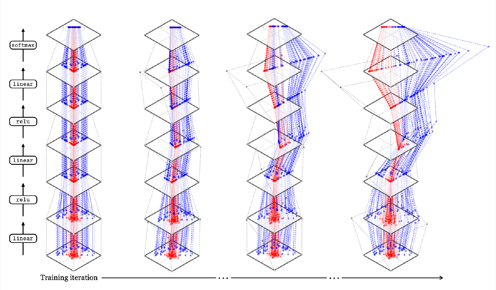

**Embedding.** L'uscita di uno strato interno è un vettore ad alta dimensione, detto **embedding**: la rappresentazione dell'immagine a quello strato (slide 12). Spesso si **congela una rete già addestrata e si usano i suoi embedding per un problema nuovo**. Per vederli si riducono a 2 dimensioni con PCA o con t-SNE (che preserva i vicini, non le distanze globali): il visionbook (fig. 13.9) mostra un ViT addestrato con CLIP in cui al primo strato le classi sono mescolate e all'ultimo separate.

L'obiettivo (slide 13) è una rappresentazione **disentangled** ("districata"): ogni concetto ben separato dagli altri, anche sotto cambi forti di vista, luce, giorno e notte. Con il **pretraining** su dati enormi si spera di ottenerla anche per concetti mai visti (classi nuove).

Un dettaglio sulla ReLU (slide 19, visionbook § 13.3): dopo una ReLU in N dimensioni tutti i punti stanno nell'ortante positivo, che è 1/2N dello spazio: **le rappresentazioni ad alta dimensione diventano molto sparse**, con molte coordinate a zero (lo vedi nel terzo pannello della figura: molti punti sugli assi).

> **Il punto**
> 
> Strato dopo strato, la rete **deforma la nuvola dei dati finché le classi diventano separabili da un iperpiano**. I vettori intermedi sono gli embedding, riusabili per altri compiti.

### 5\. Profondità o larghezza?

**Profondità** (slide 14). Una rete ReLU è lineare a tratti: **ogni neurone taglia lo spazio d'ingresso con un iperpiano, e la rete è lineare dentro ciascuna regione**. Uno strato successivo può "piegare" e riusare i tagli degli strati precedenti, quindi il numero *massimo* di regioni cresce esponenzialmente con la profondità (Montúfar et al. 2014): la profondità permette, in principio, funzioni molto più complesse.

![Sinistra e centro: le regioni lineari di due reti ReLU con pesi casuali e lo stesso numero di neuroni (24), contate su \[−3, 3\]2. Nella rete profonda i bordi sono spezzati (piegati dagli strati successivi), ma le regioni non sono di più. Destra: coseno fra coppie di vettori gaussiani casuali; la deviazione standard è 0.71, 0.31, 0.10, 0.03 per d = 2, 10, 100, 1000, cioè circa 1/√d.](../sito-src/L15/disp2_regioni_ortogonali.png)

> **Attenzione: "il numero di regioni è esponenziale nella profondità" (slide 14)**
> 
> Vale come **massimo teorico** (Montúfar et al. 2014; Prince cap. 4). L'articolo citato proprio nella figura della slide (Hanin e Rolnick 2019) mostra che nelle reti reali, all'inizializzazione e durante l'addestramento, il numero medio di regioni cresce con il numero totale di neuroni e non esponenzialmente con la profondità. Lo vedi nella figura qui sopra: a parità di neuroni la rete profonda casuale non ha più regioni. Il vantaggio della profondità è soprattutto empirico (visionbook § 12.5.3).

**Larghezza**: è la dimensione degli embedding. In alta dimensione le rappresentazioni diventano più sparse, e **due vettori casuali sono quasi ortogonali** (vTu ≈ 0): il coseno fra loro ha deviazione standard circa 1/√d, quindi in d = 1000 c'è spazio per moltissime direzioni "quasi indipendenti", una per concetto. La teoria classica (la **maledizione della dimensionalità**) scoraggerebbe gli spazi enormi; in pratica **le architetture migliori sono sia larghe sia profonde**.

> **Il punto**
> 
> Profondità = possibilità di comporre e piegare (funzioni più complesse, almeno in principio); larghezza = spazio per rappresentazioni sparse e quasi ortogonali. Servono entrambe.

### 6\. Generalizzazione: perché le reti enormi non vanno in overfitting

**Il problema.** Nel machine learning classico (slide 15) un modello troppo complesso va in **overfitting**: impara il rumore del training set. Si cerca un equilibrio bias-varianza, a forma di U (visionbook § 11.2). Le reti profonde rompono questo schema: **la loro capacità è praticamente infinita** (le reti di larghezza infinita sono approssimatori universali; misure come la VC-dimension non danno limiti utili), eppure generalizzano.

**L'esperimento chiave** (Zhang et al., ICLR 2017; Prince § 20.2.1). Si prende CIFAR-10 e si sostituiscono le etichette con **etichette casuali**. Una rete standard **impara a memoria anche quelle**, fino all'errore di training zero (solo più lentamente), e perfino con pixel di puro rumore; né il weight decay né il dropout lo impediscono. Quindi la rete *potrebbe* memorizzare; se sui dati veri generalizza, il merito non è della capacità limitata.

**Da dove viene la regolarizzazione** (slide 16):

  - **implicita**, ed è la più forte: **nei parametri di SGD (learning rate, dimensione del batch, numero di epoche) e nell'architettura**. Batch piccoli e learning rate alti portano verso minimi più piatti, che generalizzano meglio (Prince § 20.4);
  - **esplicita**: il **weight decay**, cioè aggiungere alla loss λ‖θ‖2 (pesi piccoli), e il **dropout**, che durante l'addestramento azzera a caso una frazione delle unità, così la rete non può affidarsi a una sola.

`J(θ) = (1/N) ∑i L(fθ(xi), yi) + λ R(θ)`

è la forma generale (visionbook eq. 11.1): loss media sugli N esempi più λ volte un regolarizzatore R, che si può leggere come un'ipotesi a priori sui parametri.

**Regola pratica** (slide 16): **usa il modello più grande che puoi permetterti**; la dimensione la decide il budget di calcolo, non la paura dell'overfitting. Per i modelli fondazionali le **scaling laws** dicono come far crescere insieme dimensione del modello e del dataset per addestrare in modo ottimale a parità di costo.

> **Il punto**
> 
> Una rete può imparare a memoria anche etichette casuali; generalizza grazie alla **regolarizzazione implicita di SGD e dell'architettura**, aiutata da weight decay e dropout. Più grande, se puoi, è meglio.

### 7\. Le funzioni di attivazione

**Il problema.** Che non linearità mettere fra due strati lineari? Deve essere semplice da calcolare e, soprattutto, avere una **derivata utile**: la backpropagation moltiplica le derivate di tutti gli strati.

Le candidate (slide 18), applicate a ogni elemento x = xin\[i\]:

  - **soglia**: 1 se x \> 0, altrimenti 0 (il perceptron). **Derivata nulla quasi ovunque: nessun gradiente**;
  - **sigmoide**: σ(x) = 1/(1 + e−x), fra 0 e 1;
  - **tanh**: 2σ(2x) − 1, fra −1 e 1 (è una sigmoide riscalata);
  - **ReLU**: max(x, 0);
  - **leaky ReLU**: x se x \> 0, altrimenti αx, con α piccolo.

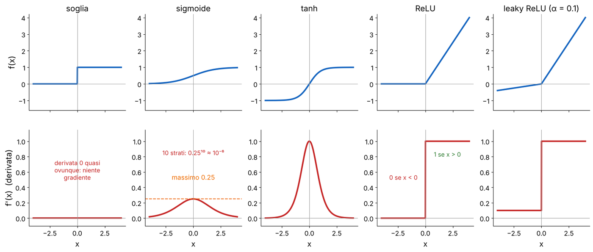

**Perché la ReLU ha vinto.** Con la sigmoide ogni strato moltiplica il gradiente per al più 0.25: dopo 10 strati 0.2510 ≈ 10−6. È il **vanishing gradient**: gli strati iniziali non imparano. La ReLU ha derivata 1 dove è attiva: **niente vanishing gradient e calcolo velocissimo** (un confronto con zero), per questo ReLU e leaky ReLU sono la scelta standard (slide 18). Il difetto della ReLU è che un'unità con ingresso sempre negativo ha gradiente zero e smette di imparare ("ReLU morta"): la leaky ReLU lo evita.

> **Attenzione: il grafico della leaky ReLU nella slide 18**
> 
> È etichettato α = 2, ma la curva passa per (−2, −0.4): la pendenza del ramo negativo è 0.2. Con α = 2 non sarebbe "leaky": il ramo negativo sarebbe più ripido di quello positivo. I valori tipici sono α = 0.01–0.2.

> **Il punto**
> 
> L'attivazione deve avere un gradiente utile. **Sigmoide e tanh saturano e fanno svanire il gradiente; ReLU e leaky ReLU no**, e costano pochissimo.

### 8\. Normalizzare le attivazioni: BatchNorm e LayerNorm

**Il problema.** Strato dopo strato, media e varianza delle attivazioni possono crescere o ridursi molto, e l'ottimizzazione diventa instabile. L'idea è **standardizzare** le attivazioni (media 0, varianza 1) e poi lasciare alla rete la libertà di riscalarle.

**BatchNorm** (slide 20):

`xout[i] = γ · (xin[i] − 𝔼[xin[i]]) / √(Var[xin[i]] + ε) + β`

Media 𝔼 e varianza Var si calcolano **per canale**, sugli esempi del batch (e, nelle CNN, anche su tutte le posizioni H × W). ε è un numero piccolo che evita di dividere per zero; γ e β sono parametri appresi (scala e spostamento). La parte delicata è **training contro test**: in addestramento le statistiche sono quelle del mini-batch corrente; in inferenza si usano medie mobili accumulate durante il training, congelate, così **l'uscita su un'immagine non dipende dalle altre immagini del batch**. Benefici (Prince § 11.4): propagazione stabile, learning rate più alti, un po' di regolarizzazione dal rumore del batch.

**Il difetto**: **BatchNorm dipende dalla dimensione del batch** (con batch = 1 la varianza non ha senso; problemi anche nel multi-task). Per questo molte reti moderne usano la **LayerNorm** (slide 21): stessa formula, ma media μ e varianza σ2 si calcolano **su tutte le feature di un singolo esempio**. Ogni esempio è standardizzato da solo. Su una matrice Nbatch × Nfeature la LayerNorm è la "trasposta" della BatchNorm.

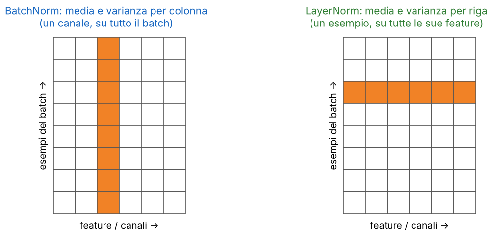

**Esempio.** BatchNorm su un canale con un batch di 4 valori (2, 4, 6, 8): media 5, varianza (9 + 1 + 1 + 9)/4 = 5, deviazione 2.24; uscite normalizzate (−1.34, −0.45, 0.45, 1.34), poi moltiplicate per γ e sommate a β. LayerNorm su un esempio con feature (1, 2, 3, 6): media 3, varianza (4 + 1 + 0 + 9)/4 = 3.5, deviazione 1.87; uscite (−1.07, −0.53, 0, 1.60).

> **Attenzione: γ e β "learned scalar parameters" (slide 20)**
> 
> Non sono due scalari per tutto lo strato: c'è una coppia (γ, β) **per canale** (o per unità). Nelle CNN media e varianza si calcolano sul batch **e** sulle posizioni spaziali, separatamente per ogni canale. Nella formula manca anche ε sotto la radice (manca anche nel libro).

> **Il punto**
> 
> BatchNorm standardizza ogni canale sul batch (statistiche del batch in training, medie mobili in test); **LayerNorm standardizza ogni esempio sulle proprie feature** e non dipende dal batch.

### 9\. L'uscita: softmax con temperatura, regressione, cross-entropy

**Classificazione.** L'ultimo strato lineare produce un numero per classe, i **logit** z = xin. La **softmax con temperatura** (slide 22) li trasforma in probabilità:

`xout[i] = ezi/τ / ∑k=1K ezk/τ`

Le uscite sono positive e sommano a 1. È una versione "morbida" di argmax: **il logit più grande è anche la probabilità più grande**, quindi se in inferenza ti serve solo la classe non devi nemmeno calcolare la softmax. La temperatura τ regola quanto è "decisa": τ → 0 dà tutta la probabilità alla classe migliore, τ → ∞ rende la distribuzione uniforme (i logit divisi per τ tendono a 0, ed e0 = 1 per tutti).

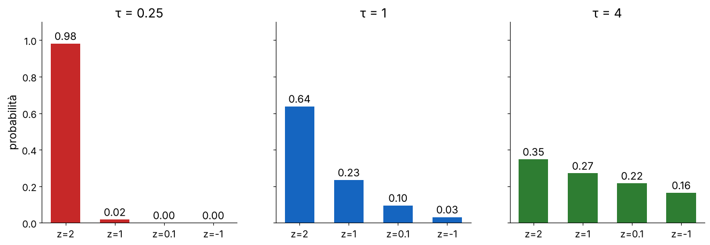

**Regressione** (slide 23): basta l'identità (uno strato lineare). Se l'uscita deve stare in un intervallo si usa una sigmoide riscalata, per esempio xout = 255 · σ(xin) per generare pixel in (0, 255).

**La loss: entropia incrociata** (slide 24). Con y la distribuzione vera (di solito one-hot) e ŷ quella predetta:

`l = − ∑c=1C y[c] log ŷ[c]`

Con y one-hot è semplicemente −log della probabilità data alla classe giusta. Per stabilità numerica (esponenziali enormi, log di zero) le librerie **calcolano softmax e cross-entropy insieme partendo dai logit**: −log ŷ\[c\] = −zc + log ∑i ezi, e il secondo termine si calcola sottraendo prima il logit massimo.

**Esempio.** Logit (2, 1, 0.1, −1), classe vera la prima, τ = 1. ∑ ezi = 7.39 + 2.72 + 1.11 + 0.37 = 11.58, log 11.58 = 2.449, quindi l = −2 + 2.449 = 0.449, che è −log 0.638: la probabilità della figura.

> **Attenzione: le formule di softmax e cross-entropy (slide 22 e 24)**
> 
> La softmax della slide 22, con z/τ, è quella giusta (convenzione usuale). Il libro (§ 12.7.4, § 24.4) scrive e−τ z: lì τ è una temperatura *inversa* e il segno meno è insolito. Nella seconda formula della slide 24 compaiono xout\[c\] e yc: devono essere i **logit** (gli ingressi della softmax, xin nella notazione della slide 22) e y\[c\].

> **Il punto**
> 
> Logit → softmax (τ regola quanto è piccata) → probabilità; la loss è **−log della probabilità della classe giusta**, calcolata direttamente dai logit per stabilità.

### 10\. Lo strato convoluzionale: uno strato lineare con i pesi condivisi

**Il problema.** Uno strato denso su un'immagine collega ogni pixel d'uscita a ogni pixel d'ingresso: troppi pesi, e nessuna idea del fatto che un bordo è un bordo ovunque si trovi. La soluzione è la convoluzione della [L3](https://gabriele-marsili.github.io/appunti-magistrale-ai/anno-2/computer-vision/sito/#L3), con i pesi da imparare.

**La formula** (slide 26, visionbook eq. 24.2):

`xout[n, m] = b + ∑k1, k2 = −KK w[k1, k2] · xin[n + k1, m + k2]`

w è il **kernel** (filtro) di lato 2K + 1 (K è la semi-ampiezza: K = 1 dà un 3 × 3), b un bias scalare appreso. Il segno "+" negli indici dice che il filtro **non viene ribaltato**: tecnicamente è una **correlazione incrociata**, non una convoluzione. Per filtri appresi è indifferente (la rete imparerebbe il filtro ribaltato), e tutti la chiamano comunque convoluzione.

**L'idea chiave** (slide 27). **Una convoluzione è un caso speciale di strato lineare**: xout = W xin con una matrice W molto particolare, di **Toeplitz** (diagonali costanti): ha **quasi tutti zeri (località) e gli stessi pochi pesi ripetuti su ogni riga (condivisione dei pesi)**. Nella figura: 48 posizioni, 3 pesi diversi, 30 zeri. Nessuno costruisce davvero la matrice: si calcola la convoluzione, risparmiando memoria e calcolo. Il visionbook (§ 24.1) lo dice così: una CNN applica **lo stesso classificatore a ogni patch** dell'immagine, e l'uscita ha la stessa topologia (griglia) dell'ingresso.

> **Il punto**
> 
> Strato convoluzionale = strato lineare con **connessioni locali e pesi condivisi** (matrice di Toeplitz). È una correlazione incrociata con un kernel appreso.

### 11\. Più canali in ingresso e in uscita

**Il problema.** Un'immagine RGB ha 3 canali, e vogliamo molti filtri diversi in uscita (bordi in varie direzioni, colori, texture). Come si generalizza la formula?

**Canali in ingresso** (slide 28): un filtro ha una "fetta" per ogni canale d'ingresso; si filtra ogni canale con la sua fetta e si **somma**: xout = ∑c w\[c, :, :\] ⋆ xin\[c, :, :\] + b. **Canali in uscita** (slide 29): si usano più filtri, ciascuno produce un canale d'uscita, detto **feature map**. È esattamente un banco di filtri ([L7](https://gabriele-marsili.github.io/appunti-magistrale-ai/anno-2/computer-vision/sito/#L7)), ma appreso. Insieme (slide 30, visionbook eq. 24.4):

`xout[c2] = ∑c1=1Cin w[c1, c2] ⋆ xin[c1] + b[c2]`

Il tensore dei pesi ha Cin × Cout × k × k numeri (k = lato del kernel), più Cout bias: **un bias per canale d'uscita**. Ogni canale d'uscita guarda **tutti** i canali d'ingresso.

**Esempio** (visionbook § 24.2.1). Ingresso RGB 128 × 128, 96 filtri 3 × 3: ogni filtro ha 3 · 3 · 3 = 27 pesi, in tutto 96 · 27 = 2592 pesi + 96 bias, e l'uscita è 96 × 128 × 128.

> **Attenzione: indici e forme nelle slide 28 e 30**
> 
> Slide 28: il bias è scritto b\[c\], indicizzato con il canale d'**ingresso** (refuso copiato dal libro): un filtro multicanale ha un solo bias, e in generale c'è un bias per canale d'uscita, b\[c2\]. Il testo dice "where ∗" ma la formula usa ⋆. Slide 30: la forma "Cout × Cin × K × K" è la convenzione di PyTorch, mentre l'indice w\[c1, c2\] con c1 = ingresso segue quella del libro (Cin × Cout × K × K); e qui K è il **lato** del kernel, mentre nella slide 26 K era la semi-ampiezza (kernel 2K + 1).

> **Il punto**
> 
> Ogni canale d'uscita è un filtro 3D che **somma i contributi di tutti i canali d'ingresso**. Pesi: k2·Cin·Cout + Cout bias.

### 12\. Quanto si risparmia: fully connected contro convoluzione

**Il conto** (slide 31). Da un ingresso H × W × Cin a un'uscita H × W × Cout:

  - **fully connected**: ogni unità d'uscita è collegata a ogni unità d'ingresso, (H W Cin) · (H W Cout) pesi. Per 64 × 64 × 3 → 64 × 64 × 64: 12 288 · 262 144 = 3 221 225 472, **circa 3,2 miliardi di pesi** per un solo strato su un'immagine piccolissima;
  - **conv k × k**: k2 Cin Cout = 9 · 3 · 64 = **1728 pesi (+64 bias), indipendenti dalla risoluzione**.

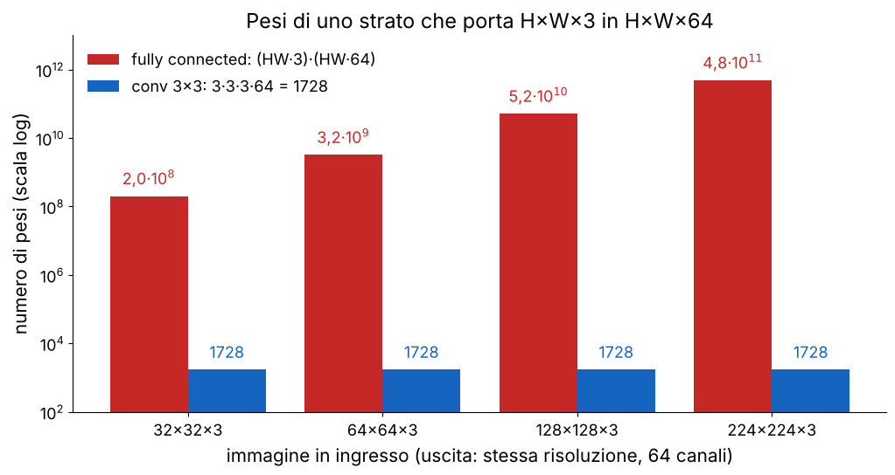

Non è solo questione di memoria. Prince (§ 10.2.7) confronta su MNIST-1D una CNN con 2050 parametri e una rete densa con 59 065: **la CNN sbaglia circa il 17% sul test, la densa circa il 40%**. Il vantaggio è il **bias induttivo** (località e invarianza per traslazione), non il numero di parametri.

> **Il punto**
> 
> 3,2 miliardi contro 1728: la convoluzione rende possibili le reti sulle immagini, e **generalizza meglio perché incorpora le ipotesi giuste**.

### 13\. Stride e dilatazione: saltare pixel, con attenzione all'aliasing

**Stride** (slide 32). Si calcola l'uscita solo ogni s pixel: xout\[n, m\] = b + ∑ w\[k1, k2\] xin\[s n + k1, s m + k2\]. Con s = 2 l'uscita ha metà righe e metà colonne: **un quarto del calcolo e una risoluzione più bassa** per gli strati successivi.

**Il problema** (slide 33). Stride s vuol dire filtrare e poi **sottocampionare**: se il filtro non toglie le frequenze sopra la nuova frequenza di Nyquist, si ha **aliasing**, esattamente come nella [L6](https://gabriele-marsili.github.io/appunti-magistrale-ai/anno-2/computer-vision/sito/#L6). Il visionbook (fig. 24.8, nella slide) applica un Laplaciano con stride 1, 2, 4: a stride 2 compaiono artefatti, a stride 4 sono gravi, e nella trasformata di Fourier appaiono righe nuove. L'apprendimento può compensare in parte, imparando filtri più lisci, ma questo **restringe i kernel utilizzabili**.

) le alte frequenze diventano grigio uniforme, senza falsi.](../sito-src/L15/disp2_stride_aliasing.png)

**Dilatazione** (slide 34). Il problema opposto: vogliamo un filtro che veda lontano, ma con pochi pesi. Si "allarga" il kernel inserendo buchi: xout\[n, m\] = b + ∑ w\[k1, k2\] xin\[n + d k1, m + d k2\]. Con dilatazione d un 3 × 3 copre 5 × 5 (d = 2) o 9 × 9 (d = 4) **sempre con 9 pesi e senza ridurre la risoluzione**.

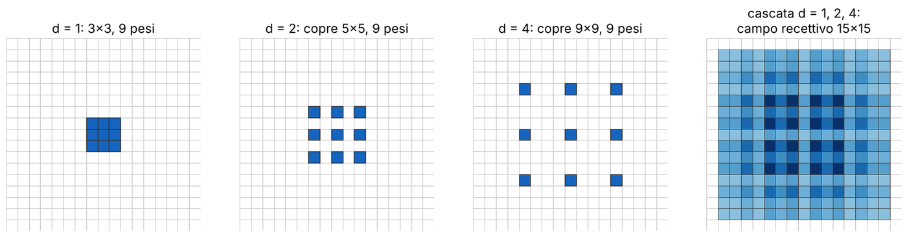

Attenzione però: **un kernel dilatato non è più un passa-basso** (visionbook § 24.2.3): i buchi sono un sottocampionamento del filtro, con gli stessi rischi di aliasing.

> **Attenzione: segni nelle formule di stride e dilatazione (slide 32 e 34)**
> 
> Le slide scrivono xin\[sn n − k1, …\] e xin\[n − dk k1, …\] (convoluzione) mentre la slide 26 usa xin\[n + k1, …\] (correlazione): è un refuso del libro. Con kernel appresi non cambia nulla (basta ribaltare w), ma per coerenza va scritto xin\[s n + k1, s m + k2\] e xin\[n + d k1, m + d k2\].

> **Il punto**
> 
> Stride = sottocampionare (meno calcolo, **rischio aliasing come in L6**). Dilatazione = kernel con buchi (campo più ampio a parità di pesi, senza perdere risoluzione).

### 14\. Pooling: invarianza da equivarianza

**Il problema.** Un rilevatore di "occhio" dovrebbe dire "c'è un occhio da queste parti", senza dipendere dal pixel esatto. La convoluzione invece è **equivariante** alla traslazione: se sposti l'ingresso, l'uscita si sposta allo stesso modo, f(T x) = T f(x). Noi vogliamo, almeno alla fine, l'**invarianza**: f(T x) = f(x).

**L'idea** (slide 36). Il **pooling** riassume ogni intorno k × k con un solo numero: il **massimo** (max pooling) o la **media** (average pooling):

`xout[i] = maxj ∈ 𝒩(i) xin[j]      oppure      xout[i] = (1/|𝒩|) ∑j ∈ 𝒩(i) xin[j]`

dove 𝒩(i) è l'intorno associato all'uscita i. Si usa quasi sempre con stride uguale alla finestra (2 × 2, stride 2): **riduce la risoluzione (meno calcolo) e dà un po' di robustezza a piccoli spostamenti**. Il max dice "questo pattern c'è da qualche parte qui vicino?"; la media ammorbidisce e mescola le risposte. Il pooling si fa canale per canale.

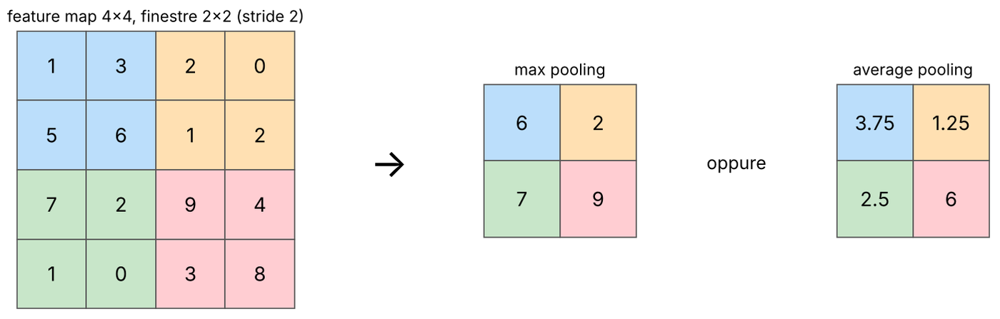

**Esempio di invarianza.** In 1D, risposta (9, 0, 0, 0) e la stessa spostata di un pixel, (0, 9, 0, 0). Con max pooling a finestre di 2 entrambe danno (9, 0): lo spostamento è sparito. Spostando di un altro pixel, (0, 0, 9, 0), si ottiene (0, 9): l'invarianza è solo **locale, entro la finestra**. Il visionbook (§ 24.3.1) mostra che con un intorno grande un rilevatore di bordi verticali più max pooling diventa insensibile alla posizione; facendo pooling sui canali (filtri di orientazioni diverse) si ottiene invarianza all'orientazione.

**Global average pooling** (slide 37): la media di ogni feature map su **tutte** le posizioni, da H × W × C a un vettore di C numeri. Si mette alla fine della parte convoluzionale, prima degli strati lineari. Due vantaggi: **invarianza alla traslazione (la media su tutte le posizioni non sa dove fosse l'oggetto) e nessun vincolo sulla risoluzione d'ingresso**: immagini più grandi danno feature map più grandi, ma sempre C canali.

> **Attenzione: l'indice nella formula del pooling (slide 36)**
> 
> La slide usa i sia per l'uscita sia per la variabile della somma o del massimo: va scritto maxj ∈ 𝒩(i) xin\[j\], come qui sopra.

> **Il punto**
> 
> Convoluzione = equivariante; **pooling = riassume un intorno e trasforma l'equivarianza in invarianza locale**; global average pooling = invarianza globale e risoluzione libera.

### 15\. Campo recettivo e gerarchia delle feature

**Il problema.** Un filtro 3 × 3 vede 9 pixel. Come fa una rete fatta di filtri 3 × 3 a riconoscere un airone che occupa mezza immagine?

**L'idea** (slide 39). Il **campo recettivo** di un'unità è la regione dell'immagine originale che può influenzarne il valore. Uno strato vede k pixel dello strato sotto, ognuno dei quali ne vede k dello strato ancora sotto, e così via: **il campo recettivo cresce con la profondità e con la dimensione dei kernel**. Nella figura della slide (visionbook fig. 24.26) x2\[3\], dopo conv-relu-conv, dipende da 5 ingressi; x1\[5\], dopo una sola conv, da 3. Le non linearità punto per punto non cambiano il campo recettivo.

**La matematica.** Se lo strato l ha kernel kl e gli strati prima hanno stride s1, …, sl−1, il campo recettivo cresce di (kl − 1) · s1 ⋯ sl−1. Con stride 1: r = 1 + L(k − 1) = 2L + 1 per k = 3. **Esempio**: conv 3, conv 3 (r = 5), pooling 2 × 2 stride 2 (r = 6), poi conv 3: ora ogni passo vale 2 pixel, r = 6 + 2 · 2 = 10. Il **sottocampionamento moltiplica la crescita**, e il global average pooling porta il campo recettivo a tutta l'immagine.

**L'ipotesi gerarchica** (slide 40). Una CNN addestrata su un compito visivo complesso impara una **gerarchia: bordi → texture → parti di oggetti → oggetti interi e concetti**, dagli strati iniziali a quelli finali. È motivata dal campo recettivo (all'inizio si vede solo struttura locale) e dalle visualizzazioni delle reti addestrate (Zeiler e Fergus 2014). Il visionbook non la enuncia con queste parole: resta un'ipotesi, ben supportata.

**Le feature map** (slide 41–42). Ogni strato produce C feature map; scendendo nella rete **la risoluzione cala e i canali aumentano**. Nella slide 42 (AlexNet sull'airone) i filtri del primo strato sono piccole macchie di colore e righe orientate, parenti delle derivate della L5; le mappe profonde sono più "semantiche", accese sull'uccello. Con centinaia di canali non si possono guardare tutti: si fa una **PCA** dei vettori di C numeri in ogni posizione e si mostrano le prime 3 componenti come R, G, B (slide 43).

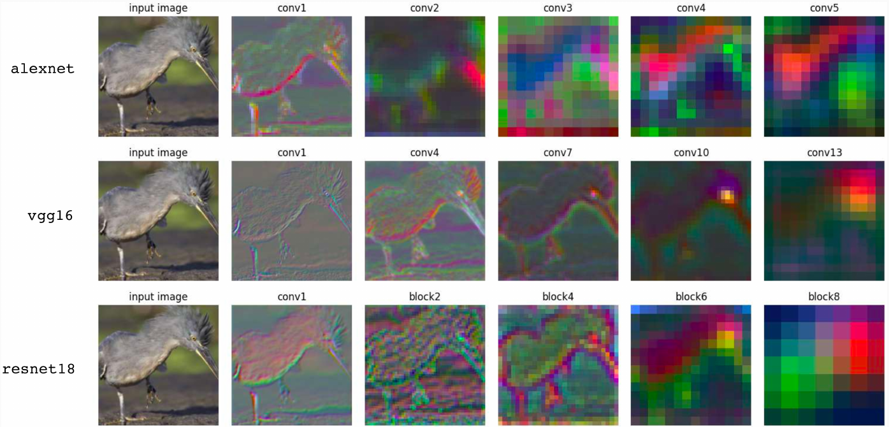

> **Il punto**
> 
> Il campo recettivo cresce come 2L + 1 con i 3 × 3 e molto più in fretta con il sottocampionamento. Per questo **gli strati iniziali vedono bordi e gli ultimi oggetti interi**.

### 16\. Le architetture classiche: da LeNet a VGG

**Lo schema base** (slide 45, LeNet 1998 sulle cifre MNIST): blocchi **conv → non linearità → pooling**, ripetuti; **il numero di filtri cresce con la profondità mentre la risoluzione scende**; poi blocchi densi e infine softmax e loss. Il visionbook (§ 24.4) ne dà una versione minima: conv, relu, global average pooling, uno strato lineare, softmax.

**ImageNet** (slide 46): 1000 classi, circa 1,28 milioni di immagini di training, ingresso tipico 224 × 224. La slide lo dice chiaramente: **i progressi del deep learning dipendono dai dati di qualità quanto dalle idee tecniche**.

**AlexNet** (2012, slide 47): la prima rete a vincere nettamente su ImageNet, l'inizio della rivoluzione deep nella visione. 8 strati con pesi (5 conv + 3 densi), primo strato 11 × 11 con stride 4 e 96 canali, circa 60 milioni di parametri, quasi tutti negli strati densi. Gli ingredienti: **ReLU, addestramento su due GPU "da gioco", dropout**, data augmentation e weight decay. Errore top-5 16.4% (Prince § 10.5).

**VGG** (2014, slide 48): design semplice e uniforme, **solo conv 3 × 3 con stride 1 e max pooling 2 × 2**, fino a 19 strati (circa 144 milioni di parametri, top-5 6.8%). L'argomento è il campo recettivo:

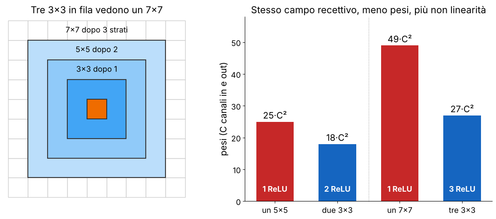

**I conti.** Due 3 × 3 = un campo 5 × 5 con 2 · 9C2 = 18C2 pesi invece di 25C2; tre 3 × 3 = un 7 × 7 con 27C2 invece di 49C2 (il 45% in meno). In più ci sono 3 ReLU invece di una: **stesso campo recettivo, meno parametri, più non linearità**. VGG ha mostrato che **la profondità conta più della dimensione esatta del kernel**.

> **Il punto**
> 
> Schema classico: conv-ReLU-pool ripetuti, canali in su e risoluzione in giù. AlexNet ha acceso la rivoluzione (ReLU, GPU, dropout); VGG ha dimostrato che **molti 3 × 3 in fila battono pochi kernel grandi**.

### 17\. Inception, ResNet, DenseNet: più scale, più profondità

**Inception / GoogLeNet** (2014, slide 49). La scala "giusta" di una struttura cambia da immagine a immagine e da punto a punto. Il **modulo Inception** applica **in parallelo convoluzioni 1 × 1, 3 × 3, 5 × 5 e un pooling**, e concatena le uscite. Per non far esplodere il costo usa le **convoluzioni 1 × 1**: un filtro 1 × 1 non guarda i vicini, mescola solo i canali in ogni posizione (Prince § 10.4.3: è la stessa piccola rete densa applicata ai canali di ogni pixel), quindi può ridurne il numero prima dei filtri grandi. **Esempio**: da 256 a 32 canali con un 5 × 5 servono 25 · 256 · 32 = 204 800 pesi; passando prima per un 1 × 1 a 64 canali, 256 · 64 + 25 · 64 · 32 = 67 584, un terzo.

**ResNet** (2015, slide 50). **Il problema**: oltre una certa profondità le reti "piane" peggiorano, e **peggiorano anche sul training set** (He et al.: su CIFAR-10 una rete da 56 strati sbaglia più di una da 20). Non è overfitting: è un problema di **ottimizzazione**. **L'idea**: il blocco residuo impara solo la correzione da sommare all'ingresso:

`y = F(x) + x`

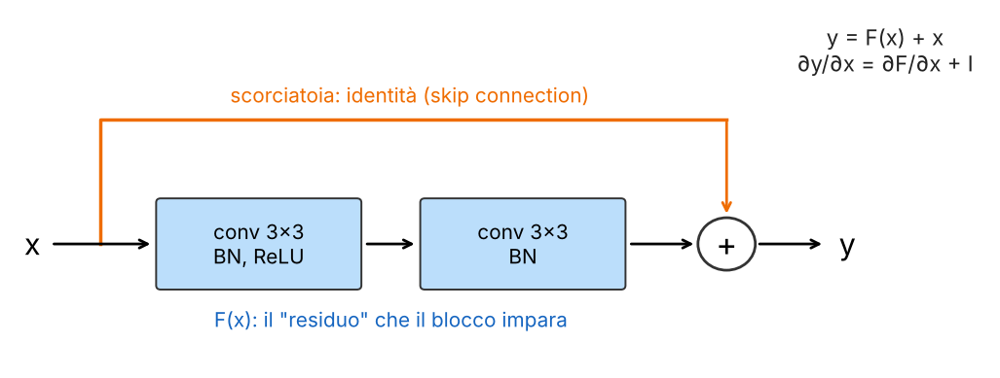

Perché funziona: **l'identità è facilissima da rappresentare** (basta F = 0), quindi aggiungere blocchi non dovrebbe mai peggiorare una rete ben inizializzata; e il gradiente ha sempre una strada diretta:

`∂y/∂x = ∂F/∂x + I`

Anche se ∂F/∂x è piccolo, il termine identità I fa passare il gradiente all'indietro senza attenuarlo. Concatenando i blocchi, il prodotto (I + J1)(I + J2)⋯ si espande in una somma di percorsi di lunghezze diverse (Prince § 11.2): la rete si comporta come un insieme di reti più corte. Con le skip connection si addestrano reti di oltre 100 strati (ResNet-152), e la loss diventa l'imbuto liscio della sezione 3. Le versioni profonde usano il blocco **bottleneck** 1 × 1 → 3 × 3 → 1 × 1, e serve la BatchNorm per tenere a bada la varianza, che a ogni somma crescerebbe.

> **Attenzione: la causa del problema nella slide 50**
> 
> La slide attribuisce la difficoltà delle reti profonde a gradienti che svaniscono o esplodono. He et al. (2016) dicono esplicitamente che la degradazione delle reti piane (che usano già BatchNorm) è un problema di ottimizzazione che **difficilmente** dipende da gradienti che svaniscono; Prince (§ 11.1.1) propone gli *shattered gradients* (gradienti frammentati, quasi rumore). La formula ∂y/∂x = ∂F/∂x + I resta giusta ed è il motivo per cui il gradiente ha sempre un cammino diretto.

**DenseNet** (2017, slide 51): portare la scorciatoia all'estremo. In un blocco **ogni strato riceve la concatenazione delle feature map di tutti gli strati precedenti**: le feature si riusano e il gradiente ha cammini brevi verso ogni strato. Il prezzo è la **memoria**, per tutte quelle concatenazioni. Nota la differenza: ResNet **somma**, DenseNet (e U-Net) **concatenano**.

> **Il punto**
> 
> Inception: più scale in parallelo, 1 × 1 per ridurre i canali. ResNet: **y = F(x) + x, l'identità come cammino diretto per il gradiente**, reti da 100+ strati. DenseNet: concatenare tutto, al prezzo della memoria.

### 18\. Reti efficienti e il costo dell'accuratezza

**EfficientNet** (2019, slide 52). Per avere più accuratezza si può aumentare la profondità, la larghezza (canali) o la risoluzione d'ingresso. La scoperta: **scalare tutte e tre insieme, con un rapporto fisso ("compound scaling"), dà più accuratezza per FLOP** che scalarne una sola. Il grafico nella slide riporta EfficientNet-B7 all'84.3% top-1.

**MobileNet** (slide 52): reti per telefoni e dispositivi embedded, basate sulle **convoluzioni depthwise separable**. Una conv standard mescola spazio e canali insieme. Qui si separano: prima una **depthwise** k × k, un filtro per ogni canale (nessun mescolamento fra canali), poi una **pointwise** 1 × 1 che mescola i canali.

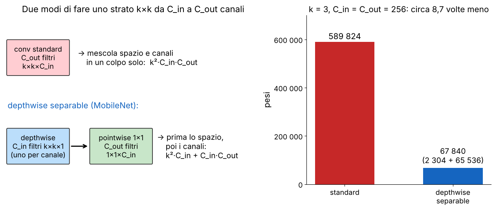

**I conti.** Standard: k2 Cin Cout. Separabile: **k2 Cin + Cin Cout**. Con k = 3 e Cin = Cout = 256: 9 · 256 · 256 = 589 824 contro 2304 + 65 536 = 67 840, **circa 8,7 volte meno**. In generale il rapporto è 1/Cout + 1/k2, quindi con molti canali si guadagna quasi un fattore k2 = 9. È la stessa idea dei filtri separabili della [L5](https://gabriele-marsili.github.io/appunti-magistrale-ai/anno-2/computer-vision/sito/#L5) (gaussiana = riga × colonna), applicata a spazio × canali.

**ConvNeXt** (2022, slide 53): una CNN "modernizzata" con le scelte vincenti dei Transformer: kernel più grandi (7 × 7 depthwise), meno strati di normalizzazione e di attivazione, **LayerNorm** al posto della BatchNorm, GELU, e un collo di bottiglia invertito (96 → 384 → 96 canali, nella figura). Risultato: **mantiene il bias induttivo delle CNN e pareggia i ViT** sui grandi benchmark.

**Le idee da portarsi a casa** (slide 54): profondità resa possibile da connessioni residue, buone inizializzazioni e ottimizzatori; pile di kernel piccoli invece di kernel grandi; architetture moderne calibrate per bilanciare calcolo, memoria e accuratezza. E due note pratiche: **parti sempre da architetture e modelli pre-addestrati esistenti, con le loro ricette di training**, perché riprodurre anni di ottimizzazione è lunghissimo; e ricorda che **anche gli strati conv profondi sono costosi, per l'alto numero di canali**.

> **Il punto**
> 
> EfficientNet scala profondità, larghezza e risoluzione insieme; **MobileNet separa spazio e canali e taglia il costo di circa k2**; ConvNeXt porta nelle CNN le idee dei Transformer. Il grafico costo-accuratezza dice che più parametri non vuol dire più accuratezza.

### 19\. Punti di forza e limiti delle CNN

**Forza** (slide 57): **località e condivisione dei pesi sono ipotesi a priori giuste per le immagini naturali**, quindi le CNN sono la scelta di default su dataset piccoli e medi, dove un'architettura meno vincolata (un ViT) dovrebbe imparare da zero località e invarianza per traslazione. E sono **efficienti in memoria e calcolo**.

**Limiti**:

  - **il campo recettivo effettivo è molto più piccolo di quello teorico** e concentrato al centro (lo vedi già nella cascata dilatata della sezione 13: i percorsi che arrivano al centro sono molti di più). Anche una CNN profonda può faticare a mettere in relazione punti lontani dell'immagine;
  - **l'equivarianza alla traslazione è rigida**: tratta ogni posizione allo stesso modo, ma a volte la posizione conta (un sistema di verifica del volto può voler essere più sensibile al centro che ai bordi);
  - dalla [L14](https://gabriele-marsili.github.io/appunti-magistrale-ai/anno-2/computer-vision/sito/#L14): le CNN guardano anche dettagli che noi ignoriamo. Il visionbook (§ 24.5.4) costruisce a mano un esempio avversario per una rete che distingue linee orizzontali da verticali, modulando l'immagine con un coseno: la rete guarda l'energia nello spettro, non la forma.

Questi limiti sono il punto di partenza dei **Vision Transformer** (visionbook cap. 26), dove ogni posizione può guardare ogni altra fin dal primo strato.

> **Il punto**
> 
> Le CNN funzionano perché **hanno il bias induttivo giusto** (località, pesi condivisi, equivarianza) e costano poco; gli stessi vincoli diventano limiti quando servono relazioni a lungo raggio o dipendenza dalla posizione.

### Il riassunto in 10 righe

1.  Filtri fissi e lineari non si compongono; una rete alterna filtri appresi e non linearità.
2.  DNN: fθ = fL ∘ … ∘ f1, addestrata con θ ← θ − α∇θL sui mini-batch; loss non convessa ma minimi buoni, e skip connection = superficie più liscia.
3.  Ogni strato trasforma la distribuzione dei dati fino a renderla linearmente separabile; gli stati intermedi sono embedding (visibili con PCA, t-SNE).
4.  Profondità = regioni lineari piegate e composte (esponenziali solo come massimo teorico); larghezza = embedding sparsi e quasi ortogonali.
5.  Le reti memorizzano anche etichette casuali; generalizzano grazie alla regolarizzazione implicita di SGD e architettura, più weight decay e dropout.
6.  ReLU: niente vanishing gradient (sigmoide: derivata ≤ 0.25); BatchNorm per canale sul batch (medie mobili in test), LayerNorm per esempio.
7.  Softmax con temperatura sui logit, cross-entropy calcolata dai logit; regressione con uscita lineare o 255·σ.
8.  Conv = strato lineare con matrice di Toeplitz: k2CinCout pesi (1728 contro 3,2 miliardi del fully connected).
9.  Stride = sottocampionamento (aliasing come in L6); dilatazione = campo più grande a parità di pesi; pooling = invarianza locale, GAP = invarianza globale; campo recettivo 2L + 1, moltiplicato dal sottocampionamento.
10. LeNet → AlexNet (ReLU, GPU, dropout) → VGG (solo 3 × 3) → Inception (1 × 1, più scale) → ResNet (y = F(x) + x) → DenseNet, EfficientNet, MobileNet (depthwise separable, 8,7× meno pesi), ConvNeXt; limiti: campo recettivo effettivo piccolo, equivarianza rigida.

### Verifica di aver capito

**Perché una pila di filtri lineari, anche lunghissima, non basta? Che cosa cambia con una ReLU in mezzo?**

La composizione di operazioni lineari è lineare: due convoluzioni in fila sono una convoluzione con il kernel h1 ∗ h2, quindi la pila non è più espressiva di un solo filtro. Con una non linearità in mezzo la composizione non collassa: la rete diventa lineare a tratti, con tante regioni lineari, e può separare classi che nessun iperpiano separa (i due anelli della sezione 4).

**Calcola i pesi di uno strato che porta un'immagine 64 × 64 × 3 in 64 × 64 × 64, fully connected e con conv 3 × 3. Perché la convoluzione non dipende dalla risoluzione?**

Fully connected: (64 · 64 · 3) · (64 · 64 · 64) = 12 288 · 262 144 ≈ 3,2 · 109. Conv 3 × 3: 9 · 3 · 64 = 1728 pesi più 64 bias. La convoluzione usa lo stesso kernel in ogni posizione (pesi condivisi), quindi il numero di pesi dipende solo da k, Cin e Cout; la risoluzione cambia solo il numero di posizioni in cui si applica, cioè il calcolo.

**Qual è il campo recettivo dopo tre strati conv 3 × 3 con stride 1? E se dopo i primi due c'è un max pooling 2 × 2 con stride 2? Perché VGG preferisce tre 3 × 3 a un 7 × 7?**

Con stride 1: 2L + 1 = 7. Con il pooling: dopo due conv 5, il pooling aggiunge 1 (r = 6), poi la terza conv aggiunge 2 · 2 = 4, r = 10. Tre 3 × 3 vedono un 7 × 7 con 27C2 pesi invece di 49C2 e con tre non linearità invece di una.

**Che differenza c'è fra BatchNorm e LayerNorm? Che cosa fa la BatchNorm in inferenza e perché?**

BatchNorm calcola media e varianza per canale sugli esempi del batch (e sulle posizioni, nelle CNN); LayerNorm le calcola per ogni esempio sulle sue feature. In inferenza la BatchNorm usa medie mobili delle statistiche accumulate durante il training, così l'uscita non dipende dalle altre immagini del batch (e funziona anche con batch = 1). In entrambe γ e β sono appresi, una coppia per canale o per feature.

**Perché lo stride può produrre aliasing? Come si potrebbe evitarlo?**

Stride s = filtrare e poi tenere un campione ogni s: è un sottocampionamento, e se il filtro lascia passare frequenze sopra la nuova frequenza di Nyquist queste si ripiegano in frequenze basse false (L6, figura della zone plate). Si evita con un filtro passa-basso prima del sottocampionamento (sfocatura, come nella piramide gaussiana); la rete può in parte impararlo da sola, ma questo restringe i kernel utilizzabili.

**Scrivi il blocco residuo e la sua derivata. Che cosa rende facile addestrare una ResNet profonda, e che cosa c'è di impreciso nella slide 50?**

y = F(x) + x, ∂y/∂x = ∂F/∂x + I. L'identità è facile da rappresentare (F = 0), quindi un blocco in più non deve peggiorare la rete, e il termine I dà al gradiente un cammino diretto all'indietro. La slide attribuisce il problema delle reti piane a vanishing/exploding gradients, ma He et al. lo descrivono come un problema di ottimizzazione che difficilmente dipende dai gradienti che svaniscono (le reti piane avevano già BatchNorm); Prince parla di shattered gradients.

### Come proseguire

  - Visionbook, cap. 24 [Convolutional Neural Nets](https://visionbook.mit.edu/convolutional_neural_nets.html): tutto (convoluzione come Toeplitz, canali, stride e aliasing, dilatazione, pooling, feature map, campo recettivo, ResNet e U-Net).
  - Visionbook, cap. 12 [Neural Networks](https://visionbook.mit.edu/neural_nets.html) (§ 12.5 reti profonde, § 12.7 attivazioni, normalizzazioni, softmax) e cap. 13 [Neural Networks as Distribution Transformers](https://visionbook.mit.edu/neural_nets_as_distribution_transformers.html) (la rete che trasforma la nuvola dei dati, t-SNE).
  - Visionbook, cap. 11 [The Problem of Generalization](https://visionbook.mit.edu/problem_of_generalization.html) (overfitting, regolarizzazione, "rethinking generalization").
  - Prince, *Understanding Deep Learning*: cap. 10 (reti convoluzionali, AlexNet e VGG con i numeri), cap. 11 (reti residue e BatchNorm), cap. 20 (perché il deep learning funziona: etichette casuali, minimi piatti). Szeliski 2a ed., § 5.3–5.4.
  - Per vedere stride, padding e dilatazione animati: [vdumoulin/conv\_arithmetic](https://github.com/vdumoulin/conv_arithmetic) (citato nella slide 59).

Ora ripassa con le schede qui sotto, slide per slide. I riquadri Attenzione riguardano: i minimi locali (slide 7), le regioni "esponenziali" nella profondità (slide 14), il valore di α della leaky ReLU (slide 18), γ e β della BatchNorm (slide 20), la softmax del libro e gli indici della cross-entropy (slide 22 e 24), bias e forme dei tensori multicanale (slide 28 e 30), i segni di stride e dilatazione (slide 32 e 34), l'indice del pooling (slide 36) e la causa del problema delle reti profonde (slide 50).
