# L16 · Lab CNN su CIFAR-10

*Lezione 16 · laboratorio · ottobre 2026*

[Versione interattiva sul sito, con videolezione](https://gabriele-marsili.github.io/appunti-magistrale-ai/anno-2/computer-vision/sito/#L16) · [Indice della dispensa](README.md)

**In una frase:** il laboratorio mette in pratica la [L15](https://gabriele-marsili.github.io/appunti-magistrale-ai/anno-2/computer-vision/sito/#L15) dall'inizio alla fine: si caricano le 60 000 foto 32×32 di **CIFAR-10**, le si trasforma in tensori normalizzati e "perturbati" (data augmentation), si costruisce una **ResNet-18** adattata alle immagini piccole, la si addestra con il ciclo **zero\_grad → forward → loss → backward → step**, si misura l'accuratezza sul test (63% dopo poco più di un'epoca) e infine si guarda dentro la rete, colorando le feature map con la PCA.

### Prima di iniziare

È un laboratorio senza slide: c'è solo il notebook `cnn_image_classification.ipynb`, e la teoria è quella della [L15](https://gabriele-marsili.github.io/appunti-magistrale-ai/anno-2/computer-vision/sito/#L15), richiamata in una riga quando serve. Ti servono:

  - dalla [L15](https://gabriele-marsili.github.io/appunti-magistrale-ai/anno-2/computer-vision/sito/#L15): conv con più canali, stride e padding, ReLU, global pooling, BatchNorm, softmax e cross-entropy, campo recettivo, blocco residuo;
  - dalla [L6](https://gabriele-marsili.github.io/appunti-magistrale-ai/anno-2/computer-vision/sito/#L6): perché sottocampionare senza filtrare crea aliasing;
  - numpy. Di PyTorch basta sapere che un **tensore** è un array che sa calcolare i propri gradienti e può stare su GPU.

I numeri vengono da tre fonti, sempre indicate: le **uscite salvate del docente** (eseguito su CPU), la **nostra esecuzione ridotta** dello stesso notebook (300 batch invece di 10 epoche) e alcuni **mini esperimenti** per gli esercizi. Le schede qui sotto seguono il notebook cella per cella; la dispensa segue l'ordine in cui conviene capire.

### Guarda prima questi video

  - [Backpropagation, intuitively (What is backpropagation really doing?)](https://www.youtube.com/watch?v=Ilg3gGewQ5U) (Video). 3Blue1Brown, Deep Learning cap. 3. Tutto. Che cosa calcola loss.backward() : come ogni esempio "chiede" di cambiare i pesi e perché si fa la media su un minibatch. Sezione 10.
  - [Lecture 8: CNN Architectures](https://www.youtube.com/watch?v=Y78DttDmkr8) (Video). Justin Johnson, Michigan EECS 498. La parte da VGG alla ResNet: blocchi residui, shortcut, bottleneck, stem e global average pooling. Sezioni 6–8.
  - [Lecture 10: Training Neural Networks Part 1 (UMich EECS 498-007)](https://www.youtube.com/watch?v=ux2-9QbsMPI) (Video). Justin Johnson. Le parti su preprocessing (sottrarre la media e dividere per la std per canale, con l'esempio di CIFAR-10) e su regolarizzazione e data augmentation (flip, crop, color jitter). Sezioni 2 e 4.
  - [Lecture 11: Training Neural Networks II](https://www.youtube.com/watch?v=WUazOtlti0g) (Video). Justin Johnson. La parte "training dynamics": schedule del learning rate (step decay, coseno), come scegliere il learning rate, come leggere le curve di training e validazione. Sezioni 11 e 14.

### 1\. Il problema: dieci classi, foto da 32×32 pixel

**Il problema.** Il telefono che raggruppa le foto in "animali", "auto", "mare" fa **classificazione**: riceve un'immagine e dice a quale di K classi appartiene. Nella [L15](https://gabriele-marsili.github.io/appunti-magistrale-ai/anno-2/computer-vision/sito/#L15) hai visto la teoria; qui la si fa girare davvero, su un dataset abbastanza piccolo da stare su un portatile.

**Il dataset.** **CIFAR-10** (Krizhevsky, 2009) contiene **60 000 immagini a colori 32×32 in 10 classi bilanciate**: 50 000 di training e 10 000 di test, 5000 + 1000 per classe. Classi e indici: 0 airplane, 1 automobile, 2 bird, 3 cat, 4 deer, 5 dog, 6 frog, 7 horse, 8 ship, 9 truck. A 32×32 pixel anche un umano a volte esita.

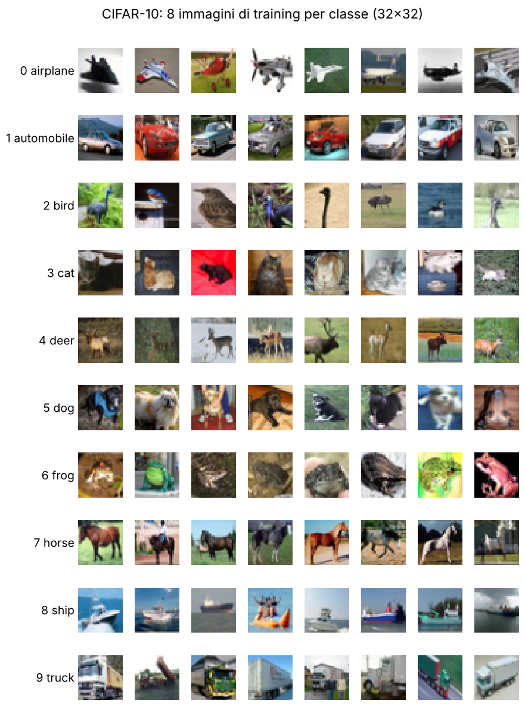

**Il formato dei dati.** I dati grezzi, `train_data.data`, sono un array **50000×32×32×3 di uint8**: immagine, riga, colonna, canale RGB, valori 0–255. È l'ordine **H×W×C** di numpy e matplotlib. PyTorch vuole i canali **prima**: un'immagine è un tensore **C×H×W** di float, un batch è **N×C×H×W** (visionbook § 12.6.1), perché una convoluzione lavora su piani H×W contigui in memoria.

L'oggetto dataset non restituisce i dati grezzi: `train_data[i]` legge l'immagine i, **applica la `transform` in quel momento** e restituisce la coppia (tensore 3×32×32 float, etichetta intera). Per esempio `train_data[0]` ha forma (3, 32, 32) ed etichetta 6, una rana. Che la trasformazione giri a ogni lettura è la chiave dell'augmentation (sezione 4).

> **Il punto**
> 
> CIFAR-10: 50 000 + 10 000 immagini 32×32×3, 10 classi. Su disco H×W×C uint8; nella rete **N×C×H×W float**, prodotto dalla transform a ogni accesso.

### 2\. Normalizzare per canale (e l'errore sulle deviazioni standard)

**Il problema.** I pixel grezzi stanno fra 0 e 255, tutti positivi, con medie diverse per R, G e B. I pesi iniziali di una rete sono pensati per ingressi centrati e di scala 1: con ingressi grandi e tutti positivi **l'ottimizzazione è mal condizionata** (il gradiente è molto più ripido in alcune direzioni che in altre).

**L'idea.** Due passi della pipeline `transforms.Compose` (scheda 4). `ToTensor` converte H×W×C uint8 in **C×H×W float in \[0, 1\]**. `Normalize(μ, σ)` poi **standardizza ogni canale**:

`x′c = (xc − μc) / σc`

c ∈ {R, G, B}; μc e σc sono media e deviazione standard del canale c **su tutto il training set**, cioè su tutte le immagini e tutte le posizioni insieme: un numero per canale. Dopo, ogni canale ha media 0 e deviazione standard 1. **Le stesse μ e σ del training si usano anche sul test**: infatti `eval_transform` ripete la stessa `Normalize`.

**L'errore del notebook.** μ = (0.4914, 0.4822, 0.4465) è giusta. σ = (0.2023, 0.1994, 0.2010) invece **non è la deviazione standard per canale di CIFAR-10**, che misurata sul training vale (0.2470, 0.2435, 0.2616). I numeri del notebook, che circolano in molti repository, sono la **media delle deviazioni standard calcolate immagine per immagine** (misurata: 0.2022, 0.1993, 0.2009).

**La matematica.** È la legge della varianza totale: **varianza totale = media delle varianze dentro le immagini + varianza delle medie delle immagini**. La std per immagine vede solo il primo termine, quindi è più piccola. Con i valori del notebook gli ingressi escono con deviazione standard 0.2470/0.2023 ≈ **1.22** (1.22, 1.22, 1.30 per canale) invece di 1. In pratica il danno è nullo, perché la prima conv è seguita da una BatchNorm che riscala; ma non è una standardizzazione.

    transforms.Normalize((0.4914, 0.4822, 0.4465), (0.2470, 0.2435, 0.2616))   # corretta
    
    d = train_data.data / 255                          # 50000×32×32×3
    d.mean(axis=(0, 1, 2)), d.std(axis=(0, 1, 2))      # immagini e posizioni insieme

**Esempio.** Un rosso a 200/255 = 0.784 diventa (0.784 − 0.4914)/0.2023 = 1.45 con le σ del notebook, 1.19 con quelle corrette. La prima immagine del training, normalizzata, va da −2.43 a 2.56.

> **Il punto**
> 
> Normalize sottrae la media e divide per la std **del canale sul training**, uguale per il test. Le σ del notebook sono la media delle std per immagine: errore innocuo grazie alla BatchNorm, ma da saper riconoscere.

### 3\. Guardare un tensore: il bug di transpose(0,2)

**Il problema.** Prima di addestrare bisogna guardare i dati. Il notebook (cella 7, scheda 5) scrive `plt.imshow(train_data[0][0].transpose(0,2).numpy())`. Il tensore è (C, H, W), matplotlib vuole (H, W, C). Ma `transpose(0,2)` in PyTorch **scambia** gli assi 0 e 2 e dà **(W, H, C)**: la forma è accettata, ma **righe e colonne sono scambiate e l'immagine è specchiata lungo la diagonale**. In più il tensore è normalizzato, in \[−2.43, 2.56\]: matplotlib taglia a \[0, 1\] ("Clipping input data") e i colori saturano.

**La correzione.** Una **permutazione** degli assi e l'inversa della normalizzazione, x = x′·σ + μ, con le σ effettivamente usate nella `Normalize`:

    mean = torch.tensor((0.4914, 0.4822, 0.4465))[:, None, None]
    std  = torch.tensor((0.2023, 0.1994, 0.2010))[:, None, None]
    x, y = train_data[0]
    plt.imshow((x * std + mean).clamp(0, 1).permute(1, 2, 0))

La cella 8 si vede bene perché usa i dati grezzi, già H×W×C. La cella 20 usa `.numpy().transpose(1,2,0)`: in numpy è una permutazione, quindi assi giusti, ma colori ancora falsati.

> **Il punto**
> 
> `transpose(i, j)` scambia due assi, `permute` li riordina tutti: **da C×H×W a H×W×C si usa permute(1, 2, 0)**, e per i colori veri si annulla la normalizzazione.

### 4\. Data augmentation: stessa etichetta, ingresso diverso

**Il problema.** La ResNet-18 ha 11 milioni di parametri, il training 50 000 immagini. Una rete così può **memorizzare le immagini di training una per una** invece di imparare che cosa rende un gatto un gatto: è l'**overfitting** (visionbook cap. 11), con accuratezza di training vicina al 100% e di test molto più bassa.

**L'idea.** Se spostare la rana di tre pixel o specchiarla non cambia il fatto che sia una rana, possiamo generare noi altri esempi. Il visionbook (§ 36.2) lo scrive così: per ogni coppia (xi, yi) si aggiungono coppie sintetiche

`(T(xi; θj), yi)   valida se   y(T(x; θ)) = y(x)`

T è una trasformazione (crop, flip, colore), θj parametri estratti a caso, e l'etichetta resta yi. La condizione a destra è l'ipotesi nascosta: **l'augmentation presuppone che il compito sia invariante alla trasformazione**.

**Nel notebook** (scheda 3) la pipeline di training è `RandomCrop(32, padding=4)`, `RandomHorizontalFlip()`, `ToTensor()`, `Normalize(…)`. Il crop aggiunge 4 pixel di zeri per lato (40×40) e ritaglia una finestra 32×32 in posizione casuale: 9×9 = 81 posizioni, cioè una **traslazione casuale fino a ±4 pixel** con una banda nera dal lato da cui l'immagine è uscita. Il flip specchia con probabilità 0.5: 162 varianti di ogni immagine.

**Pad + crop contro crop + rescale.** Il libro (fig. 36.1) descrive il crop come "ritaglia una parte e riscala": è quello che si fa su ImageNet, dove le immagini sono grandi e ingrandire un pezzo cambia anche la **scala** dell'oggetto. A 32×32 ingrandire butterebbe via pixel e sfocherebbe; per questo su CIFAR si fa padding e crop della stessa dimensione: **solo traslazione, nessuna perdita di risoluzione**.

**Perché funziona.** (1) **La rete non vede mai due volte esattamente la stessa immagine**, quindi non può memorizzarle: è **regolarizzazione**. (2) Insegna un'invarianza: la conv è equivariante alla traslazione, ma con stride, bordi e aliasing la rete intera non è esattamente invariante ([L15](https://gabriele-marsili.github.io/appunti-magistrale-ai/anno-2/computer-vision/sito/#L15)). (3) Il libro mostra (fig. 36.2) che flip, crop e color jitter **allargano la distribuzione di training** fino a coprire meglio quella di test. Le trasformazioni si ri-estraggono a ogni epoca perché la transform gira a ogni accesso.

**Quando non va usata.** Se l'invarianza non vale, l'augmentation insegna una bugia: **lo specchio scambia "b" e "d" nel riconoscimento dei caratteri**. Se l'etichetta è a sua volta un'immagine (segmentazione, [L17](https://gabriele-marsili.github.io/appunti-magistrale-ai/anno-2/computer-vision/sito/#L17)) la stessa T va applicata anche all'etichetta: serve **equivarianza**. E si fa **solo in training**: il test si misura sulle immagini vere. L'effetto misurato è nella sezione 14.

> **Il punto**
> 
> Augmentation = nuovi esempi (T(x), y) con la stessa etichetta, validi solo se il compito è invariante a T. Su CIFAR: pad 4 + crop 32 + flip, estratti di nuovo a ogni accesso. Combatte l'overfitting perché la rete non vede mai due volte la stessa immagine.

### 5\. DataLoader, minibatch ed epoche

**Il problema.** Calcolare il gradiente su tutte le 50 000 immagini per un solo passo è lento e richiede troppa memoria; un'immagine alla volta dà una stima rumorosissima e sfrutta male la GPU.

**L'idea.** Si lavora a **minibatch**: B immagini a caso, gradiente medio su quelle, un passo. Un passaggio completo sul training è un'**epoca**. Il `DataLoader` (scheda 6) pesca gli indici, chiama `train_data[i]` (quindi applica la transform) e impila i risultati in un tensore **B×3×32×32**, più B etichette intere (indici di classe, non one-hot: il formato della cross-entropy).

    dataloader = DataLoader(train_data, batch_size=32, shuffle=True)
    for x, y in dataloader:     # x: [32, 3, 32, 32]   y: [32] interi 0–9
        ...

Con `shuffle=True` ogni epoca usa una nuova permutazione: **ogni immagine compare una volta per epoca**, in ordine diverso (senza reinserimento, Prince § 6.2.1). Per il test lo shuffle non serve. `num_workers` \> 0 prepara i batch in processi paralleli, così la GPU non aspetta la CPU che fa l'augmentation.

**Esempio.** Batch per epoca = ⌈N/B⌉. Con B = 32: ⌈50000/32⌉ = **1563**, di cui 1562 pieni e l'ultimo di 50000 − 1562·32 = **16** immagini. Test: **313** batch, l'ultimo ancora di 16. Sono i numeri delle barre di avanzamento del notebook.

> **Il punto**
> 
> Il DataLoader produce batch N×C×H×W con le etichette; un'epoca = ogni immagine una volta, in ordine casuale. Con B = 32 un'epoca sono 1563 aggiornamenti.

### 6\. Dalla ResNet di ImageNet a quella per CIFAR

**Il problema.** La ResNet-18 originale (He et al., 2016) è progettata per ImageNet, **224×224**. Il suo primo strato (lo **stem**) è una conv 7×7 con stride 2 seguita da un max pooling con stride 2: riduce subito la risoluzione di 4 volte. Su 224 pixel ha senso; su 32 è un disastro: **dopo lo stem restano 8×8 pixel, e l'ultimo stadio lavora su un solo pixel**.

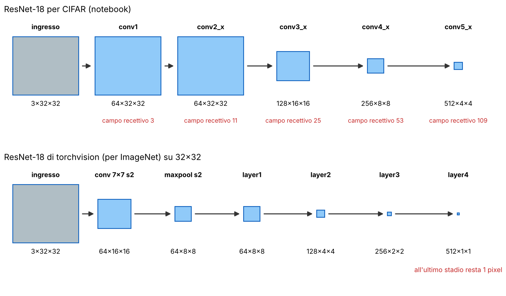

**L'idea.** La versione per CIFAR, copiata dal repository `weiaicunzai/pytorch-cifar100` (scheda 7), cambia **solo l'ingresso**: **stem con una conv 3×3 a stride 1 e niente max pooling**. Canali (64, 128, 256, 512) e blocchi (2, 2, 2, 2) restano quelli standard; le risoluzioni diventano 32 → 32 → 16 → 8 → 4.

**Quanto costa.** **I parametri sono quasi gli stessi**: 11 173 962 con 10 classi contro 11 181 642 della ResNet-18 di torchvision, e la differenza è tutta nella conv d'ingresso (3·3·3·64 = 1 728 pesi invece di 7·7·3·64 = 9 408). Il calcolo invece esplode: lavorando a 32×32 fin dal primo stadio servono circa **555 milioni di moltiplicazioni-somme per immagine**, contro circa 37 milioni della versione ImageNet sulla stessa immagine. È il prezzo della risoluzione, e il motivo per cui su CPU un'epoca dura mezz'ora.

> **Attenzione: non è una versione "slim"**
> 
> La cella 11 parla di "slim ResNet18" e gli esercizi di una rete "slightly different from theirs (slim version, less units)". **È falso**: il codice è identico a `models/resnet.py` del repository e con 100 classi ha 11 220 132 parametri, gli "11.2M" del suo README. Non è nemmeno più piccola della ResNet-18 per ImageNet (scheda 7).

> **Il punto**
> 
> ResNet-18 per CIFAR = ResNet-18 standard con lo stem sostituito da una conv 3×3 senza pooling. **Conserva la risoluzione spaziale** (32-32-16-8-4) a parità di parametri, al prezzo di molto più calcolo.

### 7\. Il BasicBlock e lo shortcut 1×1

**Il problema.** Nella [L15](https://gabriele-marsili.github.io/appunti-magistrale-ai/anno-2/computer-vision/sito/#L15) hai visto che impilare sempre più conv "piane" a un certo punto **peggiora anche l'errore di training**: non è overfitting, è che la rete profonda è difficile da ottimizzare. La ResNet risolve con il blocco residuo.

**L'idea.** Invece di calcolare l'uscita da zero, il blocco calcola una **correzione** da sommare all'ingresso (scheda 8):

`y = ReLU( F(x) + s(x) ),   F = conv3×3 → BN → ReLU → conv3×3 → BN`

F è il **ramo residuo**, s lo **shortcut**; se forma e canali non cambiano, s è l'identità (un `nn.Sequential()` vuoto). Il visionbook (§ 24.11.3) scrive xout = F(xin) + xin e sottolinea il punto chiave: **per un blocco residuo è facile fare l'identità, basta F = 0**, quindi aggiungere blocchi non può peggiorare molto la rete, che "sceglie da sola quanto essere profonda". In più il gradiente ha sempre un cammino diretto attraverso l'identità.

**Quando serve la conv 1×1.** Se il blocco ha stride 2 o cambia i canali, F(x) e x hanno forme diverse e la somma non è definita. Lo shortcut diventa allora una **conv 1×1 con lo stesso stride, più BN**: nel libro xout = F(xin) + W xin. Nel codice: `if stride != 1 or in_channels != expansion * out_channels` (scheda 9). Nella ResNet-18 succede **tre volte**, nel primo blocco di `conv3_x`, `conv4_x`, `conv5_x`.

**Esempio svolto.** Primo blocco di `conv3_x`, ingresso 64×32×32. Ramo: conv 3×3 stride 2, 64 → 128, uscita 128×16×16; conv 3×3, ancora 128×16×16. Shortcut: conv 1×1 stride 2, 64 → 128, uscita 128×16×16. La somma ora è possibile. Pesi dello shortcut: 1·1·64·128 = 8 192, più 256 della BN. Nota da [L6](https://gabriele-marsili.github.io/appunti-magistrale-ai/anno-2/computer-vision/sito/#L6): **una conv 1×1 con stride 2 prende un pixel su quattro senza filtrare prima**.

**Dettagli del codice.** Le conv hanno `bias=False` perché **la BN che segue sottrae la media del canale e il suo β fa già da bias**. L'ordine è quello "post-attivazione" dell'articolo originale, ReLU **dopo** la somma; il Prince (§ 11.5.1) descrive la variante "pre-attivazione" (BN → ReLU → conv), non confonderle. Il "18" del nome: 1 conv dello stem + 8 blocchi × 2 conv + la fc; le 3 conv 1×1 degli shortcut non si contano.

**Il BottleNeck** (scheda 11), definito ma non usato dalla ResNet-18: **1×1** che riduce i canali, **3×3** sui canali ridotti, **1×1** che riespande di 4 volte. A 256 canali due conv 3×3 costano 2·9·256·256 = 1 179 648 pesi, il bottleneck 256·64 + 9·64·64 + 64·256 = 69 632: **circa 17 volte meno**. È il blocco delle ResNet da 50 strati in su; `ResNet(BottleNeck, [3, 4, 6, 3])` è la ResNet-50.

> **Il punto**
> 
> Blocco residuo = ReLU(F(x) + s(x)): F è una correzione, e fare l'identità costa solo F = 0. **Lo shortcut è l'identità, oppure una conv 1×1 con stride quando cambiano risoluzione o canali.**

### 8\. Montare la rete: \_make\_layer, global pooling, forme e campo recettivo

**Il problema.** Diciotto strati scritti a mano sarebbero ripetitivi e pieni di errori sui canali. La classe `ResNet` (scheda 12) li genera con un ciclo.

    self.conv1   = conv3×3(3→64) + BN + ReLU          # stem
    self.conv2_x = self._make_layer(block,  64, 2, stride=1)
    self.conv3_x = self._make_layer(block, 128, 2, stride=2)
    self.conv4_x = self._make_layer(block, 256, 2, stride=2)
    self.conv5_x = self._make_layer(block, 512, 2, stride=2)
    self.avg_pool = nn.AdaptiveAvgPool2d((1, 1))       # global average pooling
    self.fc = nn.Linear(512, num_classes)               # logit
    
    def _make_layer(self, block, out_channels, num_blocks, stride):
        strides = [stride] + [1] * (num_blocks - 1)     # solo il primo blocco ha lo stride
        for s in strides:
            layers.append(block(self.in_channels, out_channels, s))
            self.in_channels = out_channels * block.expansion

**L'idea.** Quattro **stadi** da due blocchi; solo il primo blocco di uno stadio dimezza la risoluzione, e `self.in_channels` tiene traccia dei canali prodotti dal blocco precedente. Lo schema è quello di VGG: **ogni volta che la risoluzione si dimezza, i canali raddoppiano**. La testa è il **global average pooling** (media su tutte le posizioni: 512×4×4 → 512 numeri) e una fc 512 → 10 che produce i **logit**, senza softmax (è dentro la loss, sezione 9). È il classificatore minimo del libro (§ 24.4: conv → relu → gap → fc → softmax), con un corpo molto più profondo.

**La matematica: tre conti da saper fare** (scheda 13).

  - **forma**: con kernel k, padding p, stride s, `Hout = ⌊(H + 2p − k)/s⌋ + 1`. Con k = 3, p = 1 la dimensione resta a s = 1 e si dimezza a s = 2 (⌊31/2⌋ + 1 = 16); la 1×1 con p = 0, s = 2 dà la stessa metà, quindi la somma nello shortcut torna;
  - **parametri** di una conv: k·k·Cin·Cout (senza bias); una BN ne ha 2C. Stem: 3·3·3·64 + 2·64 = 1 856;
  - **campo recettivo**: r ← r + (k − 1)·j, con j il prodotto degli stride già attraversati. Stem: 3. `conv2_x`, quattro 3×3 con j = 1: 3 + 8 = 11. `conv3_x`: la prima conv ha ancora j = 1 (13), poi j = 2 e tre conv aggiungono 4 ciascuna: **25**. Allo stesso modo 53 e 109.

**Dove stanno i parametri e dove il calcolo.** Due distribuzioni opposte.

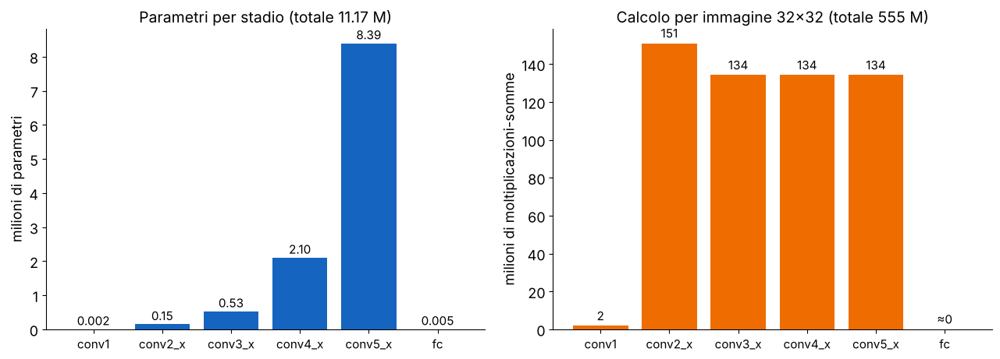

**Esempio.** Una conv 3×3 C→C su una mappa H×W fa 9·C·C·H·W moltiplicazioni. Passando da (C, H) a (2C, H/2): 9·4C²·H²/4, **lo stesso numero**. Il primo stadio costa un po' di più (151 milioni) perché negli stadi successivi la prima conv riceve solo metà dei canali (64 → 128, non 128 → 128).

> **Il punto**
> 
> Stem + 4 stadi da 2 BasicBlock + global average pooling + fc. Forme 64×32×32 → 128×16×16 → 256×8×8 → 512×4×4 → 512 → 10; **campo recettivo 3, 11, 25, 53, 109**; 11.2 milioni di parametri, quasi tutti nell'ultimo stadio.

### 9\. Dai logit alla loss: softmax e cross-entropy

**Il problema.** La fc restituisce 10 numeri qualunque, i **logit** z1, …, z10. Per addestrare serve un unico numero, derivabile, che dica quanto sbaglia la rete.

**L'idea.** Softmax per avere probabilità, poi il logaritmo della probabilità data alla classe giusta ([L15](https://gabriele-marsili.github.io/appunti-magistrale-ai/anno-2/computer-vision/sito/#L15)):

`pk = ezk / Σj ezj,     L = −ln py`

y è l'etichetta vera: se la rete dà probabilità 1 alla classe giusta L = 0, se le dà probabilità piccola L è grande. `CrossEntropyLoss` fa tutto insieme (log-softmax + negative log-likelihood) e **media sul batch**: per questo il modello restituisce logit e non probabilità.

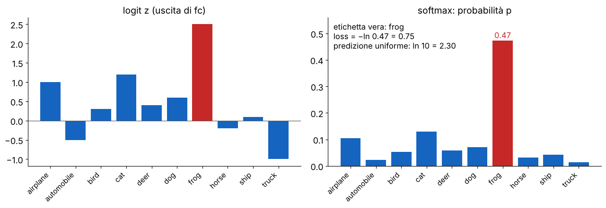

**Esempio: il valore di partenza.** All'inizio i logit sono circa uguali, quindi py ≈ 1/K e **la loss iniziale è circa ln K**: 2.30 con 10 classi. È il primo controllo di sanità: se la prima loss è molto diversa, qualcosa non va.

> **Attenzione: il notebook addestra resnet18(num\_classes=100)**
> 
> La cella 13 crea il modello con 10 classi, ma quello addestrato nella cella 15 ha `num_classes=100` (scheda 14), residuo del repository per CIFAR-100. Non dà errore perché `CrossEntropyLoss` chiede solo etichette minori del numero di classi. Ma **90 uscite non corrispondono a nessuna classe**: nella nostra esecuzione la prima loss è 4.35, vicina a ln 100 = 4.61; dopo 300 batch il logit medio è 6.8 per le classi 0–9 e −0.8 per le 10–99; ci sono 46 170 parametri in più. Correzione: `resnet18(num_classes=10)`.

> **Il punto**
> 
> Rete → logit → softmax → −ln py, mediata sul batch. La loss iniziale ≈ ln K è il primo controllo: il 4.35 del notebook tradisce le 100 classi.

### 10\. Il ciclo di training: zero\_grad, forward, loss, backward, step

**Il problema.** La loss dipende da 11 milioni di parametri θ; vogliamo cambiarli perché scenda. La discesa del gradiente (visionbook § 10.3):

`θ ← θ − η ∇θ L(θ)`

η è il **learning rate** (`lr` in PyTorch, α nel Prince), ∇θL il vettore delle derivate della loss rispetto a ogni parametro. Con lo **SGD** la loss è quella media sul minibatch, quindi **il gradiente è una stima rumorosa ma economica di quello su tutto il training** (§ 10.7). Lo si calcola con la **backpropagation** (cap. 14).

**Nel notebook** (schede 14–15) ogni iterazione sono cinque righe:

    optimizer = torch.optim.SGD(model.parameters(), lr=0.04)   # momentum 0, weight decay 0
    criterion = torch.nn.CrossEntropyLoss()
    model.train()
    for ep in range(10):
        for x, y in DataLoader(train_data, batch_size=32, shuffle=True):
            optimizer.zero_grad()        # 1. azzera i gradienti
            pred = model(x)              # 2. forward: logit 32×10
            loss = criterion(pred, y)    # 3. loss media sul batch
            loss.backward()              # 4. backward: riempie p.grad
            optimizer.step()             # 5. θ ← θ − η·p.grad

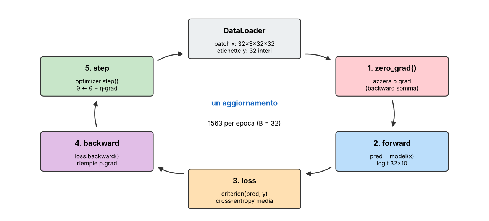

  - **forward**: calcola logit e loss; intanto PyTorch **registra il grafo delle operazioni e conserva le attivazioni**;
  - **backward**: "prima forward, poi backward" (visionbook § 14.4). Partendo dalla loss propaga all'indietro il gradiente rispetto alle attivazioni, strato per strato, e lungo la strada ottiene il gradiente rispetto ai parametri. Ha bisogno delle attivazioni del forward, per questo PyTorch le conserva;
  - **zero\_grad**: `backward()` **somma nei campi `.grad` invece di sovrascriverli**; senza azzerarli il gradiente di ogni batch si accumulerebbe su tutti i precedenti;
  - **step**: applica la formula sopra a ogni parametro.

**Il gradiente della loss media su un batch è la media dei gradienti dei singoli esempi** (§ 14.5); il Prince (eq. 6.10) usa la somma, il che cambia solo la scala di η.

**Le uscite salvate** (scheda 16). Su CPU la prima epoca ha richiesto **36 minuti** (1.40 s per batch); la seconda è stata interrotta a mano dopo 261 batch. Il modello valutato ha fatto circa **1824 aggiornamenti, poco più di un'epoca**. Il numero nella barra ("Loss: 1.1877") è la loss **di un solo batch, non la media**: molto rumorosa, come mostra la figura.

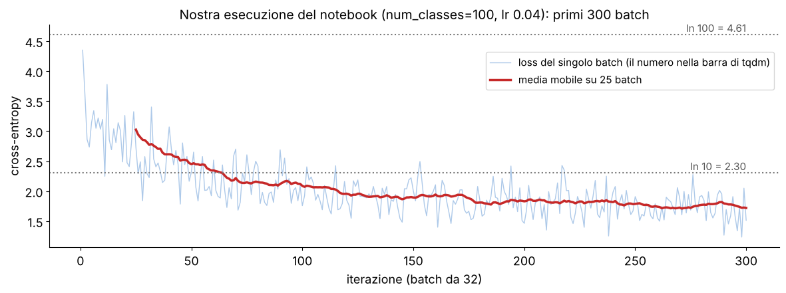

> **Il punto**
> 
> Ogni batch: **zero\_grad, forward, loss, backward, step**. backward somma nei gradienti, quindi zero\_grad è obbligatorio. Per seguire il training si salva la loss di ogni batch e se ne guarda una media mobile.

### 11\. Il learning rate: troppo piccolo, giusto, troppo grande

**Il problema.** η = 0.04 è scelto a mano. Che cosa succede se si sbaglia? L'esercizio "training stability and lr" chiede di moltiplicarlo per 10 e per 100.

**L'idea, su una parabola.** Con J(θ) = θ²/2 la derivata è θ e un passo dà θ ← θ − ηθ = (1 − η)θ: a ogni passo θ è moltiplicato per (1 − η). **Se 0 \< η \< 2 il fattore ha modulo minore di 1 e si converge**; con 1 \< η \< 2 il segno si alterna e si **oscilla**; **con η \> 2 il modulo cresce e si diverge**. Per J = aθ²/2 la soglia diventa η \< 2/a: più la loss è curva, più il passo deve essere piccolo.

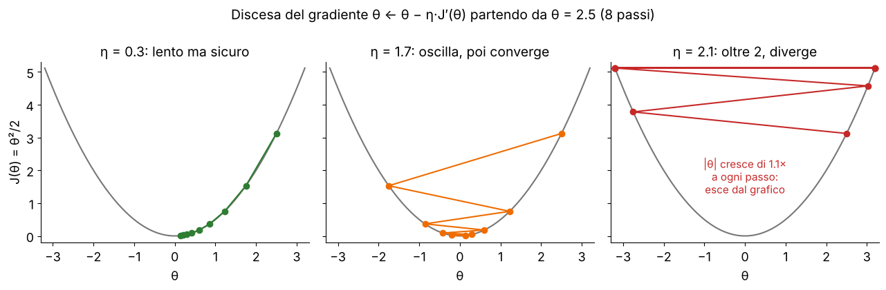

**Perché in una rete è difficile.** La loss di una rete ha direzioni con curvature molto diverse, e **un solo learning rate deve andare bene per tutte** (Prince § 6.4): abbastanza grande per avanzare nelle direzioni piatte vuol dire troppo grande per quelle ripide. Le soluzioni standard: **momentum** (§ 10.5, la direzione ricorda le precedenti e smorza i rimbalzi), **schedule** (§ 10.4, partire alti e scendere), ottimizzatori adattivi come Adam. Il notebook non usa nessuno dei tre. I risultati veri con 10× e 100× sono nella sezione 14: la loss esplode all'inizio ma, a differenza della parabola, la rete non diverge, molto probabilmente per merito della BatchNorm.

> **Il punto**
> 
> Su una parabola θ ← (1 − η)θ: converge per η \< 2/a, oscilla vicino al limite, diverge oltre. In una rete le curvature sono tante e diverse: da qui momentum e schedule.

### 12\. BatchNorm in training e in valutazione

**Il problema.** Il notebook insiste: "don't forget to set the training mode\!". Perché una rete dovrebbe comportarsi diversamente in training e in test? Per colpa della BatchNorm, che sta dopo ogni conv.

**L'idea.** La **BatchNorm2d** standardizza ogni canale con media e varianza calcolate **sul batch** e su tutte le posizioni (N·H·W valori), poi riscala con due parametri appresi (visionbook § 12.7.3, Prince § 11.4):

`y = γc · (x − μc) / √(σc2 + ε) + βc`

μc, σc2: media e varianza del canale c sul batch; γc, βc: scala e spostamento appresi; ε = 10−5. Siccome μ e σ vengono dal batch, **l'uscita per un'immagine dipende dalle altre immagini del batch**. Per questo la BN mantiene anche **medie mobili** delle statistiche (running = 0.9·running + 0.1·batch: il `momentum=0.1` della stampa è questo, non il momentum dell'ottimizzatore):

  - `model.train()`: statistiche del batch, medie mobili aggiornate;
  - `model.eval()`: **medie mobili fisse, la predizione non dipende più dal batch**.

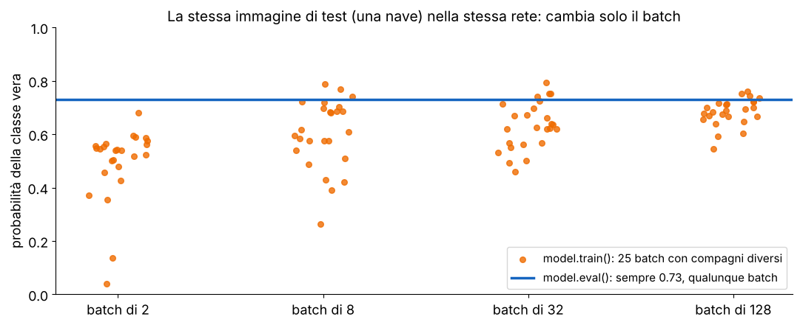

**Perché la BN aiuta** (Prince § 11.4.1): tiene stabile la scala delle attivazioni lungo la rete, permette **learning rate più alti** e **regolarizza un po'** (il rumore delle statistiche di batch). Inoltre una conv seguita da BN dà la stessa uscita se i suoi pesi vengono moltiplicati per una costante: un passo enorme cambia la scala dei pesi più della funzione.

**E `torch.no_grad()`?** Non riguarda la BN ma il grafo: dentro `with torch.no_grad():` PyTorch non registra le operazioni né conserva le attivazioni, quindi meno memoria e più velocità. In valutazione servono **entrambi: eval() per la BN, no\_grad() per il grafo**.

> **Il punto**
> 
> La BN usa le statistiche del batch in training e le medie mobili in eval. Dimenticare `model.eval()` rende la predizione dipendente dal batch e sporca le medie mobili con i dati di test.

### 13\. Valutazione: che cosa vuol dire 63%

**Il problema.** La loss di training dice se l'ottimizzazione procede, non se la rete funziona su immagini nuove.

    model.eval()
    correct, tot = 0, 0
    with torch.no_grad():
        for x, y in DataLoader(test_data, batch_size=32):
            pred = model(x).argmax(1)        # il notebook: _, pred = torch.max(pred.data, 1)
            correct += (pred == y).sum().item()
            tot += x.shape[0]                # conta le immagini, non i batch
    print(correct / tot)

L'**accuratezza** è la frazione di immagini in cui il logit più alto è quello della classe giusta. `tot` conta le immagini, quindi l'ultimo batch da 16 pesa il giusto. `torch.max(pred.data, 1)` funziona, ma `.data` è un'interfaccia vecchia: oggi si scrive `argmax(1)`.

**Il risultato.** Il docente ottiene **ACC 0.6323** sulle 10 000 immagini di test. Il caso darebbe 0.10: **la rete ha imparato molto** vedendo ogni immagine poco più di una volta. La nostra esecuzione, 300 batch, arriva a 0.41. Con una ricetta completa le ResNet su CIFAR-10 superano il 90% (He et al. riportano errori di test fra circa il 6,4% e l'8,8%, dalla ResNet-110 alla ResNet-20): **lo 0.63 riflette un training troppo corto**, senza momentum né schedule, non un limite della rete.

**Una mancanza di metodo.** **Il notebook non ha un insieme di validazione**. Se si usa il test per scegliere learning rate ed epoche, la sua accuratezza smette di essere una stima onesta: si tiene da parte una porzione del training per le scelte, e si guarda il test una volta sola alla fine.

> **Il punto**
> 
> Valutazione = eval + no\_grad + argmax, contando le immagini. 63% dopo poco più di un'epoca vuol dire "la rete impara", non "la rete è buona": oltre il 90% serve la ricetta giusta e decine di epoche.

### 14\. Gli esercizi, con i risultati misurati

#### Augmentation sì o no

Un training completo su CPU richiede ore, quindi abbiamo usato un sottoinsieme: 5000 immagini di training, 10 epoche (1570 batch da 32), lr 0.04, 10 classi; accuratezza in eval sulle stesse 5000 immagini e sulle prime 2000 del test.

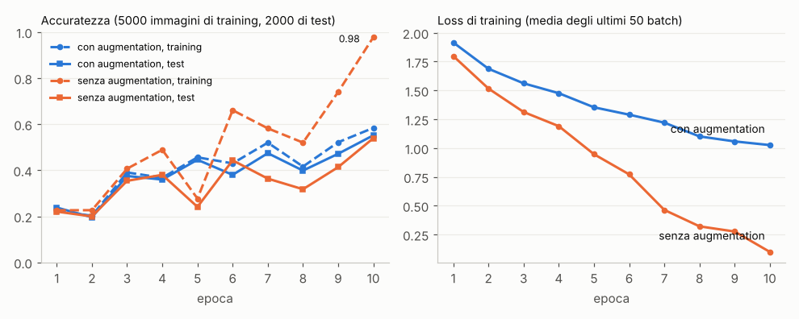

**Lettura.** Senza augmentation la rete **memorizza**: 98% sulle immagini viste, 54% sulle nuove, 44 punti di divario. Con augmentation **training e test restano vicini**. Dopo 10 epoche il test è quasi uguale (0.55 contro 0.54); il vantaggio dovrebbe crescere proseguendo, perché senza augmentation la loss di training è già quasi zero e la rete non ha più niente da imparare (atteso, non misurato oltre le 10 epoche). Le curve sono irregolari (la caduta all'epoca 5): con lr fisso e senza momentum le medie mobili della BN, usate in eval, inseguono pesi che cambiano molto.

#### Learning rate 10× e 100×

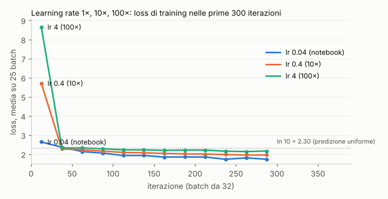

**Lettura.** **Con 10× e 100× la loss esplode subito**: passi troppo lunghi portano i logit a valori enormi, come nella parabola con η \> 2. Poi però nessun NaN: **la rete torna vicino alla predizione uniforme** e impara più lentamente e peggio (accuratezza su 2000 immagini di test 0.32, 0.28, 0.17). La spiegazione probabile è la BN della sezione 12; senza BN ci si aspetterebbe la divergenza. Seme singolo e pochi batch: risultati indicativi.

#### Uno scheduler: MultiStepLR

**L'idea.** All'inizio serve un passo grande per avanzare, alla fine un passo piccolo per non rimbalzare nel fondo della valle. Uno **schedule cambia η durante il training**. Il più semplice è a gradini (visionbook § 10.4): **`MultiStepLR` moltiplica η per γ a ogni epoca della lista `milestones`**.

`η(epoca) = η0 · γ(numero di milestone già superate)`

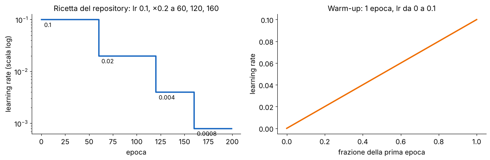

**Esempio.** Epoche 0–59 η = 0.1, 60–119 η = 0.02, 120–159 η = 0.004, 160–199 η = 0.0008. Effetto atteso (non misurato, servono decine di epoche): a ogni milestone **un gradino verso il basso della loss e verso l'alto dell'accuratezza**. Il warm-up evita i passi enormi dei primi batch, quando i pesi casuali danno gradienti grandi (il picco visto con lr 4).

    optimizer = torch.optim.SGD(model.parameters(), lr=0.1, momentum=0.9, weight_decay=5e-4)
    scheduler = torch.optim.lr_scheduler.MultiStepLR(optimizer, milestones=[60, 120, 160], gamma=0.2)
    for ep in range(200):
        for x, y in dataloader:
            ...                      # zero_grad, forward, loss, backward, step
        scheduler.step()             # una volta per epoca, dopo gli optimizer.step()

#### Riprodurre lo stato dell'arte su CIFAR-100

La rete è già quella giusta. Cambia la **ricetta** (scheda 24): CIFAR-100 con le sue medie e std e `num_classes=100` (qui finalmente giusto), in più `RandomRotation(15)`, batch 128, SGD con lr 0.1, **momentum 0.9** e **weight decay 5·10−4** (regolarizzazione esplicita, visionbook eq. 11.1), lo schedule della figura, 200 epoche su GPU. Errore top-1 dichiarato per la resnet18: 24.39%. **I punti di accuratezza mancanti non si recuperano cambiando la rete, ma la ricetta di training.**

> **Il punto**
> 
> Senza augmentation: 98% in training, 54% in test (memorizza). lr 10× e 100×: picco iniziale della loss, poi training più lento, niente divergenza. MultiStepLR: η diviso per un fattore fisso a epoche prestabilite.

### 15\. Dentro la rete: forward hook e PCA delle feature map

**Il problema.** Che cosa "vede" la rete a metà strada? Le attivazioni intermedie non escono dal `forward`, e la mappa di `conv4_x` ha 256 canali: non è un'immagine guardabile.

**Leggere un'attivazione.** Un **forward hook** è una funzione che PyTorch chiama **dopo** il forward del modulo a cui è agganciata, con (modulo, ingresso, uscita): **permette di salvare un'attivazione senza toccare il modello** (schede 20, 23).

    activations = []
    def hook(module, inp, out):
        activations.append(out.detach())
    
    h = model.conv4_x.register_forward_hook(hook)
    with torch.no_grad():                 # il notebook lo omette: costruisce il grafo per niente
        model(x)                          # x: le 16 immagini dell'ultimo batch del test
    h.remove()                            # altrimenti scatta a ogni forward successivo
    activations[0].shape                  # torch.Size([16, 256, 8, 8])

Le 16 immagini sono le ultime del test (10 000 = 312·32 + 16, scheda 18). L'uscita di `conv4_x` è dopo la ReLU: valori ≥ 0, circa il 38% esattamente zero nella nostra esecuzione.

**Da 256 canali a un colore: la PCA** (visionbook § 24.6, fig. 24.25, che la applica proprio a una ResNet18). Ogni **posizione** (i, j) della feature map è un vettore di C numeri, il suo descrittore. Le H·W posizioni sono i campioni: la PCA trova le 3 direzioni dello spazio a C dimensioni in cui i descrittori variano di più, e i 3 numeri di ogni posizione, riscalati in \[0, 1\], diventano **R, G, B: prima componente rosso, seconda verde, terza blu** (scheda 19).

**Come leggerla.** **Posizioni di colore simile hanno descrittori simili**: la rete le "vede" allo stesso modo. Il colore in sé non significa niente, e **la PCA è calcolata su ogni immagine separatamente**: i colori non si confrontano fra immagini diverse. E 3 componenti tengono solo una parte della varianza (in media 69% a `conv1`, 54–61% negli stadi successivi).

**conv1 contro conv4\_x.** A `conv1` il campo recettivo è 3×3: ogni posizione descrive colore locale e presenza e direzione di un bordo. **La PCA separa soprattutto colore e bordi** e l'immagine resta quasi una foto: i 64 canali sono rilevatori di bordi e colori come le derivate orientate della [L5](https://gabriele-marsili.github.io/appunti-magistrale-ai/anno-2/computer-vision/sito/#L5), ma appresi. A `conv4_x` la risoluzione è 8×8, i canali 256, il campo recettivo 53: **ogni posizione vede quasi tutta l'immagine**, e le mappe raggruppano le posizioni per "che parte della scena è" (oggetto contro sfondo, cielo contro mare) più che per colore. È la gerarchia di feature della [L15](https://gabriele-marsili.github.io/appunti-magistrale-ai/anno-2/computer-vision/sito/#L15), vista dal vivo. Con una rete addestrata poco più di un'epoca è un indizio qualitativo, non la prova che la rete "segmenti" l'oggetto.

**La griglia dei canali** (celle 25 e 27, scheda 22) mostra i primi 64 canali uno per uno. Attento: `imshow` **riscala i colori per ogni riquadro**, quindi un canale quasi spento e uno molto attivo sembrano ugualmente accesi; per confrontarli servono `vmin` e `vmax` comuni.

> **Il punto**
> 
> Un forward hook legge un'attivazione intermedia; la PCA a 3 componenti trasforma C canali in un'immagine RGB in cui colori simili = descrittori simili. **Da conv1 a conv4\_x si passa da bordi e colori a regioni della scena**, perché il campo recettivo cresce da 3 a 53.

### 16\. I bug del notebook e come correggerli

Tutti verificati eseguendo il notebook (riquadri Attenzione delle schede 4, 5, 7 e 14):

1.  **immagine trasposta** (cella 7): `transpose(0,2)` scambia righe e colonne, e il tensore normalizzato satura i colori;
2.  **100 classi su CIFAR-10** (cella 15): loss iniziale ln 100, 90 uscite inutili, 46 170 parametri in più;
3.  **σ sbagliate nella Normalize** (cella 5): media delle std per immagine, ingressi con std ≈ 1.22;
4.  **"slim ResNet18"** (celle 11 e 28): la rete è identica a quella del repository.

Non sono bug ma conviene saperli: la loss nella barra è di un solo batch; manca un insieme di validazione; l'ottimizzatore non ha momentum, weight decay né schedule; gli hook girano fuori da `no_grad`. Le righe principali corrette:

    normalize = transforms.Normalize((0.4914, 0.4822, 0.4465), (0.2470, 0.2435, 0.2616))
    plt.imshow((x * std + mean).clamp(0, 1).permute(1, 2, 0))      # visualizzazione
    model = resnet18(num_classes=10).to(device)
    optimizer = torch.optim.SGD(model.parameters(), lr=0.1, momentum=0.9, weight_decay=5e-4)
    losses = []
    for ep in range(n_epochs):
        model.train()
        for x, y in DataLoader(train_data, batch_size=128, shuffle=True, num_workers=4):
            x, y = x.to(device), y.to(device)
            optimizer.zero_grad()
            loss = criterion(model(x), y)
            loss.backward()
            optimizer.step()
            losses.append(loss.item())       # per la curva con media mobile
        scheduler.step()                     # MultiStepLR come nella sezione 14
    model.eval()
    with torch.no_grad():
        ...                                  # valutazione come nella sezione 13

> **Il punto**
> 
> Quattro errori: trasposta, 100 classi, σ, "slim". Nessuno blocca il notebook, ed è questo che li rende pericolosi: **un errore che non dà errore si scopre solo controllando forme, loss iniziale e immagini**.

### Il riassunto in 10 righe

1.  CIFAR-10: 50 000 + 10 000 immagini 32×32, 10 classi; su disco H×W×C uint8, in PyTorch N×C×H×W float.
2.  La transform gira a ogni accesso: ToTensor, poi Normalize per canale con media e std del training (le σ del notebook sono la media delle std per immagine: errore innocuo).
3.  Augmentation (pad 4 + crop 32, flip): nuovi esempi con la stessa etichetta, valida solo se il compito è invariante; combatte l'overfitting.
4.  DataLoader: batch casuali; un'epoca = ogni immagine una volta, 1563 batch con B = 32.
5.  ResNet-18 per CIFAR: stem 3×3 senza pooling, 4 stadi da 2 BasicBlock (32-16-8-4 pixel, 64-128-256-512 canali), global average pooling, fc; 11.2 M parametri, 555 M moltiplicazioni-somme.
6.  BasicBlock: ReLU(F(x) + s(x)), s identità o conv 1×1 con stride quando cambiano forma o canali.
7.  Softmax + cross-entropy sui logit; loss iniziale ≈ ln K (il 4.35 del notebook rivela 100 classi).
8.  Ciclo: zero\_grad, forward, loss, backward, step con θ ← θ − η∇L; η troppo grande fa esplodere la loss, gli schedule come MultiStepLR lo riducono nel tempo.
9.  BatchNorm: statistiche del batch in train, medie mobili in eval; in valutazione eval() + no\_grad(). 63% dopo poco più di un'epoca, oltre 90% con una ricetta completa.
10. Forward hook + PCA a 3 componenti: da bordi e colori (conv1) a regioni della scena (conv4\_x), con il campo recettivo da 3 a 53.

### Verifica di aver capito

**Il training set ha std per canale 0.247 ma il notebook usa 0.202. Da dove viene 0.202 e che effetto ha?**

È la media delle std calcolate immagine per immagine: ignora la variabilità fra le medie delle immagini (varianza totale = media delle varianze interne + varianza delle medie), quindi è più piccola. Gli ingressi escono con std ≈ 1.22 invece di 1; effetto trascurabile perché la BN dopo la prima conv riscala.

**Perché RandomHorizontalFlip va bene su CIFAR e non per riconoscere lettere? E perché su CIFAR si fa pad + crop invece di crop + rescale?**

L'augmentation presuppone y(T(x)) = y(x): un gatto specchiato è un gatto, una "b" specchiata è una "d". A 32×32 ritagliare e ingrandire perderebbe risoluzione; pad 4 + crop 32 fa solo una traslazione fino a ±4 pixel.

**Primo blocco di conv4\_x, ingresso 128×16×16. Dai le forme del ramo e dello shortcut e i pesi dello shortcut.**

Ramo: conv 3×3 stride 2, 128 → 256, uscita 256×8×8 (⌊(16 + 2 − 3)/2⌋ + 1 = 8), poi conv 3×3, 256×8×8. Shortcut: conv 1×1 stride 2, 128 → 256, uscita 256×8×8. Pesi: 128·256 = 32 768, più 512 della BN.

**La prima loss stampata è 4.35. Che cosa ti fa sospettare? E se togli optimizer.zero\_grad()?**

Con logit quasi uguali la loss iniziale è ln K: 4.35 è vicino a ln 100 = 4.61, non a ln 10 = 2.30, quindi la rete ha 100 uscite (il notebook crea `resnet18(num_classes=100)`). Senza zero\_grad, `backward()` somma nei `.grad`: il passo usa la somma dei gradienti di tutti i batch precedenti e il training diventa instabile.

**Con lr 4 la loss dei primi batch è 8.65 ma dopo 300 batch è 2.16, senza NaN. Perché non diverge come la parabola con η \> 2?**

Probabilmente per la BatchNorm: dopo quasi ogni conv l'uscita non dipende dalla scala dei pesi, quindi un passo enorme cambia soprattutto la scala; la rete torna vicino alla predizione uniforme (ln 10 = 2.30) e impara lentamente. Senza BN ci si aspetterebbe la divergenza.

**Valuti con model.train() invece di model.eval(). Che cosa cambia? E che cosa vuol dire un colore nella mappa PCA di conv4\_x?**

La BN usa media e varianza del batch di test: la predizione dipende dalle altre immagini del batch (nel nostro esperimento la probabilità giusta di una nave va da 0.04 a 0.68 con batch di 2, è sempre 0.73 in eval) e le medie mobili si sporcano con il test. Nella PCA il colore in sé non vuol dire nulla: dentro la stessa immagine colori simili indicano descrittori simili, fra immagini diverse i colori non si confrontano.

### Come proseguire

  - Visionbook, cap. 24 [Convolutional Neural Nets](https://visionbook.mit.edu/convolutional_neural_nets.html): § 24.4 (classificatore minimo), § 24.6 (feature map e PCA, fig. 24.25 con ResNet18), § 24.7 (campo recettivo), § 24.11.3 (ResNet).
  - Cap. 10 [Gradient-Based Learning Algorithms](https://visionbook.mit.edu/gradient_descent.html) (§ 10.3–10.5, 10.7) e cap. 14 [Backpropagation](https://visionbook.mit.edu/backpropagation.html) (§ 14.4–14.5).
  - Cap. 12 [Neural Networks](https://visionbook.mit.edu/neural_nets.html) § 12.7.3 (BatchNorm), cap. 36 [Data Augmentation](https://visionbook.mit.edu/data_augmentation.html) § 36.2, cap. 11 [The Problem of Generalization](https://visionbook.mit.edu/problem_of_generalization.html) per il divario fra training e test.
  - Prince, *Understanding Deep Learning*: § 6.2–6.4 (SGD, momentum, Adam), § 9.3.8 (augmentation), § 11.2–11.5 (blocchi residui, BatchNorm, ResNet e bottleneck, in ordine pre-attivazione).
  - Il repository `weiaicunzai/pytorch-cifar100` (`train.py`) per la ricetta completa.

Ora ripassa con le schede qui sotto, cella per cella del notebook. I riquadri Attenzione segnalano la σ della Normalize (scheda 4), la trasposta (scheda 5), la falsa "slim ResNet" (scheda 7) e `num_classes=100` (scheda 14); dopo le schede trovi la guida allo studio, i risultati della nostra esecuzione e le soluzioni degli esercizi.
