# L17 · Dense prediction e ViT

*Lezione 17 · Donald Shenaj · 22 ottobre 2026*

[Versione interattiva sul sito, con videolezione](https://gabriele-marsili.github.io/appunti-magistrale-ai/anno-2/computer-vision/sito/#L17) · [Indice della dispensa](README.md)

**In una frase:** molti compiti di visione non chiedono «che cosa c'è nell'immagine» ma **una risposta per ogni pixel** (classe, profondità, moto, articolazioni); una CNN da classificazione butta via proprio la risoluzione che serve, e la si recupera con un **encoder-decoder** che risale con operatori di upsampling e con le **skip connection** della **U-Net**; nella seconda metà arriva il **Vision Transformer**, che taglia l'immagine in patch, le tratta come una sequenza di token e le fa interagire tutte con tutte tramite la **self-attention**, e che a sua volta si può usare come encoder per la predizione densa.

### Prima di iniziare

Questa lezione (tenuta da Donald Shenaj) continua la [L15](https://gabriele-marsili.github.io/appunti-magistrale-ai/anno-2/computer-vision/sito/#L15) sulle CNN. Ti servono:

  - dalla [L15](https://gabriele-marsili.github.io/appunti-magistrale-ai/anno-2/computer-vision/sito/#L15): convoluzione con canali, **stride** e padding, campo recettivo, pooling, conv 1×1, BatchNorm e LayerNorm, blocchi residui di ResNet;
  - dalla [L6](https://gabriele-marsili.github.io/appunti-magistrale-ai/anno-2/computer-vision/sito/#L6): sottocampionamento, **espansione con zeri** e interpolazione, piramidi di analisi e sintesi: tornano identiche negli operatori di upsampling;
  - dalla [L13](https://gabriele-marsili.github.io/appunti-magistrale-ai/anno-2/computer-vision/sito/#L13): il **cost volume** dello stereo e l'ambiguità di scala della profondità da una sola foto;
  - dalla [L14](https://gabriele-marsili.github.io/appunti-magistrale-ai/anno-2/computer-vision/sito/#L14): la segmentazione LiDAR e il mIoU; dalla [L3](https://gabriele-marsili.github.io/appunti-magistrale-ai/anno-2/computer-vision/sito/#L3): la convoluzione scritta come matrice;
  - un po' di algebra lineare: prodotto scalare, matrici N × D, softmax.

Le slide sono 43 pagine (la 43 è solo un indice a miniature). Il libro di riferimento è il visionbook: cap. 24 (§ 24.8–24.11), cap. 26 per intero (transformer), più pezzi dei cap. 21, 43, 48–50; poi Prince, *Understanding Deep Learning*, cap. 10–12.

### Guarda prima questi video

  - [Lecture 16: Detection and Segmentation](https://www.youtube.com/watch?v=9AyMR4IhSWQ) (Video). Justin Johnson, University of Michigan (EECS 498-007), canale Michigan Online. Salta la prima parte sulla detection e guarda la segmentazione semantica: rete fully convolutional, downsampling e upsampling, max unpooling, convoluzione trasposta, poi istanza, panottica e keypoint. Corrisponde alle sezioni 1–6.
  - [Attention in transformers, step-by-step | Deep Learning Chapter 6](https://www.youtube.com/watch?v=eMlx5fFNoYc) (Video). 3Blue1Brown. Query, key, value, la softmax per riga e le teste multiple, con animazioni chiarissime. È spiegato sulle parole: sostituisci «parola» con «patch». Prima delle sezioni 9–11.
  - [Lecture 13: Attention](https://www.youtube.com/watch?v=YAgjfMR9R_M) (Video). Justin Johnson (EECS 498-007), Michigan Online. Parte dall'attenzione nelle reti ricorrenti (con esempi sulle didascalie di immagini) e arriva alla self-attention e al transformer. Ripasso più formale per le sezioni 10–12; la prima metà si può scorrere veloce.

### 1\. Oltre la classificazione: una risposta per ogni pixel

**Il problema.** Un'auto a guida autonoma non si accontenta di sapere che nella foto «c'è una strada»: deve sapere *quali pixel* sono strada, quali pedoni, quanto è lontano ogni punto e dove si sta muovendo. La classificazione dà **un'etichetta per tutta l'immagine**; questi compiti chiedono **una predizione per pixel**: si chiamano compiti di **predizione densa** (slide 3).

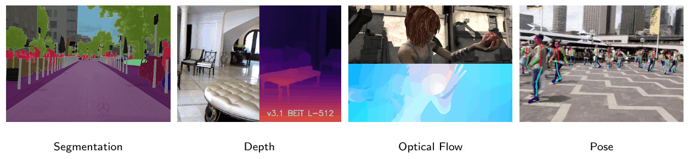

**I compiti** (slide 3–7):

  - **segmentazione semantica**: una classe per ogni pixel (strada, auto, cielo). **Non sa contare: due auto a contatto diventano un'unica macchia «auto»** (visionbook § 50.5.1);
  - **segmentazione d'istanza**: classe e identità dell'oggetto per ogni pixel che appartiene a un oggetto (auto n. 1, auto n. 2);
  - **segmentazione panottica**: le due insieme. Le regioni amorfe e non numerabili (cielo, strada, erba: lo «**stuff**») ricevono solo la classe; gli oggetti numerabili (persone, auto: le «**things**») anche l'identità;
  - **profondità monoculare**: un numero continuo per pixel, da *una* sola foto;
  - **flusso ottico**: un vettore (u, v) per pixel che dice dove si è spostato quel pixel nel frame successivo; si visualizza con la ruota dei colori (tinta = direzione, saturazione = ampiezza, bianco = fermo);
  - **keypoint e pose**: invece di regredire direttamente le coordinate dei polsi o delle ginocchia, si predicono K **heatmap**, una per articolazione, con un picco dove sta l'articolazione; la posizione è l'argmax. Così anche la pose diventa un problema denso.

**Esempio.** Una foto con tre persone su un prato. Semantica: due etichette, «persona» ed «erba». Istanza: tre maschere distinte per le persone, l'erba ignorata. Panottica: tre maschere di persona più la regione «erba».

**Stessa forma, contenuto diverso** (slide 8). Tutti questi compiti producono un array circa alla risoluzione dell'ingresso; cambia solo cosa c'è in ogni pixel:

| Compito                 | Uscita per pixel   | Canali | Ultima attivazione                                 |
| ----------------------- | ------------------ | ------ | -------------------------------------------------- |
| segmentazione semantica | punteggi di classe | C      | softmax per pixel                                  |
| profondità              | un valore positivo | 1      | positiva (o si predice log-profondità o disparità) |
| flusso ottico           | vettore (u, v)     | 2      | lineare, con segno                                 |
| pose                    | K heatmap          | K      | mappe con picchi                                   |

La conseguenza è pratica: **si può usare quasi sempre la stessa architettura** e cambiare solo la «testa» finale (una conv 1×1 al numero giusto di canali) e la loss.

> **Il punto**
> 
> Predizione densa = **un'uscita grande come l'immagine, con un contenuto diverso per compito**. Una sola struttura di rete, teste e loss diverse.

### 2\. Aritmetica delle forme: quanto è grande l'uscita, quanto vede un pixel

**Il problema.** Per costruire una rete che restituisce un'immagine bisogna saper seguire le dimensioni strato per strato, e sapere quanta parte dell'ingresso «vede» ogni pixel d'uscita. Due formule (slide 10).

**Dimensione dell'uscita** di una convoluzione con kernel k, stride s, padding p e dilatazione d:

`Hout = ⌊ (Hin + 2p − d(k − 1) − 1) / s ⌋ + 1`

Hin è il lato dell'ingresso, 2p i pixel aggiunti ai bordi, d(k − 1) + 1 l'ampiezza effettiva del kernel; la divisione per s conta quante volte il kernel «salta». Con d = 1 ritrovi la formula di L15, ⌊(Hin + 2p − k)/s⌋ + 1.

**Campo recettivo** dopo L strati con kernel kl e stride sl:

`rL = 1 + ∑l=1L (kl − 1) ∏i<l si`

A parole: ogni strato allarga il campo di kl − 1 celle *del proprio ingresso*, e una cella del proprio ingresso vale ∏i\<l si pixel dell'immagine (il prodotto degli stride precedenti). Per questo **dopo uno stride il campo recettivo cresce molto più in fretta**.

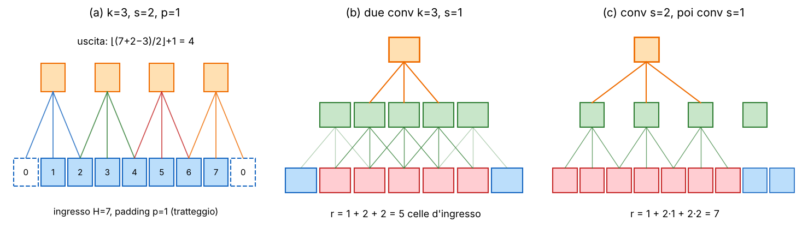

**Esempi svolti.**

  - Hin = 7, p = 1, k = 3, s = 2: ⌊(7 + 2 − 2 − 1)/2⌋ + 1 = 3 + 1 = 4 (figura a).
  - Conv 3×3 senza padding («valid», p = 0, s = 1) toglie 2 pixel: 572 → 570. Max pool 2×2 con stride 2 dimezza: 568 → 284. Sono i numeri della U-Net (sezione 5).
  - Due conv 3×3, s = 1: r = 1 + 2 + 2 = 5. Conv 3×3 con s = 2 seguita da conv 3×3: r = 1 + 2·1 + 2·2 = 7 (figura b e c).

**Dilatazione.** Una conv dilatata (o «atrous», usata da DeepLab) inserisce d − 1 buchi fra i pesi del kernel: il kernel effettivo è **keff = d(k − 1) + 1** e nella formula del campo recettivo si usa keff. Il vantaggio: **più contesto senza parametri in più e senza sottocampionare**. Tre conv 3×3 con d = 1, 2, 4 hanno keff = 3, 5, 9 e campo r = 1 + 2 + 4 + 8 = 15 (il 15 × 15 già segnalato come refuso del libro in L15).

Il visionbook (§ 24.7) non dà la formula chiusa, ma le sue regole sono le stesse: comporre filtri allarga il supporto, le non linearità puntuali non cambiano il campo, il sottocampionamento lo fa crescere più in fretta. Attenzione però al campo recettivo *effettivo*: **i pixel ai bordi del campo teorico pesano poco**.

> **Il punto**
> 
> Il compromesso della predizione densa è tutto qui: **ogni pixel ha bisogno di tanto contesto (campo recettivo grande) senza perdere il dettaglio spaziale**. Sottocampionare dà contesto ma costa risoluzione; la dilatazione dà contesto senza costarla.

### 3\. Perché una CNN da classificazione non basta: l'imbuto

**Il problema.** Prendi una ResNet-50 addestrata su ImageNet ([L15](https://gabriele-marsili.github.io/appunti-magistrale-ai/anno-2/computer-vision/sito/#L15)) e prova a usarla per segmentare. Che cosa esce dall'ultimo strato convoluzionale?

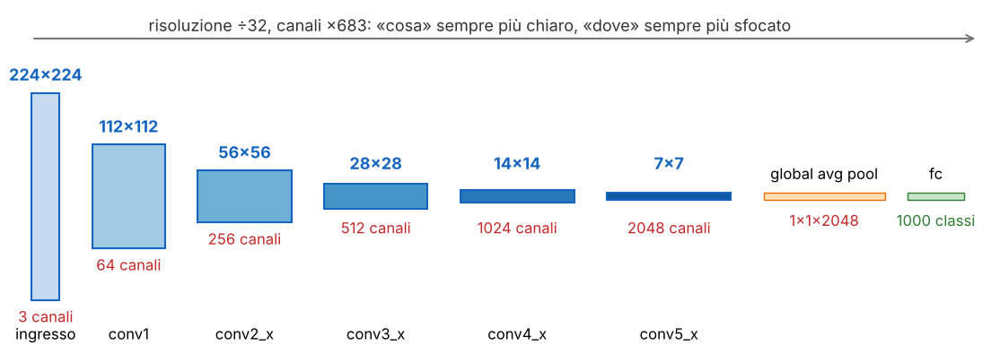

**L'idea.** Una CNN da classificazione è un **imbuto: convoluzioni con stride e pooling riducono la risoluzione e aumentano i canali**, 224 × 224 × 3 → … → 7 × 7 × 2048 → un vettore. È un ottimo affare per rispondere a «**cosa** c'è»: meno pixel, più canali semantici, campo recettivo enorme. Ma risponde male a «**cosa c'è dove**»: **all'ultimo strato il dettaglio fine (bordi, contorni, oggetti sottili) è perso**. Ogni cella della griglia 7 × 7 copre 32 × 32 pixel d'ingresso: **un palo largo 5 pixel non ha nessuna cella «sua»**.

E non è solo nascosto: lo stride è un sottocampionamento **senza filtro anti-aliasing** (L15, visionbook fig. 24.8), quindi parte dell'informazione ad alta frequenza è proprio distrutta.

**Le vie d'uscita**, in ordine di comparsa:

1.  sottocampionare meno e togliere il global pooling (visionbook § 24.8): l'ultimo strato resta una mappa e si fa un argmax per pixel. Funziona, ma **mappe grandi in tutti gli strati costano memoria e calcolo**, e il campo recettivo cresce lentamente;
2.  usare convoluzioni dilatate al posto degli ultimi stride;
3.  scendere come al solito e poi **risalire**: è l'encoder-decoder, il tema delle prossime sezioni.

> **Il punto**
> 
> La predizione densa ha bisogno di **una strada per risalire alla risoluzione dell'ingresso**, e di un modo per riportare il dettaglio che l'imbuto ha perso.

### 4\. Convoluzione 1×1 e reti fully convolutional (FCN)

**La conv 1×1** (slide 12) è la normale convoluzione con kernel 1 × 1: l'uscita in (h, w) dipende *solo* dall'ingresso in (h, w). Non mescola pixel vicini, **mescola solo i canali**:

`yh,w = W xh,w + b,   W ∈ ℝCout×Cin`

xh,w è il vettore dei Cin canali nel pixel (h, w), W una matrice di pesi, b il bias. È lo stesso strato denso (fully connected) applicato al vettore dei canali in ogni posizione (Prince § 10.4.3). Serve a **cambiare il numero di canali** (i bottleneck di ResNet) e a fare la **testa finale**: da 64 canali di feature a 21 punteggi di classe servono 64·21 + 21 = 1.365 parametri, e H e W non cambiano.

**Gli strati densi sono convoluzioni** (slide 13, il post di Yann LeCun). Uno strato denso che riceve una mappa 7 × 7 × 512 e produce 4096 uscite fa esattamente quello che farebbe una conv con kernel **7 × 7** e 4096 filtri applicata in un solo punto; gli strati densi successivi (4096 → 4096 → classi) sono conv **1 × 1**. Riscritta così, la rete **accetta immagini di qualunque dimensione**: su un'immagine 384 × 384 la mappa prima della testa è 12 × 12, la conv 7 × 7 «valid» dà 12 − 7 + 1 = 6, e invece di un vettore di classi esce una **mappa 6 × 6 di vettori di classi**, ognuno calcolato su una finestra diversa dell'ingresso.

Il visionbook (§ 24.9) lo dimostra in generale: una rete fatta solo di convoluzioni e non linearità puntuali è un **filtro non lineare scorrevole**, che applica la stessa funzione a ogni patch dell'ingresso. Senza non linearità sarebbe una sola grande convoluzione (la composizione di convoluzioni è una convoluzione, [L3](https://gabriele-marsili.github.io/appunti-magistrale-ai/anno-2/computer-vision/sito/#L3)); le non linearità puntuali non mescolano pixel, quindi la proprietà resta. Il libro la chiama, appunto, **fully convolutional network**. La sua frase chiave: **le CNN vanno pensate come architetture «image-to-image», non «image-to-label»**.

**La FCN di Long, Shelhamer e Darrell** (2015, slide 14–15) prende un classificatore pre-addestrato su ImageNet, lo «convolutionalizza» e lo rifinisce con la cross-entropy per pixel. Esce una mappa di punteggi grossolana (stride 32: 7 × 7 per un ingresso 224), che una **convoluzione trasposta inizializzata come interpolazione bilineare** (sezione 6) riporta a 224 × 224. Ma **sovracampionare 32 volte una predizione già ridotta 32 volte non può inventare il dettaglio perso**. Il rimedio sono le prime **skip connection** della predizione densa:

  - **FCN-32s**: predizione da pool5 (7 × 7), sovracampionata ×32 in un colpo;
  - **FCN-16s**: la predizione di pool5 sovracampionata ×2 (14 × 14) viene **sommata** a una predizione calcolata con una conv 1×1 su pool4 (14 × 14), poi ×16;
  - **FCN-8s**: lo stesso ancora una volta con pool3 (28 × 28), poi ×8.

> **Il punto**
> 
> Gli strati densi sono conv 7×7 e 1×1: **un classificatore si trasforma in un segmentatore senza cambiare un peso**. La sua uscita però è grossolana; FCN-8s recupera i contorni sommando le predizioni degli strati a risoluzione più alta.

### 5\. Encoder-decoder e U-Net

**L'idea** (slide 11). Dividere la rete in due metà:

  - **encoder**: una backbone tipo classificazione, spesso pre-addestrata su ImageNet, che sottocampiona passo dopo passo e costruisce feature semantiche;
  - **decoder**: risale passo dopo passo fino alla risoluzione d'ingresso;
  - una **testa** 1×1 che porta le feature del decoder all'uscita voluta.

Il visionbook (§ 24.11.1) fa un collegamento bellissimo con la [L6](https://gabriele-marsili.github.io/appunti-magistrale-ai/anno-2/computer-vision/sito/#L6): encoder e decoder sono le versioni *apprese* delle piramidi di **analisi** e di **sintesi**. Rispetto a una rete che non sottocampiona dà due vantaggi: **mappe interne piccole, quindi meno memoria e calcolo**, e un **collo di bottiglia informativo** che costringe la rete ad astrarre. La slide 11 mostra SegNet, che risale riusando le posizioni dei massimi del max pooling (max unpooling).

**Il problema del collo di bottiglia.** Tutto quello che il decoder sa deve passare dalla mappa più piccola. E lì **i dettagli ad alta frequenza non ci sono più: la mappa di etichette viene grossolana** (§ 24.11.2).

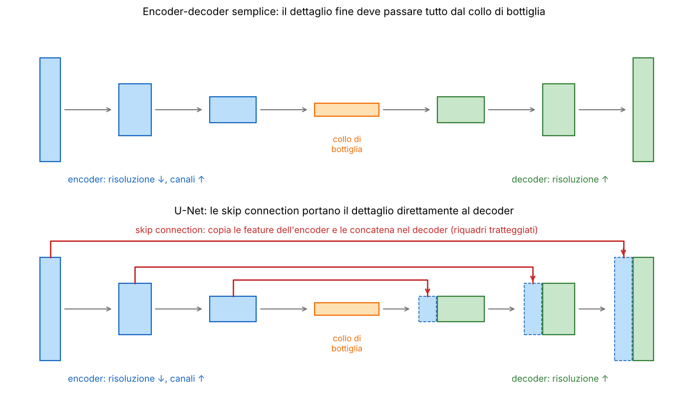

**La soluzione: la U-Net** (Ronneberger, Fischer e Brox 2015, slide 16–17). Si aggiungono **skip connection a specchio**: il livello l dell'encoder è collegato al livello L − l del decoder, e le sue feature vengono **concatenate lungo i canali** a quelle del decoder. Così si tengono i vantaggi del collo di bottiglia (astrazione, memoria) e intanto **il dettaglio fine arriva al decoder per la via diretta**. Il libro nota che la U-Net somiglia alle piramidi steerable del cap. 23, con filtri e non linearità appresi. In termini di [L6](https://gabriele-marsili.github.io/appunti-magistrale-ai/anno-2/computer-vision/sito/#L6): nella piramide laplaciana i livelli di dettaglio servono a ricostruire l'immagine in sintesi; le skip della U-Net fanno lo stesso lavoro.

**Perché le skip funzionano.** Il decoder deve rispondere a due domande insieme: «che oggetto è?» (lo sa il collo di bottiglia, che ha visto tutta l'immagine) e «dove passa esattamente il bordo?» (lo sanno gli strati alti dell'encoder, che hanno ancora la risoluzione piena). **Concatenare le due informazioni nello stesso pixel** e farle passare in due conv 3×3 permette alla rete di usare la semantica per decidere *quale* bordo locale conta.

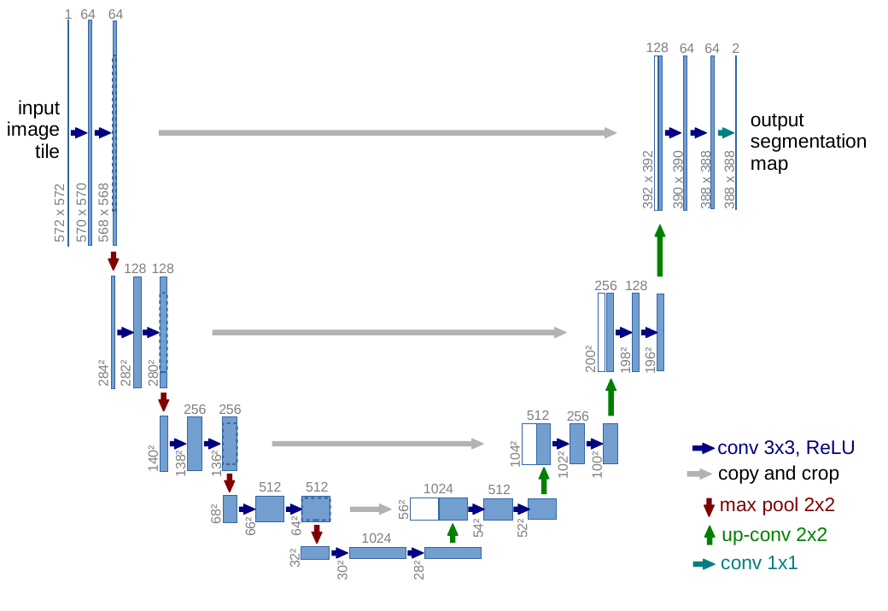

**Seguiamo le dimensioni.** Le conv della U-Net originale sono senza padding, quindi ognuna toglie 2 pixel; il max pool dimezza; la up-conv 2×2 con stride 2 raddoppia.

  - Encoder: 572 → 570 → 568 (64 canali) | pool 284 → 282 → 280 (128) | 140 → 138 → 136 (256) | 68 → 66 → 64 (512) | 32 → 30 → 28 (1024, il fondo della U).
  - Decoder: up 56, concatena i 512 canali dell'encoder ritagliati da 64 a 56, → 54 → 52 | up 104 (ritaglio 136 → 104) → 102 → 100 | up 200 (280 → 200) → 198 → 196 | up 392 (568 → 392) → 390 → 388, poi conv 1×1: **388 × 388 × 2**.

**L'uscita è più piccola dell'ingresso** proprio per le conv «valid»: un'immagine grande si segmenta a **tile sovrapposte**. Nelle implementazioni moderne si usa padding 1 e allora uscita = ingresso, senza ritagli. A ogni livello i canali raddoppiano scendendo e si dimezzano risalendo (slide 17). Il paper originale aggiungeva una mappa di pesi per pixel nella cross-entropy (bordi sottili fra cellule a contatto) e forti deformazioni elastiche come data augmentation: le immagini annotate erano poche decine. Nata per la biomedicina, la U-Net è diventata la backbone generica per profondità, restauro di immagini, modelli di diffusione.

> **Il punto**
> 
> Encoder = piramide di analisi, decoder = piramide di sintesi, apprese. **Le skip della U-Net (concatenazione a specchio) riportano al decoder le alte frequenze** che il collo di bottiglia ha perso. FCN somma punteggi, U-Net concatena feature.

### 6\. Come si risale: gli operatori di upsampling

**Il problema.** Il decoder deve raddoppiare la risoluzione a ogni passo. Come si fa, in modo che la rete possa anche imparare? Tre famiglie (slide 15, 18, 19), tutte già viste in [L6](https://gabriele-marsili.github.io/appunti-magistrale-ai/anno-2/computer-vision/sito/#L6) sotto altro nome.

**1. Interpolazione + conv.** Si ridimensiona con nearest o bilineare (fisso, non appreso) e poi si applica una conv apprendibile che rifinisce. Economico, liscio, **niente artefatti**.

**2. Convoluzione trasposta** («deconv», «up-conv»). Il visionbook (§ 24.2.5, eq. 24.7) la descrive come l'analogo della conv con stride: invece di «convolvi poi sottocampiona», **prima inserisci zeri fra i campioni (espansione), poi convolvi con un kernel appreso**. È esattamente l'upsampling di [L6](https://gabriele-marsili.github.io/appunti-magistrale-ai/anno-2/computer-vision/sito/#L6), visionbook § 21.4: espansione (la trasposta della decimazione) seguita da un filtro di interpolazione. La differenza è che qui il filtro è appreso. Il nome viene dall'algebra (Prince fig. 10.13, e la conv come matrice di [L3](https://gabriele-marsili.github.io/appunti-magistrale-ai/anno-2/computer-vision/sito/#L3)): la matrice di questa operazione è la **trasposta** della matrice di una conv con stride 2. Attenzione al nome «deconvolution»: in elaborazione dei segnali vuol dire invertire una convoluzione, un'altra cosa.

**Esempio in 1D.** Ingresso costante (1, 1, 1, …), stride 2, kernel di 3 pesi \[w1, w2, w3\]. Dopo l'espansione: (1, 0, 1, 0, 1, …). Convolvendo, le uscite sui campioni originali ricevono solo w2; quelle in mezzo ricevono w1 + w3 dai due vicini.

  - Kernel bilineare \[½, 1, ½\]: posizioni pari 1, dispari ½ + ½ = 1. Uscita costante, perfetta.
  - Kernel appreso qualunque, per esempio \[0,3; 1; 0,2\]: posizioni pari 1, dispari 0,5. **Un ingresso costante produce un'uscita che alterna due valori**.

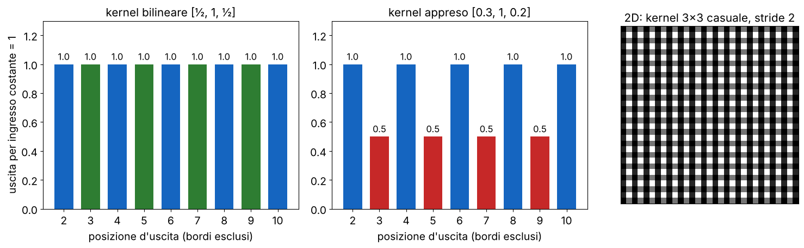

È la **sovrapposizione disuguale** del kernel (Odena, Dumoulin e Olah 2016, la figura della slide 18): in 2D diventa il tipico **artefatto a scacchiera**. Rimedi: **un kernel di lato divisibile per lo stride** (4 con stride 2: ogni uscita riceve due contributi), l'inizializzazione bilineare (come fa la FCN), oppure tornare a interpolazione + conv. Lettura alla L6: inserire zeri crea copie dello spettro, e il filtro che segue deve toglierle; il bilineare lo fa abbastanza bene (non del tutto, visionbook fig. 21.21), un kernel appreso qualunque no.

**3. Sub-pixel convolution, o pixel shuffle** (Shi et al. 2016, slide 19). Si fa tutto il calcolo a **bassa risoluzione**: una conv produce C·r² canali invece di C, poi un riordino fisso trasforma ogni gruppo di r² canali di un pixel in un blocco r × r di pixel.

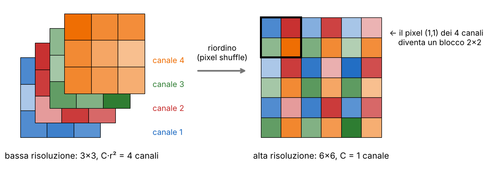

Esempio: per passare da 112 × 112 a 224 × 224 un'immagine RGB (C = 3, r = 2) la conv finale produce 3·4 = 12 canali a 112 × 112, e il riordino dà 224 × 224 × 3. **Efficiente (si convolve sulla griglia piccola) e senza sovrapposizione disuguale**; è lo standard della super-risoluzione. Una precisazione che la slide non fa: ognuna delle r² posizioni del blocco è prodotta da un filtro diverso, e **con un'inizializzazione casuale anche il pixel shuffle mostra all'inizio un motivo periodico**; si rimedia inizializzando le r² copie con lo stesso filtro (Aitken et al. 2017).

> **Il punto**
> 
> Upsampling = **espansione + filtro, come in L6**. La conv trasposta impara il filtro ma può fare la scacchiera; interpolazione + conv e pixel shuffle la evitano.

### 7\. Due casi di studio: MiDaS per la profondità, RAFT per il flusso

La struttura encoder-decoder basta quasi sempre. Due compiti mostrano però che cosa serve *in più*: una loss furba quando i dati non sono coerenti, e un'operazione di confronto quando gli ingressi sono due.

**MiDaS: profondità da una sola foto** (Ranftl et al. 2022, slide 20). La rete è un encoder-decoder con una testa a 1 canale. Il problema non è l'architettura ma la **supervisione**. Con una sola immagine la scala assoluta è ambigua (la stanza di Ames di [L13](https://gabriele-marsili.github.io/appunti-magistrale-ai/anno-2/computer-vision/sito/#L13): un oggetto piccolo vicino e uno grande lontano danno la stessa foto). E le fonti di verità sono **incompatibili**: LiDAR e sensori RGB-D danno metri ma sono sparsi o limitati agli interni; lo stereo da film 3D dà disparità note a meno di scala e spostamento (baseline e calibrazione sconosciute); la structure from motion non ha scala. Mescolare questi dataset con una loss normale sarebbe come chiedere alla rete di dare a ogni foto la «sua» unità di misura.

**L'idea**: per ogni immagine, prima di calcolare la loss, si **allinea la predizione alla verità con la scala s e lo spostamento t migliori**, così la rete è giudicata solo sulla **forma relativa** della scena:

`(s, t) = argmins,t ∑i (s d̂i + t − di)²,   L = (1/M) ∑i ρ(s d̂i + t − di)`

d̂i è la disparità predetta nel pixel i (MiDaS lavora in disparità, 1/profondità, come suggerisce anche il libro § 43.4.2 per non far pesare troppo i punti lontani), di quella vera, M il numero di pixel validi, ρ una funzione d'errore (quadratica, o robusta: MiDaS ne usa anche una con mediana e scarto dei residui più grandi). Il primo passo è **una regressione lineare con due incognite, quindi ha soluzione chiusa**: s = cov(d̂, d)/var(d̂), t = media(d) − s·media(d̂).

**Esempio a mano.** d̂ = (1, 2, 3), d = (3, 5, 7). Medie 2 e 5; cov = (1·2 + 0 + 1·2)/3 = 4/3; var(d̂) = 2/3; s = 2, t = 5 − 4 = 1. Allineata, s d̂ + t = (3, 5, 7): errore zero. La predizione aveva la forma giusta e viene premiata, anche se i suoi numeri erano diversi.

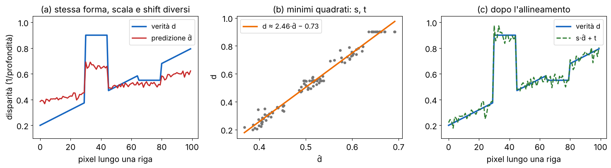

Risultato: addestrata su tanti dataset insieme, MiDaS **generalizza zero-shot** a dataset mai visti (è il protocollo di valutazione descritto anche da Szeliski § 12.8). Il prezzo: la rete **non sa la distanza in metri**; per quella servono indizi in più (altezza nota della camera, un oggetto di taglia nota, un sensore; slide 40). Nota sul libro: la loss che il visionbook chiama «scale-invariant» nel § 43.4.2, scritta senza logaritmi, toglie solo uno spostamento globale; diventa invariante alla scala solo sui log-profondità (Eigen et al. 2014), come già segnalato in L13.

**RAFT: flusso ottico** (Teed e Deng 2020, slide 21). Qui gli ingressi sono *due* frame. Un encoder-decoder che riceve i due frame impilati deve scoprire da solo che il suo compito è confrontarli. Funziona (FlowNetS ci riesce), ma **male e generalizzando poco**: la slide esagera dicendo che «non confronta mai le due immagini», il punto è che il confronto conviene renderlo esplicito.

**L'idea**: un **volume di correlazione 4D**. Si estraggono feature da entrambi i frame con lo stesso encoder (pesi condivisi) a 1/8 della risoluzione, e si calcola il prodotto scalare di ogni feature del frame 1 con ogni feature del frame 2: un array H × W × H × W. È il **cost volume** dello stereo di [L13](https://gabriele-marsili.github.io/appunti-magistrale-ai/anno-2/computer-vision/sito/#L13), con una differenza: **nello stereo rettificato il corrispondente sta sulla stessa riga (spostamento 1D, la disparità), nel flusso può essere ovunque (spostamento 2D)**. Per un'immagine 448 × 1024 la griglia a 1/8 è 56 × 128 = 7.168 pixel, e il volume ha 7.168² ≈ 51 milioni di valori: grande ma calcolabile una volta sola.

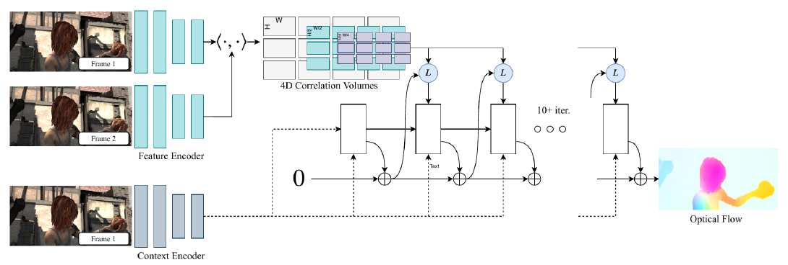

Poi RAFT **rifinisce il flusso iterativamente** (10 e più passi) invece di predirlo in un colpo: è la versione appresa delle iterazioni coarse-to-fine di Lucas-Kanade e Horn-Schunck (visionbook § 48.3). Sui dati il libro è netto (§ 49.2.1.4): **una verità densa del flusso su scene reali è quasi impossibile da raccogliere**, ed è «probabilmente il limite principale»; si addestra soprattutto su dati sintetici (FlyingChairs, MPI-Sintel).

> **Il punto**
> 
> MiDaS: quando le etichette hanno scale diverse, **si allinea scala e spostamento prima della loss** e la rete impara la forma relativa. RAFT: quando gli ingressi sono due, **si confrontano esplicitamente con un volume di correlazione**, come nello stereo.

### 8\. Loss e metriche per la predizione densa

**Prima una distinzione** (slide 23): **la loss deve essere differenziabile per guidare l'addestramento, la metrica deve solo essere significativa** per confrontare i modelli. Spesso non coincidono.

**Cross-entropy per pixel** (slide 22), la scelta di default per la segmentazione:

`LCE = − ∑i ∑c yi,c log p̂i,c`

i scorre i pixel, c le classi, yi,c vale 1 solo per la classe vera del pixel, p̂i,c è la probabilità predetta. Il difetto lo dice anche il libro (§ 50.5): la CE **si concentra sulle classi grandi e ignora quelle piccole**. **Se una lesione occupa lo 0,5% dell'immagine, una rete che dice sempre «sfondo» ha già una loss bassa.** Il libro propone di **pesare ogni classe in base alla sua area media**; le slide danno altre due soluzioni.

**Focal loss** (Lin et al. 2017). Si moltiplica la CE per un fattore che spegne i pixel facili:

`Lfocal = − ∑i (1 − pt,i)γ log pt,i`

pt,i è la probabilità che la rete dà alla classe *vera* del pixel i (nella slide è scritta p̂i: va letta così), γ ≥ 0 regola l'effetto. Esempio con γ = 2: un pixel facile con pt = 0,9 ha CE = −ln 0,9 ≈ 0,105 e fattore (0,1)² = 0,01, quindi **pesa 100 volte meno**; un pixel difficile con pt = 0,1 ha fattore 0,81 e resta quasi intatto. Con γ = 0 si torna alla CE. La versione completa del paper ha anche un peso di classe αt, che la slide omette.

**Dice loss.** Invece di sommare errori pixel per pixel, misura la **sovrapposizione** fra maschera predetta e maschera vera, in versione «morbida» (con probabilità al posto di 0 e 1) così da essere differenziabile:

`LDice = 1 − (2 ∑i p̂i yi + ε) / (∑i p̂i² + ∑i yi² + ε)`

p̂i ∈ \[0, 1\] è la probabilità di primo piano, yi ∈ {0, 1} la verità, ε evita 0/0 su maschere vuote (i quadrati al denominatore sono la versione di V-Net; molte implementazioni usano ∑p̂i + ∑yi). Il pregio: **ignora i veri negativi**. Lo sfondo classificato bene non compare da nessuna parte, quindi non può sommergere la piccola struttura. Spesso si somma alla CE.

> **Attenzione: Dice non è IoU (slide 22)**
> 
> La slide chiama la formula «Dice loss / Soft-IoU loss» e dice che viene dalla formula dell'IoU. La formula è il coefficiente di **Dice**, D = 2|A ∩ B| / (|A| + |B|), non l'IoU J = |A ∩ B| / |A ∪ B|. Sono legati in modo crescente, D = 2J/(1 + J), quindi hanno gli stessi ottimi, ma la soft-IoU è un'altra loss.

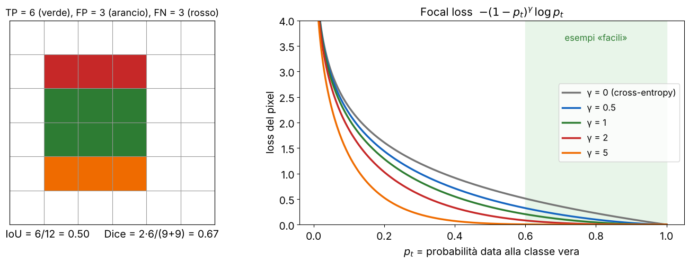

**Per la regressione** (profondità, flusso) si usano L1, L2 o varianti robuste, la loss invariante a scala e spostamento per la profondità monoculare, spesso con un termine di levigatezza che rispetta i bordi dell'immagine.

**Le metriche** (slide 23), ciascuna con un esempio piccolo:

  - **mIoU** (segmentazione): per ogni classe IoU = TP / (TP + FP + FN), poi media sulle classi. Strada con IoU 0,9 e pali con IoU 0,3: mIoU = 0,6. La **pixel accuracy** sulla stessa immagine può superare il 95%, perché i pali sono pochi pixel: è dominata dalle classi grandi (lo dice anche il libro, § 50.5). È la stessa metrica della segmentazione LiDAR di [L14](https://gabriele-marsili.github.io/appunti-magistrale-ai/anno-2/computer-vision/sito/#L14).
  - **AbsRel** (profondità) = mediai |d̂i − di| / di: errore relativo. Vera 10 m, predetta 11 m: 0,1. Dividere per d serve perché **1 m di errore è grave a 2 m e trascurabile a 50 m**.
  - **RMSE** = √(mediai (d̂i − di)²). Errori di 1, −1, 2, 0 metri: √(6/4) ≈ 1,22 m. **Pesa molto gli errori grandi**; spesso si calcola anche sul log.
  - **EPE** (flusso, end-point error) = distanza euclidea media fra vettore predetto e vero. Vero (3, 4), predetto (0, 0): 5 pixel. (Il libro, § 49.2.1.2, chiama così una somma di distanze *al quadrato*: è una loss L2, non l'EPE.)
  - **PCK** (pose) = percentuale di keypoint entro una soglia dalla verità, normalizzata per la scala della persona (per esempio metà della dimensione della testa). 14 keypoint su 17 entro soglia: 82%.

> **Il punto**
> 
> La segmentazione è **sbilanciata**: CE pesata, focal e Dice combattono lo sbilanciamento in training, il mIoU lo neutralizza in valutazione. Dice ≠ IoU, ma D = 2J/(1 + J).

### 9\. Il Vision Transformer: un'immagine come sequenza di patch

**Il problema.** Una CNN è «miope» (visionbook § 26.2): **ogni neurone vede solo il suo campo recettivo, e per collegare due pixel lontani servono tanti strati**. In una CNN a due strati con kernel 3 nessun neurone vede insieme il pixel 1 e il pixel 7. Uno strato denso li collegherebbe tutti, ma con N² parametri e nessuna idea di cosa sia un'immagine. Il **Vision Transformer** (ViT, Dosovitskiy et al. 2021, slide 24–25) prende un'altra strada: tratta l'immagine come una **frase** fatta di patch, e lascia che ogni patch guardi direttamente tutte le altre.

![Dalla slide 25 (ViT, fig. 1). Patch → proiezione lineare → token (+ posizione) → L blocchi transformer → la testa legge il token \[CLS\] (lo 0 con l'asterisco). A destra il blocco, che vediamo nella sezione 12.](../sito-src/L17/disp2_slide25_vit.png)

**Patch embedding** (slide 26), passo per passo:

1.  si divide l'immagine H × W × C in una griglia di **N = (H/P)(W/P) patch** P × P;
2.  si appiattisce ogni patch in un vettore di P²C numeri;
3.  lo si moltiplica per **la stessa matrice E** (appresa) per tutte le patch: diventa un **token**, un vettore di dimensione D;
4.  si antepone un token **\[CLS\]** apprendibile (preso da BERT): il suo stato finale servirà per classificare;
5.  si somma a ogni token una **codifica posizionale** appresa (sezione 10).

`z0 = [xcls; xp1E; …; xpNE] + Epos,   E ∈ ℝ(P²C)×D,   Epos ∈ ℝ(N+1)×D`

xpj è la patch j appiattita (un vettore riga), z0 la matrice dei token in ingresso al primo blocco, **uno per riga** (N + 1 righe, D colonne).

![ViT-B/16 su 224 × 224: 14 × 14 = 196 patch, lette riga per riga; ognuna (768 numeri) diventa un token di dimensione D = 768 (a destra, con una E casuale e senza le posizioni). Riga 0: il \[CLS\].](../sito-src/L17/disp2_patchify.png)

**Esempio con i numeri di ViT-B/16** (C = 3, P = 16, D = 768) su 224 × 224: N = 14 · 14 = **196** patch, quindi **197** token. Ogni patch ha 16·16·3 = 768 numeri, E è 768 × 768 = 589.824 pesi; Epos ha 197 · 768 = 151.296 parametri. Con P = 8 le patch diventano 28² = 784: vedremo che costa caro.

Due note dal libro (cap. 26). Il visionbook tokenizza nello stesso modo (fig. 26.2) ma **non usa il \[CLS\]**: per classificare somma tutti i token d'uscita e applica uno strato lineare, cioè un pooling globale come il GAP delle CNN. Il \[CLS\] è in Prince § 12.10.2 e nel paper. E il ViT originale era pre-addestrato su JFT-300M (303 milioni di immagini): **senza tanti dati non batteva le CNN** (sezione 15).

> **Il punto**
> 
> Il ViT **taglia l'immagine in patch, le proietta tutte con la stessa matrice E in token**, aggiunge \[CLS\] e posizioni: 224² con P = 16 dà 196 + 1 = 197 token di dimensione 768.

### 10\. Dove sta ogni patch: le codifiche posizionali

**Il problema** (slide 27). La self-attention (sezione 11) e l'MLP applicato a ogni token sono **equivarianti alle permutazioni**: se si mescolano i token in ingresso, le uscite vengono mescolate allo stesso modo e nient'altro cambia (visionbook § 26.8). E il \[CLS\], che non viene permutato, dà esattamente la stessa uscita. Conseguenza concreta: **un ViT senza posizioni classificherebbe allo stesso modo una foto e il suo puzzle rimescolato**. Per una CNN non succede: il kernel sa chi è vicino a chi.

**L'idea**: aggiungere a ogni token un vettore che dipende dalla sua posizione. Le varianti (slide 27–28):

  - **Sinusoidali, fisse** (Vaswani et al. 2017): PE(i, 2k) = sin(i / 100002k/D), PE(i, 2k+1) = cos(i / 100002k/D), con i la posizione e k l'indice della dimensione: le prime dimensioni oscillano veloci, le ultime lente, come le cifre di un contachilometri. **Nessun parametro, definite per ogni posizione.**
  - **Apprese, assolute** (default del ViT): una tabella Epos con un vettore per «casella», nessuna struttura imposta. Il difetto: **se cambia la risoluzione bisogna interpolare la tabella**.
  - **2D fattorizzate**: due tabelle, una per riga e una per colonna, Epos(r, c) = Erow\[r\] + Ecol\[c\]. Su una griglia 14 × 14 servono 14 + 14 = 28 vettori invece di 196.
  - **Bias di posizione relativa** (Swin, Liu et al. 2021): un numero appreso B(Δi, Δj) sommato direttamente ai *logit* dell'attenzione, che dipende solo dallo spostamento fra query e key. È **invariante alla traslazione**, come una convoluzione.
  - **RoPE** (rotary, Su et al. 2021): si ruotano q e k di un angolo proporzionale alla posizione; nel prodotto qᵀk le rotazioni si compongono e **la posizione entra solo come spostamento relativo** (il prodotto dipende, ovviamente, anche dal contenuto di q e k). Standard negli LLM.

**Perché conta per la predizione densa.** La segmentazione lavora a risoluzioni variabili: un ViT addestrato a 224² (griglia 14 × 14) usato a 512² ha 32 × 32 patch, e la tabella 1D va rimodellata in 14 × 14 e interpolata a 32 × 32 (lo fa DPT). Con un bias relativo o RoPE non c'è nulla da interpolare per la parte di posizione.

Il libro (§ 26.11) usa un codice periodico di soli seni, uno per x e uno per y, e lo **concatena** al token; il ViT lo **somma**. Prince (§ 12.3.1) chiama «assolute» le prime e «relative» quelle che modificano direttamente la matrice di attenzione. Nella sezione 14 vedremo che il ViT, pur ricevendo le posizioni come una lista, impara da solo che l'immagine è 2D.

> **Il punto**
> 
> Senza posizioni un transformer vede un **insieme** di patch, non un'immagine. Le codifiche assolute (fisse o apprese) si sommano ai token; quelle relative (bias di Swin, RoPE) entrano nell'attenzione e si adattano meglio a risoluzioni diverse.

### 11\. La self-attention: ogni patch guarda tutte le altre

**L'idea** (slide 29). Il visionbook la chiama un **pooling dinamico**: l'uscita di ogni token è una media pesata di tutti i token, come in uno strato lineare, ma **i pesi dipendono dai dati**. Il suo esempio (§ 26.6.2, la slide lo rifà con la torre di Pisa): il token del torso di un impala, per capire meglio che cosa rappresenta, raccoglie informazione dalle altre patch dell'impala, e diventa una rappresentazione più «semantica». È proprio ciò che serve per segmentare.

Ogni token produce tre vettori con tre proiezioni apprese (i nomi vengono dai database: una cella restituisce il suo valore quando la domanda corrisponde alla sua chiave):

  - **query** q: che cosa sto cercando;
  - **key** k: con che cosa rispondo alle domande degli altri;
  - **value** v: l'informazione che passo a chi mi sceglie.

Il peso del token j per il token i è la somiglianza qiᵀkj, scalata e normalizzata con la softmax; l'uscita di i è la somma dei value pesata così (slide 30):

`Attention(Q, K, V) = softmax( QKᵀ / √dk ) V,   Q = XWQ, K = XWK, V = XWV`

X ∈ ℝ(N+1)×D sono i token, uno per riga; WQ, WK ∈ ℝD×dk e WV le proiezioni; QKᵀ è una matrice (N+1) × (N+1) con tutte le somiglianze; la softmax si applica **per riga**, così ogni query distribuisce un peso totale 1 sui token. Il visionbook scrive la stessa cosa con T al posto di X e m al posto di dk (eq. 26.5–26.6); nel suo pseudocodice (§ 26.7) la softmax ha dim=0, cioè per colonne: è un refuso, vale per riga.

**Esempio con tre token** e dk = 2. Key k1 = (1, 0), k2 = (2, 1), k3 = (0, 2); query del secondo token q2 = (1, 1). Prodotti q2ᵀkj = 1, 3, 2; divisi per √2: 0,71; 2,12; 1,41. Softmax: e0,71 = 2,03, e2,12 = 8,34, e1,41 = 4,11, somma 14,48, pesi **0,14; 0,58; 0,28**. Con value v1 = (1, 0), v2 = (0, 1), v3 = (1, 1) il nuovo token è 0,14·(1, 0) + 0,58·(0, 1) + 0,28·(1, 1) = (0,42; 0,86).

Ne segue la proprietà chiave: **campo recettivo globale dal primo strato**. Ogni coppia di patch interagisce direttamente, mentre una CNN aggrega informazione locale strato dopo strato.

**Perché dividere per √dk.** Se le componenti di q e k sono indipendenti, a media 0 e varianza 1, allora qᵀk = ∑j=1dk qjkj è una somma di dk termini indipendenti, ognuno con media 0 e varianza E\[qj²\]E\[kj²\] = 1. Le varianze si sommano:

`Var(qᵀk) = dk`

Per ViT-B (D = 768, 12 teste, dk = 64) senza scala i logit avrebbero deviazione standard 8. La softmax di numeri così grandi dà **quasi tutto il peso a un solo token**, e in quella zona la softmax è piatta: **gradienti quasi nulli**, la rete non impara (Prince § 12.3.2). Dividendo per √dk la varianza torna 1 qualunque sia dk.

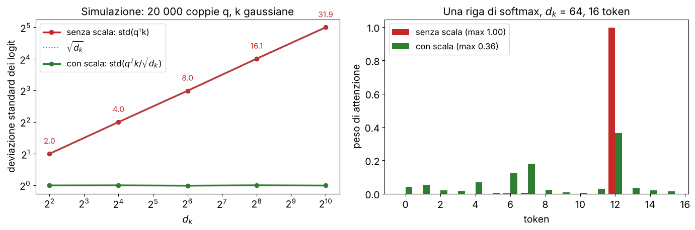

**Multi-testa.** Con una sola testa la somiglianza fra due token è tiᵀ WQWKᵀ tj: **un solo modo di misurare la somiglianza** (per esempio solo il colore). Con h teste in parallelo, ognuna con le sue proiezioni di dimensione dk = D/h, se ne misurano h (colore, texture, forma…); le uscite si concatenano e si proiettano con una matrice appresa (visionbook § 26.6.3). **Il costo dell'attenzione non cambia: h · N² · (D/h) = N²D.** In pratica Q, K e V si calcolano con un'unica moltiplicazione per WQKV ∈ ℝD×3D.

> **Il punto**
> 
> Self-attention = **media pesata dei value, con pesi softmax(qᵀk/√dk) calcolati dai dati**. La scala tiene i logit a varianza 1 e la softmax lontana dalla saturazione; più teste misurano più tipi di somiglianza allo stesso costo.

### 12\. Il blocco transformer: residui, pre-norm e quanto costa

**Il blocco** (slide 31). Due sotto-blocchi, ognuno avvolto da una normalizzazione e da un residuo:

`x ← x + MHSA(LN(x)),   x ← x + MLP(LN(x))`

MHSA è la self-attention multi-testa, che **mescola fra token**; MLP è Linear(D → 4D), GELU, Linear(4D → D), che **trasforma ogni token** da solo; LN è la LayerNorm (sezione 13). Il visionbook (§ 26.4) riassume così un transformer: si alternano solo due operazioni, mescolare i token e modificare ciascun token.

Con i **residui** ogni blocco impara una *correzione*, e **il gradiente torna indietro direttamente attraverso il «+»** anche in 12 o 24 blocchi: lo stesso motivo delle skip di ResNet ([L15](https://gabriele-marsili.github.io/appunti-magistrale-ai/anno-2/computer-vision/sito/#L15)). Questa disposizione si chiama **pre-norm**: la LN sta *dentro* il ramo, prima di MHSA e MLP, e il cammino residuo resta un'identità pulita. Il transformer originale era **post-norm**, x ← LN(x + MHSA(x)) (Prince eq. 12.13): lì il residuo passa sempre da una LN, e **i gradienti si riducono tornando verso gli strati bassi** (Xiong et al. 2020). Per questo ViT e transformer moderni sono pre-norm.

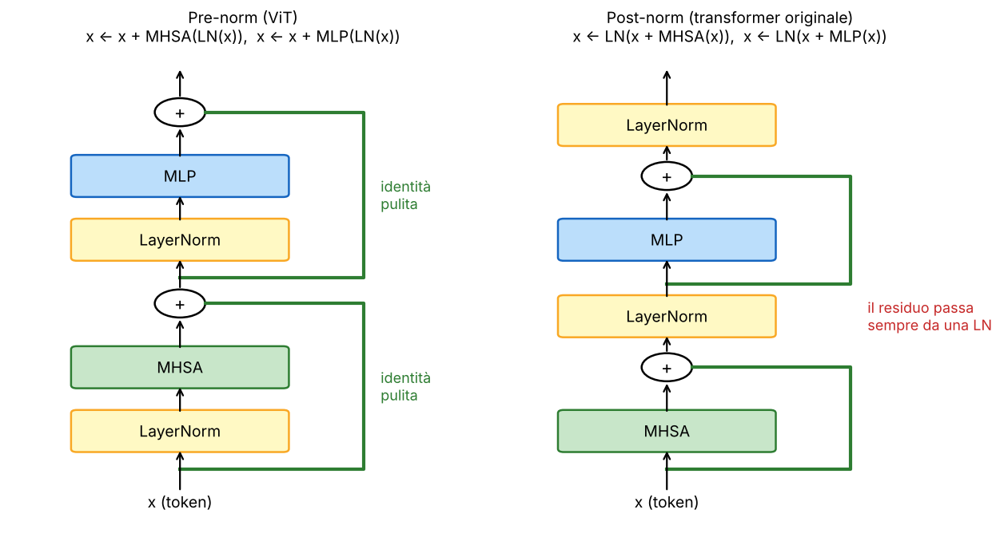

**Quanti parametri** (slide 32). Per un blocco con dimensione D e MLP con rapporto 4: QKV 3D², proiezione d'uscita D², MLP D·4D + 4D·D = 8D². Totale ≈ **12D²** (25%, 8%, 67%: **i parametri stanno soprattutto nell'MLP**). Per ViT-B, D = 768: 12 · 768² = 7.077.888 ≈ 7,1 milioni per blocco, × 12 blocchi ≈ 85 milioni. Con patch embedding, posizioni, bias, LN e testa si arriva agli \~86 M del ViT-B/16 reale.

**Quanto calcolo.** Per blocco ci sono due termini (in moltiplicazioni-addizioni): la parte lineare, ≈ 12ND² (ogni token passa per QKV, uscita e MLP), e l'attenzione vera e propria, ≈ 2N²D (QKᵀ e il prodotto per V). Il secondo è **quadratico nel numero di token**, e la matrice N × N va anche tenuta in memoria.

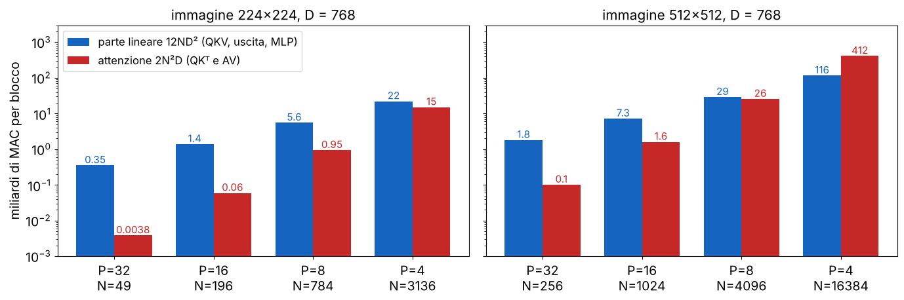

**Esempio.** ViT-B/16 a 224² (N = 197): parte lineare 12 · 197 · 768² ≈ 1,39 G, attenzione 2 · 197² · 768 ≈ 0,06 G; in totale ≈ 1,45 G per blocco, ≈ 17,5 G per 12 blocchi (il paper dichiara \~17,6 GFLOPs). Il termine quadratico supera l'altro quando N \> 6D: a 512² con P = 8 (N = 4096) i due termini sono già pari (≈ 26 G contro 29 G). La frase della slide «dimezzare P moltiplica il calcolo per 16» vale per la parte d'attenzione; il totale cresce fra 4 e 16 volte. Per la predizione densa, che vuole token piccoli su immagini grandi, **l'attenzione globale diventa il collo di bottiglia**: da qui gli encoder gerarchici o a finestre (SegFormer, Swin).

> **Il punto**
> 
> Blocco pre-norm: **x + MHSA(LN(x)), poi x + MLP(LN(x))**. Circa 12D² parametri (due terzi nell'MLP); calcolo 12ND² + 2N²D, con il termine quadratico che esplode quando i token sono tanti.

### 13\. Normalizzazioni: BatchNorm, LayerNorm, InstanceNorm, GroupNorm

**L'idea comune** (slide 33). Tutte **standardizzano le attivazioni (media 0, varianza 1) e poi applicano una scala γ e uno spostamento β appresi**, per canale. Cambia solo **su quali numeri** si calcolano media e varianza. Pensa a un tensore N × C × H × W (esempi del batch, canali, spazio):

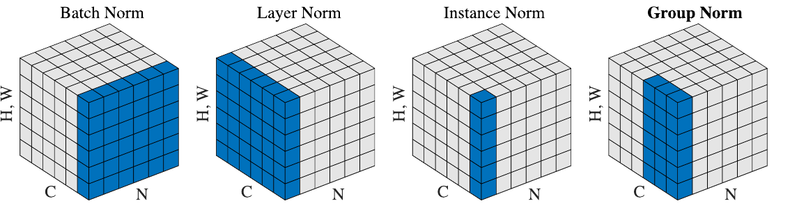

  - **BatchNorm**: su N, H, W, separatamente per ogni canale. Usa gli altri esempi del batch.
  - **LayerNorm**: su C, H, W, separatamente per ogni esempio; in un ViT, sulle D componenti di **ogni singolo token**.
  - **InstanceNorm**: su H, W, per ogni esempio e canale (tipica del trasferimento di stile).
  - **GroupNorm**: su gruppi di C/G canali e H, W, per ogni esempio. È la famiglia che contiene le altre due: G = 1 dà la LayerNorm, G = C la InstanceNorm.

> **Attenzione: «All three» ma sono quattro (slide 33)**
> 
> Titolo e prima riga parlano di tre normalizzazioni, ma la slide e la figura ne elencano quattro: BatchNorm, LayerNorm, InstanceNorm, GroupNorm.

**Perché i transformer usano la LayerNorm** (slide 34). La BatchNorm usa le statistiche del batch in training e quelle accumulate in valutazione: **il comportamento dipende dalla dimensione del batch e training e test possono differire**; con batch piccoli le stime sono rumorose. La LayerNorm **normalizza ogni token da solo: stesso calcolo in training e in test, nessuna dipendenza dagli altri esempi**, e funziona con sequenze di lunghezza qualsiasi. Vaswani et al. la scelsero perché le statistiche del testo variano molto da un batch all'altro (Prince, note del cap. 12). La **GroupNorm è invece la scelta per le CNN di segmentazione e detection**, dove le immagini sono grandi e nella GPU ne entrano due o quattro alla volta.

**Esempio.** Un token con D = 4, x = (1, 2, 3, 6), γ = 1, β = 0: μ = 3, σ² = (4 + 1 + 0 + 9)/4 = 3,5, σ ≈ 1,87, uscita ≈ (−1,07; −0,53; 0; 1,60). Lo stesso token dà la stessa uscita qualunque siano gli altri token e gli altri esempi.

> **Il punto**
> 
> Stessa formula, insiemi diversi: BN sul batch per canale, **LN sul singolo token**, IN per esempio e canale, GN per gruppi di canali. I transformer usano la LN perché non dipende dal batch.

### 14\. Che cosa impara un ViT, e perché è una CNN «travestita»

**Che cosa impara** (slide 35–36). Il paper del ViT guarda dentro la rete addestrata.

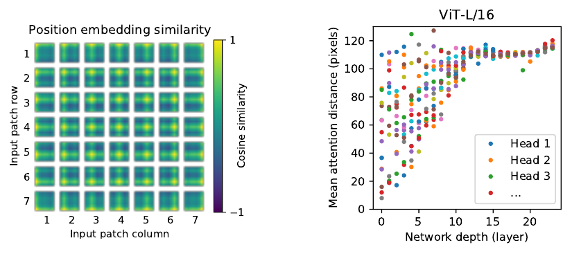

  - **Codifiche posizionali**: ogni riquadro della griglia è chiaro sulla propria posizione e, più debolmente, sulla stessa **riga** e sulla stessa **colonna**. **Il ViT impara da solo la struttura 2D dell'immagine**, pur avendo ricevuto le posizioni come una lista 1D. (La griglia 7 × 7 è di un modello con patch 32, 224/32 = 7: nel paper è ViT-L/32, la slide non lo dice.)
  - **Distanza media di attenzione**: per ogni testa, la distanza fra query e key pesata con i pesi d'attenzione; è l'analogo del campo recettivo. **Già nei primi strati alcune teste guardano a pochi pixel (si comportano come una conv) e altre già oltre 100 pixel; salendo, tutte diventano globali.** Con pochi dati le teste «locali» si imparano male: è uno dei motivi per cui il ViT vuole grandi pre-training.
  - **Attention rollout** (slide 36): si combinano le mappe d'attenzione di tutti gli strati per stimare quanto il \[CLS\] finale dipende da ogni patch. Per ogni strato si fa la media sulle teste Al, si aggiunge il residuo, Ãl = ½(Al + I), e si moltiplica R = ÃL ⋯ Ã1; la riga del \[CLS\], rimodellata in griglia, illumina il cane o l'aereo senza nessuna supervisione a livello di pixel. È però **un'approssimazione**: ignora value, MLP e non linearità, guarda solo «chi guarda chi».

**Una CNN travestita** (slide 37, visionbook § 26.9, che ha proprio questo titolo). Rileggiamo i pezzi del ViT con gli occhi di [L15](https://gabriele-marsili.github.io/appunti-magistrale-ai/anno-2/computer-vision/sito/#L15):

  - la tokenizzazione (patch P × P non sovrapposte, proiettate con la stessa E) è una **convoluzione con kernel P, stride P e niente padding**, da 3 a D canali; in PyTorch si scrive proprio `Conv2d(3, D, kernel_size=P, stride=P)`;
  - le proiezioni Q, K, V applicano la stessa trasformazione lineare a ogni token: sono **conv 1×1**;
  - i due strati lineari dell'MLP sono anch'essi conv 1×1, con una non linearità puntuale in mezzo;
  - LayerNorm e residui ci sono anche nelle CNN moderne.

L'**unica vera differenza è l'attenzione**: le CNN mescolano lo spazio con kernel **locali e fissi** (uguali per ogni immagine), il ViT con pesi **calcolati dall'ingresso** su tutta l'immagine. Il libro aggiunge un'osservazione acuta: tutti i kernel del ViT sono 1×1, e un kernel più grande romperebbe l'equivarianza alle permutazioni. Quindi **la rete non ha alcun modo architetturale di sapere chi è vicino a chi**: **la posizione può entrare solo dagli ingressi**, con le codifiche della sezione 10.

> **Il punto**
> 
> Un ViT è fatto di **una conv P×P con stride P, tante conv 1×1 e l'attenzione**: tutto il resto è come in una CNN. Impara da solo la struttura 2D e un misto di teste locali e globali, se ha abbastanza dati.

### 15\. Il ViT per la predizione densa, e il confronto con le CNN

**Il problema.** Il ViT è nato per classificare. Come si ottiene un'uscita per pixel? Il paper lo dice già nella slide 25: il ViT è un **encoder**, quindi si inserisce nella stessa ricetta encoder-decoder di FCN e U-Net.

**L'idea** (slide 38). Si scarta il \[CLS\]: gli N = h × w token di patch che restano corrispondono, in ordine, alla griglia delle patch (h = H/P, w = W/P). Basta **rimodellare la sequenza in una mappa h × w × D**: è una feature map come quelle di una CNN, e la si dà a un decoder.

**Numeri.** ViT-B/16 su 224²: 196 token → mappa 14 × 14 × 768, stride 16 (una ResNet arriva a stride 32). Su 512²: 32 × 32 × 768. Tre modi di usarla:

  - **SETR**: le feature dell'ultimo strato e un decoder che sovracampiona;
  - **DPT** (Ranftl et al., gli stessi di MiDaS): prende i token da **più strati del transformer**, li rimodella in griglie, li porta a risoluzioni diverse e li fonde come in una U-Net; è il decoder delle versioni recenti di MiDaS;
  - **SegFormer** (e Swin): encoder **gerarchici** che partono da patch piccole e riducono la risoluzione strato dopo strato, come una CNN, così danno feature **multi-scala** e contengono il costo quadratico.

**ViT contro CNN** (slide 39):

|                             | CNN                                           | ViT                                 |
| --------------------------- | --------------------------------------------- | ----------------------------------- |
| campo recettivo             | da locale a globale, strato dopo strato       | globale dal primo strato            |
| bias induttivo              | forte: località e invarianza alla traslazione | debole: la struttura 2D va imparata |
| dati                        | va bene anche con pochi dati                  | vuole pre-training su larga scala   |
| scala con dati e calcolo    | bene                                          | molto bene                          |
| predizione densa            | encoder-decoder                               | encoder-decoder                     |
| più modalità (testo, audio) | dipende dall'architettura                     | comoda: tutto è token               |

Il dato chiave (Prince § 12.10.2): pre-addestrato su 303 milioni di immagini il ViT arriva all'11,45% di errore top-1 su ImageNet, ma **senza un grande pre-training non batte le CNN**; il bias induttivo delle convoluzioni si supera solo con tantissimi dati. Il grafico della slide 39 lo mostra: a parità di calcolo di pre-training i ViT stanno sopra le ResNet.

**Un'architettura per tanti compiti?** (slide 40). **In gran parte sì**: encoder-decoder con skip, CNN o ViT, è una base flessibile, e si cambiano testa e loss. Ma non è gratis: il flusso ottico vuole due frame e un confronto esplicito (RAFT); la profondità monoculare ha l'ambiguità di scala (MiDaS, e per i metri servono indizi in più); la pose vuole feature ad alta risoluzione e spesso raffinamenti iterativi (stacked hourglass). **I metodi migliori aggiungono quasi sempre un pezzo specifico del compito.**

> **Il punto**
> 
> Togli il \[CLS\] e **rimodella i token in una griglia h × w × D**: il ViT diventa l'encoder di un encoder-decoder (SETR, DPT, SegFormer). Rispetto alla CNN ha meno bias induttivo e più bisogno di dati, ma vede tutta l'immagine da subito.

### Il riassunto in 10 righe

1.  Predizione densa = un'uscita per pixel: segmentazione (semantica, istanza, panottica), profondità, flusso, pose come heatmap; stessa forma, testa 1×1 e loss diverse.
2.  Hout = ⌊(Hin + 2p − d(k − 1) − 1)/s⌋ + 1; campo recettivo 1 + ∑(kl − 1)∏i\<lsi; la dilatazione dà contesto senza perdere risoluzione.
3.  Una CNN da classificazione è un imbuto (224 → 7, 3 → 2048 canali): sa «cosa», non «dove».
4.  Strati densi = conv 7×7 e 1×1, quindi una CNN diventa una FCN che dà una mappa di punteggi; FCN-8s somma le predizioni di pool4 e pool3 per i contorni.
5.  Encoder-decoder = piramide di analisi e sintesi apprese; la U-Net concatena a specchio le feature dell'encoder nel decoder (572 → 388) e recupera le alte frequenze.
6.  Upsampling = espansione + filtro (L6): conv trasposta (appresa, rischio scacchiera se le fasi hanno pesi diversi), interpolazione + conv, pixel shuffle (C·r² canali riordinati).
7.  MiDaS allinea scala e spostamento per minimi quadrati prima della loss; RAFT confronta i frame con un volume di correlazione 4D e rifinisce il flusso iterativamente.
8.  CE per pixel (sbilanciata), focal (1 − pt)γ, Dice (ignora i veri negativi; D = 2J/(1 + J), non è IoU); metriche mIoU, AbsRel, RMSE, EPE, PCK.
9.  ViT: N = HW/P² patch → token con la stessa E, + \[CLS\] + posizioni; self-attention softmax(QKᵀ/√dk)V con Var(qᵀk) = dk; multi-testa allo stesso costo; blocco pre-norm, 12D² parametri, costo 12ND² + 2N²D.
10. LN per token (non dipende dal batch); il ViT è conv P×P + conv 1×1 + attenzione, impara da solo la struttura 2D; rimodellando i token in griglia diventa l'encoder di SETR, DPT, SegFormer.

### Verifica di aver capito

**Qual è il campo recettivo di conv 3×3 (s = 2) → conv 3×3 (s = 2) → conv 3×3 (s = 1)? E quanto è grande l'uscita per un ingresso 64 × 64 con padding 1?**

r = 1 + 2·1 + 2·2 + 2·4 = 15 (il terzo strato vede celle distanti 2·2 = 4 pixel). Dimensioni: ⌊(64 + 2 − 3)/2⌋ + 1 = 32, poi ⌊(32 + 2 − 3)/2⌋ + 1 = 16, poi con s = 1 resta 16: uscita 16 × 16.

**Perché sovracampionare di 32 volte l'uscita di una FCN-32s non basta, e che cosa fa FCN-8s?**

La mappa 7 × 7 ha già perso tutto ciò che è più piccolo di una cella da 32 pixel (pali, code, zampe): l'interpolazione non può ricrearlo. FCN-8s calcola predizioni anche da pool4 (14 × 14) e pool3 (28 × 28) con conv 1×1, le somma a quella di pool5 sovracampionata ×2 e ×4, e sovracampiona ×8 solo alla fine: i contorni vengono dagli strati a risoluzione più alta.

**Nella U-Net originale perché l'uscita è 388 × 388 per un ingresso 572 × 572, e perché si concatena invece di sommare?**

Le conv 3×3 sono senza padding e tolgono 2 pixel ciascuna (18 conv in tutto lungo il percorso, più i dimezzamenti e raddoppi), quindi le skip vanno ritagliate e l'uscita è più piccola; si lavora a tile sovrapposte. Concatenando, il decoder riceve sia le feature semantiche sia quelle fini dell'encoder come canali separati e decide lui con le conv successive come combinarle; la somma (FCN, hourglass) le fonde subito in un solo vettore.

**Una conv trasposta con stride 2 e kernel \[0,2; 1; 0,6\] riceve un ingresso costante uguale a 1. Che cosa esce? Come la sistemeresti?**

Posizioni sui campioni originali: 1; posizioni intermedie: 0,2 + 0,6 = 0,8. L'uscita alterna 1 e 0,8: in 2D è una scacchiera. Rimedi: kernel di lato divisibile per lo stride, inizializzazione bilineare (\[½, 1, ½\], somma 1 su entrambe le fasi), oppure interpolazione + conv o pixel shuffle (inizializzato bene).

**Perché MiDaS usa una loss invariante a scala e spostamento? Calcola s e t per d̂ = (0, 1, 2) e d = (1, 4, 7).**

Perché le verità vengono da fonti che non concordano sulla scala (LiDAR in metri, stereo da film a meno di scala e spostamento, SfM senza scala): allineando ogni predizione alla sua verità la rete è giudicata solo sulla forma relativa e può imparare da tutti i dataset. Medie 1 e 4; cov = (1·3 + 0 + 1·3)/3 = 2; var(d̂) = 2/3; s = 3, t = 4 − 3 = 1: s d̂ + t = (1, 4, 7), errore nullo.

**Con due maschere A e B di 20 pixel ciascuna che ne hanno 10 in comune, quanto valgono IoU e Dice? Perché la Dice loss aiuta con le strutture piccole?**

Unione = 20 + 20 − 10 = 30: IoU = 10/30 ≈ 0,33; Dice = 2·10/40 = 0,5 (verifica: 2·0,33/1,33 = 0,5). La Dice non contiene i veri negativi, quindi il mare di sfondo classificato bene non abbassa la loss: conta solo quanto la struttura predetta si sovrappone a quella vera.

**Quanti token e quante teste di che dimensione ha ViT-B/16 su un'immagine 384 × 384? Perché si divide per √dk?**

384/16 = 24, quindi 576 patch e 577 token; D = 768 e 12 teste di dk = 64. La tabella delle posizioni, nata per 14 × 14, va interpolata a 24 × 24. Con componenti indipendenti a varianza 1, Var(qᵀk) = dk = 64 (deviazione 8): la softmax diventerebbe quasi un one-hot con gradienti quasi nulli; dividendo per 8 i logit tornano a varianza 1.

**In che senso un ViT è una «CNN travestita», e che cosa gli manca rispetto a una CNN?**

Il patch embedding è una conv con kernel e stride P, le proiezioni QKV e l'MLP sono conv 1×1, e ci sono normalizzazioni e residui come nelle CNN. L'unica parte non convoluzionale è l'attenzione, che mescola tutti i token con pesi dipendenti dall'ingresso. Siccome tutti i kernel sono 1×1, la rete non ha il bias di località delle CNN: la posizione entra solo dalle codifiche posizionali e la struttura locale va imparata dai dati, per questo serve un grande pre-training.

### Come proseguire

  - Visionbook, cap. 24 [Convolutional Neural Nets](https://visionbook.mit.edu/convolutional_neural_nets.html), § 24.7–24.11: campo recettivo, uscite spaziali, la CNN come filtro scorrevole, encoder-decoder e U-Net.
  - Visionbook, cap. 26 [Transformers](https://visionbook.mit.edu/transformers.html), tutto: token, attenzione, self-attention e multi-testa, l'architettura completa, l'equivarianza alle permutazioni, «CNNs in disguise», codifiche posizionali.
  - Visionbook, cap. 21 [Downsampling and Upsampling](https://visionbook.mit.edu/upsamplig_downsampling_2.html), § 21.4 (ripasso di L6 per la conv trasposta); cap. 50 [Object Recognition](https://visionbook.mit.edu/object_recognition_v3.html), § 50.5–50.6; cap. 43 [3D Learning](https://visionbook.mit.edu/3d_learning.html), § 43.4; cap. 49 [Motion Estimation](https://visionbook.mit.edu/motion_estimation.html), § 49.2.
  - Prince, *Understanding Deep Learning*: § 10.4 (upsampling, conv trasposta, conv 1×1), § 11.5.3 (U-Net e hourglass), cap. 12 (self-attention, codifiche posizionali, scala √D, multi-testa, ViT § 12.10).
  - Per i dettagli fuori dai libri (Dice, focal, pixel shuffle, MiDaS, RAFT, RoPE, rollout, DPT, SegFormer) bastano le slide e gli articoli della slide 42.

Ora ripassa con le schede qui sotto, slide per slide. I riquadri Attenzione riguardano la «Dice / Soft-IoU loss» (slide 22) e le normalizzazioni annunciate come tre ma elencate come quattro (slide 33); le schede chiariscono anche la p̂ della focal loss (slide 22), la frase su RAFT che «non confronta mai le immagini» (slide 21), il modello della griglia 7 × 7 (slide 35) e il fattore 16 del costo (slide 32).
