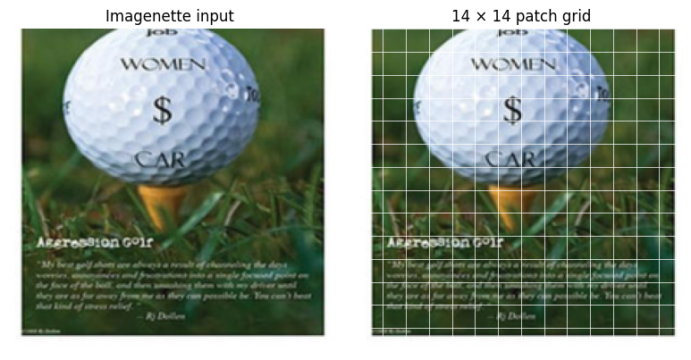
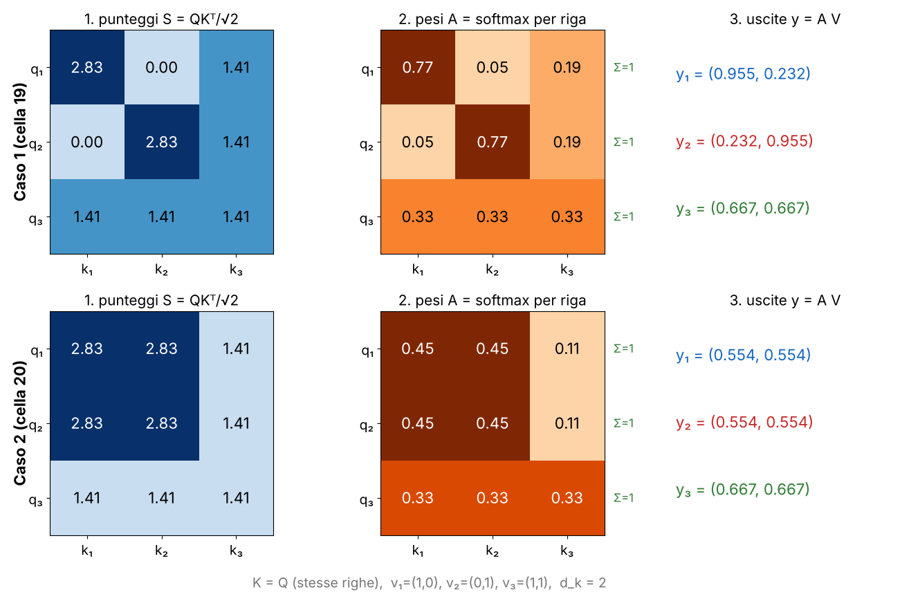
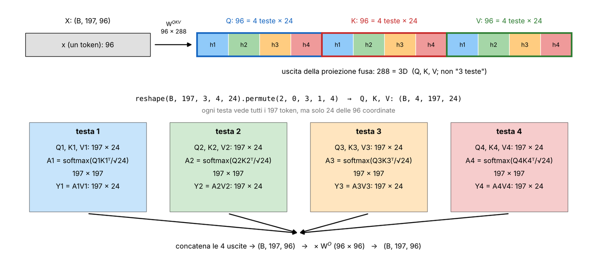
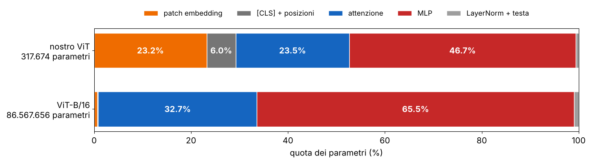
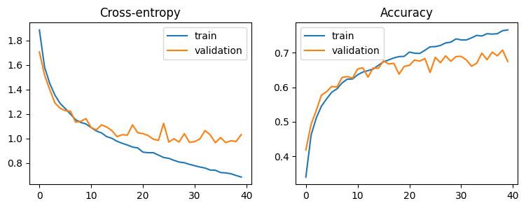
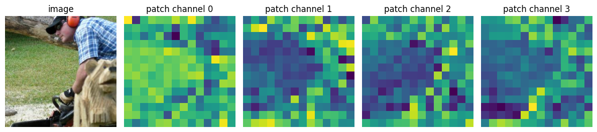
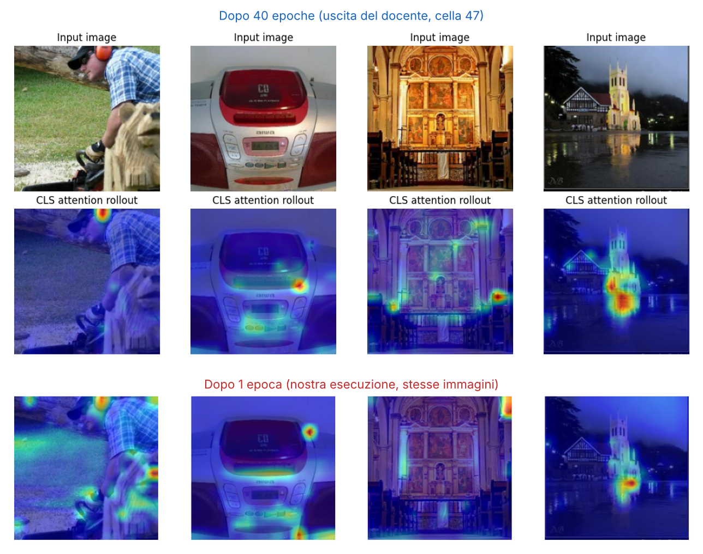
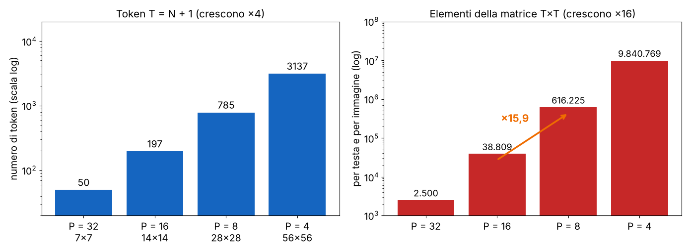
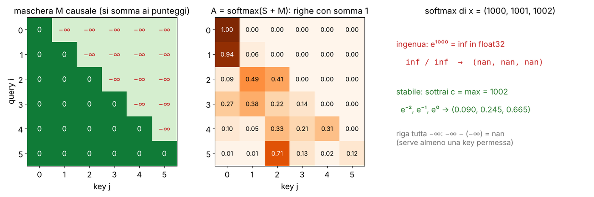

# L18 · Lab ViT

*Lezione 18 · laboratorio · ottobre 2026*

[Versione interattiva sul sito, con videolezione](https://gabriele-marsili.github.io/appunti-magistrale-ai/anno-2/computer-vision/sito/#L18) · [Indice della dispensa](README.md)

**In una frase:** il laboratorio costruisce un **Vision Transformer** pezzo per pezzo, controllando la forma di ogni tensore: si taglia una foto 224×224 in **196 patch che diventano 196 vettori (token) di dimensione 96**, si scrive la self-attention a mano, la si divide in 4 teste, si monta il blocco encoder, si aggiungono \[CLS\] e posizioni (197 token, 317 674 parametri), lo si addestra 40 epoche su Imagenette (67% sul test) e infine si guarda dentro: feature, posizioni imparate e **attention rollout**, confrontati con il ViT-B/16 preaddestrato.

### Prima di iniziare

È un laboratorio senza slide: c'è solo il notebook `vit_trained.ipynb`, che cita le slide della [L17](https://gabriele-marsili.github.io/appunti-magistrale-ai/anno-2/computer-vision/sito/#L17) (26 patch embedding, 27 posizioni, 29–30 self-attention, 31 blocco pre-norm, 36 rollout). La teoria è nella dispensa della [L17](https://gabriele-marsili.github.io/appunti-magistrale-ai/anno-2/computer-vision/sito/#L17), sezioni 9–14: qui non la ripetiamo, la **costruiamo** con le forme e i numeri del notebook. Ti servono:

  - dalla [L15](https://gabriele-marsili.github.io/appunti-magistrale-ai/anno-2/computer-vision/sito/#L15): convoluzione con canali e stride, MLP, softmax e cross-entropy, residui, LayerNorm;
  - dalla [L16](https://gabriele-marsili.github.io/appunti-magistrale-ai/anno-2/computer-vision/sito/#L16): il ciclo di training in PyTorch (zero\_grad, forward, loss, backward, step), train/validazione/test, il formato (B, C, H, W);
  - dalla [L17](https://gabriele-marsili.github.io/appunti-magistrale-ai/anno-2/computer-vision/sito/#L17): che cos'è un ViT, a grandi linee;
  - algebra lineare: prodotto matrice per matrice, prodotto scalare, varianza di una somma di variabili indipendenti.

I numeri vengono dalle **uscite salvate del docente** (GPU, 40 epoche) e dalla **nostra esecuzione** dello stesso notebook su CPU con 1 epoca: è deterministica e dà esattamente i numeri della prima epoca del docente. Le schede qui sotto seguono il notebook cella per cella (28 schede); la dispensa segue l'ordine in cui conviene capire e rimanda alle schede.

### Guarda prima questi video

  - [Attention in transformers, step-by-step | Deep Learning Chapter 6](https://www.youtube.com/watch?v=eMlx5fFNoYc) (Video). 3Blue1Brown. Tutto. Query, key e value, la griglia dei prodotti scalari, la softmax per colonna (nella sua griglia le query stanno sulle colonne: per noi è per riga), la scala √d k , le teste multiple. Parla di parole: leggi «patch» al posto di «parola». Prima delle sezioni 4–6.
  - [An Image is Worth 16x16 Words: Transformers for Image Recognition at Scale (Paper Explained)](https://www.youtube.com/watch?v=TrdevFK_am4) (Video). Yannic Kilcher. Il paper del ViT spiegato passo per passo: patch, \[CLS\], posizioni apprese, perché servono tanti dati, fino agli esperimenti e alle figure di analisi. Prima delle sezioni 9–16.
  - [Lecture 13: Attention](https://www.youtube.com/watch?v=YAgjfMR9R_M) (Video). Justin Johnson, Michigan EECS 498-007 (Michigan Online). La seconda metà: self-attention scritta con matrici, maschere, multi-head e blocco transformer. È il ripasso più «formale», utile per le sezioni 6, 8 e 18.

### 1\. Perché passare dai pixel ai token

**Il problema.** Nel lab CNN ([L16](https://gabriele-marsili.github.io/appunti-magistrale-ai/anno-2/computer-vision/sito/#L16)) ogni filtro guardava un intorno 3×3: per mettere in relazione l'orecchio di un cane con la sua coda servono molti strati, perché il campo recettivo cresce lentamente. Un'immagine però è piena di relazioni a distanza: il campanile e il suo riflesso nell'acqua, la motosega e chi la tiene.

**L'idea.** Il ViT (Dosovitskiy et al. 2021) tratta l'immagine come una frase: la taglia in pezzi quadrati, trasforma ogni pezzo in un vettore e lascia che **ogni pezzo guardi direttamente tutti gli altri già dal primo strato**, con la self-attention. Il notebook costruisce un ViT **piccolo** (2 blocchi, D = 96) e lo addestra da zero, poi lo confronta con il **ViT-B/16** di torchvision (12 blocchi, D = 768, preaddestrato su ImageNet).

**I dati** (schede 1–2). **Imagenette** è un sottoinsieme di ImageNet con 10 classi facili da distinguere: tench (un pesce), English springer, cassette player, chain saw, church, French horn, garbage truck, gas pump, golf ball, parachute. Sono foto vere (versione 320 px), portate a 224×224: in training con un crop casuale ridimensionato e il flip, in valutazione con resize a 256 e crop centrale. Non c'è un test ufficiale, quindi la validazione ufficiale (3925 foto) viene divisa a metà con seme 42: **9469 training, 1962 validazione, 1963 test**. La normalizzazione usa media e deviazione standard di ImageNet, le stesse del modello preaddestrato.

> **Il punto**
> 
> Il ViT sostituisce i filtri locali con un confronto **tutti contro tutti fra pezzi dell'immagine**. Il lab lo costruisce piccolo, lo addestra su 10 classi di ImageNet e lo confronta con un ViT grande preaddestrato.

### 2\. Dalle patch ai token: le forme

**Il problema.** Un transformer lavora su **sequenze** di vettori, (B, N, D): B immagini, N elementi, D numeri per elemento. Il DataLoader invece dà (B, C, H, W) = (32, 3, 224, 224) (scheda 3). Bisogna passare da una griglia di pixel a una lista di vettori.

**L'idea.** Si taglia l'immagine in quadrati P×P che non si sovrappongono, le **patch**. Ogni patch, appiattita, è un vettore di P²C numeri; una matrice appresa E, **la stessa per tutte le patch**, lo porta a D numeri. Quel vettore è un **token**. Il numero di patch è

`N = (H/P)·(W/P) = HW/P²`

H e W sono altezza e larghezza dell'immagine, P il lato della patch, C il numero di canali (3 per RGB).

**Esempio con i numeri del lab** (scheda 4). H = W = 224, P = 16, C = 3, D = 96:

  - N = (224/16)² = 14² = **196 patch**, disposte su una griglia 14×14;
  - ogni patch ha 16·16·3 = **768 valori**;
  - E ha 768×96 pesi e porta ogni patch a un token di **96 numeri**;
  - si aggiunge in testa il token speciale \[CLS\] (sezione 9): **197 token**.

`(B, 3, 224, 224) → (B, 196, 768) → (B, 196, 96) → (B, 197, 96)`

![Le due strade dai pixel ai token. Sopra: si estraggono le patch (`unfold`) e si moltiplica per E. Sotto: una convoluzione con kernel 16 e stride 16, poi si appiattisce la griglia. Danno lo stesso risultato (cella 13); poi si aggiungono \[CLS\] e posizioni.](../sito-src/L18/disp2_pipeline.png)

D = 96 è una **scelta di progetto**, non dipende da P: è la larghezza di tutti i blocchi del modello e ne fissa capacità e costo (ViT-B/16 usa D = 768). Qui 768 valori diventano 96: la proiezione comprime.

> **Il punto**
> 
> **N = HW/P² patch, ognuna di P²C valori, proiettate in token di dimensione D**. Con 224, P = 16 e D = 96: 196 patch da 768 valori, 196 token da 96, 197 con \[CLS\].

### 3\. La patch embedding è una convoluzione

**Il problema.** Estrarre a mano 196 patch, appiattirle e moltiplicarle per E funziona, ma è scomodo. Il notebook (scheda 5) non lo fa: la classe `PatchEmbed` contiene solo `nn.Conv2d(3, 96, kernel_size=16, stride=16)`. Perché è la stessa cosa?

**L'idea.** Una convoluzione con kernel 16×16 calcola, in ogni posizione, un prodotto scalare fra il kernel e i 16·16·3 = 768 pixel sotto di esso, più un bias. Con 96 kernel dà 96 numeri per posizione. Con **stride uguale al kernel**, la finestra salta di 16 pixel: le posizioni sono esattamente le 14×14 patch, senza sovrapposizioni né buchi. E **ogni posizione usa gli stessi pesi**: è la condivisione dei pesi della conv, cioè «la stessa E per tutte le patch». Il visionbook lo dice nella sezione «CNNs in Disguise» (§ 26.9.1): la tokenizzazione è una conv con kernel K e stride K.

L'uscita della conv è una mappa (B, 96, 14, 14). Due operazioni la rendono una sequenza: `flatten(2)` unisce le due dimensioni spaziali, (B, 96, 196), e `transpose(1, 2)` mette i token sulle righe, (B, 196, 96).

    patches = F.unfold(images, kernel_size=16, stride=16).transpose(1, 2)    # (B, 196, 768)
    tokens  = F.linear(patches, conv.weight.flatten(1), conv.bias)          # (B, 196, 96)
    # coincide con patch_embed(images) a meno di 1e-5 (cella 13)

Il peso della conv ha forma (96, 3, 16, 16); `flatten(1)` lo rende 96×768, cioè Eᵀ. I pesi sono 768·96 + 96 = **73 824**.

**Com'è fatto un token** (scheda 6). Un token è un **vettore di 96 numeri, non una piccola immagine**. La figura del notebook mostra le due matrici della stessa foto: a sinistra le patch grezze, a destra i token.

Due conseguenze. (1) Se due patch hanno pixel identici, **dopo la patch embedding hanno token identici**, perché la proiezione è la stessa: diventano diversi solo quando si sommano le posizioni (sezione 9). Nel notebook i token 1 e 2, due patch adiacenti della prima riga con contenuto simile, iniziano con (0.411, 0.430, −0.234, …) e (0.457, 0.383, −0.282, …): quasi uguali. (2) All'inizio E è casuale: le mappe descrivono la struttura della rappresentazione, non concetti imparati.

> **Il punto**
> 
> **Patch embedding = Conv2d con kernel = stride = P**, da 3 a D canali, seguita da flatten e transpose. È identica a «estrai le patch e moltiplica per E», perché la conv condivide i pesi fra le posizioni.

### 4\. Self-attention passo per passo

**Il problema.** Abbiamo 197 token, ognuno sa qualcosa solo della propria patch. Il token di una patch di cielo da solo non sa se sta sopra una chiesa o sopra un paracadute. Ogni token deve raccogliere informazione dagli altri, ma **non da tutti allo stesso modo**: da quelli rilevanti.

**L'idea** (scheda 7). Ogni token produce tre vettori con tre proiezioni lineari apprese: una **query q, «che cosa cerco»**, una **key k, «che cosa offro a chi cerca»**, e un **value v, «l'informazione che passo»**. Il token i confronta la sua query con le key di tutti; più la key j somiglia alla query, più peso riceve il value j. Senza la dimensione del batch, con X ∈ ℝ197×96 i token per riga:

`Q = XWQ,   K = XWK,   V = XWV,   Attention(Q, K, V) = softmax(QKᵀ/√dk) V`

Q, K, V hanno forma 197×dk: una riga per token, dk colonne (con una testa sola dk = D; con più teste vedremo dk = D/h). Il calcolo si fa in tre passi:

1.  **Confronta**: S = QKᵀ/√dk, una matrice 197×197. Sij = qi·kj/√dk misura quanto la query i corrisponde alla key j.
2.  **Normalizza ogni riga**: Aij = exp(Sij) / ∑m exp(Sim). **La softmax è per riga (sulle key, `dim=-1`)**: ogni riga di A è una distribuzione di probabilità, positiva e con somma 1, perché è il modo in cui *una* query divide la sua attenzione fra tutte le key.
3.  **Mescola i value**: yi = ∑j Aij vj. Ogni uscita è una media pesata dei value.

Il visionbook la chiama «pooling dinamico» (§ 26.6): come uno strato lineare l'uscita è una combinazione dei token, ma **i pesi sono calcolati dall'ingresso**, diversi per ogni immagine.

**Esempio svolto: tre token** (scheda 8, celle 19–20). dk = 2, key uguali alle query, value v1 = (1, 0), v2 = (0, 1), v3 = (1, 1).

*Caso 1*: q1 = (2, 0), q2 = (0, 2), q3 = (1, 1). Riga 1 di QKᵀ: q1·k1 = 4, q1·k2 = 0, q1·k3 = 2; divisi per √2 danno 2.83, 0, 1.41. Esponenziali: e2.83 = 16.9, e0 = 1, e1.41 = 4.11, somma 22.0. Pesi: **0.768, 0.045, 0.187**. Uscita: 0.768·(1, 0) + 0.045·(0, 1) + 0.187·(1, 1) = **(0.955, 0.232)**. Il token 1 «assomiglia» soprattutto a sé stesso e un po' al token 3. Il token 3 ha prodotti tutti uguali a 2 (q3 = (1, 1) vale 2 con ogni key): pesi 1/3 ciascuno e uscita (0.667, 0.667), la media dei value.

*Caso 2*: q1 = q2 = (2, 0). Ora le righe 1 e 2 di S sono uguali, (2.83, 2.83, 1.41), quindi pesi uguali (0.446, 0.446, 0.108) e uscite uguali, (0.554, 0.554). In generale: **query uguali danno distribuzioni di attenzione e uscite uguali**, qualunque sia il resto.

Nel notebook la funzione è tre righe (scheda 9). Funziona per qualunque numero di dimensioni iniziali (batch, teste), perché `@` moltiplica le ultime due e `transpose(-2, -1)` traspone solo quelle:

    def attention_from_scratch(q, k, v):                  # q, k, v: (B, h, T, d_k)
        scores = q @ k.transpose(-2, -1) / math.sqrt(q.shape[-1])   # (B, h, T, T)
        weights = scores.softmax(dim=-1)                  # ogni riga somma a 1
        return weights @ v, weights                       # (B, h, T, d_k)

La cella 24 la confronta con `F.scaled_dot_product_attention` di PyTorch: coincidono.

> **Il punto**
> 
> Self-attention in tre passi: punteggi S = QKᵀ/√dk, softmax per riga, media pesata dei value. **Ogni riga di A dice da quali token il token i prende informazione**, e i pesi dipendono dall'immagine.

### 5\. Perché si divide per √dk

**Il problema.** Senza il fattore 1/√dk la formula sembra uguale. Ma i prodotti scalari crescono con la dimensione: con teste larghe, i punteggi diventano grandi e la softmax si comporta male.

**La matematica.** Supponiamo (ipotesi idealizzata) che le componenti di q e k siano indipendenti, a media 0 e varianza 1. Il prodotto scalare q·k = ∑m=1dk qmkm è una somma di dk termini indipendenti; ognuno ha media 0 e varianza E\[qm²\]·E\[km²\] = 1. Le varianze di termini indipendenti si sommano:

`Var(q·k) = dk,   Var(q·k / √dk) = 1`

Quindi senza scala la deviazione standard dei punteggi è √dk: **4.9** per le teste del nostro modello (dk = 24), 8 per ViT-B (dk = 64). Dividere per √dk la riporta a 1 qualunque sia la larghezza.

**Che cosa va storto.** La softmax di numeri molto distanti fra loro è quasi un vettore one-hot: **tutto il peso va alla key con il punteggio più alto**, e l'attenzione smette di fare medie. Peggio ancora: in quella zona la softmax è piatta. La sua derivata è ∂ai/∂sj = ai(δij − aj), che vale quasi 0 quando un a vale circa 1 e gli altri circa 0: **i gradienti attraverso la softmax spariscono** e quei pesi non imparano. Prince (§ 12.3.2) lo dice così: i prodotti grandi spostano la softmax «into a region where the largest value dominates».

> **Il punto**
> 
> **Var(q·k) = dk**: senza 1/√dk i punteggi crescono con la larghezza della testa, la softmax satura su una sola key e i gradienti diventano piccolissimi. **La scala riporta i punteggi a varianza 1**.

### 6\. Più teste e la proiezione fusa: 3D, dk = D/h, 4D²

**Il problema.** Con una sola testa c'è un solo modo di misurare la somiglianza fra due token (per esempio: «stesso colore»). Ma una patch potrebbe voler sapere sia chi ha il suo stesso colore sia chi le sta sopra. Servono più confronti in parallelo.

**L'idea** (schede 10–11). Si usano h teste: ogni testa fa la sua attenzione su **tutti** i token, ma in un sottospazio di dk = D/h coordinate. Nel lab D = 96 e h = 4, quindi **ogni testa ha dk = 24**. Le uscite delle teste si concatenano (4·24 = 96) e una matrice WO ∈ ℝ96×96 le combina:

`headi = Attention(Qi, Ki, Vi),   MHSA(X) = Concat(head1, …, headh) WO`

**Perché 3D uscite.** In pratica Q, K e V non si calcolano con tre moltiplicazioni ma con una sola, per una matrice **WQKV ∈ ℝD×3D**: per D = 96 escono 288 numeri per token. **288 = 3D non vuol dire «tre teste»**: sono query, key e value, ognuno largo D = 96, e ognuno poi tagliato in 4 pezzi da 24, uno per testa. Il 3 non dipende da h.

**Quanti pesi.** WQKV ha D·3D = 3D² pesi, WO ne ha D². In tutto **4D² pesi di attenzione per blocco**, più 4D bias: per D = 96, 4·9216 + 384 = 37 248. **Cambiare h con D fisso non cambia il numero di parametri**: cambia solo come si tagliano i 3D canali. Se invece si desse a ogni testa tutta la larghezza D (uscita hD per Q, e così via) si avrebbe un modello diverso e h volte più grande.

**Traccia delle forme** per un'immagine (cella 29; con il batch si aggiunge B davanti, scheda 27):

    X                [197, 96]
    Linear(QKV)      [197, 288]
    Q, K, V          [4, 197, 24] ciascuno     # reshape(T, 3, h, d_k) + permute
    A = softmax(...) [4, 197, 197]             # una matrice per testa
    A V              [4, 197, 24]
    concatena        [197, 96]                 # transpose(0, 1) + reshape
    · W^O            [197, 96]

Una testa **non** guarda 1/h delle patch: guarda tutte le 197, ma con 24 coordinate su 96. Si dividono le **dimensioni**, non i token. Il costo dell'attenzione resta lo stesso con qualunque h: h · T² · (D/h) = T²D.

> **Il punto**
> 
> **Una moltiplicazione per WQKV (D×3D) produce Q, K e V; ognuno si taglia in h teste da dk = D/h**. Ogni testa vede tutti i token in un sottospazio; WO le ricombina. 4D² pesi, indipendenti da h.

### 7\. L'errore classico: reshape senza transpose

**Il problema.** Dopo l'attenzione le uscite delle teste hanno forma (B, h, T, dk) e vanno riportate a (B, T, D). La tentazione è `values.reshape(B, T, D)`: la forma è giusta, il codice **non dà nessun errore, ma il risultato è sbagliato** (scheda 27, domanda 4).

**Perché.** `reshape` non sposta i dati: legge la memoria nell'ordine in cui è e la ritaglia nella nuova forma. In (B, h, T, dk) la memoria contiene prima la testa 0 per tutti i token, poi la testa 1, e così via. Tagliando in righe di D numeri, una riga contiene pezzi di **token diversi** della stessa testa. Bisogna prima portare i token davanti alle teste con `transpose(1, 2)`, (B, T, h, dk), e solo allora unire le ultime due dimensioni.

Stessa trappola con `.T`: su un tensore a 4 dimensioni **`.T` inverte tutti gli assi**, (2, 4, 197, 24) → (24, 197, 4, 2). Per Kᵀ si scrive `k.transpose(-2, -1)` (o `.mT`), per unire le teste `transpose(1, 2)`: sempre nominare gli assi. La cella 73 verifica la versione scritta a mano contro `nn.MultiheadAttention` copiandone i pesi: coincidono.

> **Il punto**
> 
> `reshape` cambia la forma senza riordinare: **per unire le teste serve transpose(1, 2) prima del reshape**. Senza, le forme tornano e il bug è silenzioso.

### 8\. Il blocco encoder pre-LayerNorm

**Il problema.** L'attenzione mescola i token, ma è (a parte la softmax) un'operazione lineare sui value: serve anche una trasformazione non lineare di ogni token. E impilando molti strati bisogna che il gradiente arrivi fino in fondo.

**L'idea** (scheda 12). Il blocco alterna due operazioni, ognuna con una LayerNorm prima e un residuo intorno:

`X′ = X + MHSA(LN(X)),   X″ = X′ + MLP(LN(X′))`

MHSA è l'attenzione multi-testa della sezione 6: **mescola i token fra loro**. MLP è Linear(96 → 384), GELU, Linear(384 → 96): l'MLP **trasforma ogni token da solo**, con gli stessi pesi per tutti i 197 (allarga a 4D e torna a D). LN è la LayerNorm: per **ogni token separatamente** sottrae la media e divide per la deviazione standard delle sue 96 coordinate, poi applica scala γ e spostamento β appresi (192 parametri). Non dipende dagli altri token né dalle altre immagini.

**Perché «pre».** La LN sta *dentro* il ramo, prima di MHSA e MLP, e il cammino residuo resta un'identità pulita: **il gradiente torna all'ingresso direttamente attraverso i «+»**, come nelle ResNet. Ogni ramo impara solo una correzione da sommare. Nel transformer originale (post-norm) la LN stava dopo la somma e il residuo passava da una LN a ogni blocco (dettagli nella [L17](https://gabriele-marsili.github.io/appunti-magistrale-ai/anno-2/computer-vision/sito/#L17), sezione 12). Il libro chiama questa normalizzazione «token norm» (§ 26.7).

> **Il punto**
> 
> Blocco pre-norm: **x + MHSA(LN(x)), poi x + MLP(LN(x))**. L'attenzione mescola i token, l'MLP (D → 4D → D) trasforma ciascuno; la forma resta (197, 96).

### 9\. \[CLS\] ed embedding posizionali

**Il problema 1: dove sta una patch?** Riguarda le operazioni del blocco: la LN e l'MLP lavorano su ogni token da solo; l'attenzione confronta tutti con tutti con pesi che dipendono solo dal **contenuto**. Nessuna di queste sa in che ordine sono i token. Se si rimescolano le righe di X, le uscite si rimescolano allo stesso modo e nient'altro cambia: il blocco è **equivariante alle permutazioni** (visionbook eq. 26.8). Per il modello, senza altre informazioni, **l'immagine è un sacco di patch**: una foto e il suo puzzle rimescolato sono la stessa cosa.

**La soluzione.** A ogni posizione si associa un vettore appreso e lo si **somma** al token, una volta sola, prima del primo blocco (scheda 13). È una tabella **Epos ∈ ℝ197×96**, inizializzata con rumore di deviazione standard 0.02: nessuno dice al modello che la posizione 15 sta sotto la 1, lo deve imparare dai dati (sezione 13).

**Il problema 2: chi decide la classe?** Il blocco restituisce 197 token, la testa di classificazione vuole un vettore solo. Il ViT aggiunge in testa un **token \[CLS\]** (dal modello di linguaggio BERT): un vettore appreso, uguale per tutte le immagini, che non corrisponde a nessuna patch. Attraverso l'attenzione raccoglie informazione da tutte le patch; alla fine il suo stato, dopo una LayerNorm, va in un `nn.Linear(96, 10)`. In formula:

`Z0 = [xcls; z1; …; z196] + Epos ∈ ℝ197×96`

xcls è il token \[CLS\] (riga 0), z1…z196 i token delle patch, ; indica che si impilano come righe. Nel modello non addestrato (cella 37, scheda 14) la riga del \[CLS\] vale circa ±0.03 (somma di due vettori inizializzati a 0.02), quella delle patch circa ±1. Il visionbook non usa \[CLS\] ma somma i token d'uscita, come il global average pooling; le due scelte danno accuratezze simili (scheda 25).

**La prova.** Abbiamo preso il nostro modello dopo 1 epoca e una foto del test, e abbiamo rimescolato a caso le 196 patch.

Il risultato è istruttivo due volte. Senza posizioni il \[CLS\] dà **esattamente la stessa uscita per la foto e per il puzzle**: è **invariante**, perché il \[CLS\] non viene permutato e le sue somme pesate non dipendono dall'ordine. E dopo 1 epoca il modello usa pochissimo le posizioni. Il notebook nota (scheda 25) che togliere le posizioni su Imagenette fa perdere meno accuratezza del previsto: molte classi si riconoscono da «quali pezzi ci sono» più che da «dove».

> **Il punto**
> 
> Attenzione e MLP non sanno l'ordine: **senza posizioni un ViT vede un sacco di patch**. Si sommano embedding posizionali appresi (197×96) e si antepone un \[CLS\] appreso, il cui stato finale va alla testa lineare.

### 10\. Quanti parametri e dove stanno

**Il problema.** «Il ViT è un modello grande» è vago. Dove stanno davvero i pesi? Il conto è anche un ottimo controllo di aver capito le forme (cella 62, scheda 24).

**Il conto** per il nostro modello, D = 96, 2 blocchi, 10 classi:

  - patch embedding: 768·96 + 96 = **73 824**;
  - \[CLS\] + posizioni: 96 + 197·96 = **19 008**;
  - attenzione: (4D² + 4D) × 2 blocchi = 37 248 × 2 = **74 496**;
  - MLP: (D·4D + 4D + 4D·D + D) × 2 = (8D² + 5D) × 2 = 74 208 × 2 = **148 416**;
  - LayerNorm: 5 strati (2 per blocco + quella finale) × 192 = **960**; testa: 96·10 + 10 = **970**.

Totale **317 674**, il numero stampato dalla cella 35 (la risposta 6 della cella 61 manca nel testo: la dà questo conto, nel codice della cella 62). Per blocco, a parte i bias, 4D² + 8D² = **12D² parametri: un terzo nell'attenzione, due terzi nell'MLP**.

**Perché i due modelli sono così diversi.** I blocchi crescono come D² e con il numero di blocchi; patch embedding e posizioni crescono solo come D. In ViT-B/16, 12 · 12 · 768² ≈ 85 milioni sono nei blocchi, mentre patch embedding (590 592) e posizioni (152 064) sono meno dell'1%. Totale 86 567 656: **272 volte il nostro**. Con P = 8, invece, il nostro modello avrebbe quasi gli stessi parametri (≈ 319k: la patch embedding scende a 18 528, le posizioni salgono a 75 360), ma costerebbe molto di più (sezione 17).

> **Il punto**
> 
> Per blocco ≈ 12D² parametri, **due terzi nell'MLP**. Il nostro ViT ha 317 674 parametri, ViT-B/16 86,6 milioni; nei modelli grandi patch embedding e posizioni sono trascurabili.

### 11\. Training con AdamW e le curve

**Il ciclo** (scheda 15) è quello del lab CNN: forward, cross-entropy, backward, passo dell'ottimizzatore, con una funzione `run_epoch` che fa training se riceve un ottimizzatore e valutazione se no. Cambia l'ottimizzatore: **AdamW** con learning rate 3·10−4 e weight decay 0.05. AdamW è Adam (passo adattivo per ogni parametro, Prince § 6.4) con il weight decay **separato** dal gradiente: a ogni passo i pesi vengono anche ridotti di una piccola frazione, invece di aggiungere un termine L2 alla loss che Adam poi riscalerebbe. È la scelta standard per i transformer.

**Come leggere le curve.**

  - **Epoca 1**: train 0.340, validazione 0.418, la stessa cifra nella nostra esecuzione. La validazione è più alta del training perché l'accuratezza di training è la media su tutta l'epoca (il modello all'inizio dell'epoca era peggiore) e perché in training le immagini sono ritagliate e specchiate. Dopo 1 epoca il test vale 0.419.
  - **Epoca 40**: train 0.766, validazione 0.675; la migliore validazione è 0.708, all'epoca 39. Il test finale è **0.668** (loss 1.016).
  - Dopo l'epoca 20 la loss di validazione resta intorno a 1.0 mentre quella di training scende a 0.68: **overfitting leggero**, con un divario di circa 9 punti di accuratezza. La validazione oscilla di qualche punto (0.643 all'epoca 25, 0.708 all'epoca 39).

**Perché solo 67%.** Un ViT da zero su 9500 immagini parte svantaggiato: **non ha i presupposti di una CNN** (località, equivarianza alla traslazione), deve impararli dai dati, e con pochi dati li impara male. Il paper del ViT superava le CNN solo con un pre-training su centinaia di milioni di immagini. Il ViT-B/16 preaddestrato, nella sezione 16, classifica in modo sensato tutte e 4 le immagini di prova.

> **Attenzione: «una epoca» nel testo, 40 nel codice**
> 
> La cella 38 dice che si addestra «for one epoch by default (EPOCHS = 1)», la 58 parla del «one-epoch model» e il commento della cella 5 dice che un'epoca è solo una dimostrazione. Ma il codice ha `EPOCHS = 40` e **tutte le uscite salvate sono a 40 epoche** (curve, test 0.668, rollout, figura «after 40 epoch(s)»). È testo rimasto da una versione precedente (schede 2, 15 e 23). Con 1 epoca i risultati sono quelli della nostra esecuzione: test 0.419, mappe molto più rumorose.

> **Approfondimento: scelte da lab**
> 
> Il weight decay è applicato a tutti i parametri, anche bias, LayerNorm, posizioni e \[CLS\] (di solito si escludono); non c'è warmup né schedule del learning rate; si valuta il modello dell'ultima epoca (0.675) e non il migliore (0.708). Non sono errori, ma una ricetta seria li cambierebbe (scheda 15). E la cella 41 dice che `model.eval()` spegne il dropout: vero in generale, ma **questo modello non ha né dropout né BatchNorm**, quindi qui `eval()` non cambia nulla (scheda 17).

> **Il punto**
> 
> Stesso ciclo della CNN con AdamW (lr 3·10−4, weight decay 0.05). Da 0.42 dopo 1 epoca a **0.67 sul test dopo 40**, con un overfitting leggero dall'epoca 20: un ViT piccolo da zero su pochi dati non brilla.

### 12\. Le feature come mappe 14×14

**Il problema.** Nella [L16](https://gabriele-marsili.github.io/appunti-magistrale-ai/anno-2/computer-vision/sito/#L16) si guardavano le feature map di una CNN. Un ViT non ha mappe, ha una lista di token: come si guarda dentro?

**L'idea** (scheda 18). Ogni token di patch corrisponde a una casella della griglia. Si toglie il \[CLS\], si rimettono i 196 token d'uscita (dopo la LN finale) in una griglia 14×14×96, e si guarda **una coordinata alla volta**: la coordinata j di tutti i token forma una mappa Fj ∈ ℝ14×14, l'analogo di un canale di una CNN.

    patch_features = tokens[:, 1:]                       # (1, 196, 96), via il [CLS]
    grid = patch_features.reshape(1, 14, 14, 96)         # riga per riga, come le patch
    plt.imshow(grid[0, :, :, j])                         # canale j

Un singolo canale raramente ha un significato chiaro: i 96 numeri vanno letti insieme (per esempio con la PCA della [L16](https://gabriele-marsili.github.io/appunti-magistrale-ai/anno-2/computer-vision/sito/#L16)). Il passo importante è il reshape: **i token di un ViT si possono sempre rimettere in griglia**, ed è così che un ViT diventa un encoder per la predizione densa ([L17](https://gabriele-marsili.github.io/appunti-magistrale-ai/anno-2/computer-vision/sito/#L17), sezione 15).

> **Il punto**
> 
> Togli il \[CLS\], **rimodella 196 token in 14×14×96**: ogni coordinata è una feature map 14×14, come un canale di una CNN.

### 13\. Che cosa hanno imparato le posizioni

**Il problema.** Le posizioni partono da rumore e il modello le riceve come una lista di 197 vettori: niente gli dice che la griglia è 2D. Le impara davvero?

**Come si guarda** (scheda 21). Per ogni posizione (r, c) si calcola la **similarità coseno** fra il suo embedding e quelli di tutte le 196 posizioni (+1 = stessa direzione, 0 = ortogonali, −1 = opposte) e la si disegna come mappa 14×14. Le 196 mappe si affiancano nella disposizione della griglia: il quadratino in riga r e colonna c dice a chi somiglia la posizione (r, c). È la fig. 7 del paper del ViT.

  - **Nostro modello, 1 epoca**: rumore, a parte la diagonale (ogni vettore è identico a sé stesso). Coerente con la sezione 9: dopo 1 epoca le posizioni quasi non contano.
  - **Nostro modello, 40 epoche**: ha imparato soltanto **«bordo contro centro»**: le posizioni del bordo si somigliano fra loro, quelle interne pure. Gli oggetti di Imagenette sono quasi sempre centrati e 9500 immagini sono troppo poche per imparare righe e colonne esatte.
  - **ViT-B/16**: la croce riga/colonna (zoom in basso). Su 1,3 milioni di immagini, patch nella stessa riga o colonna sono correlate, e **il modello scopre da solo la struttura 2D** da una lista 1D.

> **Da saper fare: leggere il pannello grande di ViT-B/16**
> 
> Nella prima figura della cella 52 il pannello del modello preaddestrato sembra una trama di righe e colonne regolari invece di 196 croci separate. Non è un errore di calcolo né un difetto di disegno: ridisegnando le 196 mappe a piena risoluzione e con uno spazio bianco fra l'una e l'altra si ottiene la stessa trama (figura nella sezione Risultati delle schede). **Ogni mappa è a sua volta una trama di righe e colonne**, e affiancate senza spazi le linee chiare di mappe vicine si allineano. Per vedere la croce attorno a una posizione servono gli ingrandimenti della seconda figura (riprodotta sopra, scheda 21).

Se si volesse usare ViT-B/16 a 384×384 (griglia 24×24) basta rimodellare le 196 posizioni in 14×14, interpolarle a 24×24 e riappiattirle, tenendo il \[CLS\]: 24² + 1 = 577 posizioni (cella 54).

> **Il punto**
> 
> La similarità coseno fra embedding posizionali mostra che cosa il modello sa della geometria: **il nostro solo bordo/centro, ViT-B/16 righe e colonne**, imparate dai dati senza che nessuno gliele dica.

### 14\. Attention rollout: seguire l'informazione attraverso i blocchi

**Il problema.** Vorremmo vedere «dove guarda» il modello per decidere la classe. La riga del \[CLS\] nella matrice di attenzione dell'ultimo blocco non basta: dice da quali token il \[CLS\] prende informazione *in quel blocco*, ma quei token sono già miscugli di altri token dei blocchi precedenti. E una parte dell'informazione passa dal residuo, senza attenzione.

**L'idea** (scheda 19; Abnar e Zuidema 2020, slide 36 della [L17](https://gabriele-marsili.github.io/appunti-magistrale-ai/anno-2/computer-vision/sito/#L17)). Si trattano le matrici di attenzione come «quanto di ogni token passa in ogni token» e si concatenano i passaggi, blocco dopo blocco:

1.  **media sulle teste**: Ā(l) = (1/h) ∑i Ai(l), una matrice 197×197 per il blocco l;
2.  **aggiungi il residuo**: + I, perché ogni token passa anche a sé stesso attraverso il «+» del blocco;
3.  **normalizza le righe**: Ã(l) = row\_normalize(Ā(l) + I). Le righe di Ā sommano a 1, quindi le righe di Ā + I sommano a 2 e Ã(l) = (Ā(l) + I)/2: metà attenzione, metà residuo;
4.  **moltiplica in ordine**, dal primo blocco all'ultimo:

`R(0) = I,   R(l) = Ã(l) R(l−1),   quindi R(L) = Ã(L) ⋯ Ã(1)`

R(L)ij stima quanto il token i all'uscita viene dal token j all'ingresso. La riga 0 (il \[CLS\]), senza la colonna del \[CLS\], ha 196 valori: si rimodella in 14×14 e si ingrandisce a 224×224 per sovrapporla alla foto. L'ordine conta: **il prodotto di matrici non è commutativo**, e il blocco più recente va a **sinistra**.

**Esempio svolto** con 3 token (\[CLS\], p1, p2) e 2 blocchi. Nel blocco 1 il \[CLS\] guarda soprattutto p1 (riga (0.1, 0.8, 0.1)), nel blocco 2 soprattutto p2 (riga (0.2, 0.2, 0.6)), e nel blocco 2 anche p2 guarda sé stesso (0.8).

  - Ã(1), riga \[CLS\]: ((0.1 + 1)/2, 0.8/2, 0.1/2) = (0.55, 0.40, 0.05). Ã(2), riga \[CLS\]: (0.60, 0.10, 0.30).
  - R(2) riga \[CLS\] = 0.60·(riga \[CLS\] di Ã(1)) + 0.10·(riga p1) + 0.30·(riga p2) = 0.60·(0.55, 0.40, 0.05) + 0.10·(0.10, 0.80, 0.10) + 0.30·(0.15, 0.15, 0.70) = **(0.385, 0.365, 0.250)**.

![Il rollout sull'esempio piccolo. Nella riga del \[CLS\] di R(2) pesano sia p1 (guardato nel blocco 1) sia p2 (guardato nel blocco 2), più il \[CLS\] stesso tramite i residui. Nell'ordine sbagliato, Ã(1)Ã(2), verrebbe (0.35, 0.28, 0.37).](../sito-src/L18/disp2_rollout_esempio.png)

Nel notebook il calcolo ripete il forward del blocco (LN, attenzione con `need_weights=True, average_attn_weights=False` per avere le 4 teste, residuo, MLP) e accumula `rollout = attention @ rollout` (celle 46–47). L'ordine è giusto.

> **Attenzione: è un'approssimazione**
> 
> Il rollout guarda solo «chi guarda chi». **Ignora i value, l'MLP, le LayerNorm e la testa di classificazione**, e tratta il residuo come se valesse quanto l'attenzione. Il notebook lo dice: è una visualizzazione approssimata del flusso d'informazione, non la prova di che cosa ha causato la predizione. Per saperlo si dovrebbe intervenire, per esempio coprire una regione e vedere se la probabilità della classe scende (cella 48).

> **Il punto**
> 
> Rollout: **media le teste, aggiungi I, normalizza le righe, moltiplica i blocchi in ordine** (l'ultimo a sinistra). La riga del \[CLS\] di R, in 14×14, stima da quali patch arriva l'informazione usata per classificare.

### 15\. Il rollout del nostro modello: 40 epoche contro 1

La cella 47 (scheda 20) applica il rollout alle prime 4 immagini del test: una motosega, un lettore di cassette, l'interno e l'esterno di due chiese.

**Dopo 40 epoche** (cella 48) le mappe sono concentrate su poche regioni:

  - **motosega**: il picco è sulle **cuffie protettive rosse, non sulla sega**. Le cuffie compaiono in molte foto di motoseghe: il modello potrebbe usarle come indizio di contesto;
  - **lettore di cassette**: piccoli dettagli ad alto contrasto, i tasti colorati e i comandi laterali;
  - **chiesa interna**: macchie ai bordi, poco sull'altare; mappa quasi diffusa;
  - **chiesa esterna**: la torre illuminata e il suo **riflesso** sul selciato bagnato: il modello non separa l'oggetto dalla sua immagine specchiata.

Un modello piccolo addestrato da zero tende a guardare **regioni luminose, colorate, ad alto contrasto, e il contesto correlato all'etichetta**. **Dopo 1 epoca** le mappe sono più rumorose: macchie sull'erba e ai bordi, picchi negli angoli. La cella 46 mostra anche gli stadi: dopo il blocco 1 il rollout è quasi uguale all'attenzione del blocco 1 (R(1) = Ã(1)), dopo il blocco 2 si aggiungono le zone guardate dal secondo blocco, ma resta il picco del primo, portato avanti dal residuo.

> **Il punto**
> 
> Il modello piccolo guarda **dettagli vistosi e contesto** (cuffie, tasti, riflesso), non necessariamente l'oggetto; con 1 epoca le mappe sono quasi rumore.

### 16\. Il ViT-B/16 preaddestrato: rollout e token ad alta norma

**Il modello** (schede 21–22). `torchvision.models.vit_b_16` con pesi ImageNet-1K: stesse patch 16×16 e 197 token, ma D = 768, 12 teste, 12 blocchi, 1000 classi. Predice chain saw, cassette player, **altar** (la chiesa interna, etichettata church: la risposta è sensata) e church. Torchvision non restituisce le attenzioni, quindi la cella 56 ripete il forward di ogni blocco chiedendo i pesi, senza toccare i parametri, e calcola due rollout: quello standard e uno «filtrato», che prima di aggiungere I azzera in ogni riga il 65% più debole delle attenzioni fuori diagonale.

![Dal notebook, cella 57 (scheda 23). Colonne: foto, attenzione del \[CLS\] nei blocchi 6 e 12, rollout standard, rollout filtrato. Le mappe sovrapposte sono normalizzate fra minimo e massimo solo per la visualizzazione.](../sito-src/L18/disp2_nb_preaddestrato.png)

  - **Blocco 6**: l'attenzione del \[CLS\] è sull'**oggetto**: la torre, la testa e le braccia dell'uomo, le patch del lettore.
  - **Blocco 12**: pochi token isolati, per lo più nello **sfondo** (cielo, acqua, bordi, erba).
  - **Rollout standard**: eredita quei token. In tre immagini su quattro il picco è nello sfondo (alberi scuri, angolo del lettore, tronco ed erba), **anche se tutte e quattro le predizioni sono giuste**.
  - **Rollout filtrato**: togliendo le connessioni deboli fa emergere l'oggetto nelle chiese (la torre, i pannelli della pala); i picchi nello sfondo restano.

**I token ad alta norma.** Darcet et al. (2024, *Vision Transformers Need Registers*) hanno osservato che nei ViT grandi e addestrati a lungo alcune patch di sfondo, poco informative, vengono «riciclate» come memoria per informazione globale: i loro token hanno una **norma** molto più grande degli altri e attirano l'attenzione negli ultimi blocchi. Si chiamano token «register». La soluzione proposta è dare al modello token extra apposta, i **register**, che non corrispondono a nessuna patch (il \[CLS\] è già un token di questo tipo).

> **Attenzione: «sono i token register» vale per 3 immagini su 4**
> 
> La cella 59 afferma che i picchi isolati del blocco 12 sono i token ad alta norma. L'abbiamo verificato su ViT-B/16 con le stesse immagini: token con norma ≈ 100 contro una mediana ≈ 20 esistono davvero, e in motosega, lettore e chiesa esterna i token di norma più alta sono fra i 5 più guardati dal \[CLS\] nel blocco 12. Nella **chiesa interna no**: rapporto massimo/mediana solo 2.0, e i picchi cadono su token di norma ordinaria. Su 32 immagini di test i token con norma superiore a 3 volte la mediana sono in media 1.7 per immagine e ricevono solo l'8% dell'attenzione del \[CLS\] nel blocco 12. Ipotesi plausibile e coerente con Darcet et al., non dimostrata in generale dalla figura (scheda 23).

> **Approfondimento: il rollout filtrato**
> 
> Il filtro della cella 56 calcola la soglia per riga includendo la diagonale messa a +∞, quindi con 197 valori il quantile si sposta di poco; la versione nota (Gildenblat, *vit-explain*) scarta i valori più deboli sull'intera matrice. In ogni caso è un'euristica di visualizzazione, come dice il notebook (scheda 22).

**La lezione.** Il modello preaddestrato è molto più accurato, ma **le sue mappe sono meno centrate sugli oggetti** di quelle del nostro: **accuratezza migliore non significa attenzione più interpretabile**. Il rollout mostra il flusso d'informazione, incluse le «scorciatoie» di memoria globale, non il ragionamento del classificatore.

> **Il punto**
> 
> In ViT-B/16 i blocchi intermedi guardano l'oggetto, l'ultimo pochi token di sfondo, spesso ad alta norma (register). Il rollout standard li eredita; il filtrato aiuta un po'. **Mappe di attenzione ≠ spiegazione della predizione**.

### 17\. Il costo: quadratico nel numero di token

**Il problema** (domanda della cella 9, schede 24–25). Patch più piccole danno più dettagli: perché non usare P = 8?

**Il conto.** Con P = 8 la griglia è 28×28: N = 784 patch, **785 token**, ognuno di 8·8·3 = 192 valori. I token sono circa 4 volte tanti (785/197 = 3.98). Ma la matrice di attenzione è T×T: **(785/197)² ≈ 15.9, quasi 16 volte più grande**, sia come memoria sia come calcolo di QKᵀ e AV. Le parti lineari (QKV, WO, MLP) lavorano token per token e crescono solo di 4 volte.

**Esempio in memoria.** Il tensore dei pesi di attenzione (B, h, T, T) con B = 32 e h = 4, in float32: con P = 16 è 32·4·197²·4 byte ≈ **20 MB** per blocco; con P = 8, 32·4·785²·4 ≈ **316 MB**. **In calcolo**, per blocco la parte lineare costa circa 12TD² moltiplicazioni-addizioni e l'attenzione circa 2T²D; la seconda supera la prima quando T \> 6D. Nel nostro modello 6D = 576: con P = 16 (T = 197) l'attenzione è circa un quarto del totale (7.5 milioni contro 21.8), con P = 8 (T = 785) **domina già** (118 milioni contro 87). I parametri invece restano ≈ 319k (sezione 10). In cambio: mappe 28×28 più fini e, dopo un training lungo, di solito più accuratezza.

Il caso opposto è CIFAR-10 (scheda 25): a 32×32 con P = 16 ci sono 2×2 = **4 patch, 5 token**, e non resta quasi struttura spaziale. Lì serve P = 4 (64 patch) o P = 2 (256).

> **Il punto**
> 
> Token T = HW/P² + 1; **memoria e calcolo dell'attenzione crescono come T²**. Dimezzare P: token ×4, attenzione ×16, parametri quasi invariati.

### 18\. Esercizi: maschere e softmax stabile

**Maschere** (esercizio A, scheda 26). A volte un token **non deve** guardare certi altri. Si somma ai punteggi una matrice M con 0 dove è permesso e −∞ dove è vietato, **prima** della softmax:

`Attention(Q, K, V) = softmax(QKᵀ/√dk + M) V`

Poiché e−∞ = 0, le key vietate ricevono peso esattamente zero e la softmax **rinormalizza sulle key permesse**: le righe sommano ancora a 1. Mascherare *dopo* la softmax lascerebbe righe con somma minore di 1. Il caso tipico è la maschera **causale** (triangolare inferiore): il token i vede solo 0…i. Serve quando si genera in sequenza (un video fotogramma per fotogramma): in training senza maschera **il modello copierebbe il fotogramma che deve predire**. Un ViT per classificazione **non usa maschere**: l'immagine c'è tutta, ogni patch può guardare tutte le altre e tutte le immagini hanno 197 token.

**Softmax stabile** (esercizio C, scheda 28). In float32 ex diventa `inf` già per x ≳ 88, e inf/inf = nan. La softmax non cambia se si sottrae la stessa costante c a tutti gli ingressi (e−c si semplifica fra numeratore e denominatore). Con **c = maxj xj** tutti gli esponenti sono ≤ 0, quindi niente overflow, e il termine del massimo vale e0 = 1, quindi **il denominatore è almeno 1**: mai divisione per zero. Esempio: (1000, 1001, 1002) − 1002 = (−2, −1, 0), e−2 = 0.135, e−1 = 0.368, e0 = 1, somma 1.503, softmax (0.090, 0.245, 0.665). Una riga **tutta** mascherata dà −∞ − (−∞) = nan: per questo l'esercizio A chiede almeno una key permessa. E la cross-entropy usa log-softmax = xi − c − log ∑ exj−c (log-sum-exp), non `log(softmax(x))`, che dà log 0 = −∞: per questo `nn.CrossEntropyLoss` vuole i logit.

L'esercizio B (scheda 27) è la tabella delle forme della sezione 6 con le domande su 3D, softmax per riga e transpose della sezione 7. Nel codice della cella 76 un commento finisce con un residuo «er?»: refuso innocuo.

> **Il punto**
> 
> Maschera: **−∞ sui punteggi prima della softmax**, peso 0 e righe ancora con somma 1; il ViT da classificazione non ne ha bisogno. Softmax stabile: sottrai il massimo, così nessun overflow e denominatore ≥ 1.

### Il riassunto in 10 righe

1.  Imagenette: 10 classi di ImageNet, 9469 / 1962 / 1963 foto, portate a 224×224; batch (32, 3, 224, 224).
2.  N = HW/P²: con P = 16, 196 patch da 768 valori, proiettate in token da D = 96; con \[CLS\], 197 token.
3.  Patch embedding = Conv2d(3, 96, kernel 16, stride 16) + flatten + transpose, identica a unfold + moltiplicazione per E (73 824 pesi).
4.  Self-attention: S = QKᵀ/√dk, softmax per riga, Y = AV; ogni uscita è una media pesata dei value con pesi calcolati dall'immagine.
5.  Var(q·k) = dk: senza la scala la softmax satura su una key e i gradienti spariscono.
6.  Multi-head: WQKV (D×3D) dà Q, K, V; 4 teste da dk = 24 vedono tutti i token; WO ricombina; 4D² pesi; per unire le teste transpose(1, 2) prima del reshape.
7.  Blocco pre-norm: x + MHSA(LN(x)), x + MLP(LN(x)) con MLP 96 → 384 → 96; per blocco ≈ 12D² parametri, due terzi nell'MLP.
8.  Senza posizioni il modello vede un sacco di patch (equivarianza alle permutazioni); Epos appresi (197×96) e \[CLS\] → testa lineare; 317 674 parametri.
9.  AdamW 40 epoche: test 0.668 (0.419 dopo 1 epoca), overfitting leggero; le posizioni imparano solo bordo/centro, ViT-B/16 righe e colonne.
10. Rollout: media teste, + I, normalizza, moltiplica in ordine; approssimazione, non spiegazione. Attenzione e memoria crescono come T²: P = 8 dà 785 token e ≈ 16× l'attenzione.

### Verifica di aver capito

**Immagine 224×224 RGB con P = 8 e D = 96. Quanti token, quanti valori per patch, che forma ha la matrice di attenzione di un batch di 32 con 4 teste?**

N = (224/8)² = 28² = 784 patch, 785 token con \[CLS\]; ogni patch ha 8·8·3 = 192 valori; i pesi di attenzione hanno forma (32, 4, 785, 785), circa 15.9 volte più elementi che con P = 16. La patch embedding ha 192·96 + 96 = 18 528 parametri, le posizioni 785·96 = 75 360: il totale resta ≈ 319k.

**Perché nn.Conv2d(3, 96, kernel\_size=16, stride=16) è uguale a «estrai le patch e moltiplica per E»? Che succederebbe con stride 8?**

Con kernel 16 ogni uscita è un prodotto scalare fra 96 kernel e i 768 pixel della finestra, più un bias; con stride 16 le finestre sono esattamente le 196 patch, senza sovrapposizione; la conv usa gli stessi pesi in ogni posizione, cioè la stessa E per tutte le patch. Con stride 8 le finestre si sovrapporrebbero: griglia 27×27 = 729 token, non più patch disgiunte.

**Rifai la riga 1 dell'esempio giocattolo (q1 = (2, 0), key = query, value (1, 0), (0, 1), (1, 1)) senza dividere per √2. Che cosa cambia e perché conta in un modello vero?**

Punteggi (4, 0, 2), esponenziali 54.6, 1, 7.39, pesi (0.867, 0.016, 0.117), uscita (0.984, 0.133): più concentrata sul token più simile. In un modello vero, con dk = 24 o 64 e 197 token, i punteggi hanno deviazione standard √dk e la softmax diventa quasi one-hot, con gradienti quasi nulli.

**La proiezione fusa ha 288 uscite. Sono tre teste? Se passi da 4 a 8 teste con D = 96, che cosa cambia?**

No: 288 = 3D sono query, key e value, ciascuno largo 96. Con 8 teste ognuna ha dk = 12 invece di 24; i parametri di WQKV (3D² + 3D) e WO (D² + D) non cambiano, il costo dell'attenzione nemmeno (h·T²·D/h = T²D); cambia solo come i 96 canali si dividono fra le teste.

**Azzeri pos\_embed e rimescoli le patch di una foto. Che cosa succede ai 197 token d'uscita e alla predizione? E con le posizioni apprese?**

Senza posizioni il blocco è equivariante alle permutazioni: i token d'uscita delle patch sono gli stessi, nello stesso ordine rimescolato; il \[CLS\] non si muove e le sue somme pesate non dipendono dall'ordine, quindi la predizione è identica (nella nostra prova i logit differiscono di 10−6). Con le posizioni la predizione può cambiare; dopo 1 epoca cambiava solo di 0.02 nei logit, perché le posizioni erano ancora quasi rumore.

**Nel rollout perché si aggiunge I, e perché R = Ã(2)Ã(1) e non Ã(1)Ã(2)? Basta il rollout per dire che il modello «ha usato» le cuffie per riconoscere la motosega?**

I rappresenta il residuo: ogni token passa anche a sé stesso attraverso il «+» del blocco, senza attenzione; normalizzando, Ã = (Ā + I)/2. L'ordine: il token d'uscita del blocco 2 è un miscuglio dei token d'uscita del blocco 1, che a loro volta sono miscugli dei token d'ingresso; quindi la matrice del blocco più recente moltiplica a sinistra. No: il rollout ignora value, MLP e testa ed è un'approssimazione del flusso; per una prova bisogna coprire le cuffie e vedere se la probabilità di chain saw scende.

### Come proseguire

  - Visionbook, cap. 26 [Transformers](https://visionbook.mit.edu/transformers.html): § 26.4 (token, T ∈ ℝN×d), § 26.6 (attenzione come pooling dinamico, self-attention eq. 26.5–26.6, multi-head eq. 26.7), § 26.7 (architettura completa e token norm; nel pseudocodice la softmax ha `dim=0`, ma va per riga), § 26.8 (equivarianza alle permutazioni), § 26.9 (CNNs in Disguise: tokenizzazione = conv kernel K stride K, QKV e MLP = conv 1×1), § 26.10 (attenzione mascherata), § 26.11 (codici posizionali; il libro li concatena, il ViT li somma).
  - Prince, *Understanding Deep Learning*, cap. 12: § 12.2 (dot-product self-attention, forma matriciale), § 12.3 (codifiche posizionali, scaled dot product, teste multiple), § 12.4 (blocco con LayerNorm e residui), § 12.10.2 (ViT). Attenzione: Prince mette i token sulle **colonne** (X ∈ ℝD×N), quindi la sua softmax è per colonna. § 6.4 per Adam.
  - Gli articoli: Dosovitskiy et al. 2021 (ViT, fig. 7 sulle posizioni), Abnar e Zuidema 2020 (attention rollout), Darcet et al. 2024 (register), Beyer et al. 2022 (mean pooling al posto di \[CLS\]).
  - La teoria compatta nella dispensa della [L17](https://gabriele-marsili.github.io/appunti-magistrale-ai/anno-2/computer-vision/sito/#L17), sezioni 9–14.

Ora ripassa con le schede qui sotto, cella per cella del notebook. I riquadri segnalano «una epoca» contro 40 (schede 2, 15, 23), `eval()` e il dropout (scheda 17), come leggere il pannello delle posizioni (scheda 21) e i token register (scheda 23); le schede 24–28 contengono domande finali, esperimenti ed esercizi con le soluzioni.
