# L19 · Detection e segmentazione

*Lezione 19 · Donald Shenaj · 28 ottobre 2026*

[Versione interattiva sul sito, con videolezione](https://gabriele-marsili.github.io/appunti-magistrale-ai/anno-2/computer-vision/sito/#L19) · [Indice della dispensa](README.md)

**In una frase:** la **detection** non produce una mappa di dimensione fissa ma un **insieme di oggetti, ognuno con scatola, classe e punteggio, in numero sconosciuto**; per addestrarla bisogna decidere *quante* predizioni fare e *quale predizione va con quale oggetto*, e la lezione è una galleria di risposte (proposte e ancore, griglie, query con matching ungherese) più la NMS per ripulire i duplicati e l'AP per misurare; poi si torna alla **segmentazione** con convoluzioni dilatate e transformer, e si chiude con **Mask R-CNN** e la segmentazione **panottica**.

### Prima di iniziare

Questa lezione (tenuta da Donald Shenaj, 28 ottobre) continua la [L17](https://gabriele-marsili.github.io/appunti-magistrale-ai/anno-2/computer-vision/sito/#L17). Ti servono:

  - dalla [L17](https://gabriele-marsili.github.io/appunti-magistrale-ai/anno-2/computer-vision/sito/#L17): segmentazione semantica, U-Net, mIoU, e il Vision Transformer con la self-attention (query, chiavi, valori, costo quadratico nei token);
  - dalla [L15](https://gabriele-marsili.github.io/appunti-magistrale-ai/anno-2/computer-vision/sito/#L15): campo recettivo, stride, dilatazione, convoluzione 1×1;
  - dalla [L6](https://gabriele-marsili.github.io/appunti-magistrale-ai/anno-2/computer-vision/sito/#L6): le piramidi di immagini (servono per cercare oggetti a più scale);
  - un po' di probabilità (precisione, recall) e di algebra elementare (aree di rettangoli).

Le slide sono 63 pagine: la 63 non è una slide ma un indice a miniature; le pagine 8, 38, 49 e 58 sono divisorie; 58–62 sono un'appendice. Il libro di riferimento è il visionbook, cap. 50 ([Object Recognition](https://visionbook.mit.edu/object_recognition_v3.html)), ma molte cose della lezione (la famiglia R-CNN, DETR, DeepLab, SegFormer, la mAP di COCO, la panottica) **non sono nei libri**: per quelle questa dispensa è la fonte più completa che hai.

### Guarda prima questi video

  - [Lecture 15: Object Detection (UMich EECS 498-007)](https://www.youtube.com/watch?v=MshSNnwF1Qg) (Video). Justin Johnson, University of Michigan. La detection spiegata dal principio: IoU, NMS, R-CNN, Fast e Faster R-CNN con RPN e ancore, YOLO e SSD, le metriche. Corrisponde alle sezioni 1–12 di questa dispensa e si può guardare per intero prima di leggerle.
  - [DETR: End-to-End Object Detection with Transformers | Paper Explained](https://www.youtube.com/watch?v=BNx-wno-0-g) (Video). Aleksa Gordić, The AI Epiphany. Spiega DETR: object query, cross-attention e matching ungherese. Guardalo dopo la sezione 11 per fissare l'idea della predizione di insiemi.
  - [Lecture 16: Detection and Segmentation (UMich EECS 498-007)](https://www.youtube.com/watch?v=zHSjrqS0jAY) (Video). Justin Johnson, University of Michigan. Riprende la segmentazione semantica e poi arriva a istanza e Mask R-CNN con il RoIAlign. Utile come ripasso delle sezioni 15–16.

### 1\. Dall'immagine all'insieme di oggetti

**Il problema.** Un'auto a guida autonoma deve sapere che davanti a lei ci sono *tre* pedoni e *dove*. Nella [L17](https://gabriele-marsili.github.io/appunti-magistrale-ai/anno-2/computer-vision/sito/#L17) l'uscita era una mappa grande come l'immagine con un'etichetta per pixel: dimensione fissa, ogni elemento d'uscita ha un bersaglio ovvio. Qui l'uscita è **un insieme di scatole, ognuna con una classe e un punteggio di confidenza**, e il numero di scatole cambia da immagine a immagine (slide 4–6).

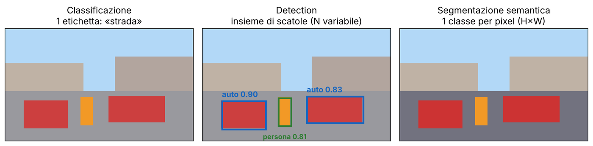

**L'idea.** Con un'uscita a dimensione fissa bastano la cross-entropy per pixel e la regressione. Con un'uscita-insieme mancano due cose: **non si sa quante predizioni servano** e **non si sa quale predizione corrisponda a quale oggetto**. Prima di calcolare una loss bisogna decidere quali predizioni sono «positive» (assegnate a un oggetto vero) e quali «negative» (sfondo). Tutta la lezione è fatta di risposte diverse a queste due domande:

  - Faster R-CNN: proposte di regioni e ancore, assegnamento per sovrapposizione (IoU);
  - YOLO: una griglia di celle, ogni oggetto è assegnato alla cella che contiene il suo centro;
  - DETR: un numero fisso di «query» abbinate agli oggetti con l'algoritmo ungherese.

**I dati.** Per addestrare servono annotazioni più ricche della classe: una scatola e una classe per oggetto (detection), oppure una maschera per oggetto (istanza). Dataset standard (slide 7): **PASCAL VOC** (20 classi), **MS COCO** (80 classi di oggetti più 53 di «stuff» per la panottica: è il dataset su cui si misura la mAP), **Cityscapes** (scene urbane, 19 classi) e **ADE20K** (150 classi, segmentazione).

> **Il punto**
> 
> Detection significa predire un **insieme di lunghezza variabile**. Ogni metodo della lezione è una risposta a «quante predizioni?» e «quale va con quale oggetto?».

### 2\. Scatole e IoU: come si misura una sovrapposizione

**Il problema.** Per dire se una scatola predetta è giusta, o se due predizioni parlano dello stesso oggetto, serve un numero che misuri quanto due scatole si sovrappongono.

**L'idea.** L'**IoU** (*intersection over union*) è **l'area dell'intersezione divisa per l'area dell'unione**: vale 0 se le scatole sono disgiunte, 1 se coincidono.

`IoU(A, B) = |A ∩ B| / |A ∪ B|`

Una scatola si scrive con gli angoli (x1, y1, x2, y2) oppure con centro e dimensioni (x, y, w, h); passare dall'una all'altra è banale (x1 = x − w/2, x2 = x + w/2 e così per y).

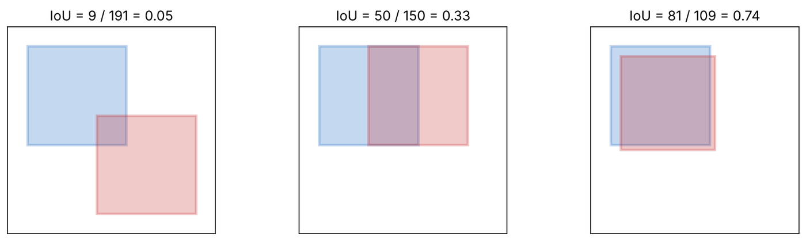

**Esempio svolto** (slide 30). A = \[0, 0, 10, 10\] e B = \[5, 5, 15, 15\]. L'intersezione è il quadrato \[5, 5, 10, 10\], area 25. L'unione è 100 + 100 − 25 = 175. Quindi IoU = 25/175 ≈ 0.14. Convenzione tipica: IoU ≥ 0.5 vuol dire «stesso oggetto».

> **Il punto**
> 
> L'IoU è **il metro di tutto**: assegna ancore a oggetti veri, decide quali duplicati la NMS elimina, e dice se una detection è giusta quando si calcola l'AP.

### 3\. Prima del deep learning: finestra scorrevole e Viola-Jones

**Il problema.** Come si trova un volto in una foto, senza reti neurali, in tempo reale?

**L'idea più semplice: la finestra scorrevole** (slide 11). Si fa scorrere una finestra di dimensione fissa su tutta l'immagine e un classificatore decide «oggetto o sfondo» per ciascuna posizione. Per oggetti di taglia diversa si ripete su una **piramide di immagini** ([L6](https://gabriele-marsili.github.io/appunti-magistrale-ai/anno-2/computer-vision/sito/#L6)). Il guaio è il costo: una finestra 64 × 64 con passo 4 su una foto 640 × 480 sono 145 × 105 = 15 225 posizioni *per una sola scala*; con più scale e forme si arriva a 105–106 finestre, quasi tutte sfondo. **Il classificatore deve costare pochissimo, oppure bisogna scartare in fretta quasi tutte le finestre.** Il libro (§ 50.4.1) lo chiama «algoritmo di finestra scorrevole» e osserva che l'invarianza a traslazione e scala non sta nel classificatore ma nel provare ogni posizione e ogni scala.

**Viola-Jones** (2001, slide 12–13 e 61) risolve il costo con tre ingredienti.

**(a) Le feature di Haar.** Sono rettangoli adiacenti, uno bianco e uno nero: la risposta è *somma dei pixel del bianco meno somma del nero* (per esempio la zona scura degli occhi contro le guance chiare). Servono migliaia di rettangoli diversi, quindi ogni somma deve costare poco.

**(b) L'immagine integrale.** L'immagine integrale II è la somma cumulativa: `II(x, y) = ∑x′ ≤ x, y′ ≤ y I(x′, y′)` cioè in ogni punto la somma di tutti i pixel sopra e a sinistra. Con II calcolata una volta per immagine, **la somma su qualunque rettangolo costa 4 accessi, qualunque sia la sua taglia**:

`S = II(D) − II(B) − II(C) + II(A)`

dove A, B, C, D sono i quattro punti della II appena fuori dal rettangolo (A in alto a sinistra, D in basso a destra).

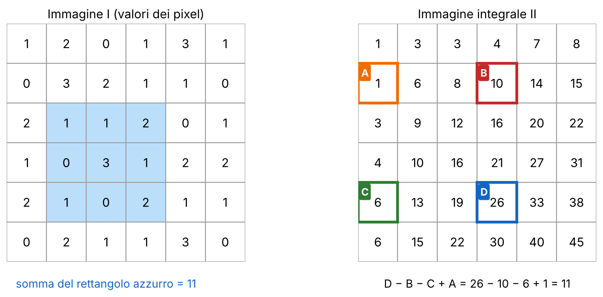

Perché funziona: II(D) è tutto ciò che sta sopra e a sinistra di D; togliendo II(B) e II(C) si tolgono due fasce, ma la zona sopra-sinistra di A è stata tolta due volte, quindi si riaggiunge II(A).

**(c) AdaBoost e la cascata.** Un **classificatore debole** è una soglia su una sola feature di Haar: h(x) = 1\[p·f(x) \> p·θ\], con soglia θ e polarità p ∈ {−1, +1}. **AdaBoost** sceglie da un enorme insieme poche decine di classificatori deboli e li combina con un peso ciascuno. Poi i classificatori si **mettono in cascata**: gli stadi iniziali sono economici e scartano subito quasi tutte le finestre di sfondo; solo le poche sopravvissute arrivano agli stadi più severi e costosi.

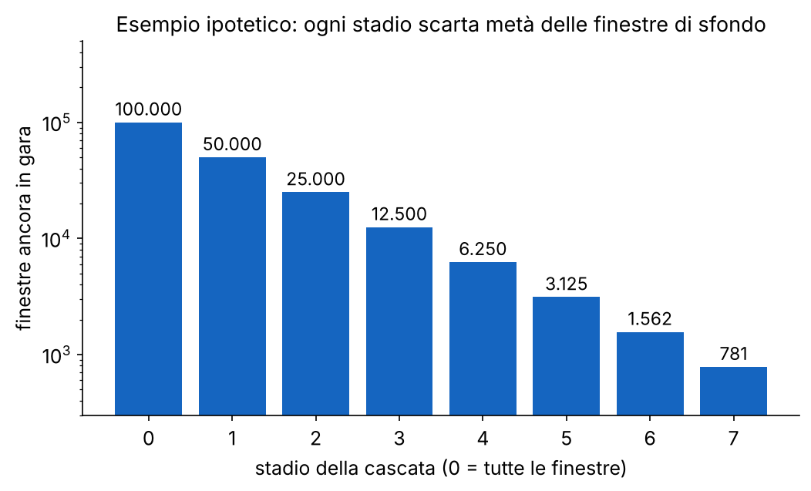

Il libro (§ 50.4.1.3) la presenta come il caso estremo di «cercare l'ago nel pagliaio»: la finestra scorrevole è una cascata a uno stadio, la selective search una a due stadi.

> **Attenzione: il segno in AdaBoost**
> 
> La slide 61 scrive H(x) = sign(∑ αt ht(x)) con ht ∈ {0, 1} (slide 13) e αt \> 0: la somma è sempre ≥ 0, quindi il segno darebbe «volto» per qualunque finestra. La formula con *sign* è corretta per ht ∈ {−1, +1}, con αt = ½ ln((1 − εt)/εt). Nell'articolo originale, con h ∈ {0, 1}, si dice «volto» se ∑ αtht ≥ ½ ∑ αt. Vedi la scheda 61.

> **Il punto**
> 
> Viola-Jones è veloce perché **le somme su rettangoli costano 4 accessi** (immagine integrale) e perché **la cascata spende poco sullo sfondo**. È l'archetipo di «non guardare bene dove non serve».

### 4\. Le proposte di regioni: selective search

**Il problema.** Invece di provare 105 finestre, si può provare a indovinare poche centinaia di zone dove probabilmente c'è un oggetto? Sono le **region proposal** (slide 15–17, 59, 62).

**L'idea.** La **selective search** è un algoritmo fisso, senza apprendimento, che ne ottiene circa 2000 per immagine in tre passi: (1) si divide l'immagine in tanti **superpixel**, regioni piccole e coerenti (algoritmo di Felzenszwalb e Huttenlocher); (2) si fonde ripetutamente la coppia di regioni adiacenti *più simile*; (3) ogni regione che compare durante le fusioni, superpixel iniziali compresi, dà la sua scatola. Una gerarchia di fusioni copre tutte le scale.

**La similarità** mescola quattro indizi, perché nessuno basta da solo:

`s(ri, rj) = a1 scolore + a2 stexture + a3 sdim + a4 sfill,   ogni s ∈ [0, 1]`

  - **colore e texture**: ogni regione ha un istogramma normalizzato (la frazione dei suoi pixel in ogni bin); due istogrammi si confrontano per *intersezione*, s = ∑k min(cik, cjk);
  - **dimensione**: sdim = 1 − (size(ri) + size(rj))/size(immagine), che favorisce la fusione delle regioni piccole per prime;
  - **fill**: premia le unioni compatte, cioè con poco spazio vuoto nella scatola che le racchiude.

**Esempio svolto.** Istogrammi ci = (0.5, 0.3, 0.2) e cj = (0.2, 0.3, 0.5): s = min(0.5, 0.2) + min(0.3, 0.3) + min(0.2, 0.5) = 0.2 + 0.3 + 0.2 = 0.7. Istogrammi identici danno 1, disgiunti danno 0.

**Quante scatole?** Se partono n superpixel, l'algoritmo fa esattamente n − 1 fusioni e produce 2n − 1 regioni, quindi 2n − 1 scatole: con n ≈ 1000 si arriva alle \~2000 proposte. Un dettaglio che lo rende economico: l'istogramma di una regione fusa si ottiene come media pesata dei due istogrammi dalle dimensioni (slide 62), senza rileggere i pixel.

> **Il punto**
> 
> La selective search trasforma «cerca ovunque» in **«controlla circa 2000 candidati»**. È **lenta e non appresa**: Faster R-CNN la sostituirà con una rete.

### 5\. R-CNN, Fast R-CNN, Faster R-CNN

**Il problema.** Hai \~2000 candidati: come li classifichi con una CNN, senza buttare un'ora per immagine? Ogni modello della famiglia risolve il limite del precedente (slide 14, 18–20).

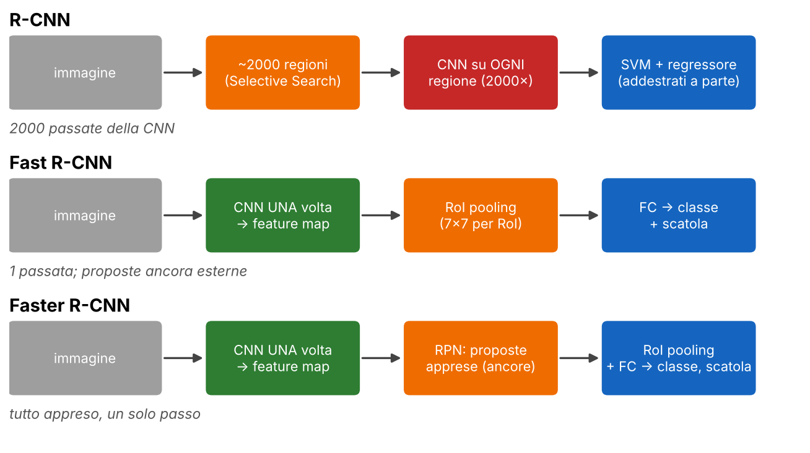

**R-CNN** (2014). Si prendono \~2000 proposte dalla selective search, ciascuna ritagliata e deformata a dimensione fissa, e **una CNN pesante la elabora in modo indipendente**: 2000 passate per immagine, decine di secondi. Poi uno SVM lineare per ogni classe sulle feature congelate, più un regressore di scatola. L'addestramento è in tre passi separati e richiede di salvare su disco le feature di tutte le regioni.

**Fast R-CNN** (2015). Idea: **la feature map si calcola una volta per immagine, non una volta per proposta**. Ogni proposta (RoI, *region of interest*) si proietta sulla feature map condivisa, e uno strato di **RoI pooling** ne estrae un vettore di dimensione fissa (per esempio 7 × 7). Due strati densi alimentano un softmax di classe e un regressore di scatola, addestrati insieme alla CNN con una loss multi-task. Il RoI pooling **arrotonda le coordinate alla griglia intera**: va bene per classificare, non per maschere precise (lo ritroverai in sezione 15).

**Faster R-CNN** (2015). Restano le proposte esterne, lente. Si sostituiscono con una piccola **Region Proposal Network (RPN)** che scorre sulla stessa feature map e per ogni posizione predice «c'è un oggetto?» e uno scostamento di scatola rispetto a delle *ancore* (sezione 6). L'articolo originale alterna 4 passi di addestramento; le implementazioni moderne addestrano tutto insieme, in uno solo.

Distingui le due reti dentro Faster R-CNN: la RPN è *agnostica alla classe* (oggetto sì/no più scatola), la testa di Fast R-CNN assegna la classe vera e raffina la scatola. Entrambe riusano la backbone, per questo le proposte costano poco.

> **Il punto**
> 
> R-CNN → Fast → Faster è la storia di **condividere il calcolo** (una passata della CNN) e **imparare anche le proposte**. Faster R-CNN è l'architettura two-stage di riferimento.

### 6\. Ancore e RPN

**Il problema.** Predire coordinate assolute di una scatola direttamente dalla feature map è difficile. È molto più facile predire *di quanto correggere* una scatola di partenza già vicina.

**L'idea.** Un'**ancora** (*anchor*) è **una scatola di riferimento fissa, centrata in una posizione della feature map, con scala e rapporto d'aspetto predefiniti**. La rete non predice la scatola, ma uno scostamento dall'ancora.

**Quante.** Nell'articolo ogni posizione ha k = 9 ancore (3 scale × 3 rapporti: 1:1, 1:2, 2:1). Su una feature map 40 × 60 sono 40 · 60 · 9 = **21 600 ancore**. Per ognuna la RPN emette 2 punteggi (oggetto o no) e 4 offset: per posizione sono 2k = 18 punteggi e 4k = 36 numeri di scatola (slide 21).

**Assegnamento.** Per addestrare, ogni ancora si etichetta con l'IoU con la ground truth: nell'articolo **positiva** sopra 0.7 (più l'ancora con IoU massimo per ogni oggetto), **negativa** sotto 0.3, e quelle in mezzo non contano. È la risposta di Faster R-CNN a «quale predizione va con quale oggetto».

**Funziona solo se l'insieme di ancore copre scale e rapporti degli oggetti del dataset**: è un iperparametro da tarare, ed è uno dei motivi per cui poi sono nati i metodi senza ancore (sezione 9).

> **Il punto**
> 
> Le ancore trasformano la detection in **classificazione e correzione di scatole di riferimento**: ogni ancora è positiva o negativa in base all'IoU con la ground truth.

### 7\. Dall'offset alla scatola, e le loss

**Il problema.** Come si scrive «di quanto correggere l'ancora» in numeri che una rete può regredire, e con quale loss?

**Codifica.** Data un'ancora (xa, ya, wa, ha) e la ground truth (x, y, w, h), in forma centro-dimensioni, il bersaglio è (slide 22):

`tx = (x − xa)/wa,   ty = (y − ya)/ha,   tw = log(w/wa),   th = log(h/ha)`

Gli spostamenti del centro sono divisi per le dimensioni dell'ancora, così contano in modo relativo (10 pixel di errore pesano di più su una scatola piccola). Larghezza e altezza passano per il **logaritmo**: un rapporto w/wa è sempre positivo e moltiplicativo; il log lo rende un numero libero, circa simmetrico attorno a 0, e decodificando con l'esponenziale si ottengono ŵ, ĥ \> 0 per costruzione.

**Decodifica** (a inferenza, la rete predice t̂ e si inverte): x̂ = t̂x wa + xa, ŷ = t̂y ha + ya, ŵ = et̂w wa, ĥ = et̂h ha.

Verifica decodificando: ŵ = e0.405 · 40 = 60 e ĥ = e−0.105 · 80 = 72; gli angoli sono x1 = 110 − 30 = 80, x2 = 140, y1 = 90 − 36 = 54, y2 = 126.

**La loss multi-task** (slide 23). Per ogni RoI di Fast R-CNN (p = distribuzione di classe predetta, u = classe vera con u = 0 per lo sfondo, tu = offset predetto per la classe u, v = offset bersaglio):

`ℒ(p, u, tu, v) = − log pu + λ [u ≥ 1] ∑i smL1(tiu − vi)`

Il primo termine è la cross-entropy della classe, per tutte le RoI. Il secondo è la regressione, moltiplicata da \[u ≥ 1\]: **conta solo per le RoI di primo piano**; lo sfondo continua ad addestrare il classificatore («non è un oggetto») ma non ha una scatola giusta da regredire. La RPN ha la stessa struttura per ogni ancora i, con pi\* ∈ {0, 1} al posto di \[u ≥ 1\].

**Smooth L1.** smL1(x) = ½x² se |x| \< 1, altrimenti |x| − ½. È quadratica vicino a zero (gradiente dolce) e lineare lontano (gradiente limitato a ±1): **una scatola molto sbagliata non domina l'addestramento**. Esempio: smL1(0.3) = 0.5 · 0.09 = 0.045; smL1(2) = 1.5 (una L2 darebbe 2).

Il libro (§ 50.4.2) confronta proprio queste scelte: la loss IoU è invariante a traslazione e scala ma ha il difetto della figura a destra (fig. 50.18); la L2 è invariante alla traslazione ma non alla scala. Per questo si regrediscono scostamenti con L1 liscia, e DETR (sezione 11) somma L1 e loss IoU.

> **Il punto**
> 
> Si regrediscono **scostamenti relativi all'ancora** (centro diviso per la dimensione, dimensioni in logaritmo). La loss è **classe su tutti + scatola solo sui positivi**, con smooth L1.

### 8\. One-stage: YOLO e SSD

**Il problema.** Le two-stage fanno due passaggi. Si può predire tutto in una volta sola, senza proposte? (slide 24–28)

**Celle, ancore, posizioni.** Una CNN riduce l'immagine in una feature map più grossolana: ogni *cella* è una posizione di quella griglia. Una cella decide *chi è responsabile* di un oggetto; la *scatola* predetta è la risposta, e **non è confinata nella cella**: un'auto che occupa metà immagine è predetta da una sola cella, quella del suo centro. Il *campo recettivo* dice quanta immagine vede la cella: se è più piccolo dell'oggetto, la predizione è difficile.

**YOLO** (*You Only Look Once*, 2016). Si ridimensiona l'immagine, la si passa a una CNN, si fa la NMS. L'immagine è divisa in una griglia S × S; **una cella è responsabile di un oggetto se il centro dell'oggetto cade al suo interno**. Ogni cella predice B scatole, ciascuna con (x, y, w, h) e una confidenza, più *un solo* insieme di C probabilità di classe condiviso dalle B scatole.

Nella versione originale (Prince § 10.5.2) l'immagine è 448 × 448, la rete ha 24 strati convoluzionali e l'uscita 7 × 7 × 30. La loss è una somma di quadrati: scatola (su x, y, √w, √h, solo per la scatola responsabile; la radice evita che le scatole grandi dominino), confidenza (con peso ridotto per le molte scatole di sfondo) e classe. **Un solo oggetto per cella**: uno stormo di uccelli piccoli e vicini viene perso.

**Da YOLO ai moderni.** Le versioni successive aggiungono ancore ricavate con k-means sul dataset (v2), predizioni a tre scale 13 × 13, 26 × 26 e 52 × 52 (v3) e, nelle versioni recenti, teste senza ancore e disaccoppiate. La direzione è: più scale, meno ancore predefinite.

**SSD** (2016, slide 28). Predice da **più mappe di feature di risoluzioni diverse** in un solo passaggio: le mappe poco profonde e ad alta risoluzione per gli oggetti piccoli, quelle profonde e piccole per i grandi. Su VOC: 74.3 mAP a 59 FPS contro 63.4 mAP a 45 FPS di YOLO. La scala delle scatole di default al livello k di m è `sk = smin + (smax − smin)(k − 1)/(m − 1)`; con smin = 0.2, smax = 0.9, m = 6 si ottiene 0.2, 0.34, 0.48, 0.62, 0.76, 0.9 (frazioni dell'immagine). Per un rapporto d'aspetto ar la scatola è larga s√ar e alta s/√ar.

> **Il punto**
> 
> One-stage = **niente proposte**: ogni cella o posizione predice direttamente scatole e classi. Il numero di predizioni è fissato dall'architettura (S · S · B, o le ancore di tutte le scale), non dai dati; per questo serve la NMS.

### 9\. Senza ancore: FCOS

**Il problema.** Le ancore hanno iperparametri (scale, rapporti, soglie di assegnamento) da tarare per ogni dataset. Si può farne a meno? (slide 27 e 29)

**L'idea.** Un detector **anchor-free** lega le predizioni direttamente alle posizioni della feature map, senza forme predefinite. **FCOS** fa così: ogni posizione che cade *dentro* una scatola di ground truth è «positiva» e regredisce direttamente quattro numeri, **(l, t, r, b): le distanze dalla posizione ai quattro lati della scatola** (sinistra, alto, destra, basso).

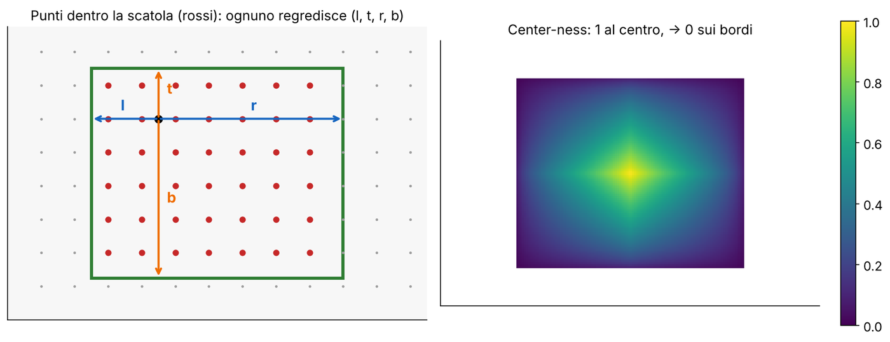

Conseguenza: **molte posizioni predicono lo stesso oggetto**, e quelle vicine al bordo danno scatole di bassa qualità. Per questo FCOS aggiunge un terzo ramo, la **center-ness**:

`centerness = √( min(l, r)/max(l, r) · min(t, b)/max(t, b) )`

Vale 1 al centro esatto (l = r e t = b) e tende a 0 sul bordo. A inferenza il punteggio finale è *punteggio di classe × center-ness*, quindi le scatole mal centrate scendono in classifica e la NMS le elimina. **Esempio:** un punto con l = 10, r = 30, t = 20, b = 20 ha center-ness √(10/30 · 20/20) = √(1/3) ≈ 0.58. La rete ha tre uscite per posizione, condivise fra i livelli di una piramide di feature: classificazione (H × W × C), center-ness (H × W × 1) e regressione (H × W × 4).

> **Il punto**
> 
> Anchor-free = **niente ancore da tarare**, ma **più posizioni positive per oggetto**: servono regole di assegnamento, una correzione di qualità (center-ness) e comunque la NMS finale.

### 10\. La NMS: togliere i duplicati

**Il problema.** Un detector a griglia, a ancore o FCOS produce molte scatole sovrapposte per lo stesso oggetto. Ne vogliamo una sola (slide 30–31).

**L'algoritmo** (*non-maximum suppression*, greedy), eseguito una volta per classe, con soglia IoU τ:

1.  ordina le scatole per punteggio decrescente;
2.  tieni quella col punteggio più alto;
3.  sopprimi tutte le altre con IoU \> τ rispetto a quella tenuta;
4.  ripeti con quelle rimaste, finché l'elenco è vuoto.

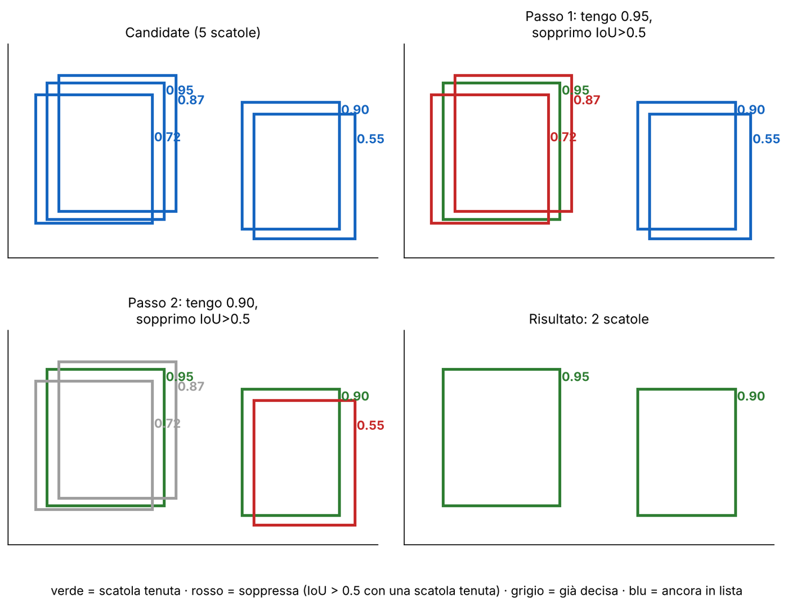

La soglia è un compromesso: τ bassa sopprime di più e rischia di cancellare oggetti diversi ma vicini; τ alta lascia passare duplicati. Il costo ingenuo è O(n²); in torchvision è `torchvision.ops.nms`.

**Il difetto classico.** In una folla due persone vicine hanno scatole con IoU alto: la scatola della persona con punteggio più basso viene soppressa anche se è un oggetto diverso, e si perde una detection vera (**il recall scende**). Rimedi: **Soft-NMS** (si attenua il punteggio invece di cancellare), NMS adattiva, oppure evitare del tutto la NMS (DETR, e un'inferenza senza NMS esplorata in YOLOv10). Va fatta *per classe*: un'auto non deve sopprimere la persona seduta davanti.

Il libro (§ 50.4.1) dà lo stesso algoritmo in tre righe: prendi la scatola a confidenza massima, mettila nel risultato, togli lei e le altre con IoU sopra soglia, ripeti.

> **Il punto**
> 
> La NMS è una **post-elaborazione greedy basata sull'IoU**: tiene il migliore di ogni gruppo di duplicati. **Dipende da una soglia e sbaglia nelle folle.**

### 11\. DETR: la detection come predizione di insiemi

**Il problema.** Ancore, proposte, soglie di assegnamento, NMS: tante regole fatte a mano. DETR (Carion et al., 2020) le elimina trattando la detection come **predizione diretta di un insieme** (slide 32–34).

**L'architettura.** Una **CNN** estrae una feature map, appiattita in una sequenza con codifiche posizionali. Un **encoder transformer** applica la self-attention a questa sequenza (contesto globale). Un **decoder transformer** prende N **object query**, vettori fissi e appresi, e fa *cross-attention* sull'uscita dell'encoder: le query sono le «domande» (Q), i token dell'encoder le chiavi e i valori (K, V), come nel cap. 26 del libro (§ 26.6.1). Una rete densa condivisa trasforma ogni uscita in una coppia (distribuzione di classe, scatola). Le query che non trovano nulla predicono «nessun oggetto» (∅).

**Il matching ungherese.** Si completa la ground truth con ∅ fino ad avere N elementi. Poi l'**algoritmo ungherese** sceglie la permutazione σ̂ delle query sugli oggetti che minimizza il costo totale:

`σ̂ = argminσ ∑i=1..N ℒmatch(yi, ŷσ(i)),   ℒmatch = −𝟙ci ≠ ∅ p̂σ(i)(ci) + 𝟙ci ≠ ∅ ℒbox(bi, b̂σ(i))`

Cioè: una query è abbinata a un oggetto se ne prevede bene la classe (probabilità alta) e la scatola (L1 più IoU); per ∅ il costo è zero. È un problema di assegnamento N × N, che si risolve con `scipy.optimize.linear_sum_assignment`. Con il costo \[\[0.2, 0.9\], \[0.6, 0.3\]\] (2 query, 2 oggetti), l'assegnamento q1 → A, q2 → B costa 0.5 e l'altro 1.5: vince il primo.

**Perché sparisce la NMS.** Dopo il matching la loss si calcola sull'abbinamento ottimo: il termine di classe riguarda tutte le N query (quelle abbinate a ∅ imparano a dire «nessun oggetto»), il termine di scatola solo quelle abbinate a oggetti veri. **Due query che predicono lo stesso oggetto vengono penalizzate direttamente dalla loss**, perché una sola può essere abbinata: i duplicati sono scoraggiati in addestramento, non rimossi dopo. A inferenza si tiene ogni query con classe più probabile diversa da ∅.

> **Attenzione: «lo stesso costo» è un'approssimazione**
> 
> La slide 33 dice che la loss di addestramento minimizza «lo stesso costo» del matching. Nell'articolo (eq. 2–3) i due sono simili ma non identici: nel matching compare la probabilità −p̂σ(i)(ci), nella Hungarian loss il logaritmo (cross-entropy), e la classe ∅ è pesata 1/10. Nel matching si usa la probabilità perché così il termine di classe è commensurabile con quello di scatola.

> **Attenzione: la backbone non è un ViT**
> 
> La backbone di DETR è una CNN; il transformer elabora solo la sequenza di feature che ne esce. Un detector nativo ViT è YOLOS (Fang et al. 2021). Vedi scheda 32.

**Tre modi di organizzare le predizioni** (slide 34): Faster R-CNN usa proposte apprese e poi raffina; YOLOv1 usa predizioni dense legate alle celle; DETR usa un insieme fisso di query abbinate uno-a-uno. Chi decide il numero di oggetti e chi è assegnato a chi? Faster R-CNN: le proposte (\~300–1000) e l'IoU con le ancore. YOLO: le celle e il centro dell'oggetto. DETR: le N query e il matching. Il prezzo: NMS per le prime due, nessuna per DETR.

> **Il punto**
> 
> DETR risponde a «quale predizione va con quale oggetto?» con un **matching ottimo uno-a-uno (algoritmo ungherese)**. Grazie a questo i duplicati sono penalizzati dalla loss e **la NMS non serve**.

### 12\. Valutare un detector: AP e mAP

**Il problema.** Un detector può sbagliare in tre modi: trova oggetti che non ci sono (falsi positivi), manca oggetti veri (falsi negativi), li trova con la scatola storta. Serve un solo numero che li tenga tutti in conto (slide 35–37, 60).

**La procedura** (per una classe):

1.  ordina *tutte* le detection dell'insieme di valutazione per confidenza decrescente;
2.  una detection è un **vero positivo** (TP) se ha IoU ≥ soglia con una scatola vera *non ancora assegnata*; altrimenti è un **falso positivo** (FP); le scatole vere mai trovate sono falsi negativi (FN);
3.  scendendo nella lista, a ogni rango k si calcolano precisione e recall sulle prime k detection;
4.  i punti (recall, precisione) formano la curva; l'**AP** è l'area sotto la curva, dopo l'interpolazione (a ogni recall si prende la precisione massima a destra).

`Precisione = TP/(TP + FP),   Recall = TP/(TP + FN)`

Il libro (§ 50.4.3) descrive la variante di PASCAL: per ogni detection si prende la ground truth con IoU massimo; se supera la soglia (di solito 0.5) è corretta e la ground truth esce dalla lista, altrimenti è sbagliata; quelle rimaste sono mancate. La curva è non monotona.

**Dall'AP alla mAP.** La **mAP** è la media degli AP su tutte le classi. Il **matching uno-a-uno** è essenziale: ogni scatola vera è abbinata al più a una predizione; le detection in più dello stesso oggetto sono falsi positivi. **Senza questa regola un detector senza NMS con 5 scatole sullo stesso oggetto avrebbe 5 «veri positivi» e precisione perfetta**; con la regola sono 1 TP e 4 FP. La convenzione di **COCO**, **mAP@\[.5:.95\]**, media su 10 soglie di IoU (0.50, 0.55, …, 0.95): è molto più severa della mAP@0.5, perché premia scatole precise. Un modello con mAP@0.5 alta e mAP@\[.5:.95\] bassa ha scatole solo grossolanamente allineate.

> **Attenzione: un esempio svolto che non c'è**
> 
> La slide 60 dice che l'algoritmo completo produce «esattamente le colonne Pk, Rk dell'esempio svolto della slide principale», ma la slide 35 non contiene nessuna tabella di esempio (probabilmente è stata tolta). L'esempio qui sopra la sostituisce. Piccola differenza anche con PASCAL: nella slide 60 la ricerca è solo fra le ground truth non ancora abbinate, in PASCAL fra tutte.

**Accuratezza contro efficienza** (slide 37). Il grafico di EfficientDet (AP su COCO contro miliardi di FLOPs) non ha un modello «migliore»: mostra una frontiera. EfficientDet D0–D7 sta in alto a sinistra (più AP con meno calcolo) per la scalatura congiunta di backbone, rete di fusione delle feature (*neck*) e risoluzione, non perché è one-stage. Attenzione: FLOPs ≠ latenza (dipende anche da memoria e hardware).

> **Il punto**
> 
> L'AP è **l'area sotto la curva precisione-recall** di una classe; la mAP la media sulle classi, e COCO la media anche su dieci soglie di IoU. **Il matching uno-a-uno impedisce di contare i duplicati come successi.**

### 13\. Segmentazione avanzata: convoluzione dilatata, ASPP, DeepLabv3+

**Il problema.** Nella [L17](https://gabriele-marsili.github.io/appunti-magistrale-ai/anno-2/computer-vision/sito/#L17) il campo recettivo si allargava col pooling, che però **riduce la risoluzione**: proprio ciò che la segmentazione vuole evitare. Come vedere più contesto senza perdere dettagli? (slide 39–42)

**L'idea: la convoluzione dilatata** (*atrous*). Si **distanzia il filtro stesso, con zeri fra i pesi**: un kernel k × k con dilatazione d ha dimensione effettiva

`keff = d(k − 1) + 1`

ma sempre solo k² pesi. Un 3 × 3 con d = 1, 2, 4 copre 3, 5 e 9 punti per lato. Impilando strati con dilatazione crescente il campo recettivo cresce in modo esponenziale: **più contesto, stessa risoluzione, stesso numero di parametri**.

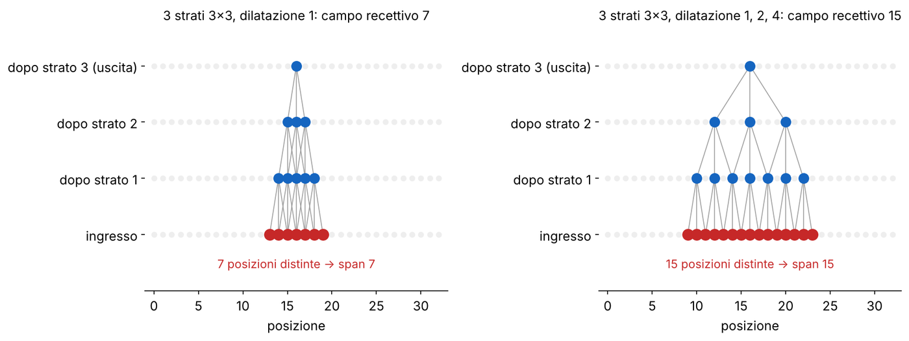

Il libro (§ 24.2.3) avverte: come lo stride, la dilatazione può dare artefatti da aliasing («gridding»): un filtro di blur dilatato non è più un blur. **Refuso del libro**: scrive 9 × 9 per la cascata con d = 1, 2, 4; il supporto vero è 15 × 15, mentre 9 è solo l'ultimo kernel (lo stesso già segnalato in [L15](https://gabriele-marsili.github.io/appunti-magistrale-ai/anno-2/computer-vision/sito/#L15)).

**ASPP** (*atrous spatial pyramid pooling*, slide 40). Gli oggetti nella stessa immagine hanno scale diverse e un solo campo recettivo non va bene per tutti. Si guarda la stessa feature map con più campi recettivi *in parallelo*: una conv 1 × 1, tre conv 3 × 3 con rate 6, 12, 18 e un ramo di pooling globale; le uscite si concatenano e una conv 1 × 1 le fonde. È l'idea di un modulo Inception, con la dilatazione al posto della dimensione del kernel. Con k = 3 il campo recettivo di un ramo è 2d + 1: 13, 25 e 37 sulla mappa a stride 16.

**DeepLabv3+** (slide 41). Encoder: una backbone atrous e ASPP. Decoder: le feature a basso livello (stride 4) passano per una conv 1 × 1, si concatenano con l'uscita di ASPP sovracampionata ×4, una conv 3 × 3 le raffina, un ultimo ×4 dà la predizione. Su 512 × 512 con stride 16 l'encoder lavora su 32 × 32; si sale a 128 × 128, dove si concatenano le feature fini, poi a 512 × 512. **Questa skip «alla U-Net» dà bordi più netti**.

Per valutare si usa la mIoU (slide 42): IoU = TP/(TP + FP + FN) per classe, mediato sulle classi; a differenza della pixel accuracy non è dominata dalle classi grandi come cielo e strada. Il libro (§ 50.5) suggerisce anche pesi per classe nella cross-entropy.

> **Il punto**
> 
> La dilatazione **allarga il campo recettivo senza pooling**; ASPP **combina campi recettivi diversi in parallelo**; DeepLabv3+ aggiunge una skip per i bordi.

### 14\. Segmentazione con i transformer: SETR, SegFormer, DPT

**Il problema.** L'altra strada per il contesto è la self-attention, già globale al primo strato (slide 43–48). Ma costa N² nei token.

**SETR** (2021). Un ViT puro: patch 16 × 16, 24 strati transformer, **nessuna gerarchia e nessuna feature multi-scala**. L'uscita ∈ ℝL×C si riforma in una mappa (H/16) × (W/16) × C e un decoder (PUP) risale con 4 stadi di conv 3 × 3 e upsampling bilineare ×2. Su 512 × 512 sono L = (512/16)² = 1024 token, quindi 1024² ≈ 106 coppie per testa e per strato; con p = 8 sarebbero 4096 token e 16 volte di più.

**SegFormer** (slide 44–45) risolve il costo e la mancanza di scale con tre idee.

  - **Encoder gerarchico**: quattro stadi con feature a circa 1/4, 1/8, 1/16 e 1/32 dell'ingresso, come una CNN, con *overlapped patch merging* (finestre sovrapposte che preservano la continuità locale).
  - **Attenzione efficiente**: si riduce la lunghezza di K (e V) di un fattore R prima dell'attenzione: K̂ = Linear(CR, C)(Reshape(N/R, CR)(K)). **Il costo scende da N² a N²/R.**
  - **Mix-FFN**: una convoluzione 3 × 3 depthwise dentro l'MLP inietta l'informazione posizionale, così non servono codifiche posizionali che non si adattano a risoluzioni di test diverse.

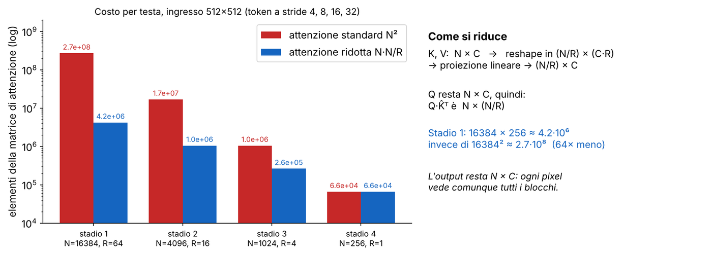

Il **decoder è tutto MLP**: ogni feature Fi si proietta a C canali, si sovracampiona a 1/4, si concatenano le quattro e un MLP dà la mappa H/4 × W/4 × Ncls. Basta così poco perché le feature profonde dei transformer hanno già un campo recettivo quasi globale: il decoder unisce solo informazione locale (stadi 1–2) e semantica (3–4).

**DPT** (slide 46–47) è la stessa idea della U-Net su un encoder *piatto*: il ViT non ha stadi a risoluzione decrescente, quindi i token di quattro profondità diverse vengono rimodellati in griglie (**Reassemble**: read, concatenate, resample) a quattro scale e fusi progressivamente da blocchi **Fusion**. Con ViT-B/16 a 384 × 384 la griglia è 24 × 24: Reassemble la porta a 96, 48, 24 e 12 per lato. È il modello dietro MiDaS v3 ([L17](https://gabriele-marsili.github.io/appunti-magistrale-ai/anno-2/computer-vision/sito/#L17)), stato dell'arte per la profondità monoculare.

**Chi vince** (slide 48, mIoU su ADE20K): SegFormer-B0 37.4 con 3.7 M di parametri contro FCN-R50 36.1 con 49.6 M; SegFormer-B2 46.5 con 27.5 M (24.5 FPS) contro DeepLabv3+/R101 44.1 con 62.7 M (14.1 FPS); SegFormer-B4 50.3 con 64.1 M contro SETR 48.6 con 318.3 M e 5.4 FPS. Lezione: **l'architettura (gerarchia, attenzione efficiente) conta più della taglia**.

> **Il punto**
> 
> I transformer portano contesto globale, ma **il costo N² e l'assenza di gerarchia** sono i problemi: SegFormer li risolve con scale multiple e attenzione ridotta, DPT ricostruisce le scale dai token.

### 15\. Mask R-CNN e RoIAlign

**Il problema.** La semantica «non sa contare» due auto a contatto. Servono maschere *per istanza* (slide 49–52). La strada più naturale: riusare la detection.

**L'idea.** **Mask R-CNN** (2017) aggiunge a Faster R-CNN una **testa di maschera**, una piccola rete convoluzionale che, sopra ogni RoI, predice una maschera binaria per l'oggetto. Stessa RPN, stesse ancore, stessa testa di scatola. Il libro (§ 50.6) descrive la stessa scelta: dopo aver proposto le scatole, si dà il ritaglio a una funzione binaria che dice, per ogni pixel, se appartiene all'oggetto.

**Il problema dell'arrotondamento.** Il RoI pooling arrotonda due volte alla griglia intera, il bordo della RoI e quello di ogni bin. Con stride 16 un errore di mezza cella sono 8 pixel dell'immagine: **enorme per una maschera**.

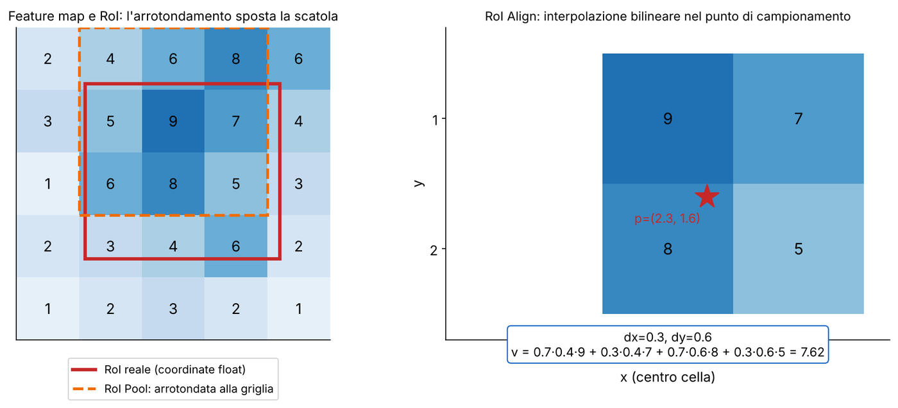

**RoIAlign** non arrotonda mai: divide la RoI in k × k bin, in ogni bin campiona r punti a coordinate continue, e ciascun punto si legge per **interpolazione bilineare** dai 4 vicini:

`F(x, y) = ∑i,j ∈ {0,1} wij F[x0 + i, y0 + j],   w00 = (1 − dx)(1 − dy), w10 = dx(1 − dy), w01 = (1 − dx)dy, w11 = dxdy`

con (x0, y0) = (⌊x⌋, ⌊y⌋), dx = x − x0, dy = y − y0. I pesi sommano 1. L'uscita del bin è la media (o il massimo) dei suoi punti. Esempio della slide 51: (x, y) = (3.4, 5.7) → dx = 0.4, dy = 0.7, pesi 0.18, 0.12, 0.42, 0.28: il vicino (3, 6) pesa di più.

**La loss.** Per ogni RoI: ℒ = ℒcls + ℒbox + ℒmask. La testa produce *C maschere binarie m × m*, una per classe (tipicamente m = 28, C = 80 su COCO), ma ℒmask, la cross-entropy binaria media per pixel, è calcolata solo sul canale della classe vera. Ogni maschera è una **sigmoide per pixel**, non una softmax fra classi: la classificazione è già decisa dal ramo di classe, e la maschera risponde solo a «oggetto o sfondo per questa classe». **Disaccoppiare maschera e classe funziona meglio, empiricamente, di una softmax per pixel.** A inferenza si usa il canale della classe predetta, si ridimensiona alla scatola e si binarizza a 0.5.

> **Il punto**
> 
> Mask R-CNN = **Faster R-CNN più una testa di maschera per classe**, con **RoIAlign** (campionamento bilineare, niente arrotondamenti) per allineare la maschera ai pixel veri.

### 16\. Segmentazione panottica e Panoptic Quality

**Il problema.** Cielo e strada non si contano, le auto sì. Serve un'unica uscita che dia, a *ogni* pixel, una classe e, se è un oggetto contabile, un'identità (slide 53–54).

**Stuff e things.** Lo **stuff** è la materia amorfa e non numerabile (cielo, strada, erba): solo classe. Le **things** sono gli oggetti numerabili (persone, auto): classe e istanza. La **segmentazione panottica** è l'unione di una segmentazione semantica (stuff) e di una d'istanza (things).

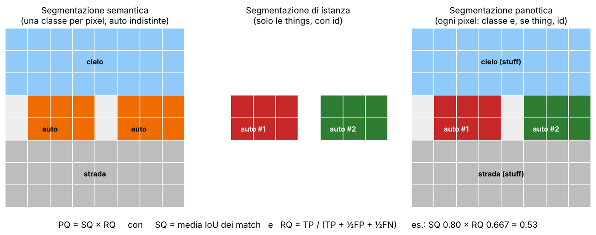

**La fusione** (Kirillov et al., 2019). Si ordinano le maschere d'istanza per confidenza e si «incollano» a partire dalla più alta, così ogni pixel è rivendicato da al più un'istanza; i pixel non rivendicati ricadono sulla predizione semantica (una classe di stuff, oppure void). In caso di conflitto vince l'istanza sullo stuff. Ogni pixel finisce con una sola coppia (classe, id). È un'euristica; i modelli successivi (Panoptic FPN, Mask2Former) fanno la fusione dentro il modello. Il visionbook non tratta la panottica (il cap. 50 si ferma a § 50.6): la fonte è Szeliski § 6.4.3.

**Panoptic Quality.** Si abbinano segmenti predetti e veri: una coppia con IoU \> 0.5 è un TP, una predizione senza coppia un FP, una vera senza coppia un FN. Poi

`PQ = [ ∑(p,g) ∈ TP IoU(p, g) / |TP| ] × [ |TP| / (|TP| + ½|FP| + ½|FN|) ] = SQ × RQ`

**SQ** (*segmentation quality*) è l'IoU medio dei segmenti abbinati: quanto sono precisi. **RQ** (*recognition quality*) è come una F1: quanti segmenti sono stati trovati. **Esempio:** 3 coppie con IoU 0.9, 0.8, 0.7 (TP = 3), 1 FP e 2 FN. SQ = (0.9 + 0.8 + 0.7)/3 = 0.80; RQ = 3/(3 + 0.5 + 1) = 0.667; PQ ≈ 0.53. Perché IoU \> 0.5 basta a rendere l'abbinamento unico: i segmenti panottici non si sovrappongono, quindi una ground truth non può avere due predizioni sopra 0.5. PQ si calcola per classe e poi si media, anche separatamente per things e stuff.

**La tabella di sintesi** (slide 55): classificazione, una classe, cross-entropy, argmax; detection, insieme di (scatola, classe, punteggio), CE più smooth L1, NMS; segmentazione semantica, classe per pixel, CE per pixel (più Dice), argmax per pixel; istanza, scatola più maschera, CE più scatola più maschera, NMS e soglia della maschera; panottica, classe e id per pixel, loss semantiche e d'istanza, fusione. Cambiano uscita, annotazioni, loss e post-elaborazione; la backbone (CNN o transformer) resta lo strumento comune.

> **Il punto**
> 
> Panottica = **stuff (classe per pixel) + things (maschere per istanza)** fusi in un'unica mappa. Si misura con **PQ = SQ × RQ**: precisione dei segmenti trovati per la frazione trovata.

### Il riassunto in 10 righe

1.  La detection predice un insieme di (scatola, classe, punteggio) di lunghezza variabile: mancano il «quante» e il «chi va con chi».
2.  L'IoU (intersezione su unione) misura le sovrapposizioni e guida assegnamento, NMS e valutazione.
3.  Prima del deep learning: finestra scorrevole su piramide; Viola-Jones la rende veloce con l'immagine integrale (4 accessi) e la cascata di classificatori.
4.  Two-stage: R-CNN (2000 passate), Fast R-CNN (una passata e RoI pooling), Faster R-CNN (proposte apprese con RPN e ancore, 9 per posizione).
5.  Si regrediscono offset relativi all'ancora (tx, ty, tw = log, th = log); loss = cross-entropy su tutti + smooth L1 solo sui positivi.
6.  One-stage: YOLO (griglia S × S, cella responsabile del centro, 7 · 7 · 30), SSD (più scale), FCOS (senza ancore, (l, t, r, b) e center-ness).
7.  La NMS greedy tiene la scatola migliore e sopprime quelle con IoU sopra soglia; fallisce nelle folle (Soft-NMS).
8.  DETR: N query, matching ungherese uno-a-uno; i duplicati sono penalizzati dalla loss, niente NMS.
9.  AP = area sotto la curva precisione-recall; mAP = media sulle classi; COCO media anche su IoU da 0.5 a 0.95.
10. Segmentazione: dilatazione e ASPP (DeepLabv3+), SETR e SegFormer (attenzione ridotta N²/R), DPT; Mask R-CNN con RoIAlign; panottica con PQ = SQ × RQ.

### Verifica di aver capito

**1. Perché la detection non si addestra con la cross-entropy per pixel? Che cosa manca?**

Perché l'uscita è un insieme di lunghezza variabile e non una mappa a dimensione fissa. Mancano il numero di predizioni (scelto dall'architettura: ancore, celle, query) e l'assegnamento fra predizioni e oggetti veri, che va deciso prima di poter calcolare una loss (IoU per le ancore, il centro per YOLO, il matching ungherese per DETR).

**2. Calcola IoU di A = \[0, 0, 10, 10\] e B = \[5, 5, 15, 15\], poi codifica la ground truth (110, 90, 60, 72) rispetto all'ancora (100, 80, 40, 80).**

IoU = 25/175 ≈ 0.14. Offset: tx = 10/40 = 0.25, ty = 10/80 = 0.125, tw = ln(60/40) ≈ 0.405, th = ln(72/80) ≈ −0.105.

**3. Perché Faster R-CNN è più veloce di R-CNN? Che cosa fa la RPN?**

R-CNN fa una passata della CNN per ognuna delle \~2000 regioni, Faster R-CNN una sola sull'immagine intera e poi RoI pooling. Inoltre le proposte non vengono più dalla selective search ma dalla RPN, una rete piccola che sulla stessa feature map predice oggetto o no e un offset per ognuna delle ancore.

**4. Esegui la NMS (τ = 0.5) su tre scatole con punteggi 0.95, 0.87, 0.72 che si sovrappongono molto. Quando fallisce?**

Tieni 0.95, sopprimi le altre due (IoU sopra 0.5 con quella tenuta). Fallisce nelle folle: due persone vicine hanno scatole con IoU alto e la persona con punteggio minore viene cancellata, calando il recall. Rimedi: Soft-NMS, oppure DETR che non la usa.

**5. Come fa DETR a non avere NMS?**

Addestra con un matching uno-a-uno (algoritmo ungherese) fra N query e oggetti veri (completati con ∅). Poiché una sola query può essere abbinata a un oggetto, le altre vengono addestrate a predire ∅: i duplicati sono scoraggiati dalla loss, non rimossi in post-elaborazione.

**6. Calcola l'AP con 3 oggetti veri e 5 detection TP, FP, TP, TP, FP. Perché la mAP di COCO è più severa?**

Precisione 1, 0.5, 0.67, 0.75, 0.6 e recall 0.33, 0.33, 0.67, 1, 1. Interpolando: AP = ⅓·1.00 + ⅓·0.75 + ⅓·0.75 ≈ 0.83. COCO media su soglie IoU da 0.5 a 0.95, quindi premia scatole precise e non solo vicine.

**7. Quanto vede un 3 × 3 con dilatazione 4? E tre strati con d = 1, 2, 4?**

keff = 4·(3 − 1) + 1 = 9. Tre strati con d = 1, 2, 4: r = 1 + 2·(1 + 2 + 4) = 15, contro 7 senza dilatazione.

**8. Di quanto si riduce il costo dell'attenzione in SegFormer allo stadio 1?**

N = 128 · 128 = 16 384 token, R = 64: da 16 384² ≈ 2.7·10⁸ a 16 384 · 256 ≈ 4.2·10⁶ elementi, cioè 64 volte meno (N²/R).

**9. Perché RoIAlign e non RoI pooling? Perché una sigmoide per classe?**

RoI pooling arrotonda le coordinate (con stride 16 mezza cella = 8 pixel), RoIAlign le tiene continue e interpola bilinearmente, così la maschera si allinea ai pixel. La sigmoide per classe separa la maschera dalla classificazione: la loss usa solo il canale della classe vera.

**10. Calcola PQ con 3 TP (IoU 0.9, 0.8, 0.7), 1 FP, 2 FN.**

SQ = 0.80, RQ = 3/(3 + 0.5 + 1) = 0.667, PQ ≈ 0.53.

### Come proseguire

Leggi nel visionbook il [cap. 50](https://visionbook.mit.edu/object_recognition_v3.html), § 50.4 (detection: scansione, loss, AP), § 50.5 e § 50.6, poi § 24.2.3 sulla dilatazione. Per le parti non coperte dai libri (R-CNN, DETR, DeepLab, SegFormer, panottica) usa le slide e la sezione «Studia dal libro» qui sotto. Poi **ripassa con le schede qui sotto**, slide per slide: i riquadri «Attenzione» segnalano gli errori delle slide (33, 60, 61, 32). Il lab della [L20](https://gabriele-marsili.github.io/appunti-magistrale-ai/anno-2/computer-vision/sito/#L20) mette in pratica ancore, NMS e detector a due stadi: ciò che hai appena visto, in codice.
