# L20 · Lab detection e segmentazione

*Lezione 20 · laboratorio · ottobre 2026*

[Versione interattiva sul sito, con videolezione](https://gabriele-marsili.github.io/appunti-magistrale-ai/anno-2/computer-vision/sito/#L20) · [Indice della dispensa](README.md)

**In una frase:** il laboratorio mette le mani su tutto ciò che la [L17](https://gabriele-marsili.github.io/appunti-magistrale-ai/anno-2/computer-vision/sito/#L17) ha spiegato a parole: si fa girare **Faster R-CNN** su una foto di pedoni, si scrivono da zero **IoU e NMS**, si confrontano quattro detector (Faster R-CNN, FCOS, YOLOv8, DETR), si segmenta con **SegFormer** una scena di guida e un video, si scopre il **domain gap** fra un modello addestrato su GTA5 e uno su Cityscapes, e si arriva alle istanze con **Mask R-CNN** e con le **componenti connesse**.

### Prima di iniziare

È un laboratorio senza slide: c'è solo il notebook `lab_obj_det_seg.ipynb`. La teoria sta nella [L17](https://gabriele-marsili.github.io/appunti-magistrale-ai/anno-2/computer-vision/sito/#L17) (detection, segmentazione, metriche) e nella [L15](https://gabriele-marsili.github.io/appunti-magistrale-ai/anno-2/computer-vision/sito/#L15) (backbone, feature map). Qui la riprendiamo dal punto di vista di chi deve **capire cosa esce dalle celle**. Ti servono:

  - dalla [L15](https://gabriele-marsili.github.io/appunti-magistrale-ai/anno-2/computer-vision/sito/#L15): convoluzione, feature map a risoluzioni diverse, softmax;
  - dalla [L17](https://gabriele-marsili.github.io/appunti-magistrale-ai/anno-2/computer-vision/sito/#L17): che cosa sono detection, segmentazione semantica, d'istanza e panottica;
  - dalla [L18](https://gabriele-marsili.github.io/appunti-magistrale-ai/anno-2/computer-vision/sito/#L18): l'idea di transformer con token e attention (per DETR e SegFormer);
  - un po' di geometria: area di un rettangolo, intersezione di due rettangoli.

Il notebook è arrivato **senza uscite salvate**: tutti i numeri qui sotto vengono dalla **nostra esecuzione su CPU**. Sono quindi lenti in assoluto (secondi per immagine), ma i conteggi di box e pixel sono deterministici. Le 28 schede sotto seguono il notebook cella per cella; questa dispensa segue l'ordine in cui conviene capire.

### Guarda prima questi video

  - [Lecture 15: Object Detection (UMich EECS 498-007)](https://www.youtube.com/watch?v=MshSNnwF1Qg) (Video). Justin Johnson, University of Michigan. IoU, NMS, R-CNN, Fast e Faster R-CNN con RPN e anchor, YOLO e SSD, le metriche. Copre le sezioni 1–6 di questa dispensa.
  - [DETR: End-to-End Object Detection with Transformers | Paper Explained](https://www.youtube.com/watch?v=BNx-wno-0-g) (Video). Aleksa Gordić, The AI Epiphany. Object query, cross-attention e matching ungherese: guardalo dopo la sezione 6.
  - [Lecture 16: Detection and Segmentation (UMich EECS 498-007)](https://www.youtube.com/watch?v=zHSjrqS0jAY) (Video). Justin Johnson, University of Michigan. Segmentazione semantica, poi istanza e Mask R-CNN con RoIAlign. Utile per le sezioni 7–11.

### 1\. Tre compiti, tre tipi di risposta

**Il problema.** Un'auto a guida autonoma riceve una foto. Cosa deve restituire? «Ci sono due persone e una macchina» non basta: serve sapere *dove*. Ma «dove» si può dire in tre modi diversi.

**L'idea.** Con la **detection** ogni oggetto riceve un rettangolo (box) e una classe. Con la **segmentazione semantica** ogni pixel riceve una classe, ma due persone vicine diventano un unico blocco. Con la **segmentazione d'istanza** ogni oggetto riceve la sua maschera, ma cielo e strada restano fuori. La **panottica** mette insieme le due cose: tutti i pixel hanno una classe e ogni persona è distinta.

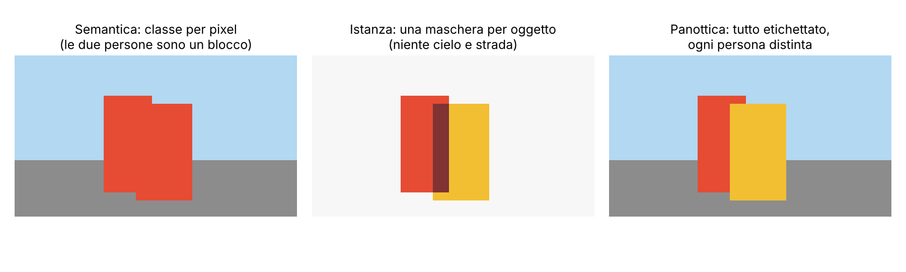

Il lab percorre questi compiti in ordine: parte 1 detection (schede 1–12), parte 2 semantica (13–22), parte 3 istanze (23–28).

> **Il punto**
> 
> Box = dove sono gli oggetti. Semantica = che cosa è ogni pixel. Istanza = quale oggetto possiede ogni pixel. Nessuna risposta sostituisce le altre.

### 2\. IoU: misurare quanto due box coincidono

**Il problema.** Il detector dice «persona qui», la verità è «persona lì». Quanto sono vicini? Serve un numero, perché lo useremo per togliere duplicati, per assegnare predizioni e verità e per valutare.

**L'idea e la formula.** Si confronta ciò che i due box hanno in comune con ciò che coprono insieme:

`IoU(A, B) = |A ∩ B| / |A ∪ B|`

*A* e *B* sono i due box, *|·|* è l'area, ∩ l'intersezione, ∪ l'unione. Il valore va da 0 (box disgiunti) a 1 (box identici) e non cambia se si ingrandisce o si sposta l'immagine. L'unione si calcola come *|A| + |B| − |A ∩ B|*.

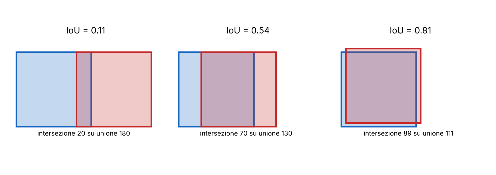

**Esempio svolto.** Due box 10×10 con l'ultimo 5 pixel spostato a destra: l'intersezione è 5×10 = 50, l'unione è 100 + 100 − 50 = 150, IoU = 1/3. Nel notebook (scheda 7) `box_iou_manual` dà gli stessi valori di `torchvision.ops.box_iou`: differenza massima 0,0.

> **Il punto**
> 
> IoU è il «righello» dei box. Il libro (§ 50.4.2) nota che usarlo come loss ha un difetto: per box disgiunti vale sempre 0, quindi **non c'è gradiente** che dica da che parte spostarsi.

### 3\. NMS: togliere i duplicati

**Il problema.** Un detector produce centinaia di box candidati e molti riguardano lo stesso oggetto. Se li mostri tutti, la persona risulta «trovata» venti volte.

**L'idea.** La **Non-Maximum Suppression (NMS)** è golosa: tieni il box con il punteggio più alto, butta tutti quelli che lo coprono troppo (IoU maggiore di una soglia τ) e ripeti con i rimasti. Il libro la descrive nel § 50.4.1.2 con tre passi; Szeliski la chiama «greedy most-confident-first».

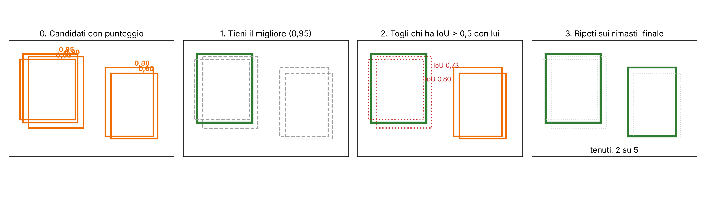

**In codice** (scheda 7): ordina per punteggio; finché la lista non è vuota prendi il primo, calcola l'IoU con tutti gli altri, tieni solo quelli con IoU ≤ τ. La nostra versione dà lo stesso insieme di `torchvision.ops.nms` su 3000 box (2664 restano), ma è 16 volte più lenta (327,8 ms contro 20,6 ms): il costo cresce come il quadrato dei box, e torchvision lo fa in C++.

**La soglia τ è un compromesso.** Troppo bassa: due oggetti vicini vengono fusi in uno. Troppo alta: i duplicati sopravvivono. Sulla foto di esempio (1 pedone) restano 4, 5, 5, 9 e 40 box per τ = 0,1, 0,3, 0,5, 0,7, 0,9: a 0,9 si vede lo scarto fra «ripulito» e «pieno di doppioni». Sulla foto affollata (8 pedoni) le persone restano 8 fino a τ = 0,7 e salgono a 14 con 0,9.

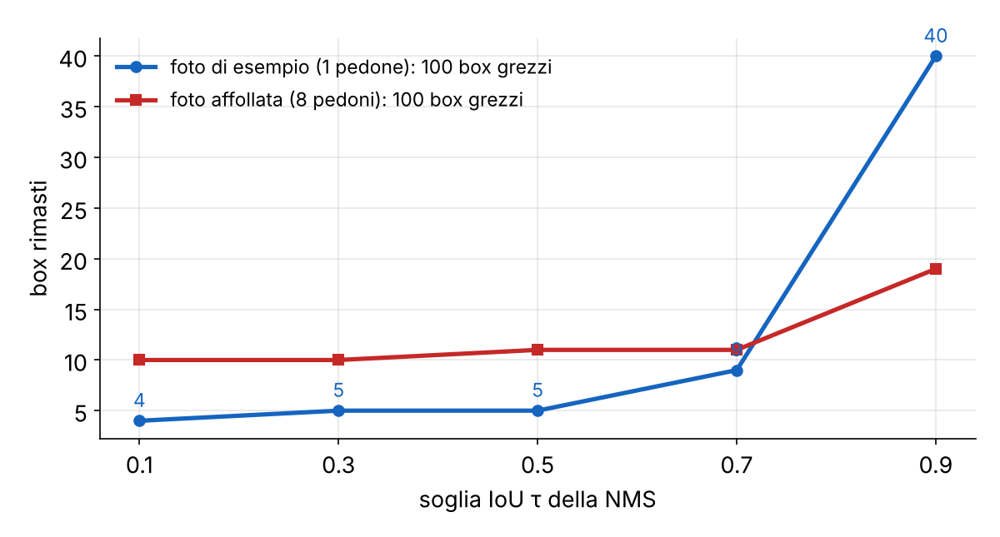

**Per classe.** Le librerie fanno l'NMS **separatamente per ogni classe**: una borsa sopra una persona ha IoU alto con lei, ma non va cancellata. Il libro non lo dice: è un dettaglio dell'implementazione (scheda 8).

> **Il punto**
> 
> NMS = tieni il migliore, scarta chi lo copre oltre τ, ripeti. **Non esiste una τ perfetta**: con oggetti vicini è un compromesso.

### 4\. Soft-NMS: non cancellare, abbassare

**Il problema.** Due persone vicine hanno IoU 0,55: con τ = 0,5 l'NMS cancella la seconda. Hai contato 1 persona invece di 2.

**L'idea.** Il **Soft-NMS** (Bodla et al. 2017; non è nei libri) invece di cancellare **riduce il punteggio** del vicino: `s ← s · (1 − IoU)` se IoU \> τ. Alla fine un secondo filtro sul punteggio decide chi resta.

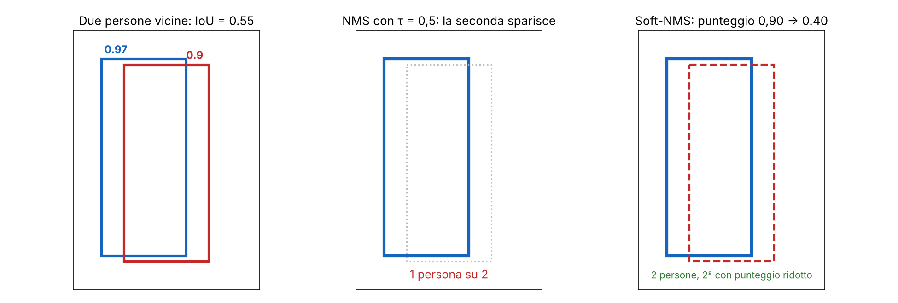

Sui 100 box della foto di esempio il Soft-NMS lineare (τ = 0,3, soglia 0,05) tiene 8 box, la NMS dura 4 (scheda 10). Ma i quattro in più hanno punteggi bassi: il Soft-NMS sposta il problema sulla scelta della soglia finale.

> **Il punto**
> 
> Soft-NMS = declassare invece di cancellare. Aiuta nelle folle, **ma non elimina il problema dei duplicati**: lo rimanda alla soglia sul punteggio.

### 5\. Faster R-CNN: guardare in due stadi

**Il problema.** Provare ogni possibile rettangolo costa troppo. Come si propongono pochi box buoni?

**L'idea.** **Faster R-CNN** lavora in due stadi (Szeliski § 6.3.3). Primo stadio: una rete (la **RPN**, Region Proposal Network) guarda la feature map e propone zone dove c'è «qualcosa». Secondo stadio: ogni proposta viene ritagliata dalla feature map, classificata e affinata.

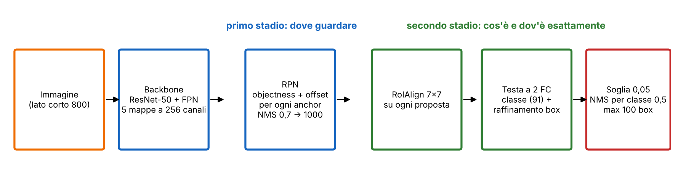

**Le anchor.** A ogni posizione della feature map la RPN prova box di forma prefissata: le **anchor**. In torchvision sono **15 per posizione**: 5 scale (aree circa 32², 64², 128², 256², 512², una per livello della FPN) × 3 proporzioni (h/w = 0,5, 1, 2). Per ogni anchor la RPN predice un punteggio di *objectness* (c'è un oggetto?) e un piccolo spostamento che corregge il box.

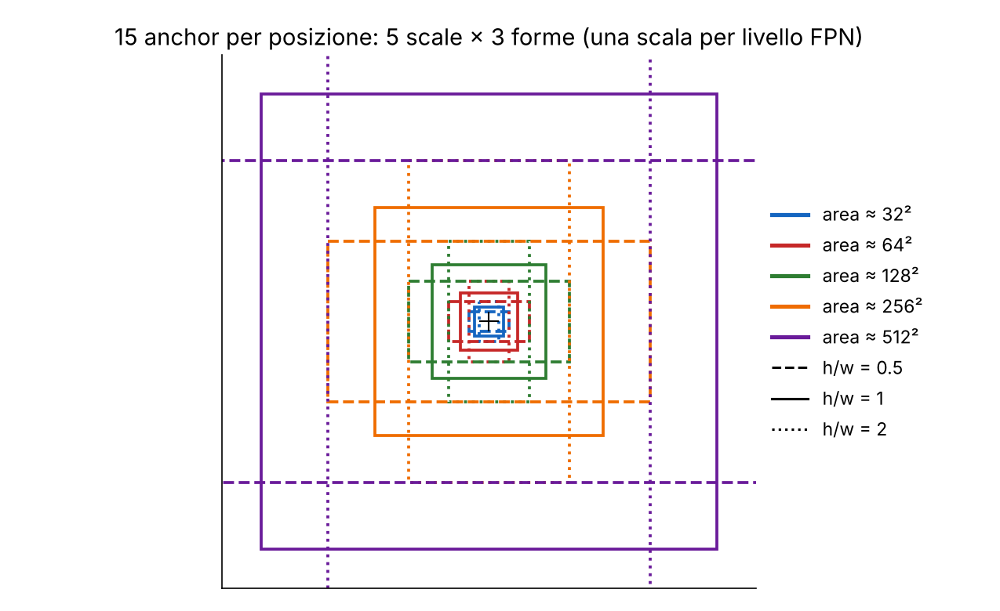

**Il conto.** L'immagine di esempio, portata a 800×1056, genera mappe di 200×264, 100×132, 50×66, 25×33 e 13×17 posizioni: 70 346 in totale, per 3 forme: **211 038 anchor**. Il notebook li mostra come un imbuto (scheda 4):

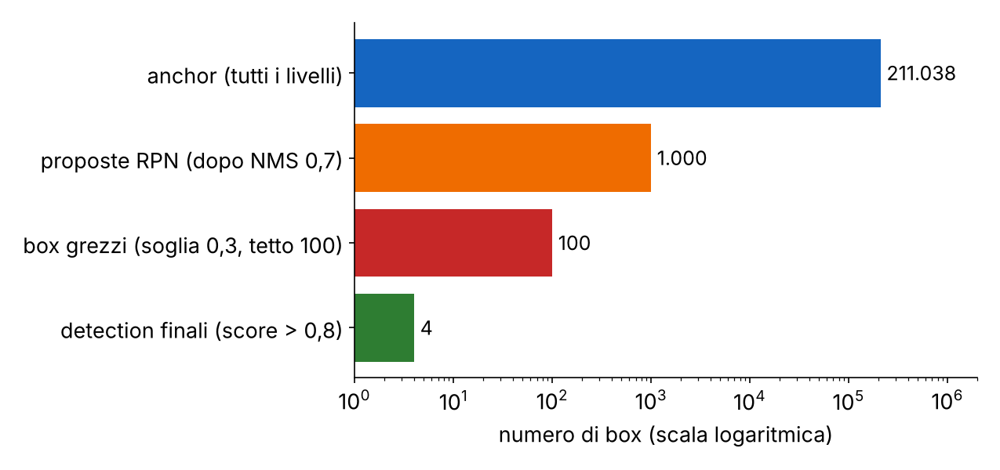

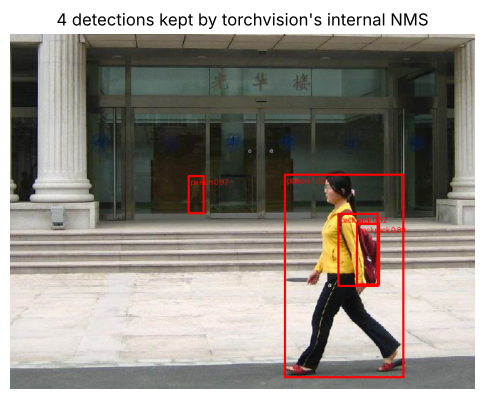

**Quanti box «grezzi» ci sono?** Abbassando la soglia sul punteggio i box crescono: 29 con 0,9, 82 con 0,5, poi 100 con 0,3 e 0,1. Qui non è un risultato del modello: è il **tetto `detections_per_img = 100`**, che il notebook non dichiara (scheda 5).

> **Il punto**
> 
> Faster R-CNN = RPN che dice dove guardare (211 038 anchor → 1000) + testa che dice cosa c'è (100 → pochi). Sono le due parti che il libro non descrive: il visionbook ferma la storia a selective search.

### 6\. DETR: niente anchor, niente NMS

**Il problema.** Anchor e NMS sono pezzi disegnati a mano, con parametri da regolare (scale, proporzioni, τ). Si può fare a meno?

**L'idea.** **DETR** (Carion et al. 2020; in Szeliski § 6.3.3) vede la detection come **predizione di un insieme**. Un transformer riceve le feature e **100 query** apprese; ognuna produce un box e una classe (91 classi COCO più «nessun oggetto»: 92 logit). In training si accoppia ogni oggetto vero a *una sola* query con l'**algoritmo ungherese**, che sceglie l'abbinamento di costo totale minimo; le query non accoppiate imparano «nessun oggetto». Così **non nascono duplicati e l'NMS non serve**.

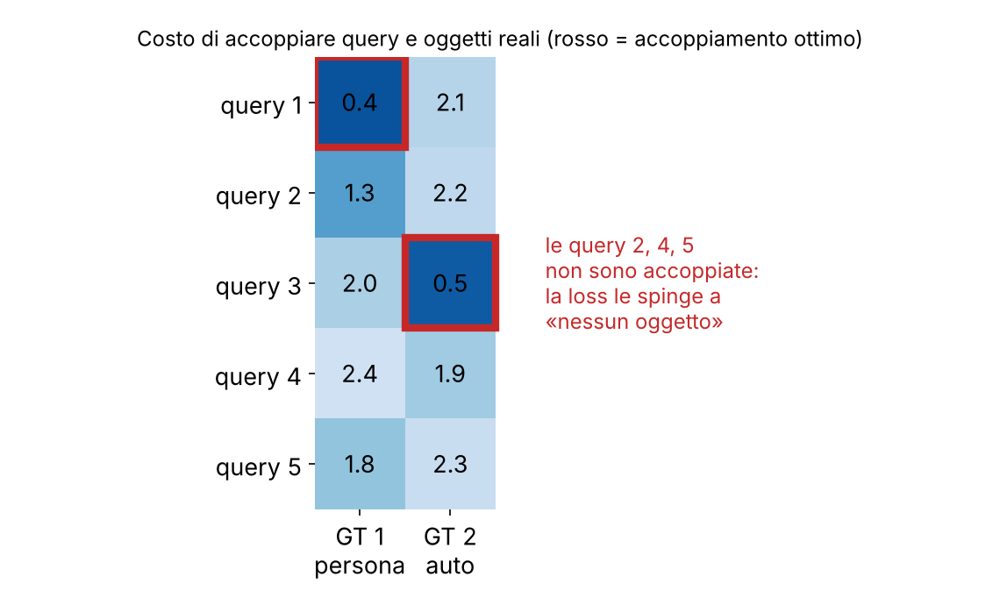

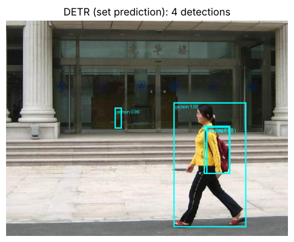

**Il confronto del lab** (scheda 12). Quattro detector sulla stessa foto, su CPU:

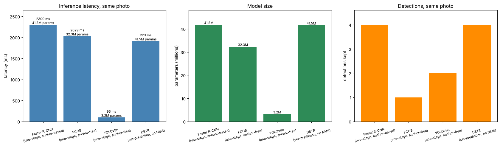

Attenzione a come si legge. **YOLOv8n è 20 volte più veloce perché è minuscolo (3,2 M parametri)**, non perché «uno stadio» sia magico. E il terzo grafico non è un test di qualità: i punteggi dei modelli non sono calibrati allo stesso modo, quindi «FCOS ne trova 1» a soglia 0,8 dice poco. Sulla foto affollata (8 pedoni veri) i conteggi di persone sono: Faster R-CNN 9, DETR 9 (13 con soglia 0,5), YOLOv8n 8, FCOS 4 / 10 / 18 con soglie 0,8 / 0,5 / 0,3. Per un giudizio serve l'AP su un dataset annotato (§ 50.4.3 del libro). Nota anche che il notebook dice «anchor-based» per YOLOv8 nel testo e «anchor-free» nel grafico: il secondo è corretto.

> **Il punto**
> 
> Tre famiglie: due stadi (Faster R-CNN), uno stadio (FCOS, YOLO), insieme di predizioni (DETR). **Dimensione del modello e soglia pesano quanto la famiglia**.

### 7\. Dai box ai pixel: SegFormer

**Il problema.** Il box non dice quali pixel sono della persona, e non ha senso per cielo o strada (§ 50.4.4 del libro). Serve una classe *per pixel*.

**L'idea.** La rete **SegFormer-b0** (Xie et al. 2021; non nei libri) ha un encoder a quattro stadi che riduce via via la risoluzione e un decoder minuscolo, fatto di soli strati MLP, che ricombina le quattro uscite. Il risultato è una mappa di 19 punteggi per posizione (le classi di Cityscapes) a **un quarto della risoluzione**: bisogna riportarla alla taglia dell'immagine.

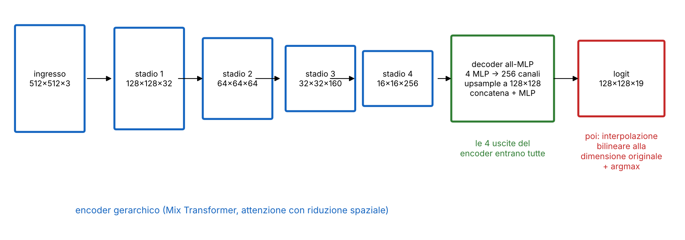

**La catena di forme** (schede 13–15): (1, 3, 512, 512) → (1, 19, 128, 128) → **interpolazione bilineare dei logit** a (1, 19, H, W) → *argmax* sui canali → (1, H, W). Si interpolano i *logit*, non gli id di classe: la media di «strada = 0» e «persona = 11» non è una classe.

**Una trappola nascosta.** Il checkpoint si chiama `…1024-1024`, ma il preprocessore del lab ridimensiona a **512×512** (scheda 13). Sulla foto Cityscapes 2048×1024 questo cambia i risultati più di quanto ci si aspetti:

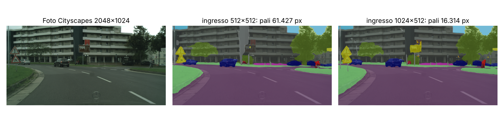

> **Il punto**
> 
> SegFormer = encoder gerarchico + decoder MLP, logit a 1/4, poi upsample e argmax. **La risoluzione di ingresso cambia il risultato**, soprattutto per le classi piccole e sottili.

### 8\. Come si legge il risultato: overlay e metriche

**Overlay.** Per vedere la maschera sull'immagine si fa una miscela: `out = (1 − α)·foto + α·colori`, con α fra 0 e 1 (cv2.addWeighted). Con α = 0 vedi la foto, con α = 1 solo la mappa delle classi.

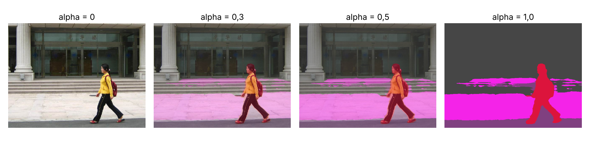

**mIoU contro pixel accuracy.** La **pixel accuracy** è la frazione di pixel giusti. Il **mIoU** calcola l'IoU *per classe* (sui pixel: TP / (TP + FP + FN)) e ne fa la media. Strada e cielo occupano quasi tutti i pixel, quindi la prima è dominata da loro (§ 50.5 del libro).

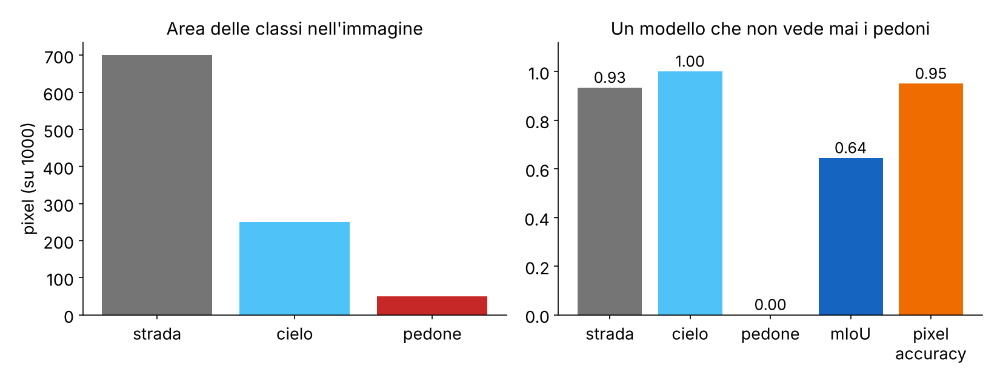

Il 95% sembra ottimo, eppure il modello è inutile per un'auto, perché non vede i pedoni. Per questo si usa il mIoU.

> **Il punto**
> 
> **La pixel accuracy nasconde gli errori sulle classi piccole**: guarda sempre l'IoU per classe.

### 9\. Domain gap: GTA5 contro Cityscapes

**Il problema.** Etichettare a mano le immagini di guida costa moltissimo; i frame di un videogioco (GTA5) arrivano con le etichette gratis. Un modello addestrato solo sul videogioco funziona sulle strade vere?

**L'idea.** Il **domain gap** è il calo di prestazioni quando i dati d'uso (reali) sono diversi da quelli di training (sintetici). Il lab (schede 17–18) mette due SegFormer, uno addestrato su Cityscapes e uno su GTA5, davanti a due immagini, una per dominio: 2×2 pannelli.

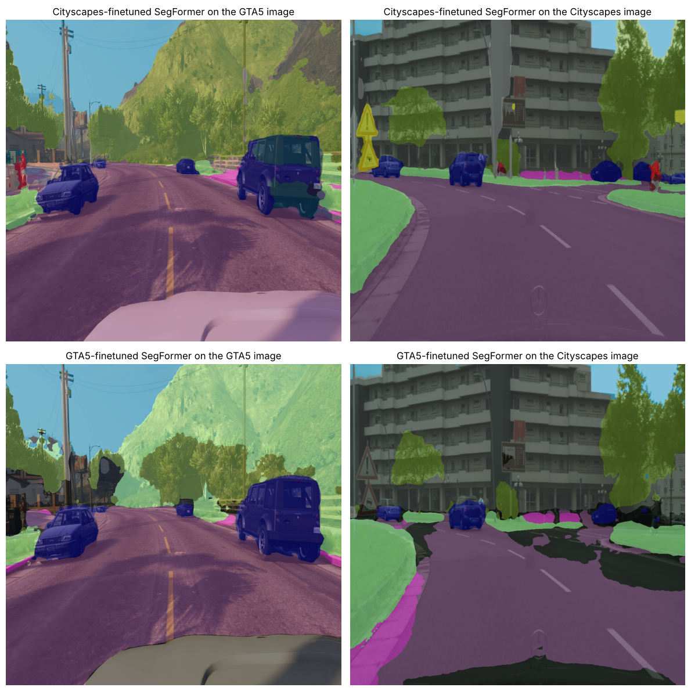

**I numeri.** Se si prende il modello Cityscapes come riferimento, l'accordo pixel per pixel del modello GTA5 è del 61% su un frame GTA5, 77% sulla foto Aquisgrana, 80% sulla foto di esempio e **44% sulla foto affollata**. Il calo non è costante: dipende da quanto la scena somiglia a un frame di guida. Sulla foto dei pedoni, la gamba di una persona viene segnata come strada (ipotesi: nei dati sintetici i pedoni hanno aspetto e pose diverse). Mitigazioni tipiche: più varietà nei dati sintetici, domain adaptation, un po' di dati reali.

> **Il punto**
> 
> Sintetico ≠ reale. **Un modello bravo nel suo dominio può essere mediocre in un altro**, e l'accordo medio nasconde le differenze fra scene.

### 10\. Il video: tempo reale in numeri

Il lab applica SegFormer a un video 2048×1024 a 10 FPS (201 frame, 20 elaborati). Tre cose da sapere (schede 20–22):

  - **BGR e RGB**: OpenCV legge i frame in BGR, il modello vuole RGB. Si converte all'ingresso e di nuovo all'uscita prima di scrivere.
  - **FPS**: il video di uscita nel notebook è scritto a 5 FPS contro i 10 dell'ingresso, quindi va al rallentatore (un errore del notebook).
  - **Il budget**: a 10 FPS hai 100 ms per frame, a 30 FPS 33 ms. Il nostro SegFormer-b0 su CPU ne impiega 1087 in media (0,9 FPS). Il testo dice che il primo frame è più lento; nella nostra esecuzione no (998 ms).

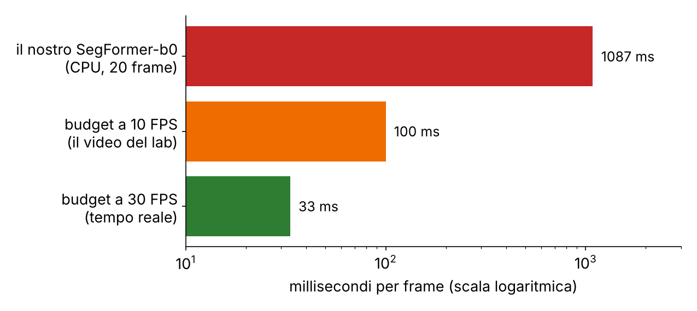

### 11\. Mask R-CNN e RoIAlign: istanze vere

**Il problema.** Con la semantica, due persone a contatto sono un blocco solo. Come si ottiene una maschera per ciascuna?

**L'idea.** **Mask R-CNN** (He et al. 2017; § 50.6 e Szeliski § 6.4.2) è Faster R-CNN con un **ramo in più**: dentro ogni box proposto prevede una maschera binaria (28×28 pixel, poi ridimensionata al box). Due persone hanno due box, quindi due maschere.

**RoIAlign.** Per passare da un box di dimensione qualsiasi a una griglia fissa di feature serve un ritaglio. Il vecchio RoIPool **arrotonda le coordinate del box alle celle** della feature map: spostamenti di mezza cella, che per un box vanno bene ma per una maschera si vedono. RoIAlign non arrotonda: campiona punti dentro il box con interpolazione bilineare. Nel lab sono 7×7 per la testa dei box e 14×14 per la maschera.

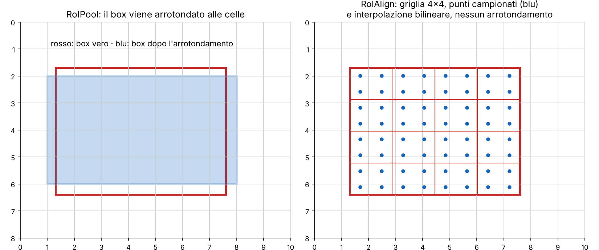

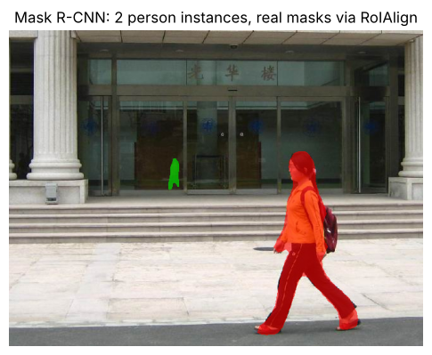

**Panottica.** La scheda 24 la costruisce «per composizione»: semantica per lo stuff, istanze per le persone. Non è una vera panottica (nessuna etichetta coerente: i bordi «person» di SegFormer restano, gli zaini sono istanze): il libro la tratta solo in Szeliski § 6.4.3, con la metrica PQ.

> **Il punto**
> 
> Mask R-CNN = Faster R-CNN + maschera per box, con RoIAlign che **mantiene l'allineamento al pixel**.

### 12\. Componenti connesse: contare i blob

**Il problema.** Ho una maschera binaria «persona» di SegFormer (non Mask R-CNN). Posso contare le persone senza una rete d'istanza?

**L'idea.** Si dà un'etichetta diversa a ogni insieme di pixel «accesi» collegati fra loro. Con una ricerca in ampiezza (BFS): scorri l'immagine; appena trovi un pixel acceso non visitato, parti da lì, visita tutti i vicini accesi e assegna loro la stessa etichetta. Il costo è lineare nel numero di pixel. Nel lab (scheda 25) la scrivi con una `deque`: 41,9 ms contro 1,9 ms di `cv2.connectedComponents`, stessa partizione.

**4 o 8 vicini?** Con la 4-connessione contano solo i vicini su, giù, destra e sinistra; con la 8 anche le diagonali.

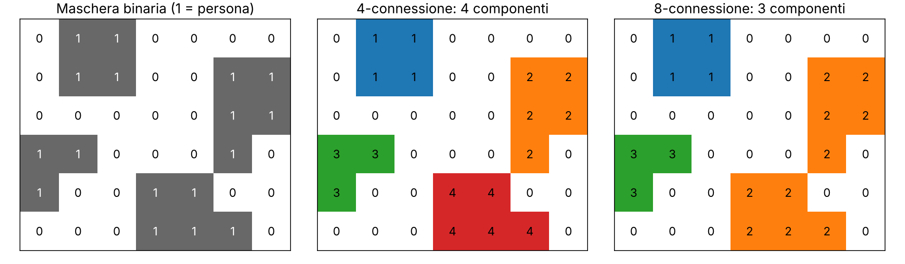

**Dove sbaglia.** Sulla foto affollata Mask R-CNN trova 9 persone, SegFormer con le componenti connesse 7 blob (5 con più di 200 pixel). **Persone vicine si fondono in un blob, un occlusore spezza una persona in due, il rumore crea blob spuri.** Mask R-CNN parte da box separati, quindi non ha questo problema.

> **Il punto**
> 
> Le componenti connesse sono un surrogato economico delle istanze: **funzionano finché gli oggetti non si toccano**.

### I bug del notebook da non copiare

Eseguendolo abbiamo trovato 14 imprecisioni, elencate con cella e correzione nella sezione «Risultati dell'esecuzione» più in basso. Le più importanti: il tetto a 100 box (sezione 5), il ridimensionamento a 512×512 (sezione 7), i 5 FPS contro 10 (sezione 10), e il `ValueError` di Mask R-CNN con più di 8 persone (palette di 8 colori).

### Il riassunto in 10 righe

1.  Detection = box + classe; semantica = classe per pixel; istanza = maschera per oggetto; panottica = entrambe.
2.  IoU = intersezione su unione, fra 0 e 1.
3.  NMS = tieni il migliore, scarta chi ha IoU \> τ, per classe; τ è un compromesso.
4.  Soft-NMS abbassa i punteggi invece di cancellare.
5.  Faster R-CNN: RPN con 15 anchor per posizione (211 038 sul nostro esempio) → 1000 proposte → RoIAlign → testa → NMS: 4 detection.
6.  DETR: 100 query + accoppiamento ungherese, niente anchor né NMS.
7.  SegFormer: encoder gerarchico + decoder MLP; logit a 1/4, upsample, argmax.
8.  mIoU, non pixel accuracy, per valutare le classi piccole.
9.  Domain gap: il modello GTA5 sulle foto reali degrada in modo variabile (44–80% di accordo).
10. Mask R-CNN dà istanze vere con RoIAlign; le componenti connesse sono un surrogato che sbaglia quando gli oggetti si toccano.

### Verifica di aver capito

**Perché l'NMS si fa per classe, e quando non basta?**

Perché oggetti di classi diverse possono sovrapporsi legittimamente (zaino e persona). Non basta con oggetti della stessa classe molto vicini: lì servono Soft-NMS o un detector senza NMS come DETR.

**Da dove vengono i 211 038 anchor e perché alla fine ne restano 4?**

Cinque mappe FPN con 70 346 posizioni totali per 3 forme. La RPN tiene 1000 proposte con NMS a 0,7; la testa le classifica e l'NMS a 0,5 per classe e il tetto di 100 box danno i candidati; con soglia 0,8 ne restano 4.

**Come fa DETR a evitare i duplicati?**

In training ogni oggetto vero è accoppiato a una sola query (matching ungherese); le altre query imparano «nessun oggetto». Non ci sono più query che rispondono allo stesso oggetto.

**Un modello ha pixel accuracy 95% ma non vede i pedoni. Come lo scopri?**

Con l'IoU per classe: sui pedoni vale 0, il mIoU scende (0,64 nell'esempio) anche se i pixel giusti sono il 95%.

**Perché si interpolano i logit e non le etichette?**

Interpolare id di classe produce valori senza significato (la media fra strada e persona non è una classe); interpolando i logit e poi facendo argmax si ottengono bordi coerenti.

**Quando le componenti connesse sbagliano il conteggio e perché Mask R-CNN no?**

Quando persone vicine si toccano, quando un occlusore spezza una persona, quando il rumore crea blob. Mask R-CNN parte da box separati e predice una maschera in ognuno.

### Come proseguire

Libro: [cap. 50 Object Recognition](https://visionbook.mit.edu/object_recognition_v3.html), § 50.4 (box, NMS, IoU, AP), § 50.5 (semantica) e § 50.6 (istanza); Szeliski § 6.3.3 e § 6.4. Poi apri le schede qui sotto, in particolare le soluzioni e la guida allo studio in fondo alla pagina. Ora ripassa con le schede qui sotto.
