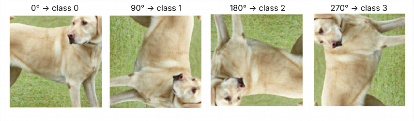
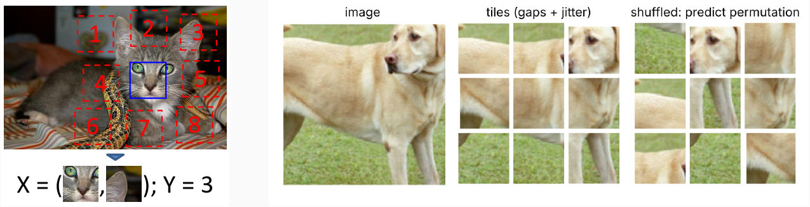
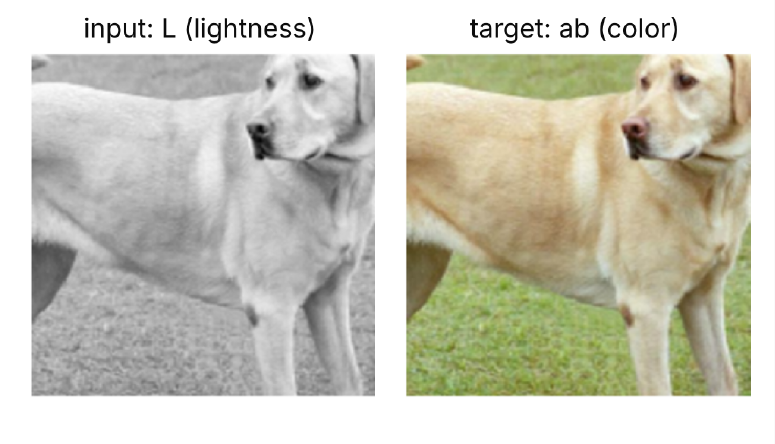
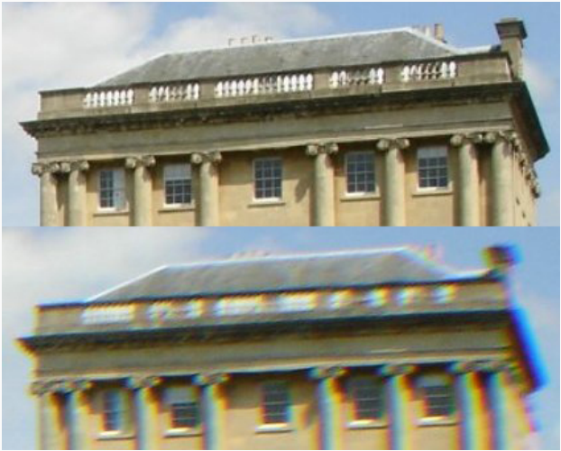
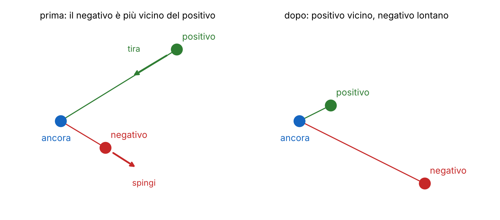
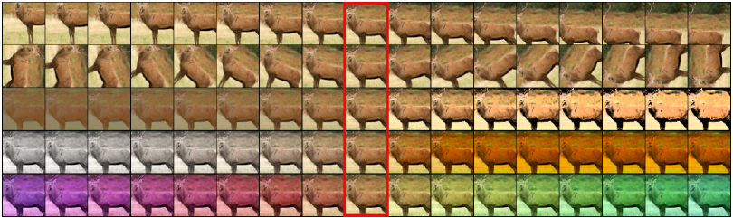
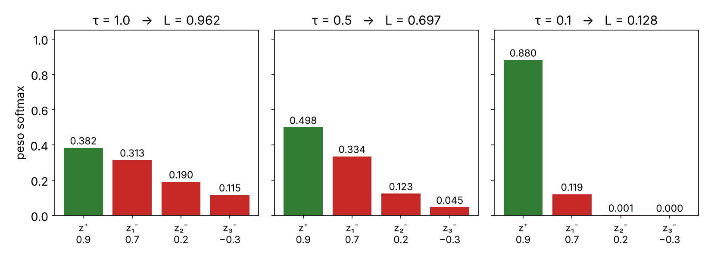
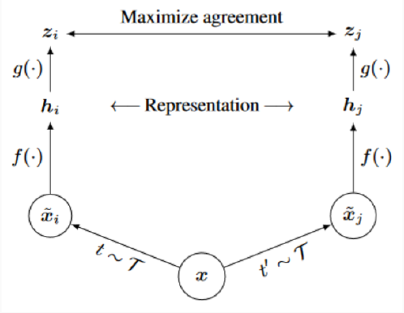
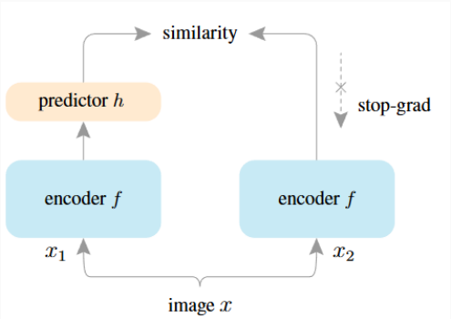

# L21 · SSL contrastivo

*Lezione 21 · Antonio Carta · 4 novembre 2026*

[Versione interattiva sul sito, con videolezione](https://gabriele-marsili.github.io/appunti-magistrale-ai/anno-2/computer-vision/sito/#L21) · [Indice della dispensa](README.md)

**In una frase:** l'**apprendimento auto-supervisionato** (SSL) addestra una rete su milioni di immagini **senza etichette, inventando un compito le cui risposte si ricavano dai dati stessi**; dopo i primi compiti «artigianali» (indovinare la rotazione, rimettere in ordine un puzzle, colorare) si è capito che funziona meglio **confrontare** immagini: due versioni modificate della stessa foto devono finire vicine, foto diverse lontane (loss **InfoNCE**, metodo **SimCLR**), e le modifiche scelte (le *augmentation*) decidono che cosa la rappresentazione imparerà a ignorare.

### Prima di iniziare

Questa lezione (prof. Antonio Carta, 4 novembre) apre la parte del corso sulle rappresentazioni apprese senza etichette; la [L22](https://gabriele-marsili.github.io/appunti-magistrale-ai/anno-2/computer-vision/sito/#L22) la continua con i metodi non contrastivi e i modelli di fondazione (DINO, MAE). Ti servono:

  - dalla [L15](https://gabriele-marsili.github.io/appunti-magistrale-ai/anno-2/computer-vision/sito/#L15): softmax con temperatura, cross-entropy, l'idea di embedding e di separabilità lineare, la BatchNorm;
  - dalla [L16](https://gabriele-marsili.github.io/appunti-magistrale-ai/anno-2/computer-vision/sito/#L16): le augmentation (crop, flip) usate nel lab su CIFAR, e le feature estratte da una rete;
  - dalla [L7](https://gabriele-marsili.github.io/appunti-magistrale-ai/anno-2/computer-vision/sito/#L7) e dalla [L8](https://gabriele-marsili.github.io/appunti-magistrale-ai/anno-2/computer-vision/sito/#L8): SIFT come esempio di descrittore *progettato a mano* per essere invariante a scala, rotazione e illuminazione;
  - un po' di algebra: prodotto scalare, norma, similarità coseno (per vettori di norma 1, ‖u − v‖² = 2 − 2 cos(u, v)).

«Slide N» è la pagina N del PDF, come nelle schede sotto (il footer stampa N − 1). Libro: visionbook cap. 30 ([Representation Learning](https://visionbook.mit.edu/representation_learning.html)) e cap. 37 ([Transfer Learning](https://visionbook.mit.edu/transfer_learning.html)); SimCLR e SimSiam sono solo in Szeliski § 5.4.7.

### Guarda prima questi video

  - [Stanford CS231N | Spring 2025 | Lecture 12: Self-Supervised Learning](https://www.youtube.com/watch?v=4howBU7THbM) (Video). Ehsan Adeli, Stanford Online. Lezione completa sullo stesso programma: pretext task, apprendimento contrastivo, SimCLR e MoCo. Guardala per intero prima o dopo le sezioni 1–16.
  - [Can Contrastive Learning Work? - SimCLR Explained](https://www.youtube.com/watch?v=7Id8SPH31UE) (Video · 10 min). Boris Meinardus. SimCLR in dieci minuti: viste, testa di proiezione, NT-Xent e perché servono batch grandi. Utile come ripasso delle sezioni 12–17.
  - [Exploring Simple Siamese Representation Learning](https://www.youtube.com/watch?v=k-PcMBYQsOY) (Video). Connor Shorten. Spiega SimSiam e il ruolo dello stop-gradient, con il confronto con SimCLR e BYOL. Guardalo dopo la sezione 18.

### 1\. Perché imparare senza etichette

**Il problema.** La ricetta classica della visione con il deep learning (slide 3) è: addestra una rete grande su un dataset etichettato (ImageNet, 1.3 milioni di foto con 1000 classi), togli l'ultimo strato e riusa il resto, la **backbone**, come estrattore di feature per il tuo problema. Ma le etichette costano (slide 4): poco per immagine, di più per una scatola, moltissimo per una maschera; in medicina servono esperti; e sono rumorose e legate a classi fisse. Le immagini *senza* etichetta invece sono gratis: web, telecamere, robot.

**L'idea.** Se mancano le risposte, si inventa una domanda di cui conosciamo già la risposta. Il libro (§ 30.6) la scrive così: da un dato X si ricavano due parti, V1(X) e V2(X), e si addestra la rete a predire la seconda dalla prima, per esempio la metà destra di una foto dalla metà sinistra. Tre definizioni (slide 4):

  - **apprendimento auto-supervisionato (SSL): addestrare su un grande dataset senza etichette con un compito le cui etichette si generano dai dati**;
  - **pretext task** (compito pretesto): quel compito inventato, che fornisce una loss «come se» fosse supervisionata;
  - **downstream task** (compito a valle): il problema che vogliamo davvero risolvere dopo (classificare, rilevare oggetti, segmentare).

La frase da tenere a mente è della slide 4: **il pretext task non ci interessa, è solo un modo per addestrare la rappresentazione**.

**Che cosa rende utile una rappresentazione** h = fθ(x) (slide 5)? Tre proprietà: **trasferibile** (va bene su molti compiti a valle, con poche etichette e poco adattamento), **semantica** (immagini simili per significato sono vicine, idealmente le classi sono linearmente separabili) e **invariante ai fattori di disturbo** (luce, punto di vista, piccoli ritagli, colore). Attenzione all'ultima: **che cosa sia un «disturbo» dipende dal compito a valle**; il colore è rumore per riconoscere un'auto, è l'informazione chiave per distinguere due specie di fiori. Il libro (§ 30.3) riassume: una buona rappresentazione **comprime** (butta i disturbi) e **predice**.

> **Il punto**
> 
> L'SSL sposta il costo dalle etichette al calcolo: **si preaddestra senza etichette, poi si adatta con poche etichette**. Il compito di pretraining conta solo per la qualità della rappresentazione che lascia.

### 2\. Fine-tuning e linear probe: come si usa una rappresentazione

**Il problema.** Quale di due metodi SSL ha imparato la rappresentazione migliore? La loss del pretext non lo dice: bisogna misurare quanto la rappresentazione aiuta un compito vero. Le slide 7–11 danno quattro modi, dal più caro al più economico.

**Fine-tuning completo** (slide 7; libro § 37.3). Sostituisci la testa del pretext con una testa nuova per il tuo compito e continui ad addestrare *tutta* la rete sui dati etichettati, di solito con un **learning rate più piccolo** per la backbone, per non distruggere ciò che ha imparato. Puoi anche congelare alcuni strati: **gli strati bassi sono generici (bordi, texture), quelli alti specifici del compito**, quindi si congelano i bassi e si adattano gli alti. Dà **l'accuratezza migliore** se hai abbastanza dati da non andare in overfitting, ma **costa un addestramento intero per ogni compito** e ha molti iperparametri (learning rate, schedule, augmentation, epoche).

**Linear probe** (slide 8; libro § 37.3.2). Congeli l'encoder fθ e addestri sopra solo un classificatore lineare:

`ŷ = softmax(W fθ(x) + b)`

dove W e b sono gli unici parametri appresi. L'idea: **se le classi di ImageNet sono linearmente separabili nello spazio delle feature, la rappresentazione è buona**. È economico (le feature si calcolano una volta sola e si salvano) e ha pochi iperparametri. Per questo **la top-1 di un linear probe su ImageNet con backbone congelata è il protocollo standard per confrontare i metodi SSL**: quando leggi «SimCLR fa 69.3%», è questo numero.

> **Il punto**
> 
> Fine-tuning = adattare tutto (meglio, ma caro); linear probe = congelare e aggiungere uno strato lineare (il metro standard dell'SSL). Entrambi misurano la rappresentazione attraverso un compito con etichette.

### 3\. k-NN e prototipi: valutare senza addestrare

**Il problema.** Il linear probe va riaddestrato ogni volta che la backbone cambia: durante il pretraining serve un termometro più economico.

**k-NN** (slide 9). Calcoli l'embedding di tutte le immagini di training con l'encoder congelato, di solito normalizzato a norma 1. Per un'immagine di test con embedding z trovi i k vicini più simili (similarità coseno) e voti, pesando ogni vicino:

`ŷ = arg maxc ∑i ∈ 𝒩k(x) exp(sim(z, zi)/τ) · 1[yi = c]`

dove 𝒩k(x) sono i k vicini, yi la loro classe, 1\[·\] vale 1 se la condizione è vera e τ è una temperatura che decide quanto contano i vicini più simili. **Non c'è addestramento**: gli unici iperparametri sono k e τ. Misura la **struttura locale** dello spazio: se i vicini hanno la classe giusta, le classi formano gruppi compatti.

**Esempio svolto.** I 5 vicini hanno similarità e classi (0.90 cane), (0.85 gatto), (0.80 gatto), (0.60 cane), (0.55 gatto). Con τ = 1 i pesi sono e0.90 = 2.46, e0.85 = 2.34, e0.80 = 2.23, e0.60 = 1.82, e0.55 = 1.73: cane 2.46 + 1.82 = 4.28, gatto 2.34 + 2.23 + 1.73 = 6.30, vince **gatto**. Con τ = 0.1 i pesi diventano e9 = 8103, e8.5 = 4915, e8 = 2981, e6 = 403, e5.5 = 245: cane 8506, gatto 8141, vince **cane**. **Una temperatura bassa fa contare quasi solo i vicini più simili**: la stessa idea tornerà in InfoNCE.

**Prototipi** (slide 10–11), detti anche **nearest class mean** (NCM). Per ogni classe c calcoli un solo vettore, la media degli embedding dei suoi esempi Dc, e classifichi con il prototipo più vicino:

`μc = (1/|Dc|) ∑x ∈ Dc fθ(x)        ŷ = arg minc ‖fθ(x) − μc‖2`

**Perché la slide dice «equivalente a un classificatore lineare».** Sviluppa il quadrato: ‖x − μc‖² = ‖x‖² − 2μc⊤x + ‖μc‖². Il termine ‖x‖² è uguale per tutte le classi, quindi minimizzare la distanza equivale a massimizzare `wc⊤x + bc  con  wc = 2μc,  bc = −‖μc‖²` una funzione lineare. Nell'esempio: A ottiene 2·(8 + 8) − 8 = 24, B ottiene 2·(28 + 24) − 85 = 19: vince A. Il classificatore NCM **funziona con pochissimi esempi per classe** (basta una media), per questo è comunissimo nel *few-shot learning*; **funziona bene solo se le classi formano gruppi compatti**, mentre il k-NN (slide 11, a sinistra) segue anche forme più irregolari.

> **Il punto**
> 
> k-NN e prototipi valutano lo spazio degli embedding **senza addestrare nulla**: si possono calcolare durante il pretraining per seguirne i progressi. Il prototipo è la media di classe e dà un confine lineare.

### 4\. I primi pretext task: rotazione, puzzle, colorizzazione

**Il problema.** Quale domanda «gratuita» costringe una rete a capire il contenuto di una foto? La ricetta generale (slide 13): **trasformi l'immagine e chiedi alla rete di predire una proprietà della trasformazione, o l'informazione che hai tolto**. L'etichetta è gratis perché la trasformazione l'hai scelta tu, e si addestra con una loss supervisionata qualunque. Il compito deve essere **risolvibile, non banale e semantico**: non deve bastare un bordo, un colore, un artefatto. Il libro (§ 30.7–30.8) li divide in **imputazione** (ricostruire pixel o colore mancanti) e **pretext astratti** (rotazione, posizione).

**Predire la rotazione** (Gidaris et al. 2018, slide 14–15). Ruoti ogni immagine di 0°, 90°, 180° o 270° e la rete deve dire quale: una classificazione a 4 classi. Per rispondere deve sapere dove stanno la testa del cane, il cielo, i piedi: cioè riconoscere gli oggetti e il loro orientamento tipico.

Pregio: **i multipli di 90° non richiedono interpolazione**, quindi non lasciano artefatti che tradiscano la risposta. Limite: **fallisce sulle immagini senza orientamento canonico** (texture, foto aeree). La slide 15 mostra che i filtri del primo strato somigliano a quelli supervisionati: bordi orientati, come i banchi di filtri della [L7](https://gabriele-marsili.github.io/appunti-magistrale-ai/anno-2/computer-vision/sito/#L7).

**Posizione relativa e puzzle** (slide 16). Il precursore (Doersch et al. 2015) prende una patch centrale e una delle sue **8 vicine** in una griglia 3 × 3 e chiede quale delle 8 posizioni occupa: una classificazione a 8 classi. Il **jigsaw** (Noroozi e Favaro 2016) mescola tutte le 9 tessere e chiede la permutazione. Le permutazioni sono 9\! = 362 880: se ne usa un sottoinsieme fisso e la rete classifica quale è stata applicata.

Spazi e spostamenti casuali fra le tessere, color jitter e pixelazione servono a **impedire soluzioni banali**: senza spazi basterebbe seguire le linee da una tessera all'altra.

**Colorizzazione** (Zhang, Isola, Efros 2016, slide 17). Converti l'immagine nello spazio colore **Lab**: L è la luminosità, a e b il colore. L'ingresso è il solo canale L (una foto in bianco e nero), il bersaglio sono i canali ab. Per colorare bisogna capire la scena: l'erba è verde, il cielo azzurro, un'auto di qualunque colore. Per questo non si usa una regressione (darebbe la media, un grigio spento) ma una **classificazione su valori ab quantizzati** (313 classi nell'articolo): la rete può dire «rosso o blu» senza fare la media.

Pregio: **è un compito naturale con uscita densa**. Difetto: **in addestramento la rete vede solo immagini grigie, a valle immagini a colori**, quindi le statistiche dell'ingresso cambiano. Il libro (§ 30.7) nota che in una rete addestrata a colorare emergono **rilevatori di oggetti**.

> **Il punto**
> 
> Un pretext task trasforma l'immagine e chiede di indovinare la trasformazione o la parte tolta. Funziona se **per indovinare bisogna capire il contenuto**, e solo se la rete non trova un modo più furbo.

### 5\. Limiti dei pretext task e scorciatoie

**Il problema.** Questi compiti hanno dato le prime rappresentazioni utili, ma con quattro limiti (slide 18).

  - **Feature specializzate nel pretext**: gli ultimi strati diventano esperti di rotazioni o permutazioni, non di oggetti. Per questo il linear probe dà spesso il massimo su uno strato **intermedio**, non sull'ultimo.
  - **Scorciatoie** (*shortcut*): la rete risolve il compito con indizi di basso livello invece che con la semantica.
  - **Progettati a mano**: ogni compito richiede ingegneria e porta con sé un bias arbitrario.
  - **Distanza dal supervisionato**: il linear probe restava molto sotto quello di una rete addestrata con le etichette.

**Le scorciatoie** (slide 19) meritano un esempio, perché torneranno. **Shortcut learning: il modello risolve il pretext task con indizi di basso livello invece che con la semantica.** L'esempio classico è l'**aberrazione cromatica**: le lenti non mettono a fuoco nello stesso punto il rosso, il verde e il blu, e lo sfasamento cresce verso i bordi della foto. Una rete può dedurre da quanto sono sfasati i canali *dove* si trova una patch nell'immagine, senza guardare che cosa contiene: risolve il compito della posizione relativa «barando».

Altre scorciatoie della slide: la **continuità dei bordi** fra tessere del puzzle, gli **istogrammi di colore** (due ritagli della stessa foto hanno gli stessi colori, sezione 17) e filigrane, testo, cornici o artefatti JPEG nelle immagini del web. Una rete impara la regola più facile che abbassa la loss, non quella che avevi in mente (lo stesso fenomeno della [L14](https://gabriele-marsili.github.io/appunti-magistrale-ai/anno-2/computer-vision/sito/#L14)).

Il passo successivo (slide 18, in fondo): invece di *predire* una proprietà della trasformazione, **imparare a essere invarianti alle trasformazioni confrontando immagini**, con trasformazioni sia di colore sia spaziali.

> **Il punto**
> 
> I pretext task «artigianali» lasciano feature specializzate e si prestano a scorciatoie. La svolta è **confrontare immagini invece di predire una trasformazione**.

### 6\. L'idea contrastiva: avvicinare e allontanare

**Il problema.** Vogliamo uno spazio latente in cui la distanza abbia un significato: immagini simili vicine, immagini diverse lontane (slide 21). Senza etichette, come diciamo alla rete che cosa è «simile»?

**L'idea.** Non serve sapere *che cosa* c'è nell'immagine: basta sapere quali coppie dovrebbero stare vicine. L'apprendimento contrastivo **confronta coppie di immagini: avvicina le coppie positive, allontana le coppie negative**. Due scelte di progetto: come definire e campionare le coppie, e quale loss usare.

**Da dove vengono le coppie** (slide 22). Le loss contrastive esistono anche nel mondo supervisionato: nel riconoscimento facciale o nella re-identificazione di persone, positivi = stessa classe (la stessa persona), negativi = classi diverse. In SSL non ci sono classi, quindi le coppie vanno *definite*: **positivo = due versioni aumentate della stessa immagine; negativo = viste di immagini diverse**.

**Il punto di vista del libro** (§ 30.10). Se vogliamo che l'encoder f sia invariante a una trasformazione T, la cosa più diretta è penalizzare la differenza:

`ℒalign = ‖f(T(x)) − f(x)‖22`

una **loss di allineamento**. Ma ha un difetto fatale: **se f restituisce sempre lo stesso vettore, la loss vale zero**. È il **collasso della rappresentazione**. Per il libro il contrastivo è allineamento sui positivi più un termine che spinge lontano i negativi (di solito due immagini prese a caso): una **compressione** in cui si dice esplicitamente quale informazione buttare, quella che cambia fra le due viste. Le coppie possono venire da **trasformazioni** (la stessa foto modificata) o da **co-occorrenza** (immagine e suono dello stesso evento).

> **Il punto**
> 
> **Positivi vicini, negativi lontani.** Il solo allineamento ammette la soluzione banale «tutto nello stesso punto»: i negativi servono a escluderla.

### 7\. Le prime loss: Hadsell e triplet

**Il problema.** Come si traduce «vicino/lontano» in una funzione da minimizzare? Le prime risposte usano una distanza D e un **margine**.

**La loss di Hadsell, Chopra e LeCun** (2006; libro eq. 30.4, Szeliski eq. 5.57) è la «contrastive loss» originale, nome oggi esteso a tutta la famiglia. Tira i positivi solo se distano più di un margine mpos e spinge i negativi solo se distano meno di mneg:

`ℒ = max(D(f(x), f(x+)) − mpos, 0) + max(mneg − D(f(x), f(x−)), 0)`

Nel libro questa riga ha un refuso (un meno davanti al secondo termine: va un **più**); vedi la scheda della slide 23.

**La triplet loss** (FaceNet, Schroff et al. 2015; slide 23) confronta in un colpo solo un'**ancora** a, un **positivo** p e un **negativo** n:

`ℒ = max(0, ‖za − zp‖2 − ‖za − zn‖2 + α)`

A parole: il negativo deve stare più lontano del positivo *di almeno* α; finché non è così si paga la differenza, dopo la loss è zero e non si spinge più. Le distanze sono al quadrato, come in FaceNet (con embedding normalizzati e α = 0.2).

**Esempio svolto.** α = 0.2. Se ‖za − zp‖² = 0.5 e ‖za − zn‖² = 0.6, ℒ = max(0, 0.5 − 0.6 + 0.2) = 0.1: il negativo è più lontano, ma non abbastanza. Se ‖za − zn‖² = 1.0, ℒ = 0 e la tripletta non insegna più niente.

> **Il punto**
> 
> Hadsell e triplet usano una distanza e un margine. **Un negativo alla volta converge lentamente** e la maggior parte delle triplette è già «risolta» (loss zero): per questo si passerà a confrontare molti negativi insieme.

### 8\. Instance discrimination: ogni immagine è una classe

**Il problema.** Senza etichette, quale compito di classificazione possiamo porre su milioni di foto?

**L'idea** (slide 24): **ogni immagine è la sua classe**, una **classe surrogata**. Applichi due augmentation casuali t e t′ alla stessa immagine x e ottieni due **viste** t(x) e t′(x): sono una coppia positiva. Le viste di tutte le altre immagini sono negative. Per riconoscere «è ancora la foto 4512, anche ritagliata e ricolorata», la rete deve estrarre feature che **identificano l'immagine restando invarianti alle augmentation**.

La prima versione, l'**Exemplar CNN** (Dosovitskiy et al. 2014), aveva letteralmente una classe per immagine, con uno strato finale con tante uscite quante immagini: non scala a milioni di foto. Wu et al. (2018) l'hanno resa **non parametrica**: niente pesi per classe, si confrontano direttamente gli embedding (tenendo in una *memory bank* quelli di tutto il dataset). I metodi moderni (SimCLR, MoCo) fanno lo stesso: **instance discrimination è il compito SSL principale dei metodi contrastivi moderni**.

> **Il punto**
> 
> Positivo = due viste della stessa immagine, negativo = viste di immagini diverse. È un pretext task anch'esso, ma generico: **le invarianze non sono fissate dal compito, le scegli tu con le augmentation**.

### 9\. Perché servono i negativi

**Il problema.** Basterebbe avvicinare le due viste di ogni immagine? No (slide 25): **con i soli positivi esiste la soluzione banale, mandare ogni immagine nello stesso punto**, il **collasso della rappresentazione**. La loss sarebbe perfetta e la rappresentazione inutile.

**L'idea.** I negativi danno **contrasto**: la rete deve trovare feature che distinguono un'immagine da tutte le altre. Non tutti i negativi sono uguali: un'immagine di un mare quando l'ancora è un gatto è già lontana e non insegna niente; un altro gatto molto simile, cioè un **negativo difficile (hard negative): embedding simile ma immagine diversa**, dà il gradiente più informativo. E poiché un negativo alla volta (triplet) converge lentamente, si confronta l'ancora con **molti negativi insieme**: la N-pair loss di Sohn (2016) e InfoNCE.

> **Il punto**
> 
> I positivi danno l'invarianza, i negativi **impediscono il collasso**. I negativi difficili e numerosi rendono l'addestramento efficiente.

### 10\. Geometria sull'ipersfera: allineamento e uniformità

**Il problema.** Che forma prende lo spazio degli embedding quando la loss contrastiva funziona? E perché si normalizzano gli embedding?

**L'idea** (slide 26; Wang e Isola 2020, ripreso nel libro § 30.10.1). Se gli embedding hanno norma 1 vivono sull'**ipersfera unitaria** (in 2D, un cerchio) e la vicinanza si misura con il coseno. Una buona rappresentazione ha due proprietà:

  - **allineamento (alignment): le coppie positive stanno vicine**;
  - **uniformità (uniformity): gli embedding si distribuiscono su tutta la sfera**, senza ammucchiarsi.

**I positivi producono l'allineamento, i negativi l'uniformità.** Le classi diventano gruppi separati sulla sfera. La normalizzazione è indispensabile: senza, i negativi potrebbero essere spinti all'infinito.

**La matematica**. Il libro scrive le due proprietà come due loss separate:

`ℒalign = 𝔼(x, x⁺) ∼ ppos [ ‖f(x) − f(x+)‖2α ]` `ℒunif = log 𝔼x, x⁻ ∼ pdata [ e−t ‖f(x) − f(x−)‖22 ]        ℒ = ℒalign + λ ℒunif`

𝔼 è la media; ppos la distribuzione delle coppie positive, pdata quella delle immagini; α, t, λ sono iperparametri (tipicamente α = 2, t = 2). ℒalign è la distanza media fra positivi. In ℒunif ogni coppia di immagini diverse contribuisce con e−t·distanza², che è grande (fino a 1) se i due punti sono vicini e piccolo se lontani: la media è piccola, e il suo log molto negativo, solo se *quasi tutte* le coppie sono lontane, cioè se i punti sono sparsi uniformemente.

**Esempio svolto.** Nel collasso tutte le distanze sono circa 0, ogni e−2·0 = 1, la media è 1 e il log è 0: **uniformità pessima anche se l'allineamento è perfetto**. Nel caso «a caso» due viste della stessa immagine sono punti indipendenti sul cerchio (ℒalign ≈ 2.6). Nel caso buono le viste quasi coincidono e i quattro gruppi coprono il cerchio.

> **Il punto**
> 
> Sulla sfera unitaria la loss contrastiva fa due cose: **allinea i positivi e sparge tutto il resto uniformemente**. Il collasso è perfettamente allineato e per niente uniforme.

### 11\. Le augmentation decidono le invarianze

**Il problema.** Con instance discrimination la loss chiede f(t(x)) ≈ f(t′(x)) per ogni coppia di augmentation t, t′ di un insieme 𝒯 (slide 28). Allora che cosa imparerà la rete a ignorare?

**L'idea.** Esattamente ciò che le augmentation cambiano. **L'insieme delle augmentation 𝒯 definisce le invarianze della rappresentazione: è il principale bias induttivo dell'SSL contrastivo.** Confronta con gli altri due mondi: in una rete supervisionata sono le **etichette** a dire che cosa è semantico e che cosa è disturbo; nella visione classica le invarianze erano **progettate a mano**, come SIFT che è costruito per non cambiare con scala, rotazione e illuminazione ([L8](https://gabriele-marsili.github.io/appunti-magistrale-ai/anno-2/computer-vision/sito/#L8)). Qui invece **le invarianze si imparano dalle augmentation**.

Il caso più interessante della tabella della slide 29 è **crop + resize**: oltre a scala, traslazione e occlusione insegna il legame **parte → tutto** (un ritaglio della testa e uno della coda devono finire vicini). Il **grayscale** costringe a usare forma e texture; il **solarize** inverte i pixel sopra una soglia. I metodi moderni concatenano molte augmentation.

**L'esperimento del libro** (§ 30.10.2): forme colorate, embedding a 2 dimensioni (sul cerchio). Con viste = solo **ritagli** il colore resta uguale fra le viste: l'embedding si organizza per **colore**. Aggiungendo cambi casuali di tinta, luminosità e saturazione il colore non aiuta più: l'embedding si organizza per **forma**.

**Le trappole** (slide 30). **Un'invarianza è utile solo se il compito a valle non ha bisogno di quell'informazione.** L'invarianza al colore danneggia i compiti fini in cui il colore conta (specie di fiori o di uccelli); quella alla rotazione danneggia i compiti in cui l'orientamento ha significato (6 contro 9, la disposizione di una scena). **Ritagli troppo aggressivi possono produrre due viste senza oggetti in comune** (una solo cielo, l'altra solo prato): la coppia positiva non è più semanticamente legata, un «falso positivo». E augmentation **troppo deboli rendono il compito banale**: la rete impara scorciatoie.

> **Il punto**
> 
> **Scegli le augmentation e hai scelto che cosa la rete dimenticherà.** Sono il vero «iperparametro» dell'SSL contrastivo e vanno adattate al compito a valle.

### 12\. InfoNCE: una cross-entropy fra un positivo e molti negativi

**Il problema.** Vogliamo una loss che confronti l'ancora con un positivo e *molti* negativi insieme, e che si possa ottimizzare bene.

**L'idea.** Trasformare il confronto in una classificazione: fra N candidati (1 positivo e N − 1 negativi), *quale* è il positivo? Le similarità fanno da logit, il softmax le trasforma in probabilità, e la cross-entropy chiede probabilità alta sul positivo. È lo stesso softmax + cross-entropy della [L15](https://gabriele-marsili.github.io/appunti-magistrale-ai/anno-2/computer-vision/sito/#L15), solo che **le «classi» sono le istanze (positiva e negative) e i «logit» sono le similarità**.

**La matematica** (slide 32). Dati un'ancora z, un positivo z+ e i negativi z1−, …, zN−1−:

`ℒInfoNCE = − log [ exp(sim(z, z+)/τ) / ( exp(sim(z, z+)/τ) + ∑j=1N−1 exp(sim(z, zj−)/τ) ) ]`

dove sim(u, v) = u⊤v/(‖u‖ ‖v‖) è la similarità coseno e τ la **temperatura**. La frazione è la probabilità softmax p+ assegnata al positivo; −log p+ è zero se p+ = 1 e cresce se il positivo si confonde fra i negativi. Il libro (eq. 30.4) usa il prodotto scalare f(x)⊤f(x+)/τ, uguale al coseno con embedding normalizzati; Szeliski (eq. 5.58) nota che si chiama anche NT-Xent.

**Il gradiente** (slide 32, ultimo punto). Chiama sk le similarità e pk = softmax(s/τ)k. Allora ℒ = −s+/τ + log ∑k exp(sk/τ) e

`∂ℒ/∂s+ = −(1 − p+)/τ        ∂ℒ/∂sj = pj/τ`

La discesa del gradiente aumenta s+ (tira z verso z+) e diminuisce ogni sj con forza proporzionale a pj: **ogni negativo viene spinto via tanto quanto è «scambiabile» con il positivo**. I negativi già lontani hanno pj ≈ 0 e quasi non contano.

**Esempio svolto** con N = 4: similarità del positivo 0.9, dei tre negativi 0.7, 0.2 e −0.3.

  - **τ = 1.** Esponenziali: e0.9 = 2.460, e0.7 = 2.014, e0.2 = 1.221, e−0.3 = 0.741; somma 6.436. p = (0.382, 0.313, 0.190, 0.115) e ℒ = −ln 0.382 = **0.962**. Gradienti: −0.618 sul positivo, 0.313, 0.190, 0.115 sui negativi: il negativo difficile (0.7) prende solo il 51% della spinta totale sui negativi.
  - **τ = 0.1.** Logit 9, 7, 2, −3; esponenziali 8103, 1097, 7.39, 0.05; somma 9207. p = (0.880, 0.119, 0.0008, 0.000005) e ℒ = −ln 0.880 = **0.128**. Gradienti: −1.20 sul positivo, 1.19, 0.008, 0.00005 sui negativi: **il negativo difficile prende il 99% della spinta**.

Il valore «al caso»: se tutte le similarità sono uguali, pk = 1/N e ℒ = log N (qui log 4 = 1.386). Le slide (slide 50) dicono anche che InfoNCE è un **limite inferiore della mutua informazione** fra le due viste, senza spiegarlo: van den Oord et al. (2018) dimostrano `I(vista 1; vista 2) ≥ log N − ℒInfoNCE` quindi abbassare la loss alza una stima garantita dell'informazione condivisa, ma la stima non può superare log N.

> **Il punto**
> 
> InfoNCE = **cross-entropy che deve riconoscere il positivo fra N candidati**, con le similarità come logit. Il suo gradiente spinge via ogni negativo in proporzione alla sua probabilità softmax.

### 13\. La temperatura

**Il problema.** Nell'esempio sopra τ ha cambiato la loss (da 0.96 a 0.13) e la spinta fra i negativi. Come sceglierla?

**L'idea** (slide 33). Come nel softmax standard, τ **scala i logit**. **τ piccola: distribuzione appuntita, l'attenzione va sui negativi più difficili.** **τ grande: distribuzione piatta, tutti i negativi pesano uguale, gradienti deboli.**

C'è un compromesso (Wang e Liu 2021). Una τ molto piccola concentra tutto sui negativi più simili, ma in instance discrimination i negativi più simili sono spesso *della stessa classe* (un altro gatto): **spingerli via troppo forte rompe i gruppi semantici**. Una τ grande è più tollerante ma insegna poco. In pratica si usano valori fra 0.05 e 0.5: SimCLR trova il meglio con τ = 0.1, MoCo usa 0.07.

> **Il punto**
> 
> **τ decide quanto la loss guarda i negativi difficili**: piccola = selettiva, grande = uniforme e debole. È lo stesso effetto visto nel k-NN pesato.

### 14\. Quanti negativi?

**Il problema.** InfoNCE migliora con più negativi, ma i negativi costano. Quanti ne servono?

**L'idea** (slide 34). I metodi migliori usano **moltissimi negativi**, per due motivi: **più negativi, più probabilità di trovare negativi difficili** (gradienti più informativi), e una copertura migliore della distribuzione dei dati (embedding più uniformi). C'è anche il motivo teorico della sezione 12: la stima di mutua informazione non supera log N.

**Esempio svolto.** Se una frazione q del dataset è «difficile» per un'ancora, fra K negativi a caso ce n'è almeno uno con probabilità 1 − (1 − q)K: con q = 0.001, 0.22 per K = 254 e 0.9997 per K = 8190.

**Il costo.** **In SimCLR il numero di negativi è legato alla dimensione del batch**: la memoria cresce linearmente con il batch, la matrice delle similarità quadraticamente, e le catene di augmentation (fatte sulla CPU) diventano il collo di bottiglia. La slide dice «SimCLR uses batches \> 4096»: nell'articolo il batch di default è **4096**, con esperimenti da 256 a 8192 (vedi la scheda della slide 34). Chi non può permettersi batch così grandi usa una **coda** di negativi dei batch precedenti (MoCo) o un metodo senza negativi (sezione 18 e [L22](https://gabriele-marsili.github.io/appunti-magistrale-ai/anno-2/computer-vision/sito/#L22)).

> **Il punto**
> 
> Più negativi = più negativi difficili e una stima di informazione più alta, ma **con negativi presi dal batch servono batch enormi**.

### 15\. Collasso completo e dimensionale

**Il problema.** Il collasso è il nemico numero uno dell'SSL (slide 35). Come lo riconosci mentre addestri?

**Due tipi di collasso.**

  - **Collasso completo: f(x) = c per ogni x.** Le coppie positive sono allineate alla perfezione e la rappresentazione non contiene informazione. Sintomi: **deviazione standard degli embedding sul batch → 0**, accuratezza k-NN al livello del caso. La slide dice «la loss è zero»: vale per una loss di solo allineamento; con InfoNCE il collasso è invece penalizzato, perché tutte le similarità valgono 1 e la loss vale log N, il valore al caso (vedi la scheda della slide 35). È proprio per questo che i negativi lo impediscono.
  - **Collasso dimensionale: gli embedding occupano solo un sottospazio di bassa dimensione.** **La loss non lo vede e la capacità si spreca.** Sintomo: i **valori singolari** della matrice di covarianza degli embedding decadono in fretta.

**Come si misura.** (1) Normalizza gli embedding di un batch e calcola la deviazione standard di ogni dimensione: se è vicina a 0, collasso completo; per embedding ben sparsi su una sfera in d dimensioni vale circa 1/√d. (2) Calcola la covarianza degli embedding, i suoi valori singolari, ordinali e guardali in scala log: una caduta brusca dopo i primi k dice che la rappresentazione usa solo k dimensioni. La figura mostra perché servono entrambi: **la deviazione standard non si accorge del collasso dimensionale**.

> **Il punto**
> 
> **La sfida principale dell'SSL è imparare buone rappresentazioni evitando il collasso.** Il completo si vede dalla deviazione standard, il dimensionale solo dallo spettro.

### 16\. SimCLR: il framework contrastivo semplice

**Il problema.** Mettere insieme i pezzi: instance discrimination, augmentation, InfoNCE con molti negativi. SimCLR (Chen et al., ICML 2020, slide 37) lo fa nel modo più semplice: i negativi sono le altre immagini del batch.

**L'architettura** (slide 38). Per ogni immagine x di un batch di B immagini:

1.  due augmentation casuali: x̃i = t(x), x̃j = t′(x);
2.  l'**encoder** f (per esempio una ResNet-50) dà hi = f(x̃i): **è h che si usa a valle**;
3.  la **testa di proiezione** g (un piccolo MLP) dà zi = g(hi): **z serve solo alla loss**;
4.  la loss **NT-Xent** (*normalized temperature-scaled cross entropy*) sulle 2B viste del batch.

`ℓi,j = − log [ exp(sim(zi, zj)/τ) / ∑k=12B 1[k≠i] exp(sim(zi, zk)/τ) ]`

È InfoNCE con una scelta precisa dei candidati: per la vista i, il positivo è j (l'altra vista della stessa immagine) e i negativi sono tutte le altre viste del batch. Il denominatore somma su k ≠ i, quindi 2B − 1 termini: **ogni vista ha 1 positivo e 2B − 2 negativi**. La loss finale è la media di ℓi,j su tutte le 2B viste (sia ℓi,j sia ℓj,i).

**Esempio svolto.** Con B = 4096 le viste sono 8192, la matrice ha 8192² ≈ 6.7 · 107 elementi e ogni vista ha 8190 negativi.

**I tre risultati dell'articolo** (slide 37): (1) la **composizione delle augmentation è decisiva**; (2) una **testa di proiezione non lineare** fra rappresentazione e loss migliora molto la rappresentazione; (3) il contrastivo beneficia di **batch più grandi e addestramenti più lunghi** del supervisionato. Il risultato: linear probe su ImageNet 69.3% con una ResNet-50, 76.5% con una ResNet-50 larga 4 volte, circa quanto una ResNet-50 supervisionata.

> **Il punto**
> 
> SimCLR = due viste, encoder f, testa g, NT-Xent con **i negativi presi dal batch**. Semplice e forte, ma affamato di batch grandi.

### 17\. La testa di proiezione, le augmentation e il batch di SimCLR

**Il problema.** Se la loss si calcola su z, perché a valle si usa h? E quali dettagli rendono SimCLR davvero efficace?

**La testa di proiezione** (slide 39): `x →f h →g z,   g(h) = W2 ReLU(W1 h)` un MLP con uno strato nascosto (nell'articolo h ha 2048 dimensioni, z 128). **Un linear probe su h funziona meglio che su z**, di oltre 10 punti. L'intuizione: la loss rende z invariante alle augmentation, quindi z **butta** informazione (colore, orientamento) che a valle può servire; g si fa carico di questa perdita e h resta più ricca. **La separazione encoder + proiettore si ritrova in quasi tutti i metodi SSL moderni.**

**Le augmentation** (slide 40). La catena, applicata in modo indipendente a ciascuna vista: (1) crop casuale con resize e flip orizzontale; (2) distorsione del colore, cioè color jitter e grigio casuale; (3) blur gaussiano. Risultati: nessuna augmentation basta da sola; **crop + distorsione del colore è la coppia più importante**; il contrastivo vuole augmentation di colore più forti del supervisionato. Il motivo è una scorciatoia: **senza distorsione del colore, due ritagli della stessa immagine si riconoscono dagli istogrammi di colore**.

**Il batch e la durata** (slide 41). Servono batch grandi (molti negativi) e addestramenti lunghi (centinaia di epoche).

> **Il punto**
> 
> La loss si calcola su z ma **a valle si usa h**; senza distorsione del colore SimCLR impara a confrontare istogrammi; batch grandi aiutano soprattutto negli addestramenti brevi.

### 18\. SimSiam: e se togliessimo i negativi?

**Il problema.** I negativi costano (batch enormi) e a volte respingono immagini della stessa classe. Si può farne a meno senza collassare?

**L'idea** (Chen e He 2021, slide 43–44). Una rete **siamese**: due viste x1, x2 della stessa immagine passano per lo **stesso encoder** f (backbone + MLP di proiezione), che dà z1, z2. Su un solo ramo si aggiunge un piccolo MLP, il **predictor** h, che dà p1 = h(z1). La loss è la similarità coseno negativa fra la predizione e l'altra vista:

`𝒟(p1, z2) = − (p1/‖p1‖2) · (z2/‖z2‖2)        ℒ = ½ 𝒟(p1, stopgrad(z2)) + ½ 𝒟(p2, stopgrad(z1))`

Il trucco è lo **stop-gradient**: z2 viene trattato come una costante, il gradiente passa solo dal ramo con il predictor. I due encoder sono la stessa rete, ma **il segnale di apprendimento scorre in una sola direzione**. La loss è simmetrizzata, quindi a turno ciascuna vista fa da predizione e da bersaglio.

**Esempio svolto.** p1 = (0.6, 0.8) (già di norma 1) e z2 = (3, 4) con norma 5: 𝒟 = −(0.6·0.6 + 0.8·0.8) = −1, il minimo: predizione e bersaglio puntano nella stessa direzione. Con z2 = (4, −3): 𝒟 = −(0.6·0.8 − 0.8·0.6) = 0, ortogonali.

**Perché non collassa.** **Senza negativi la soluzione costante ha la loss minima, −1.** L'articolo mostra che **senza stop-gradient il modello collassa subito** (linear probe 0.1%, il caso su 1000 classi), e così anche senza predictor; con entrambi non collassa e raggiunge 68.1% a 100 epoche, con batch 512 e senza bisogno di batch enormi.

> **Attenzione: due imprecisioni della slide 43**
> 
> La slide chiama SimSiam «a simple contrastive SSL method», ma **SimSiam non usa negativi**: è un metodo siamese *non contrastivo* (Szeliski § 5.4.7: BYOL mostra che si possono togliere i negativi, SimSiam che basta lo stop-gradient). E «Projector only in the first augmentation» va letto **predictor**: il projector fa parte dell'encoder f e sta in entrambi i rami, il predictor h in uno solo, e con la loss simmetrizzata agisce a turno su entrambe le viste. Vedi la scheda della slide 43.

> **Il punto**
> 
> SimSiam evita il collasso **senza negativi e senza batch grandi**, grazie a **stop-gradient + predictor**. È il ponte verso i metodi non contrastivi della [L22](https://gabriele-marsili.github.io/appunti-magistrale-ai/anno-2/computer-vision/sito/#L22) (BYOL, DINO).

### 19\. Pretext contro contrastivo, e consigli pratici

**Il confronto** (slide 46):

|                | Pretext task                                           | Apprendimento contrastivo             |
| -------------- | ------------------------------------------------------ | ------------------------------------- |
| Obiettivo      | predire una proprietà della trasformazione             | essere invarianti alla trasformazione |
| Segnale        | etichette progettate (rotazione, permutazione, colore) | confronti fra istanze                 |
| Feature        | specializzate nel pretext                              | generiche, semantiche                 |
| Bias induttivo | un compito specifico                                   | l'insieme delle augmentation          |
| Prestazioni    | lontane dal supervisionato                             | vicine al supervisionato o migliori   |

**Consigli pratici** (slide 48):

  - **batch piccoli = pochi negativi = contrasto debole**: usa una coda di negativi (MoCo) o un metodo senza negativi;
  - adatta le augmentation al compito: non togliere informazione che ti servirà (colore per le specie, orientamento per testo e immagini mediche); le pipeline standard di ImageNet non vanno bene per ogni dominio;
  - **il linear probe dipende dai suoi iperparametri e favorisce feature linearmente separabili**: k-NN, fine-tuning e few-shot possono ordinare i metodi in modo diverso;
  - gli iperparametri del supervisionato (learning rate, epoche, weight decay) non si trasferiscono all'SSL;
  - le augmentation pesanti sulla CPU possono diventare il collo di bottiglia: spostale sulla GPU.

Per approfondire, la slide 49 consiglia «A Cookbook of Self-Supervised Learning» (Balestriero et al. 2023, arXiv 2304.12210).

> **Il punto**
> 
> Il contrastivo ha battuto i pretext task perché **sposta il bias induttivo dal compito alle augmentation**, che sono più generiche e controllabili. Ma batch, augmentation e protocollo di valutazione vanno scelti con cura.

### Il riassunto in 10 righe

1.  SSL: si preaddestra senza etichette con un compito le cui risposte si ricavano dai dati; il pretext conta solo per la rappresentazione che lascia.
2.  Valutazione: fine-tuning (tutto, caro), linear probe (encoder congelato + strato lineare, lo standard), k-NN pesato e prototipi (nessun addestramento).
3.  Prototipi = medie di classe; il classificatore NCM è lineare (wc = 2μc, bc = −‖μc‖²).
4.  Pretext storici: rotazione (4 classi), posizione relativa e jigsaw, colorizzazione (classificazione su ab quantizzati).
5.  Limiti: feature specializzate, scorciatoie di basso livello (aberrazione cromatica, bordi, istogrammi), distanza dal supervisionato.
6.  Contrastivo: positivi vicini, negativi lontani; instance discrimination: positivo = due viste della stessa immagine.
7.  Solo positivi → collasso; sull'ipersfera i positivi danno allineamento, i negativi uniformità.
8.  Le augmentation definiscono le invarianze (crop + colore la coppia chiave): togliere troppo o troppo poco fa danni.
9.  InfoNCE = cross-entropy sul positivo fra N candidati con logit sim/τ; τ piccola concentra il gradiente sui negativi difficili; più negativi aiutano (I ≥ log N − ℒ).
10. SimCLR: f, testa g, NT-Xent con 2B − 2 negativi dal batch, h usato a valle; SimSiam: niente negativi, stop-gradient + predictor; collasso completo (std → 0) e dimensionale (spettro).

### Verifica di aver capito

**1. Perché la loss del pretext task non dice quanto è buono un metodo SSL? Come si misura allora?**

Perché il pretext è solo un pretesto: una rete può indovinare benissimo le rotazioni con feature inutili a valle (o con scorciatoie). Si misura la rappresentazione su un compito con etichette: linear probe su ImageNet con encoder congelato (lo standard), oppure k-NN, prototipi, fine-tuning, few-shot.

**2. k-NN pesato con vicini (0.90 cane), (0.85 gatto), (0.80 gatto), (0.60 cane), (0.55 gatto): che classe esce con τ = 1 e con τ = 0.1?**

τ = 1: cane 2.46 + 1.82 = 4.28, gatto 2.34 + 2.23 + 1.73 = 6.30, vince gatto. τ = 0.1: cane 8103 + 403 = 8506, gatto 4915 + 2981 + 245 = 8141, vince cane. La temperatura bassa dà peso quasi solo ai vicini più simili.

**3. Dimostra che il classificatore a prototipi è lineare.**

‖x − μc‖² = ‖x‖² − 2μc⊤x + ‖μc‖². ‖x‖² non dipende da c, quindi arg min della distanza = arg max di 2μc⊤x − ‖μc‖², lineare in x con wc = 2μc e bc = −‖μc‖².

**4. Perché una loss di solo allineamento collassa, e che cosa misurano ℒalign e ℒunif?**

Perché f costante rende nulle tutte le distanze fra positivi: loss zero, rappresentazione vuota. ℒalign è la distanza media fra positivi (bassa = viste allineate); ℒunif è il log della media di e−t·d² sulle coppie qualsiasi (molto negativa = punti sparsi sulla sfera). Il collasso ha ℒalign = 0 ma ℒunif = 0, il valore peggiore.

**5. Calcola InfoNCE con similarità 0.9 (positivo), 0.7, 0.2, −0.3 per τ = 1 e τ = 0.1. Quale negativo riceve più gradiente?**

τ = 1: p = (0.382, 0.313, 0.190, 0.115), ℒ = 0.962. τ = 0.1: p = (0.880, 0.119, 0.0008, 0.000005), ℒ = 0.128. Il gradiente su sj è pj/τ, quindi riceve di più il negativo con similarità 0.7; con τ = 0.1 prende circa il 99% della spinta sui negativi.

**6. Vuoi distinguere specie di uccelli che differiscono quasi solo per il colore. Che cosa cambi nella pipeline di SimCLR?**

Attenui o togli la distorsione del colore (jitter forte e grigio), perché insegnerebbe proprio l'invarianza al colore che ti danneggia. Il rischio è la scorciatoia degli istogrammi: compensa con crop aggressivi e altre augmentation, e valuta su un probe con il compito vero, non solo su ImageNet.

**7. Perché a valle si usa h e non z?**

Perché la loss rende z invariante alle augmentation e quindi z perde informazione (colore, orientamento) che può servire; la testa g assorbe questa perdita e h resta più ricca. Nell'articolo il linear probe su h supera quello su z di oltre 10 punti.

**8. SimSiam è contrastivo? Che cosa impedisce il collasso?**

No: non usa negativi (la slide 43 sbaglia a chiamarlo contrastivo). Il collasso è impedito dallo stop-gradient sul ramo bersaglio insieme al predictor h (non al projector, che sta in entrambi i rami): senza stop-gradient il linear probe crolla a 0.1%.

### Come proseguire

Leggi nel visionbook il [cap. 30](https://visionbook.mit.edu/representation_learning.html), § 30.2–30.3 (che cosa rende buona una rappresentazione), § 30.6–30.8 (self-supervised, imputazione, pretext astratti) e § 30.10 con 30.10.1–30.10.2 (contrastivo, allineamento e uniformità, esperimento delle forme colorate); poi il [cap. 37](https://visionbook.mit.edu/transfer_learning.html), § 37.2–37.3.2 (pretraining, fine-tuning, probe). Szeliski § 5.3.4 (loss contrastive, eq. 5.57–5.58) e § 5.4.7 (SSL, SimCLR, MoCo, BYOL, SimSiam). Poi **ripassa con le schede qui sotto**, slide per slide: i riquadri «Attenzione» segnalano gli errori delle slide (3, 34, 35, 43). La [L22](https://gabriele-marsili.github.io/appunti-magistrale-ai/anno-2/computer-vision/sito/#L22) continua con i metodi senza negativi, la distillazione e il masked image modeling.
