# L22 · SSL e foundation model

*Lezione 22 · Giacomo Cignoni · 5 novembre 2026*

[Versione interattiva sul sito, con videolezione](https://gabriele-marsili.github.io/appunti-magistrale-ai/anno-2/computer-vision/sito/#L22) · [Indice della dispensa](README.md)

**In una frase:** il **self-supervised learning** addestra una rete su milioni di immagini *senza etichette*, inventando il compito dai dati stessi (due viste della stessa foto devono avere feature simili, oppure le patch nascoste vanno ricostruite); il nemico è il **collasso**, cioè la soluzione banale in cui la rete dà a tutto la stessa risposta, e la lezione è una galleria di modi per evitarlo (teacher lento, coda di negativi, statistiche del batch, mascheramento), fino ai **foundation model** della famiglia DINO, che danno feature riusabili per quasi ogni compito visivo.

### Prima di iniziare

Questa lezione (Giacomo Cignoni, 5 novembre) continua direttamente la [L21](https://gabriele-marsili.github.io/appunti-magistrale-ai/anno-2/computer-vision/sito/#L21), dove hai visto l'apprendimento contrastivo: la loss InfoNCE, SimCLR con coppie positive e negative, SimSiam con predictor e stop-gradient. Qui non li rispieghiamo: li diamo per noti e li usiamo come punto di partenza. Ti servono anche:

  - dalla [L15](https://gabriele-marsili.github.io/appunti-magistrale-ai/anno-2/computer-vision/sito/#L15): softmax con temperatura, cross-entropy, BatchNorm;
  - dalla [L17](https://gabriele-marsili.github.io/appunti-magistrale-ai/anno-2/computer-vision/sito/#L17) e dalla [L18](https://gabriele-marsili.github.io/appunti-magistrale-ai/anno-2/computer-vision/sito/#L18): il Vision Transformer, le patch 16 × 16 come token, il token \[CLS\], la stima di profondità da una sola immagine;
  - un po' di statistica: media, varianza, covarianza e correlazione di un vettore di feature calcolate su un batch.

Le slide sono 59 pagine (il numero in basso, «n / 59», è la pagina del PDF). Il libro di riferimento è il visionbook: cap. 30 ([Representation Learning](https://visionbook.mit.edu/representation_learning.html)) per autoencoder, imputazione e contrastivo, cap. 37 ([Transfer Learning](https://visionbook.mit.edu/transfer_learning.html)) per finetuning, linear probe e distillazione. BYOL, MoCo, Barlow Twins, VICReg, MAE, BEiT, DINO e successori **non sono nei libri**: i numeri che trovi qui sono verificati sugli articoli originali.

### Guarda prima questi video

  - [BYOL: Bootstrap Your Own Latent: A New Approach to Self-Supervised Learning (Paper Explained)](https://www.youtube.com/watch?v=YPfUiOMYOEE) (Video · 34 min). Yannic Kilcher. Spiega perché si può fare a meno dei negativi: teacher con media mobile, predictor, stop-gradient. Bastano i primi 20 minuti; corrisponde alle sezioni 4–6.
  - [DINO: Emerging Properties in Self-Supervised Vision Transformers (Facebook AI Research Explained)](https://www.youtube.com/watch?v=h3ij3F3cPIk) (Video · 39 min). Yannic Kilcher. Crop globali e locali, centering e sharpening, le mappe di attenzione che segmentano gli oggetti da sole. Guardalo dopo la sezione 14.
  - [DINOv2 model from Meta AI: data pipeline, model training and results explained](https://www.youtube.com/watch?v=RZEkdOc3szU) (Video · 12 min). AI Bites. La cura dei dati (LVD-142M), la loss globale più mascherata e la distillazione in modelli piccoli. Ripasso delle sezioni 16–17.

### 1\. Imparare senza etichette

**Il problema.** ImageNet ha 1.3 milioni di immagini etichettate a mano; Instagram ne riceve molte di più ogni giorno, senza nessuna etichetta. Per segmentare cellule al microscopio o stimare l'altezza degli alberi da satellite le etichette sono rare e costose. Si può addestrare una rete *solo* sulle immagini, e poi riusarla?

**L'idea.** Il **self-supervised learning (SSL) insegna a una rete a estrarre rappresentazioni utili da dati non etichettati, con un segnale di addestramento ricavato dalla struttura dei dati stessi** (slide 3). Il trucco è inventare un compito in cui la «risposta giusta» la conosciamo gratis: per esempio, due ritagli della stessa foto devono avere feature simili, oppure una patch nascosta va ricostruita a partire dal resto. **Il compito in sé non interessa; interessa la rete che impara a risolverlo.**

**Non è l'unsupervised classico** (slide 4). k-means, PCA, SOM, DBSCAN cercano struttura nei dati (cluster, componenti principali) con criteri come distanze, varianza o verosimiglianza, e il risultato è la struttura stessa. L'SSL usa la struttura dei dati per **addestrare una rete riusabile**: il prodotto finale è un encoder preaddestrato da attaccare ad altri compiti. Le rappresentazioni buone servono anche da sole: nel *retrieval* di immagini basta cercare le foto con feature più simili (slide 5).

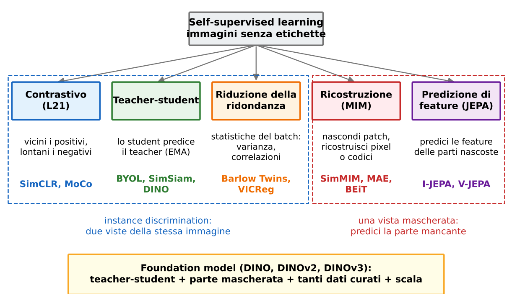

> **Il punto**
> 
> SSL = un compito inventato dai dati, risolto da una rete, che alla fine si tiene come **estrattore di feature generico**. Tutta la lezione riguarda quale compito scegliere perché la rete impari qualcosa di utile.

### 2\. Due fasi, e come si misura una rappresentazione

**Il problema.** Abbiamo addestrato un encoder senza etichette. Come facciamo a sapere se ha imparato qualcosa? La loss del compito inventato non basta: **una loss bassa sul compito pretesto non garantisce rappresentazioni buone a valle** (slide 9).

**Le due fasi** (slide 6–7). **Fase 1, preaddestramento**: l'encoder impara su immagini non etichettate con la loss SSL. **Fase 2, compito a valle** (*downstream*): si attacca all'encoder una **testa** piccola e la si addestra con poche etichette, per classificazione, segmentazione, profondità. L'encoder si può tenere **congelato** o rifinire (**fine-tuning**). Il libro (§ 37.3) descrive proprio questo: tagliare l'ultimo strato, sostituirlo e riaddestrare, e cita DINO come estrattore congelato.

**Tre protocolli** per misurare la qualità (slide 8), dal più severo al più permissivo:

  - **k-NN**: non si addestra nulla. Ogni immagine di test prende l'etichetta di maggioranza fra le k immagini di addestramento con feature più vicine. Misura direttamente la geometria dello spazio delle feature.
  - **Linear probe**: encoder congelato, si addestra solo uno strato lineare. Se basta un iperpiano per separare le classi, l'informazione è già lì in forma esplicita (il libro, § 37.3.2, li chiama *linear probes*).
  - **Fine-tuning**: si addestrano testa e backbone. Dà i numeri migliori, ma **misura anche quanto è facile *adattare* la rete**, non solo quanto è buona la rappresentazione.

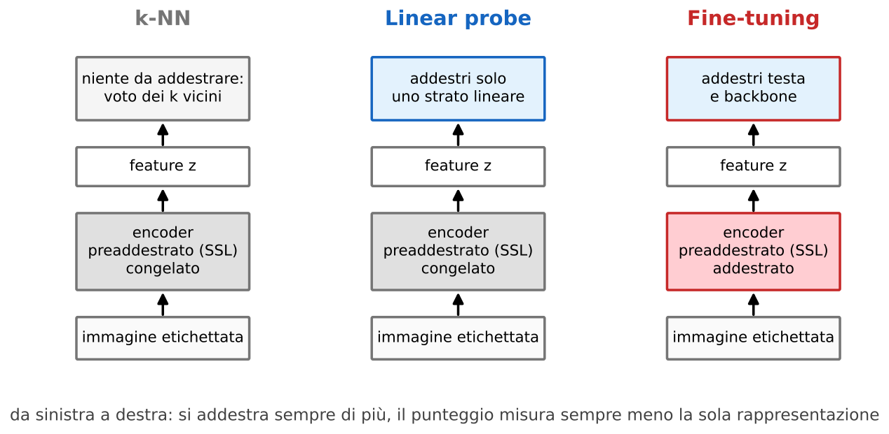

**Progettare il compito pretesto** (slide 9). Tre regole: difficoltà giusta (troppo facile non insegna nulla, ambiguo è impossibile); **evitare le scorciatoie**, perché la rete può sfruttare bordi, aberrazioni della lente o artefatti di compressione invece di capire gli oggetti (lo stesso fenomeno degli shortcut della [L14](https://gabriele-marsili.github.io/appunti-magistrale-ai/anno-2/computer-vision/sito/#L14)); favorire il trasferimento ad altri compiti.

> **Il punto**
> 
> Preaddestri senza etichette, poi adatti con poche. La qualità si misura **a valle**: k-NN e linear probe guardano la rappresentazione così com'è, il fine-tuning anche la sua adattabilità.

### 3\. Il nemico comune: il collasso

**Il problema.** L'idea più naturale (slide 11) è l'**instance discrimination**: prendi un'immagine x, crea due viste con augmentation casuali, v1 = t1(x) e v2 = t2(x), passale nella stessa rete f e chiedi che z1 = f(v1) e z2 = f(v2) siano vicini:

`Lagree = ‖f(v1) − f(v2)‖²`

Il libro (§ 30.10) la chiama *alignment loss* e ne indica subito il difetto: la rete può minimizzarla in modo stupido.

**Due collassi** (slide 12).

  - **Collasso completo: f(x) = c per ogni x.** Ogni immagine riceve lo stesso vettore costante. La loss vale zero, la rappresentazione non serve a nulla.
  - **Collasso dimensionale: rank(Cov(z)) ≪ d.** Le feature hanno d coordinate ma variano solo lungo poche direzioni: le immagini sono diverse fra loro, però stanno tutte su una retta o un piano dentro uno spazio enorme. **È più subdolo, perché non lo vedi guardando una sola immagine.**

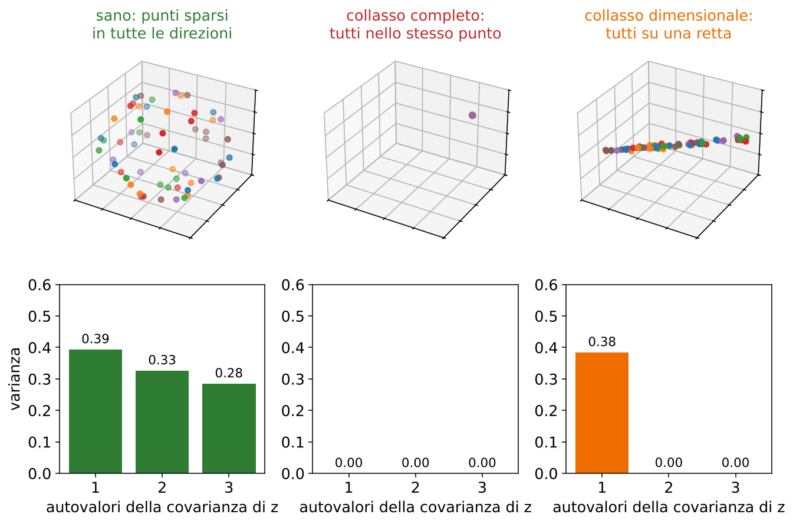

**Come si evita.** Il resto della prima parte è un elenco di rimedi. In [L21](https://gabriele-marsili.github.io/appunti-magistrale-ai/anno-2/computer-vision/sito/#L21) ne hai visti due: SimCLR aggiunge i **negativi** (immagini diverse devono stare lontane) e SimSiam usa un **predictor** più lo **stop-gradient** (slide 13; il piè di pagina della slide 13 nomina anche MoCo, che però arriva solo alla slide 21). Oggi vediamo un teacher che cambia lentamente (BYOL, MoCo, DINO), vincoli espliciti sulle statistiche (Barlow Twins, VICReg) e il mascheramento.

> **Il punto**
> 
> Chiedere solo «due viste uguali» ammette la **soluzione costante**. Ogni metodo SSL è, prima di tutto, un modo per impedirla, completa o dimensionale.

### 4\. Teacher-student: BYOL

**Il problema.** I negativi di SimCLR funzionano, ma ne servono tanti: batch da migliaia di immagini, molta memoria. Si può evitare il collasso *senza* negativi?

**L'idea.** BYOL (*Bootstrap Your Own Latent*, Grill et al. 2020) usa due reti con ruoli diversi (slide 14–15). Lo **student** (rete *online*, pesi θ) guarda una vista e deve **predire** le feature che il **teacher** (rete *target*, pesi ξ) produce sull'altra vista. Lo student si aggiorna con il gradiente; il teacher no: **il teacher è una media mobile dei pesi dello student**. All'inizio è una copia dello student, poi lo segue in ritardo. «Bootstrap» perché la rete impara da una versione passata di sé stessa: i bersagli migliorano man mano che migliora lo student.

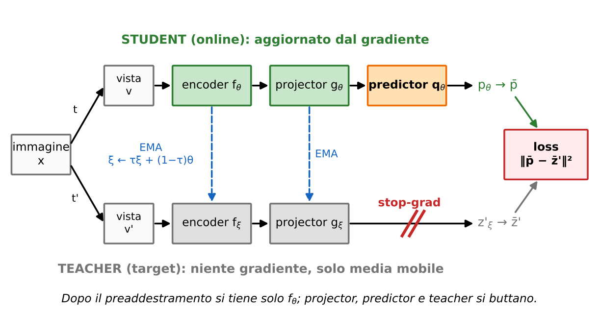

**La matematica** (slide 16). Con s la predizione dello student e t il bersaglio del teacher:

`L = ‖s − stop_grad(t)‖²,   ∂L/∂s = 2(s − t),   ∂L/∂t = 0`

**stop\_grad** è l'identità nel passaggio in avanti, ma blocca il gradiente all'indietro: **l'ottimizzatore muove solo lo student verso il teacher, mai il teacher verso lo student**. La domanda della slide 16 (a cui manca un soggetto: «come può *il teacher* cambiare nel tempo senza ricevere gradienti?») ha risposta nella sezione successiva: tramite la media mobile.

**Perché non collassa** (slide 18). Tre ingredienti insieme:

  - **il predictor solo nello student**: **i due rami fanno calcoli diversi**, quindi «uguali» non è una soluzione banale per costruzione;
  - **lo stop-gradient**: il teacher non può spostarsi per abbassare la loss del passo corrente (se potesse, entrambi correrebbero verso una costante);
  - **il teacher lento**: i bersagli seguono la storia dello student, non il suo gradiente di adesso.

Attenzione: **non c'è un teorema che garantisca l'assenza di collasso**. La slide dice «empiricamente», ed è onesto: la ricetta completa funziona in pratica; togliendo il predictor, BYOL collassa. Lo Szeliski (§ 5.4.7) lo riassume così: BYOL toglie i negativi grazie a momentum encoder, predictor e stop-gradient; SimSiam mostra poi che basta lo stop-gradient.

> **Il punto**
> 
> BYOL impara **senza coppie negative**: uno student predice un teacher che è la sua media mobile. Asimmetria (predictor), stop-gradient e lentezza del teacher, insieme, evitano il collasso.

### 5\. La media mobile esponenziale (EMA), passo per passo

**Il problema.** Se il teacher fosse una copia esatta dello student, i bersagli salterebbero a ogni passo insieme ai pesi. Serve un bersaglio che si muova, ma piano.

**La formula** (slide 17). Dopo ogni passo di ottimizzazione dello student:

`ξ ← τ ξ + (1 − τ) θ`

θ sono i pesi dello student, ξ quelli del teacher, τ il **momento** (vicino a 1). A parole: il nuovo teacher è il 99% del teacher vecchio più l'1% dello student attuale. È la stessa media mobile esponenziale che usa BatchNorm per le statistiche di test ([L15](https://gabriele-marsili.github.io/appunti-magistrale-ai/anno-2/computer-vision/sito/#L15)), solo applicata ai pesi.

**Esempio svolto**, un solo peso, τ = 0.99, teacher 2.00, student fermo a 3.00:

  - passo 1: 0.99 · 2.00 + 0.01 · 3.00 = 1.98 + 0.03 = **2.01** (il numero della slide);
  - passo 2: 0.99 · 2.01 + 0.03 = 2.0199; passo 3: 2.0297; passo 5: 2.0490.

In forma chiusa, la distanza dal bersaglio si moltiplica per 0.99 a ogni passo: ξk = 3 − 0.99k. Dopo 69 passi il teacher è a metà strada (2.50), dopo 100 passi a 2.63. La regola pratica: **il teacher «ricorda» circa gli ultimi 1/(1 − τ) passi**, cioè 100 con τ = 0.99. BYOL usa τ = 0.996 (memoria di circa 250 passi) e lo fa crescere fino a 1 con una schedula a coseno: alla fine dell'addestramento il teacher è quasi fermo.

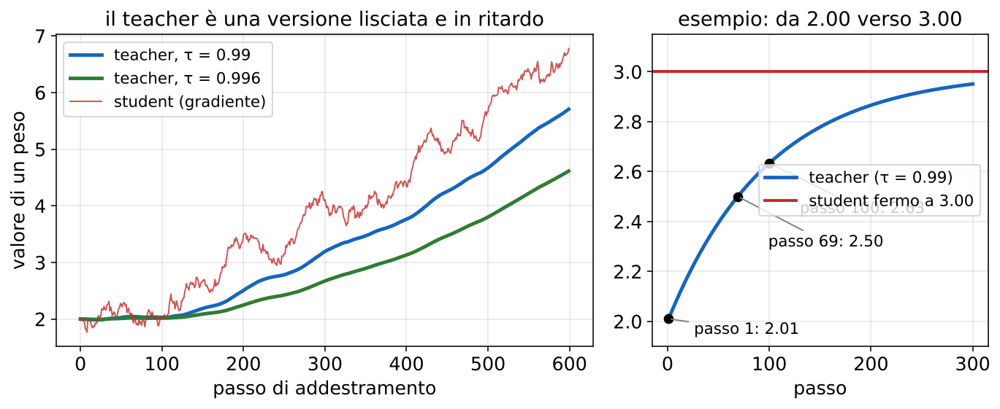

**Perché mediare** (slide 17): smussa gli aggiornamenti bruschi dello student, fa cambiare i bersagli gradualmente e conserva informazione degli student precedenti. Una media di pesi lungo la traiettoria è anche, spesso, un modello *migliore* dello student: per questo in DINO alla fine si tiene il teacher.

> **Il punto**
> 
> Lo student impara con il gradiente, il teacher lo insegue con l'EMA. Con τ = 0.99 un passo sposta il teacher dell'1% della distanza: **bersagli stabili** senza bisogno di gradienti.

### 6\. BYOL completo: projector, predictor, normalizzazione

**Tre moduli** (slide 19). L'**encoder** f (una ResNet-50) estrae la rappresentazione y; il **projector** g la porta nello spazio dove si calcola la loss (in BYOL un MLP con uscita a 256 dimensioni); il **predictor** q, presente solo nello student, predice la proiezione del teacher (stessa struttura del projector). **Dopo il preaddestramento si tiene solo l'encoder dello student fθ**: projector, predictor e teacher sono impalcature.

**La loss vera** (slide 20). Con pθ = qθ(gθ(fθ(v))) e z′ξ = gξ(fξ(v′)), i due vettori si normalizzano a norma 1 prima del confronto:

`Lv,v′ = ‖ pθ/‖pθ‖ − sg( z′ξ/‖z′ξ‖ ) ‖² = 2 − 2 cos(pθ, z′ξ)`

Perché la seconda uguaglianza: per due vettori unitari a e b, ‖a − b‖² = ‖a‖² + ‖b‖² − 2a·b = 2 − 2 cos. Quindi la loss guarda solo la **direzione**, non la lunghezza: **senza normalizzazione la rete potrebbe ridurre la loss rimpicciolendo tutti i vettori**, una via verso il collasso. Esempio: se il coseno è 0.8 la loss vale 0.4; se i vettori sono allineati (cos = 1) vale 0; opposti (cos = −1) vale 4.

**Loss simmetrica.** Si scambiano le viste (v′ allo student, v al teacher) e si sommano: LBYOL = Lv,v′ + Lv′,v. Così ogni vista fa sia da domanda sia da bersaglio. Nell'articolo: batch 4096 e 74.3% di accuratezza top-1 in linear probe su ImageNet con ResNet-50 (vedi schede 19–20).

> **Il punto**
> 
> BYOL confronta direzioni (vettori normalizzati, loss = 2 − 2 cos), in entrambi i versi. Alla fine resta solo l'encoder dello student.

### 7\. MoCo: tanti negativi con una coda

**Il problema.** InfoNCE ([L21](https://gabriele-marsili.github.io/appunti-magistrale-ai/anno-2/computer-vision/sito/#L21)) funziona meglio con molti negativi, ma in SimCLR i negativi sono le altre immagini del batch: per averne migliaia servono batch enormi.

**L'idea** (slide 21). MoCo (*Momentum Contrast*, He et al. 2020) mette insieme i due mondi:

  - un **teacher a momento** (EMA dello student, come BYOL, con m = 0.999) calcola le «chiavi»;
  - una **loss contrastiva** con negativi, come SimCLR;
  - una **coda FIFO che conserva le chiavi dei minibatch precedenti**: a ogni passo entrano le chiavi nuove ed escono le più vecchie.

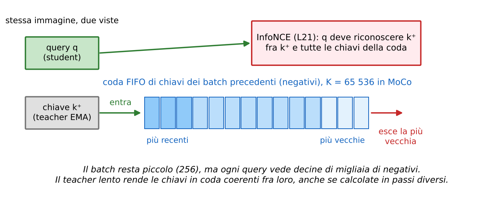

**Perché serve il teacher lento.** Le chiavi in coda sono state calcolate in passi diversi. **Se l'encoder delle chiavi cambiasse velocemente, chiavi vecchie e nuove verrebbero da «reti diverse»** e il confronto non avrebbe senso. Con m = 0.999 la rete cambia così poco che **la coda resta coerente**. Risultato: **tanti negativi senza minibatch grande** (MoCo usa batch 256).

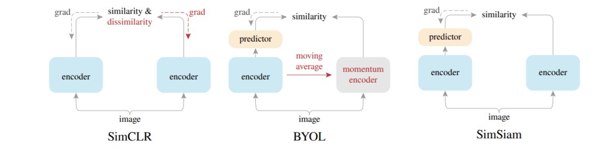

> **Il punto**
> 
> MoCo = contrastivo + teacher EMA + coda FIFO. La coda dà **molti negativi a basso costo**; l'EMA li rende confrontabili.

### 8\. Riduzione della ridondanza: Barlow Twins

**Il problema.** BYOL e MoCo evitano il collasso con trucchi di architettura (teacher, coda, predictor). Si può scriverlo direttamente nella loss?

**L'idea** (slide 23). Guardiamo le statistiche delle feature su un batch e chiediamo tre cose: **accordo fra viste** (la feature non cambia con l'augmentation), **variazione fra immagini** (non dare a tutte la stessa feature) e **poca ridondanza fra dimensioni** (non copiare lo stesso segnale in tutte le coordinate). Barlow Twins e VICReg lo fanno senza negativi e senza teacher.

**La matematica** (slide 24–25). Un batch di B immagini, due viste, stesso encoder e projector: si ottengono ZA, ZB ∈ ℝB×d. Ogni colonna (feature) si **standardizza lungo il batch** (media 0, deviazione standard 1). Poi:

`C = (ZA)⊤ ZB / B,   L = ∑i (1 − Cii)² + λ ∑i≠j Cij²`

C è d × d e Cij è la correlazione fra la feature i della vista A e la feature j della vista B, calcolata sulle B immagini. Il primo termine (**invarianza**) vuole la diagonale a 1: la stessa feature, nelle due viste, varia in modo identico da un'immagine all'altra. Il secondo (**riduzione della ridondanza**) vuole fuori diagonale 0: feature diverse portano informazione diversa. Insieme: **C deve somigliare alla matrice identità**. Nell'articolo λ = 0.005 e d = 8192; il nome viene dal neuroscienziato H. Barlow e dal suo principio di riduzione della ridondanza.

**Esempio svolto**, B = 4 immagini, d = 2 feature, viste identiche per semplicità. Righe di ZA = ZB: (1, 1), (1, −1), (−1, 1), (−1, −1). Le colonne hanno già media 0 e deviazione standard 1.

  - C11 = (1·1 + 1·1 + (−1)(−1) + (−1)(−1))/4 = 1; C12 = (1·1 + 1·(−1) + (−1)·1 + (−1)(−1))/4 = 0. Quindi C = I e **L = 0**: rappresentazione sana.
  - **Collasso completo** (slide 26, caso 1): tutte le righe uguali, per esempio (1, 2). Dopo aver tolto la media le colonne sono tutte zero, quindi C = 0. Diagonale 0 invece di 1: **L = (1 − 0)² + (1 − 0)² = 2**. Lo punisce il termine di invarianza.
  - **Collasso dimensionale** (caso 2): le due feature copiano lo stesso segnale, righe (1, 1), (1, 1), (−1, −1), (−1, −1). Ora C12 = 1 come C11: C ha tutti 1. Diagonale perfetta, fuori diagonale 1: **L = λ(1² + 1²) = 2λ = 0.01**. Lo punisce il termine di ridondanza.

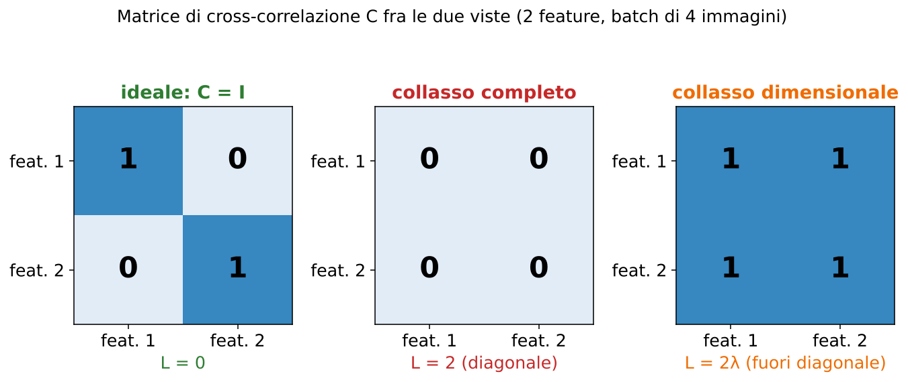

0.01 sembra poco, ma con d = 8192 i termini fuori diagonale sono d(d − 1) ≈ 67 milioni: per questo λ è piccolo, altrimenti la ridondanza dominerebbe tutto. Barlow Twins raggiunge 73.2% in linear probe su ImageNet con batch 2048 e funziona già con batch 256.

> **Il punto**
> 
> Barlow Twins spinge la cross-correlazione fra le viste verso l'identità: **diagonale 1 contro il collasso completo, fuori diagonale 0 contro quello dimensionale**. Nessun negativo, nessun teacher.

### 9\. VICReg: tre vincoli espliciti

**L'idea** (slide 27). VICReg (*Variance-Invariance-Covariance Regularization*, Bardes et al. 2022) separa i tre desideri in tre termini, ognuno con il suo peso:

`L = λ s(Z, Z′) + μ [v(Z) + v(Z′)] + ν [c(Z) + c(Z′)]`

  - **Invarianza** s: media sul batch di ‖zb − z′b‖². Le due viste devono coincidere.
  - **Varianza** v: (1/d) ∑j max(0, γ − σj), dove σj è la deviazione standard della feature j sul batch e γ = 1 la soglia. È una *hinge*: **se una feature varia abbastanza fra le immagini non costa nulla, se diventa costante viene penalizzata**. **Impedisce direttamente il collasso completo.** Nell'articolo σj = √(Var + ε), con ε piccolo (0.0001), per evitare gradienti infiniti quando la varianza tende a zero; la slide omette ε.
  - **Covarianza** c: (1/d) ∑i≠j Cov(Z)ij², calcolata *dentro* ogni vista. **Scorrela le feature fra loro, contro il collasso dimensionale.**

Esempio: con γ = 1, una feature con σ = 0.3 costa 0.7, una con σ = 1.4 costa 0. Pesi tipici dell'articolo: λ = μ = 25, ν = 1. La differenza con Barlow Twins: **ogni vista è regolarizzata separatamente**, quindi i due rami non devono nemmeno avere gli stessi pesi.

> **Il punto**
> 
> VICReg scrive i tre requisiti come tre termini: viste uguali (invarianza), feature che variano (varianza), feature scorrelate (covarianza).

### 10\. Ricostruire: autoencoder, mascheramento, patch come token

**Il problema.** Tutti i metodi visti finora hanno bisogno di **due viste** e di augmentation forti. Esiste un compito che funzioni con una sola immagine?

**L'autoencoder** (slide 29; libro § 30.4). Un encoder fθ comprime x, un decoder dφ la ricostruisce: x̂ = dφ(fθ(x)), con loss ‖x̂ − x‖². Il bersaglio è l'immagine stessa; il collo di bottiglia costringe a tenere l'essenziale. Il libro mostra il limite con un esperimento di k-NN strato per strato: **il colore si riconosce meglio dai pixel grezzi, la forma dagli strati profondi**, e non esiste una rappresentazione migliore per tutto. Copiare l'input è un compito troppo facile.

**Il mascheramento** (slide 30). «Il gatto è seduto sul \_\_\_\_.» Nascondi una parte, usa il contesto visibile per predirla, usa l'originale come bersaglio. È l'idea di BERT (masked language modeling) e il libro la chiama **imputazione** (§ 30.7): inpainting e colorizzazione ne sono casi particolari. Per le immagini la domanda è **cosa predire: pixel, codici discreti o feature apprese**.

**Patch come token** (slide 31; libro § 26.4.1). Un ViT ([L17](https://gabriele-marsili.github.io/appunti-magistrale-ai/anno-2/computer-vision/sito/#L17), [L18](https://gabriele-marsili.github.io/appunti-magistrale-ai/anno-2/computer-vision/sito/#L18)) divide un'immagine H × W in patch P × P e proietta ciascuna in un vettore token:

`N = HW / P²,   224 · 224 / 16² = 50 176 / 256 = 196 = 14 × 14 token`

Mascherare un'immagine diventa naturale: si tolgono alcuni token, come si tolgono parole in BERT.

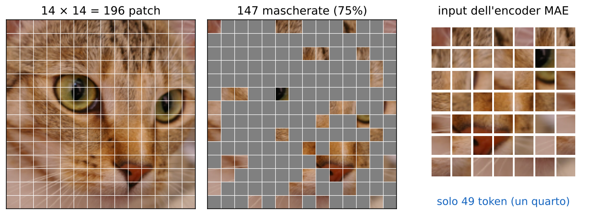

> **Il punto**
> 
> Il masked image modeling (MIM) trasforma l'autoencoder in un compito difficile: **ricostruire ciò che manca**, non ciò che si vede. Basta una vista per immagine.

### 11\. SimMIM e MAE: predire i pixel mancanti

**SimMIM** (Xie et al. 2022, slide 32). Le patch mascherate vengono sostituite tutte dallo **stesso token apprendibile m**; l'encoder (ViT o Swin) vede la griglia completa; una **testa lineare** predice i valori RGB. Loss L1 solo sui pixel mascherati:

`L = ‖yM − xM‖1 / Ω(xM)`

xM sono i pixel originali mascherati, yM le predizioni, Ω(xM) il loro numero (quindi è un errore assoluto medio). Impostazione tipica: blocchi da 32 × 32 pixel, 60% mascherato.

**MAE** (*Masked Autoencoder*, He et al. 2022, slide 33–34). Tre scelte: si maschera **il 75% delle patch, a caso**; **l'encoder ViT elabora solo le patch visibili**, senza token m; i token m si inseriscono solo *dopo*, prima di un **decoder leggero** (8 blocchi larghi 512, contro i 24 da 1024 di un ViT-L). Loss:

`LMAE = (1/|M|) ∑i∈M MSE(x̂i, xi)`

con M l'insieme delle posizioni mascherate: errore quadratico medio *solo* sulle patch nascoste (calcolarlo anche su quelle visibili peggiora i risultati). **Per i compiti a valle si tengono le feature *prima* del decoder**; il decoder si butta.

**Esempio svolto: quanto calcolo si risparmia.** 196 token, 75% mascherato: 147 nascosti, 49 visibili. In un blocco transformer le parti lineari costano in proporzione a N (49/196 = 25%), l'attenzione a N² (49²/196² = 1/16 ≈ 6%). Con le dimensioni di un ViT-L l'encoder costa circa il 24% di un passaggio completo; il decoder leggero sulle 196 posizioni aggiunge circa il 9%. Totale circa un terzo: l'articolo riporta un addestramento **3 volte più veloce o più**.

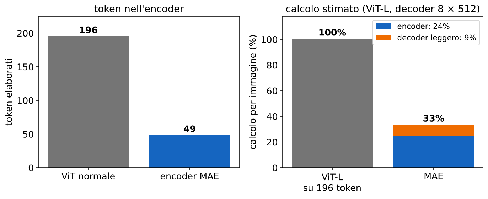

Perché il 75% e non il 15% di BERT? Le immagini sono **molto ridondanti**: con poche patch nascoste basta interpolare dai vicini, senza capire nulla. Con tre quarti nascosti bisogna sapere com'è fatto un gatto.

> **Il punto**
> 
> MAE nasconde il 75%, fa lavorare l'encoder grande **solo sul 25% visibile** e ricostruisce i pixel con un decoder piccolo: compito difficile e addestramento economico.

### 12\. BEiT: predire codici visivi invece dei pixel

**Il problema.** Predire pixel esatti spreca capacità su dettagli irrilevanti (rumore, trama fine). BERT predice *parole* da un vocabolario finito: si può fare lo stesso con le immagini?

**Fase 1: un vocabolario visivo** (slide 35). Un **tokenizer** trasforma ogni patch in un **ID discreto**. È la parte encoder di un autoencoder variazionale discreto (dVAE, con CNN), addestrato separatamente a ricostruire immagini; BEiT usa quello pubblico di DALL-E, con un vocabolario di 8192 codici. Ogni ID corrisponde a un pattern visivo appreso. Poi il tokenizer si **congela** e il suo decoder si butta.

![Dalla slide 36. In alto il tokenizer congelato produce gli ID bersaglio (234, 456, …). In basso alcune patch sono sostituite dal token \[M\]; l'encoder e la testa devono predire gli ID proprio in quelle posizioni (h2, h3, h6, h7, h14). Il decoder in alto a destra non si usa nel preaddestramento.](../sito-src/L22/disp2_slide36.png)

**Fase 2: predire i codici mancanti** (slide 36–37). Il tokenizer legge l'immagine originale e dà gli ID bersaglio zi. Circa il 40% delle patch (a blocchi) viene sostituito da un embedding di maschera apprendibile. L'encoder BEiT più una testa di classificazione devono recuperare l'ID in ogni posizione mascherata: **una classificazione a 8192 classi per patch**, con cross-entropy. Nell'articolo l'obiettivo si scrive come massimizzazione:

`max EM [ ∑i∈M log pMIM(zi | xM) ]`

dove xM è l'immagine con le patch mascherate.

> **Attenzione: manca il segno meno nella slide 37**
> 
> La slide chiama ℒBEiT = EM\[∑ log pMIM(zi | xM)\] «loss», ma così è una **log-verosimiglianza**, che va *massimizzata* (nell'articolo c'è «max»). Come loss da minimizzare serve il segno meno: ℒBEiT = −EM\[∑i∈M log pMIM(zi | xM)\], che è appunto la cross-entropy citata sotto la formula. Vedi la scheda 37.

**Il confronto** (slide 38). Il riassunto delle tre ricette:

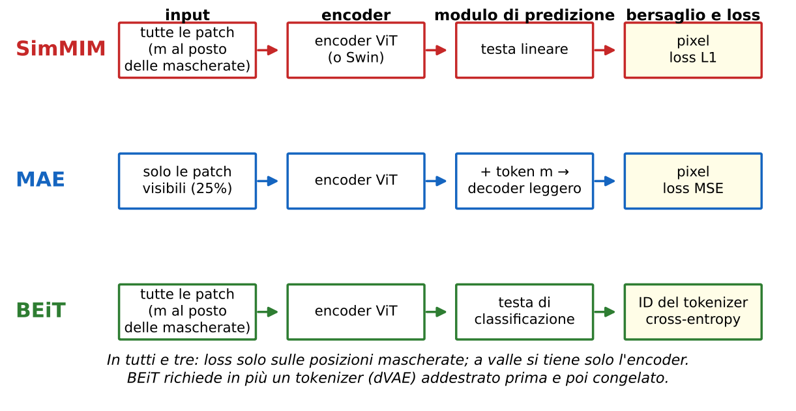

> **Il punto**
> 
> BEiT trasforma la ricostruzione in **classificazione su un vocabolario visivo**: fase 1 impara i codici, fase 2 impara a predirli dal contesto. Ricorda il segno meno.

### 13\. MIM contro instance discrimination: cosa trasferisce meglio?

**Il problema.** Abbiamo due grandi famiglie: confrontare viste (contrastivo, BYOL, DINO) e ricostruire parti nascoste (SimMIM, MAE, BEiT). Quale scegliere?

**Le differenze** (slide 39, da Park et al. 2023). L'instance discrimination confronta due o più viste aumentate; il MIM si accontenta di una vista mascherata. Le rappresentazioni che ne escono hanno *bias* diversi: **il contrastivo cattura più struttura globale e forma, il MIM più dettaglio locale e trama**. C'è anche un costo pratico: le augmentation forti girano spesso sulla CPU e generare più viste **può rallentare il caricamento dei dati e lasciare la GPU ad aspettare**; il MIM non ne ha bisogno.

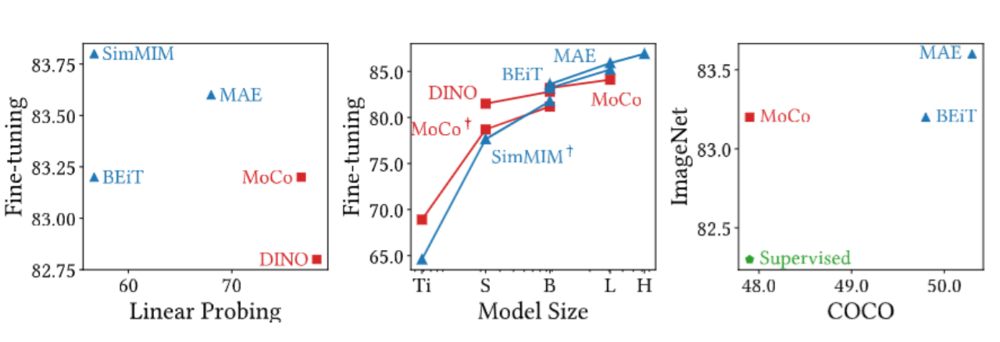

**Cosa trasferisce meglio** (slide 40):

  - **linear probe**: **vince l'instance discrimination**, le sue feature sono più linearmente separabili (MAE ViT-L: 73.5% in linear probe, ma sale a 81% sbloccando un solo blocco);
  - **fine-tuning e scala**: i modelli mascherati possono superare quelli contrastivi, soprattutto se grandi;
  - **compiti densi** come la detection: vanno bene i mascherati, perché conta il dettaglio spaziale.

> **Il punto**
> 
> **La rappresentazione migliore dipende dal compito a valle.** Contrastivo: globale, separabile linearmente. Mascherato: locale, ottimo da rifinire e per i compiti densi. I foundation model li combinano.

### 14\. Foundation model e DINO: auto-distillazione

**Il problema.** Ogni volta che serve un nuovo compito (segmentare, stimare profondità, cercare immagini simili) non si vuole riaddestrare tutto. Serve **un modello grande, preaddestrato in modo ampio, che supporti molti compiti a valle**: un **vision foundation model** (slide 42). Contano scala e varietà dei dati, il trasferimento oltre un singolo benchmark, e lo schema d'uso pratico: **backbone congelato più teste per i compiti**.

**DINO** (*self-DIstillation with NO labels*, Caron et al. 2021, slide 43). È un teacher-student come BYOL, ma con un ViT e un'uscita diversa: la testa di proiezione produce K logit (65 536 nel codice ufficiale) e una softmax li trasforma in una **distribuzione di probabilità**. Lo student deve riprodurre la distribuzione del teacher su un'altra vista, con la cross-entropy:

`H(pt, ps) = −∑k pt(k) log ps(k)`

È la **distillazione** del libro (§ 37.4.1: **lo student imita la distribuzione «morbida» del teacher**), ma qui il teacher è la media mobile dello student stesso: auto-distillazione. Il teacher si aggiorna per EMA (τ da 0.996 a 1) e riceve lo stop-gradient.

**Crop globali e locali** (multi-crop). Da ogni immagine: **2 crop globali 224 × 224 (più di metà immagine) e diversi crop locali 96 × 96 (piccoli)**. Il teacher vede solo i globali, lo student tutti. La loss somma su ogni coppia (vista del teacher, vista diversa dello student). Così lo student impara a dire, da un pezzetto di orecchio, la stessa cosa che il teacher dice guardando tutto il gatto: **corrispondenze dal locale al globale**.

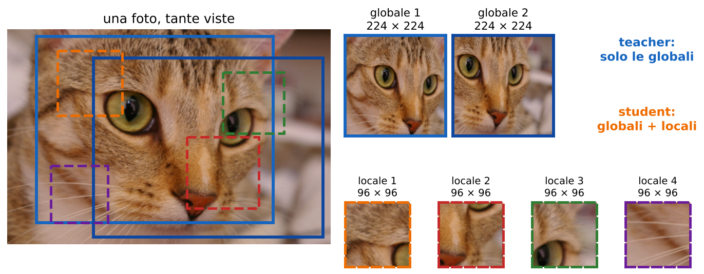

**Centering e sharpening** (slide 44). Senza negativi né predictor, DINO evita il collasso così:

`pt = softmax((ut − c) / τt)`

ut sono i logit del teacher, c la loro **media mobile** sui batch (c ← m c + (1 − m) · media del batch), τt la temperatura del teacher, bassa (da 0.04 a 0.07; lo student usa 0.1). Due operazioni contro due collassi opposti:

  - **centering** (sottrarre c): impedisce che **la stessa coordinata domini per ogni immagine**; da solo spinge però verso la distribuzione uniforme;
  - **sharpening** (temperatura bassa, [L15](https://gabriele-marsili.github.io/appunti-magistrale-ai/anno-2/computer-vision/sito/#L15)): impedisce che **ogni immagine riceva una distribuzione piatta**; da solo spinge verso una sola dimensione dominante.

**Esempio svolto.** K = 4, tre immagini con logit del teacher u1 = (5, 1, 0, 0), u2 = (4, 0, 2, 0), u3 = (5, 0, 0, 1). La dimensione 1 domina ovunque.

  - Senza nulla (τ = 1): p1 ≈ (0.97, 0.02, 0.01, 0.01), e quasi uguale per le altre: tutte le immagini «sono» la classe 1.
  - Solo sharpening (τ = 0.04): diventano esattamente (1, 0, 0, 0) per tutte e tre. Collasso su una dimensione.
  - Centering: c = media = (4.67, 0.33, 0.67, 0.33). u1 − c = (0.33, 0.67, −0.67, −0.33), u2 − c = (−0.67, −0.33, 1.33, −0.33), u3 − c = (0.33, −0.33, −0.67, 0.67). Con τ = 1: p1 ≈ (0.31, 0.43, 0.11, 0.16), piatta e poco informativa.
  - Centering più sharpening (τ = 0.04): p1 ≈ (0, 1, 0, 0), p2 = (0, 0, 1, 0), p3 ≈ (0, 0, 0, 1). **Ogni immagine ha un bersaglio netto e diverso.**

**Un passo di addestramento** (slide 45, pseudocodice dell'implementazione ufficiale): augmentation in crop globali e locali; logit dello student su tutti i crop; logit del teacher sui soli globali, senza gradiente; pt con centering e temperatura τt; log-softmax dello student con τs; cross-entropy fra viste diverse (salta le coppie della stessa vista); retropropagazione e passo dell'ottimizzatore *solo* sullo student; aggiornamento EMA del teacher; aggiornamento del centro c con la media dei logit del teacher.

> **Il punto**
> 
> DINO = student che imita la distribuzione di un teacher EMA, da crop locali verso crop globali. **Centering e sharpening si bilanciano**: uno toglie la dimensione dominante, l'altro rende i bersagli netti.

### 15\. Strutture che emergono da sole

**Cosa succede** (slide 46). Si prende un ViT addestrato con DINO e si guarda l'attenzione del token \[CLS\] nell'ultimo strato (come l'attention rollout della [L18](https://gabriele-marsili.github.io/appunti-magistrale-ai/anno-2/computer-vision/sito/#L18)). Alcune teste illuminano esattamente l'oggetto principale: l'uccello, lo spazzolino, le giraffe. **Nessuno ha mai mostrato alla rete una maschera di segmentazione.**

![Dalla slide 46. Ogni coppia: la foto e la mappa di attenzione del \[CLS\] nell'ultimo strato di DINO. L'oggetto emerge come una sagoma chiara su fondo scuro, anche la bicicletta davanti alla porta.](../sito-src/L22/disp2_slide46.png)

**Similarità semantica.** Le feature di DINO funzionano bene anche con il semplice k-NN: un ViT-S/8 arriva al 78.3% su ImageNet senza addestrare nulla sopra (79.7% con linear probe). Il libro (§ 31.3.2) mostra l'uso pratico: si calcolano le feature DINO in modo denso, un vettore per patch, e si applica k-means a quei vettori; ne esce una segmentazione dell'immagine. Il libro ricorda anche (§ 30.5.1 e § 30.7) che «detector» di oggetti emergono quasi con qualunque compito pretesto ragionevole, perfino la colorizzazione: gli oggetti sono una struttura utile del mondo, e una rete che deve capire le immagini finisce per trovarli.

> **Il punto**
> 
> Con DINO, **segmentazione grezza e similarità semantica emergono senza etichette**: le feature sono già organizzate per oggetti.

### 16\. DINOv2: dati curati, due loss, distillazione

**Dati curati** (slide 47). Self-supervised non vuol dire «qualunque immagine va bene». DINOv2 (Oquab et al. 2023) costruisce **LVD-142M**, 142 milioni di immagini: parte da 1.2 miliardi di immagini web, **toglie i duplicati**, poi con il **retrieval visivo** tiene le immagini simili a quelle di dataset curati (ImageNet-22k, Google Landmarks e altri). **L'SSL elimina il bisogno di etichette, ma su quali immagini si addestra conta ancora**: un mucchio di foto web casuali è sbilanciato verso pochi soggetti.

**Due loss** (slide 48):

`Lmain = LDINO + Lmasked`

  - **LDINO**, globale: student e teacher devono concordare sull'uscita del token \[CLS\] fra crop diversi. Dà una buona rappresentazione dell'immagine intera.
  - **Lmasked**, locale (dal metodo iBOT): si mascherano alcune patch nell'input dello student, che deve predire *l'uscita del teacher* in quelle posizioni (il teacher vede l'immagine intera). Dà buone feature per patch.

Nota la differenza con MAE: **il bersaglio mascherato non sono i pixel ma le uscite del teacher**. L'articolo aggiunge altri accorgimenti (un regolarizzatore che sparpaglia le feature nel batch, il centering con Sinkhorn-Knopp, una fase finale a risoluzione 518), che le slide non citano.

**Distillare un modello grande** (slide 49). Si addestra con SSL un modello enorme, ViT-g/14 da 1.1 miliardi di parametri; lo si **congela** come teacher; si addestrano student più piccoli a riprodurne le uscite su immagini non etichettate. **Attenzione alla differenza**: qui il teacher è **fisso**, non una EMA dello student come in BYOL o DINO; è la distillazione classica del libro (§ 37.4.1). Il risultato è una famiglia (slide 50):

  - ViT-S/14: 21 milioni di parametri, distillato dal ViT-g;
  - ViT-B/14: 86 milioni, distillato;
  - ViT-L/14: 300 milioni, distillato;
  - ViT-g/14: 1.1 miliardi, addestrato con SSL su larga scala.

«/14» è la dimensione delle patch (14 × 14 pixel). Un ViT-L distillato va meglio di uno addestrato da zero con lo stesso metodo: **addestri in grande una volta, poi scegli la taglia che entra nel tuo budget**.

> **Il punto**
> 
> DINOv2 = dati curati + loss globale sul \[CLS\] + loss mascherata sulle patch (bersaglio: il teacher) + distillazione da un ViT-g congelato in modelli piccoli.

### 17\. Un'applicazione: Depth Anything

**Il problema.** Stimare una mappa di profondità densa da una sola foto RGB ([L17](https://gabriele-marsili.github.io/appunti-magistrale-ai/anno-2/computer-vision/sito/#L17), dove hai visto MiDaS). Le etichette di profondità vere sono poche e costose (LiDAR, stereo).

**La ricetta** (slide 51; Yang et al. 2024). **Encoder DINOv2**, inizializzato con i pesi preaddestrati, più una **testa decoder di profondità** (DPT). Si addestra con **supervisione di profondità** su 1.5 milioni di immagini etichettate e con **pseudo-etichette** su oltre 62 milioni di immagini non etichettate: un primo modello (teacher) addestrato sulle etichette vere predice la profondità delle immagini non etichettate, e un nuovo modello impara da tutto, con perturbazioni forti sulle immagini non etichettate.

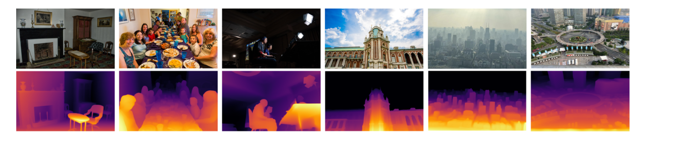

> **Il punto**
> 
> **DINOv2 dà le feature, l'addestramento specifico le trasforma in profondità.** È lo schema dei foundation model: backbone generico più testa per il compito.

### 18\. DINOv3: scala, feature dense che peggiorano, Gram anchoring

**Più grande** (slide 52). DINOv3 (Siméoni et al. 2025) porta il teacher a **7 miliardi di parametri** e il dataset curato a **1.689 miliardi di immagini** (LVD-1689M, scelte da circa 17 miliardi). Poi, di nuovo, una famiglia di modelli distillati per budget più piccoli.

**Il problema nuovo** (slide 53). Addestrando a lungo un modello così grande, **le feature dense peggiorano anche se la loss continua a scendere**. La figura mostra, per una patch di riferimento (rossa), la similarità coseno con tutte le altre patch durante l'addestramento: a 200 mila iterazioni la mappa è pulita (le pecore, i petali), a 1 milione è piena di puntini sparsi. Il motivo: **obiettivo globale (\[CLS\]) e obiettivo locale (patch) competono**, e con il tempo vince il globale; le feature delle patch somigliano sempre più a quella del \[CLS\] e perdono località.

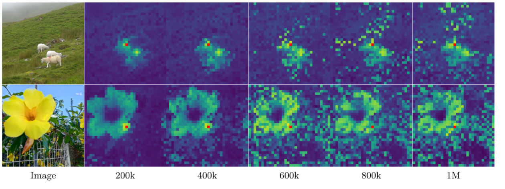

**Gram anchoring** (slide 54). L'idea: **tenere fisso *quali patch si somigliano*, anche mentre le feature stesse continuano a cambiare**. Con X la matrice P × d delle feature delle P patch (normalizzate), la **matrice di Gram** è

`G = X X⊤,   LGram = ∑i,j (Gijstudent − Gijteacher)²`

Gij è la similarità fra la patch i e la patch j. **La loss non chiede che le feature dello student siano uguali a quelle del teacher, solo che *le similarità fra patch* lo siano**: le feature possono ruotare e migliorare, la struttura «questa patch somiglia a quella» resta. **Il teacher di Gram è un checkpoint precedente con feature dense nette**, rinfrescato periodicamente (ogni 10 mila iterazioni, nell'articolo), non il teacher EMA di ogni passo; la loss si aggiunge dopo 1 milione di iterazioni.

> **Attenzione: frase troncata nella slide 54**
> 
> La riga «Why: keep.» è incompleta. Il senso, dall'articolo: *perché* si vuole mantenere la qualità delle feature dense (la struttura delle similarità fra patch del checkpoint buono) mentre l'obiettivo globale continua a migliorare la rappresentazione; senza il vincolo, le mappe di patch si degradano come nella slide 53. Vedi la scheda 54.

**Osservazione della Terra** (slide 55). Stessa ricetta su un dominio diverso: un backbone SSL addestrato su SAT-493M, **493 milioni di immagini satellitari** RGB, più una testa di regressione densa addestrata con altezze misurate dal LiDAR, dà mappe dell'altezza della chioma degli alberi. **L'SSL fornisce feature spaziali riusabili; la testa supervisionata dà significato fisico e unità di misura**. Il trasferimento fra domini dipende però da sensori, geografia e compito.

> **Il punto**
> 
> A scala enorme le feature dense si degradano perché il globale schiaccia il locale. Il Gram anchoring **congela la struttura delle similarità fra patch**, non le feature.

### 19\. JEPA: predire rappresentazioni, non pixel

**Il problema** (slide 56). Un MAE deve indovinare il colore esatto di ogni pixel nascosto: la trama del pelo, il riflesso, il rumore. **Molti dettagli esatti sono ambigui o irrilevanti per i compiti a valle**. Meglio predire una *descrizione* del contenuto mancante che il suo aspetto.

**L'idea.** Le **Joint-Embedding Predictive Architectures** predicono nello **spazio delle rappresentazioni**: invece di generare un'immagine, si predicono le feature della regione mancante.

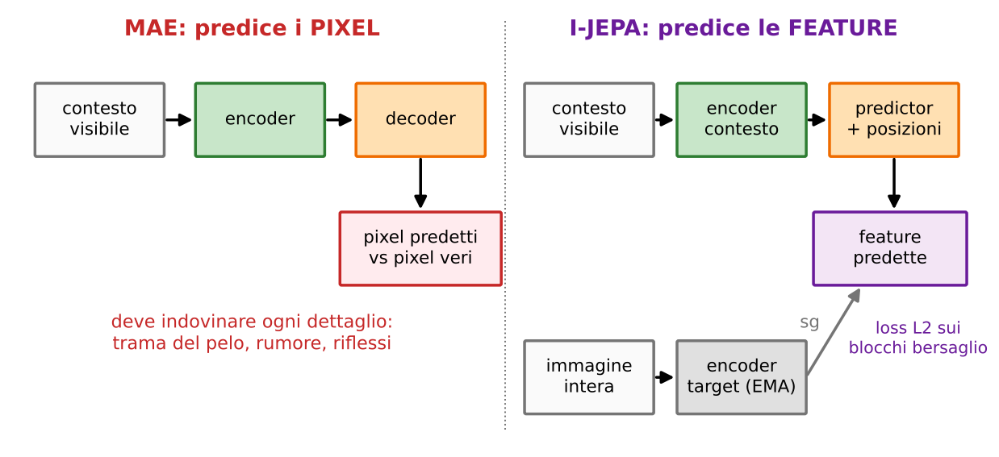

**I-JEPA** (Assran et al. 2023, slide 57):

1.  un ViT codifica il **contesto visibile** (un grande blocco dell'immagine);
2.  un predictor, dati quei token e le **posizioni** dei blocchi bersaglio, predice le feature dei **blocchi nascosti** (nell'articolo 4 blocchi, ciascuno 15–20% dell'immagine);
3.  le feature bersaglio vengono da un **encoder target EMA** che vede l'immagine intera.

`L ∝ ∑i∈M ‖ẑi − sg(zit)‖²`

M sono le posizioni bersaglio, ẑi la feature predetta, zit quella del teacher, sg lo stop-gradient. **Il bersaglio è un vettore di feature, non pixel RGB.** Riconosci gli ingredienti: **mascheramento (come MAE), teacher EMA e stop-gradient (come BYOL e DINO)**. A valle si tiene l'encoder con una testa adatta. Ed è economico: un ViT-H/14 su ImageNet in meno di 72 ore su 16 GPU.

**V-JEPA** (Bardes et al. 2024, slide 58). La stessa idea sul video: si predicono le feature di regioni nascoste **nello spazio e nel tempo**. L'estensione **V-JEPA 2** (2025) va oltre: si congela l'encoder e si addestra una nuova testa che, date osservazioni passate e **azioni di un robot**, predice le feature future. Con meno di 62 ore di video robotico non etichettato il robot riesce a pianificare prese e spostamenti di oggetti: un primo passo verso i «modelli del mondo».

> **Il punto**
> 
> JEPA = mascheramento + teacher EMA, ma **la predizione avviene nello spazio delle feature**: impari la struttura senza dover generare ogni pixel.

### Il riassunto in 10 righe

1.  SSL: si inventa un compito dai dati non etichettati e si tiene la rete come estrattore di feature; si valuta a valle con k-NN, linear probe e fine-tuning.
2.  Chiedere solo che due viste coincidano porta al collasso: completo (f(x) = c) o dimensionale (rango della covarianza ≪ d).
3.  BYOL: student con predictor che predice un teacher EMA con stop-gradient; loss 2 − 2 cos, simmetrica; niente negativi.
4.  EMA ξ ← τξ + (1 − τ)θ: con τ = 0.99, da 2.00 verso 3.00 si va a 2.01, 2.0199, …; memoria di circa 1/(1 − τ) passi.
5.  MoCo: contrastivo + teacher EMA + coda FIFO di negativi, tanti negativi con batch piccoli.
6.  Barlow Twins: C fra le viste ≈ I (diagonale 1 contro il collasso completo, fuori diagonale 0 contro quello dimensionale); VICReg: invarianza, varianza con hinge, covarianza.
7.  MIM: si mascherano patch (196 token per 224 × 224); SimMIM pixel e L1, MAE 75% e encoder solo sui visibili (circa un terzo del calcolo), BEiT ID di un tokenizer e cross-entropy (con il segno meno).
8.  Contrastivo: globale e linearmente separabile; MIM: locale, meglio in fine-tuning, a scala e nei compiti densi.
9.  DINO: auto-distillazione con crop globali e locali, centering più sharpening; attenzione che segmenta gli oggetti da sola. DINOv2: dati curati, loss \[CLS\] + mascherata, distillazione da ViT-g in S/B/L.
10. Depth Anything usa DINOv2 per la profondità; DINOv3 (7B, 1.689 miliardi di immagini) aggiunge il Gram anchoring; JEPA predice feature invece di pixel, anche su video.

### Verifica di aver capito

**1. Che differenza c'è fra k-means e un metodo self-supervised? E fra linear probe e fine-tuning?**

k-means produce la struttura dei dati (i cluster); l'SSL usa i dati per addestrare un encoder riusabile. Nel linear probe l'encoder è congelato e si addestra solo uno strato lineare (misura la rappresentazione); nel fine-tuning si addestra anche il backbone (misura anche l'adattabilità).

**2. Cosa sono il collasso completo e quello dimensionale? Quale termine di Barlow Twins punisce ciascuno?**

Completo: f(x) = c per ogni immagine, C = 0, lo punisce il termine di invarianza ∑(1 − Cii)² (vale 2 nell'esempio con d = 2). Dimensionale: le feature variano ma tutte insieme (rango basso), C ha tutti 1, lo punisce il termine di ridondanza λ∑Cij² (vale 2λ).

**3. Calcola tre passi di EMA con τ = 0.99, teacher 2.00 e student fermo a 3.00. Dopo quanti passi il teacher è a metà strada?**

2.01, 2.0199, 2.0297. In generale ξk = 3 − 0.99k; metà strada (2.5) quando 0.99k = 0.5, cioè k = ln 0.5 / ln 0.99 ≈ 69 passi.

**4. Perché BYOL non collassa pur senza negativi? E perché normalizza i vettori?**

Per la combinazione di predictor solo nello student (asimmetria), stop-gradient (il teacher non insegue la loss) e teacher lento (EMA); vale empiricamente, non per teorema. La normalizzazione rende la loss 2 − 2 cos: conta solo la direzione, e la rete non può ridurre la loss rimpicciolendo i vettori.

**5. Quanti token vede l'encoder di MAE per un'immagine 224 × 224 con patch 16? Perché il 75% e non il 15%?**

196 token, 147 mascherati, 49 visibili. Il costo dell'encoder scende a circa un quarto (parti lineari) e l'attenzione a 1/16. Il 75% perché le immagini sono ridondanti: con poche patch nascoste basta interpolare dai vicini, con tre quarti nascosti bisogna capire l'oggetto.

**6. Cosa c'è di sbagliato nella formula di BEiT della slide 37?**

Manca il segno meno: EM\[∑ log pMIM(zi | xM)\] è una log-verosimiglianza da massimizzare. Come loss (cross-entropy) va scritta con −.

**7. Logit del teacher (5, 1, 0, 0), (4, 0, 2, 0), (5, 0, 0, 1). Cosa succede con solo sharpening, solo centering, entrambi?**

Solo sharpening (τ = 0.04): tutte (1, 0, 0, 0), collasso su una dimensione. Solo centering (τ = 1): distribuzioni piatte, per esempio (0.31, 0.43, 0.11, 0.16). Entrambi: (0, 1, 0, 0), (0, 0, 1, 0), (0, 0, 0, 1), bersagli netti e diversi.

**8. In cosa differiscono il teacher di DINO, quello della distillazione di DINOv2 e quello del Gram anchoring?**

DINO: EMA dello student, aggiornato a ogni passo. Distillazione DINOv2: un ViT-g già addestrato e congelato. Gram anchoring: un checkpoint precedente con feature dense buone, rinfrescato periodicamente; si confrontano solo le similarità fra patch (G = XX⊤).

**9. Che differenza c'è fra MAE e I-JEPA?**

Entrambi mascherano e predicono la parte mancante. MAE predice i pixel (MSE sulle patch mascherate) con un decoder; I-JEPA predice le feature dei blocchi nascosti, prese da un encoder target EMA con stop-gradient che vede l'immagine intera. Così non spreca capacità su dettagli irrilevanti.

### Come proseguire

Leggi nel visionbook il [cap. 30](https://visionbook.mit.edu/representation_learning.html), § 30.3–30.7 (buona rappresentazione, autoencoder con l'esperimento del k-NN per strato, self-supervision e imputazione) e § 30.10 (contrastivo e collasso); poi il [cap. 37](https://visionbook.mit.edu/transfer_learning.html), § 37.3–37.4.1 (finetuning, linear probe, distillazione); § 31.3.2 per k-means sulle feature DINO e § 26.4.1 per le patch come token. Lo Szeliski § 5.4.7 riassume BYOL e SimSiam in una pagina. Per i metodi non nei libri, la slide 59 consiglia il post di Meta su DINOv3 e il *Cookbook of Self-Supervised Learning* (Balestriero et al. 2023). Poi **ripassa con le schede qui sotto**, slide per slide: i riquadri «Attenzione» segnalano gli errori delle slide (37, 54, 13).
