# L23 · Lab SSL: SimSiam e DINOv3

*Lezione 23 · laboratorio · novembre 2026*

[Versione interattiva sul sito, con videolezione](https://gabriele-marsili.github.io/appunti-magistrale-ai/anno-2/computer-vision/sito/#L23) · [Indice della dispensa](README.md)

**In una frase:** nel primo notebook si addestra da zero una ResNet-18 su CIFAR-10 **senza guardare le etichette** (SimSiam) e poi si misura quanto valgono le sue feature con un **linear probe** e un **k-NN**; nel secondo si prende un foundation model già pronto (DINOv3), lo si **congela** e si addestra sopra una semplice regressione logistica che dice, patch per patch, se lì c'è l'oggetto in primo piano.

### Prima di iniziare

È un laboratorio senza slide: ci sono due notebook, `simsiam_cifar10_lab.ipynb` e `dinov3_foreground_segmentation_lab.ipynb`. La teoria è nelle due lezioni precedenti e qui la ripassiamo solo quanto basta. Ti servono:

  - dalla [L21](https://gabriele-marsili.github.io/appunti-magistrale-ai/anno-2/computer-vision/sito/#L21): viste, coppie positive, collasso, SimCLR e l'idea di SimSiam;
  - dalla [L22](https://gabriele-marsili.github.io/appunti-magistrale-ai/anno-2/computer-vision/sito/#L22): BYOL, Barlow Twins, DINO e DINOv3 come foundation model;
  - dalla [L16](https://gabriele-marsili.github.io/appunti-magistrale-ai/anno-2/computer-vision/sito/#L16): la ResNet-18 adattata a CIFAR-10 (stessa modifica del primo strato);
  - dalla [L17](https://gabriele-marsili.github.io/appunti-magistrale-ai/anno-2/computer-vision/sito/#L17) e [L18](https://gabriele-marsili.github.io/appunti-magistrale-ai/anno-2/computer-vision/sito/#L18): il ViT che taglia l'immagine in patch 16×16 e produce un token per patch;
  - un po' di statistica: regressione logistica, precision e recall.

I notebook sono arrivati senza uscite. I numeri della nostra esecuzione di SimSiam sono in [Risultati dell'esecuzione](#l23-risultati). Per DINOv3 i pesi richiedono un'autorizzazione di Meta: abbiamo misurato solo la parte dati (conteggi delle patch); le figure con punteggi del modello sono **simulate**.

### Guarda prima questi video

  - [Stanford CS231N | Spring 2025 | Lecture 12: Self-Supervised Learning](https://www.youtube.com/watch?v=4howBU7THbM) (Video). Stanford Online. Lezione completa sull'SSL: pretext task, contrastivo, metodi senza negativi, valutazione con linear probe. Ripasso di L21–L22 prima delle sezioni 2–6.
  - [BYOL: Bootstrap Your Own Latent: A New Approach to Self-Supervised Learning (Paper Explained)](https://www.youtube.com/watch?v=YPfUiOMYOEE) (Video · 34 min). Yannic Kilcher. Predictor, stop-gradient, teacher con media mobile: SimSiam è BYOL senza media mobile. Bastano i primi 20 minuti; serve per le sezioni 5–6 e per l'esercizio BYOL.
  - [DINOv3: One backbone, multiple image/video tasks](https://www.youtube.com/watch?v=Ou0pfOZUaJU) (Video · oltre 1 h 45 min). John Tan Chong Min. Discussione lunga dell'articolo DINOv3: teacher-student, Gram anchoring, feature dense usate congelate. Guarda la prima parte prima della sezione 11.

### 1\. Perché un laboratorio SSL

**Il problema.** Etichettare immagini costa. Per CIFAR-10 qualcuno ha scritto «gatto», «nave», «camion» su 60 000 immagini; per segmentare un oggetto bisogna disegnarne il contorno. Di foto senza etichetta, invece, ne abbiamo quante vogliamo. Si può usare questa montagna di dati per imparare qualcosa di utile, e poi aggiungere solo poche etichette?

**L'idea.** Il lavoro si divide in **due fasi**. Nella prima (pretraining self-supervised) la rete impara feature da sola, con un compito inventato le cui risposte conosciamo gratis. Nella seconda le feature restano ferme e si addestra sopra un pezzetto piccolo con le etichette. Prince (§ 9.3.7) lo presenta come transfer learning da un compito «gratuito».

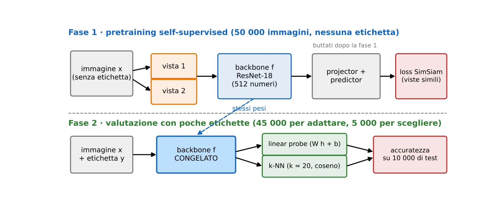

Nel primo notebook facciamo noi il pretraining (piccolo: CIFAR-10, una ResNet-18). Nel secondo **usiamo il pretraining fatto da Meta** (DINOv3) e ci limitiamo alla seconda fase, con **nove sole immagini annotate**.

> **Il punto**
> 
> SSL = imparare le feature senza etichette, poi pochissimo lavoro supervisionato sopra. **Il compito della prima fase non interessa: interessa la rete che ne esce.**

### 2\. Ripasso lampo: viste, collasso, due famiglie

**Il problema.** Che compito «gratuito» dare alla rete? Dalla [L21](https://gabriele-marsili.github.io/appunti-magistrale-ai/anno-2/computer-vision/sito/#L21): crea due versioni modificate a caso di un'immagine x (due **viste**) e chiedi alla rete f lo stesso vettore per entrambe.

**Il difetto.** Il libro (§ 30.10) chiama questa richiesta *alignment loss* e mostra subito il trucco sporco: se f restituisce sempre lo stesso vettore, le due viste coincidono sempre e la loss è minima. È il **collasso**.

**Due famiglie di rimedi.**

  - **Contrastivi** (SimCLR, MoCo): avvicinano le viste della stessa immagine (positivi) e allontanano quelle di immagini diverse (negativi). Il § 30.10.1 scompone l'obiettivo in due termini: Lalign = E‖f(x) − f(x+)‖2α avvicina i positivi, Lunif = log E e−t‖f(x) − f(x−)‖² spinge tutti i punti a spargersi in modo uniforme sulla sfera.
  - **Non contrastivi** (BYOL, SimSiam, Barlow Twins, DINO; [L22](https://gabriele-marsili.github.io/appunti-magistrale-ai/anno-2/computer-vision/sito/#L22)): niente negativi. Evitano il collasso con un'asimmetria fra i due rami (predictor, stop-gradient, teacher lento) o con vincoli sulle statistiche delle feature.

SimSiam è il più semplice della seconda famiglia: **niente negativi, niente teacher separato, niente batch enormi**.

> **Il punto**
> 
> «Due viste uguali» da solo ammette la **soluzione costante**. Ogni metodo SSL è un modo per impedirla: con i negativi o con un'asimmetria.

### 3\. Augmentation: scegliere che cosa ignorare

**Il problema.** Le due viste devono differire in qualcosa. Ma in cosa? **La scelta decide che cosa la rete imparerà a ignorare.**

**L'idea.** Se due viste differiscono per il colore e la rete deve dar loro lo stesso vettore, la rete diventa **invariante al colore**: il colore sparisce dalla rappresentazione. L'esperimento del § 30.10.2 del libro lo mostra su un insieme di figure colorate: con viste ottenute solo ritagliando, l'embedding raggruppa le figure per colore (il colore è l'indizio più facile e resta uguale nelle due viste); aggiungendo variazioni casuali di tinta, luminosità e saturazione, il colore smette di funzionare e l'embedding raggruppa per forma.

**Nel notebook** (cella 8) ogni vista nasce così:

  - `RandomResizedCrop(32, scale=(0.2, 1.0))`: un ritaglio che copre dal 20% al 100% dell'area, riportato a 32×32 → invarianza a posizione e scala;
  - flip orizzontale con probabilità 0,5;
  - `ColorJitter(0.4, 0.4, 0.2, 0.1)` (luminosità, contrasto, saturazione, tinta) applicato con probabilità 0,8;
  - scala di grigi con probabilità 0,2;
  - normalizzazione per canale con media e deviazione standard di CIFAR-10.

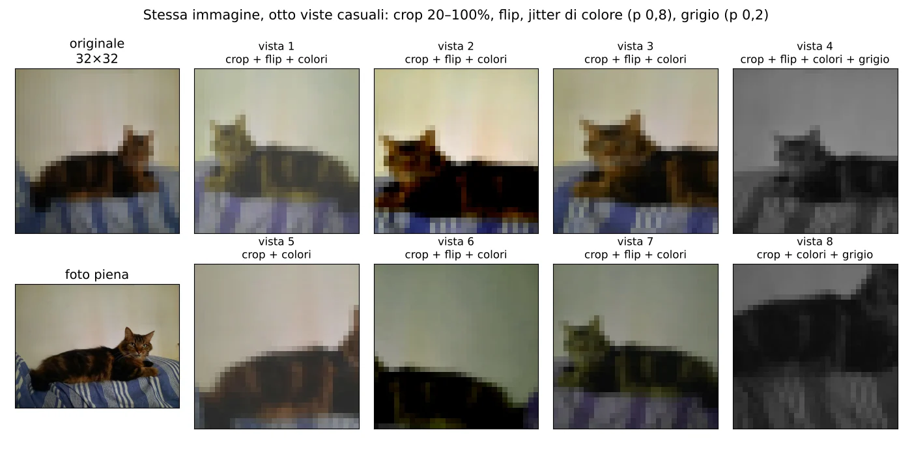

La classe `TwoViews` (cella 9) chiama due volte la trasformazione **sull'immagine originale**, non sulla prima vista: ogni chiamata estrae parametri nuovi.

**Attenzione al rovescio.** **Le invarianze sono anche cecità.** Con il flip la rete non distingue più destra da sinistra; con il grigio smette di fidarsi del colore. Per CIFAR-10 va bene (un'auto rossa e una blu sono entrambe «auto»), ma **un'augmentation sbagliata cancella proprio l'informazione che servirebbe dopo**, per esempio il colore per riconoscere i semafori.

> **Il punto**
> 
> L'augmentation è il modo in cui diciamo alla rete **che cosa non conta**. Il libro lo mostra con un esperimento: cambi le viste, cambia ciò che l'embedding raggruppa.

### 4\. SimSiam: le tre reti

**Il problema.** Vogliamo una rete che dia vettori simili alle due viste senza collassare, con il minimo di pezzi.

**L'idea.** SimSiam (Chen e He 2021) usa una rete **siamese**: gli stessi pesi elaborano le due viste. Ogni vista attraversa tre pezzi.

1.  **Backbone**: ResNet-18 senza pesi preaddestrati. Come nella [L16](https://gabriele-marsili.github.io/appunti-magistrale-ai/anno-2/computer-vision/sito/#L16), per immagini 32×32 il primo strato diventa una convoluzione 3×3 con stride 1 e si toglie il max-pooling: con lo strato standard (7×7, stride 2, più pooling) un'immagine minuscola verrebbe ridotta subito a 8×8. L'ultimo strato di classificazione è sostituito da `nn.Identity()`: l'uscita è il vettore h da **512 numeri**, la rappresentazione che valuteremo. Sono circa 11,2 milioni di parametri.
2.  **Projector**: un MLP a tre strati 512 → 512 → 512 → 2048 con BatchNorm e ReLU. L'ultima BatchNorm non ha parametri appresi (`affine=False`) e non è seguita da ReLU. L'uscita è z.
3.  **Predictor**: un MLP 2048 → 512 → 2048, con un **collo di bottiglia** a 512. L'uscita è p, con la stessa forma di z.

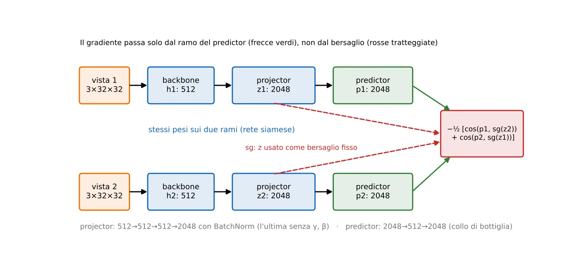

Sono le dimensioni dell'articolo su ImageNet. Projector e predictor **servono solo durante il pretraining**: nella valutazione si buttano e si usa h. Il motivo è empirico: **le uscite vicine alla loss si specializzano sul compito di SSL** e perdono informazione utile altrove (come per SimCLR in [L21](https://gabriele-marsili.github.io/appunti-magistrale-ai/anno-2/computer-vision/sito/#L21)).

> **Il punto**
> 
> Backbone (h, 512) → projector (z, 2048) → predictor (p, 2048), stessi pesi sui due rami. **Si tiene solo il backbone.**

### 5\. La loss: coseno, simmetria, stop-gradient

**Il problema.** Come si misura «p1 assomiglia a z2»? E come si impedisce che la rete sposti il bersaglio invece della predizione?

**La formula** (cella 16 e cella 17):

`L = −½ [ cos(p1, sg(z2)) + cos(p2, sg(z1)) ]`

Simbolo per simbolo:

  - **cos(a, b) = a·b / (‖a‖ ‖b‖)**: la similarità coseno, cioè il coseno dell'angolo fra i due vettori. Vale 1 se puntano nella stessa direzione, 0 se sono perpendicolari, −1 se opposti. **Non dipende dalla lunghezza** dei vettori, solo dalla direzione.
  - **sg(·)**, lo **stop-gradient**: in avanti restituisce il valore così com'è, all'indietro non lascia passare gradiente. In PyTorch è `z.detach()`.
  - **Il segno meno** trasforma «massimizza la somiglianza» in «minimizza la loss». Il minimo possibile è −1.
  - **La somma** rende la loss simmetrica: ogni vista fa una volta da predizione e una da bersaglio.

**Esempio svolto.** Prendi vettori in 2D: p = (1, 0), z = (0,6, 0,8), entrambi lunghi 1. Allora cos(p, z) = 1·0,6 + 0·0,8 = 0,6 e quel termine vale −0,6. Il gradiente del coseno rispetto a p (con ‖p‖ = 1) è z − cos·p = (0,6, 0,8) − 0,6·(1, 0) = (0, 0,8): per abbassare la loss p ruota verso l'alto, cioè verso z. Rispetto a z il gradiente sarebbe p − cos·z = (1, 0) − 0,6·(0,6, 0,8) = (0,64, −0,48): senza stop-gradient anche z ruoterebbe verso p.

La cella 19 lo verifica con autograd su due tensori casuali 4×8: dopo `backward()` la predizione ha un gradiente, il bersaglio staccato no (`target.grad is None`). Attenzione: **detach non congela la rete**. La stessa rete riceve gradiente dall'altro termine, dove la sua uscita fa da predizione.

Il commento della cella 19 avverte anche di una trappola: **una loss vicina a −1 non prova che le feature siano buone**. Anche una rete collassata allinea perfettamente le viste.

> **Il punto**
> 
> Loss = meno il coseno medio fra predizione e bersaglio, in entrambe le direzioni. Lo stop-gradient fa sì che si muova solo la predizione: **il bersaglio resta fermo** durante il passo.

### 6\. Perché SimSiam non collassa (a grandi linee)

**Il problema.** Non ci sono negativi. Che cosa impedisce a f di restituire una costante?

**Quello che si sa per certo.** L'articolo lo misura: **togliendo lo stop-gradient la rete collassa e l'accuratezza lineare crolla allo 0,1%** (il caso, su ImageNet con 1000 classi); togliendo il predictor succede lo stesso. Servono **entrambi**.

**L'interpretazione degli autori** (un'ipotesi, non un teorema). **Lo stop-gradient trasforma il training in un'alternanza, simile a k-means**:

  - passo «bersagli»: con la rete attuale si calcolano i vettori z e li si tiene fissi (come assegnare i punti ai centroidi);
  - passo «rete»: si aggiornano i pesi perché le predizioni si avvicinino a quei bersagli (come spostare i centroidi).

**Il predictor colma la differenza fra ciò che mostra una vista e la rappresentazione «media» dell'immagine su tutte le augmentation.**

**Come accorgersene.** Un controllo pratico, dalla [L21](https://gabriele-marsili.github.io/appunti-magistrale-ai/anno-2/computer-vision/sito/#L21): si normalizzano i vettori z a lunghezza 1 e si guarda la deviazione standard di ogni coordinata sul batch. Se le z sono sparse in modo uniforme sulla sfera vale circa 1/√2048 ≈ 0,022; se la rete collassa scende a 0.

**Il predictor a lr costante.** Nella cella 21 l'ottimizzatore ha due gruppi di parametri: backbone e projector seguono un coseno (il learning rate scende fino quasi a zero), il predictor resta a 0,05 per tutto il training. L'articolo trova che così va un po' meglio (68,1% contro 67,7% su ImageNet, Tab. 1c). L'idea: **il predictor deve continuare a inseguire bersagli che cambiano**.

> **Il punto**
> 
> Senza stop-gradient o senza predictor, **collasso**. Con entrambi il training si comporta come un'alternanza fra «fissa i bersagli» e «inseguili». Il predictor tiene il learning rate costante.

### 7\. Il training: una, dieci o ottocento epoche

**Il ciclo** (cella 23) è il più semplice possibile: per ogni batch di 256 coppie di viste, `zero_grad`, `loss = model(view1, view2)`, `backward`, `step`. Con `drop_last=True` ogni epoca fa 50 000 / 256 = 195 aggiornamenti, tutti con 256 immagini. SGD con lr 0,05 (la regola dell'articolo 0,05·B/256 con B = 256), momentum 0,9, weight decay 10−4.

**Una discrepanza nel notebook.** Il titolo della sezione 6, il messaggio per chi usa la CPU e il commento finale parlano di 10 epoche, ma la configurazione dice `SSL_EPOCHS = 1`. Con una sola epoca il coseno del learning rate non ha il tempo di scendere: **la funzione vale 1 all'epoca 0 e tutta l'epoca si fa a 0,05**.

**Cosa aspettarsi.** Un'epoca sono 195 passi di gradiente; l'articolo, per CIFAR-10, allena per 800 epoche (circa 156 000 passi) e arriva intorno al 91,8% di accuratezza lineare. Dopo 1 o 10 epoche le feature sono **molto lontane da quel livello**: il laboratorio serve a vedere la pipeline funzionare, non a riprodurre l'articolo. Un'altra cautela: **anche un backbone con pesi casuali dà un probe sopra il caso**; il pretraining va confrontato con quella base. I numeri della nostra esecuzione sono in [Risultati dell'esecuzione](#l23-risultati).

> **Il punto**
> 
> Il codice fa 1 epoca, il testo ne promette 10, l'articolo ne usa 800. **Il valore della rappresentazione cresce con il training**: giudica i risultati del lab con questa scala in mente.

### 8\. Come si valuta una rappresentazione

**Il problema.** La loss di SimSiam non dice se le feature sono utili (sezione 5). Serve un compito vero con etichette. Ma se in quel compito ri-addestri tutta la rete, non stai più misurando le feature del pretraining.

**L'idea: il protocollo congelato.** **Si fissa il backbone (`requires_grad_(False)`, `eval()`) e si addestra sopra solo un pezzo minuscolo.** Se un classificatore semplice funziona bene, il merito è delle feature. Il notebook fa due cose prima di valutare (cella 26):

  - `backbone.eval()`: la BatchNorm usa le statistiche accumulate e non le aggiorna. `no_grad()` da solo non basta: spegne i gradienti, non cambia il comportamento della BatchNorm.
  - ogni vettore h viene **normalizzato a lunghezza 1** (`F.normalize`). Così il prodotto scalare fra due feature è proprio il loro coseno.

Le feature si calcolano **una volta sola** (un tensore 50 000 × 512): da lì in poi la ResNet non serve più.

**Lo split.** Le etichette si usano in tre ruoli diversi, e non si devono mescolare.

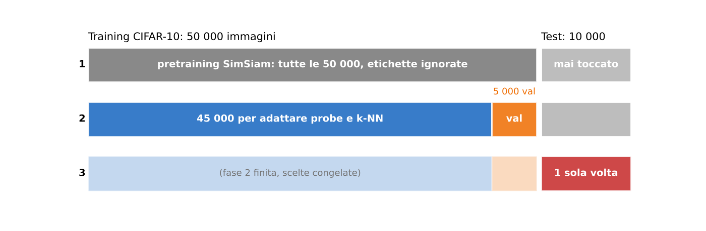

Perché il test una volta sola? Se guardi un numero e cambi qualcosa in base a esso (l'epoca del probe, il valore di k), **quel numero smette di essere una misura onesta**: hai scelto la configurazione che su quei dati va meglio, anche per fortuna. Per questo le scelte si fanno sulla **validazione** e il **test** arriva quando tutto è deciso (cella 36: «do not use these results to select hyperparameters»).

> **Il punto**
> 
> Backbone congelato, feature normalizzate, un classificatore piccolo sopra. **Scegliere guardando il test gonfia il risultato**: si sceglie sulla validazione, si riporta il test.

### 9\. Il linear probe

**Il problema.** Le feature h separano le classi? Il modo più diretto per chiederlo è vedere se basta una frontiera lineare.

**L'idea.** Un **linear probe** **è un classificatore lineare addestrato su feature congelate**. Il libro (§ 37.3.2) lo descrive come un modulo di lettura leggero, con pochi parametri, che serve sia a riusare una rete per un compito nuovo sia a «sondare» che cosa sa uno strato: se un attributo si legge linearmente da una feature map, quella feature map lo contiene.

`logit = W h + b,   ŷ = argmax(logit)`

Qui h è il vettore normalizzato di 512 numeri, W è una matrice 10 × 512 (una riga per classe di CIFAR-10), b un vettore di 10 bias. In tutto 512·10 + 10 = **5130 parametri**, contro gli 11 milioni del backbone. Si addestra con la cross-entropy, come la softmax regression del libro (§ 9.7.3).

**Nel notebook** (celle 29–31): Adam con lr 0,01, coseno su 30 epoche, batch di 512 vettori. Dopo ogni epoca si misura l'accuratezza sulle 5 000 di validazione e si conserva una copia (`deepcopy`) dei pesi migliori. Alla fine si ricaricano quelli: è **la scelta dell'epoca migliore sulla validazione**, una forma di *early stopping*.

**Esempio piccolo.** Con 2 classi e feature 2D, h = (0,6, 0,8), W = \[\[1, 0\], \[0, 1\]\], b = 0: logit = (0,6, 0,8), vince la classe 2. Il probe taglia lo spazio solo con iperpiani: **se le classi sono intrecciate, nessun W funziona**, ed è proprio ciò che vogliamo scoprire.

> **Il punto**
> 
> Linear probe = 5130 parametri sopra feature ferme. **Se funziona, l'informazione sulla classe è già linearmente leggibile nelle feature.**

### 10\. Il k-NN: nessun addestramento

**Il problema.** Anche il probe impara qualcosa (W e b). Si può valutare le feature senza addestrare proprio nulla?

**L'idea.** Per classificare un'immagine si cercano, fra le 45 000 feature con etichetta, le **k più simili** e si fa votare la loro classe. Se immagini della stessa classe hanno feature vicine, il voto è giusto. È la stessa idea del libro (§ 30.4.1), che misura la qualità di ogni strato di un autoencoder con un classificatore a 1 vicino: nei pixel il vicino più vicino ha lo stesso colore, negli strati profondi la stessa forma.

**Nel notebook** (cella 34): `KNeighborsClassifier` di scikit-learn con k = 20, distanza coseno (1 − cos), voto a maggioranza semplice.

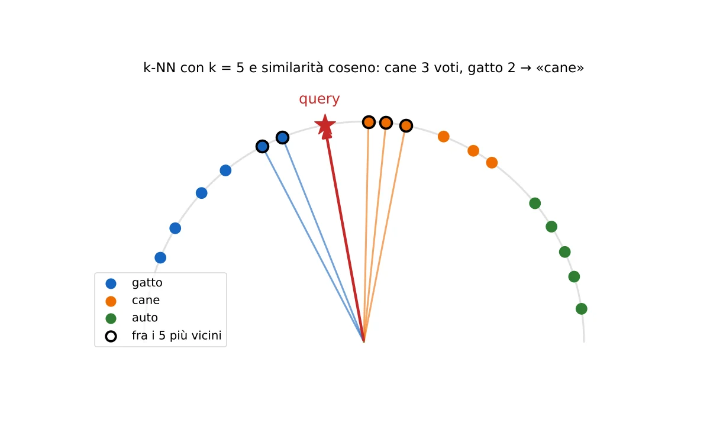

**Esempio svolto.** Con k = 5 e similarità (0,98 gatto, 0,98 cane, 0,96 cane, 0,955 gatto, 0,93 cane): voti cane 3, gatto 2, risposta «cane». Un k più grande rende il voto più stabile, ma **se k è troppo grande entrano vicini lontani di altre classi**. Il notebook fissa k = 20 in anticipo e avverte: se lo vuoi regolare, fallo sulla validazione.

**Probe contro k-NN.** **Il probe guarda la struttura globale** (esiste un taglio lineare?), **il k-NN quella locale** (i vicini hanno la stessa classe?). Per questo il lab li riporta entrambi.

> **Il punto**
> 
> k-NN = vota la classe dei k vicini nello spazio delle feature. **Zero parametri addestrati**: misura direttamente se la geometria delle feature rispetta le classi.

### 11\. Parte 2: un foundation model congelato, feature per patch

**Il problema.** Ora vogliamo una maschera: quali parti della foto sono l'oggetto in primo piano (il gatto, la crostata) e quali lo sfondo. Abbiamo solo 9 immagini annotate. Addestrare una rete di segmentazione da zero con 9 esempi è impossibile.

**L'idea.** Usiamo un **foundation model**: una rete addestrata in modo self-supervised su moltissimi dati e **pensata per essere riusata così com'è**. DINOv3 ([L22](https://gabriele-marsili.github.io/appunti-magistrale-ai/anno-2/computer-vision/sito/#L22)) nella versione ViT-S/16 distillata ha circa 21 milioni di parametri ed è stata addestrata sui dati LVD-1689M. Il libro descrive esattamente questo uso nel § 37.3.1: un modulo che trasforma l'immagine in una feature map, preaddestrato e congelato («potrebbe essere DINO»), con sopra moduli piccoli per i compiti specifici. Nel § 31.3.2 **basta un k-means sulle feature dense di DINO per segmentare**.

**Dalla foto alla griglia di token.** Un ViT con patch 16 ([L17](https://gabriele-marsili.github.io/appunti-magistrale-ai/anno-2/computer-vision/sito/#L17), [L18](https://gabriele-marsili.github.io/appunti-magistrale-ai/anno-2/computer-vision/sito/#L18); libro § 26.4.1) taglia l'immagine in quadrati 16×16 e produce un vettore per quadrato. Prima la foto si ridimensiona: lato lungo 448, entrambi i lati arrotondati per difetto a multipli di 16 (cella 11).

**Il conto.** Le foto del dataset sono 4032×3024. Fattore di scala 448 / 4032 = 0,111, quindi 4032×3024 → 448×336 (entrambi già multipli di 16). Griglia: 448 / 16 = 28 colonne, 336 / 16 = 21 righe, **21 × 28 = 588 patch**. Le immagini 2 e 7 sono verticali: griglia 28 × 21, sempre 588.

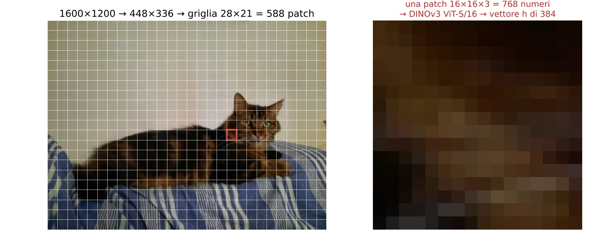

**L'estrazione** (cella 17): `model.get_intermediate_layers(batch, n=1, reshape=True, norm=True)`. `n=1` chiede solo l'ultimo strato; `reshape=True` toglie il token \[CLS\] e i token di registro e rimette i token delle patch su una griglia \[384, 21, 28\]; `norm=True` applica la LayerNorm finale del modello, che non è una normalizzazione a lunghezza 1. Poi \[384, 21, 28\] → \[384, 588\] → \[588, 384\]: **una riga per patch**, nello stesso ordine (riga per riga) dei bersagli.

> **Il punto**
> 
> DINOv3 congelato trasforma ogni patch 16×16 in un vettore di 384 numeri. **Il lavoro difficile l'ha già fatto il pretraining**; a noi resta un problema di classificazione per riga.

### 12\. Dalla maschera ai bersagli per patch

**Il problema.** Le etichette sono maschere al pixel (il canale alpha del PNG: 0 = sfondo, 255 = primo piano). Il modello invece dà un vettore per patch. Bisogna portare la maschera alla risoluzione delle patch.

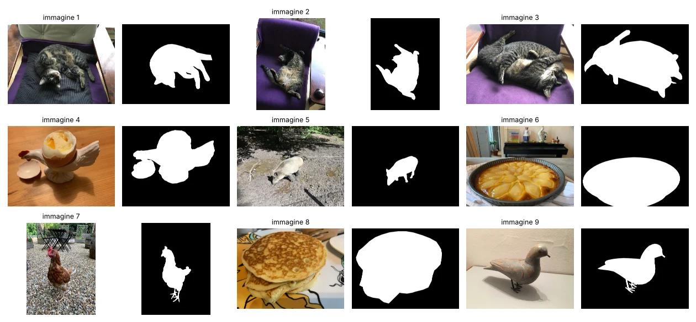

**L'idea.** Si ridimensiona la maschera come l'immagine (bilineare, perché alpha è una copertura continua) e si fa la media dentro ogni quadrato 16×16 con `avg_pool2d`: ne esce, per ogni patch, la **frazione di primo piano**. 0,75 vuol dire che tre quarti della patch sono oggetto. Poi tre casi:

  - frazione \< 0,01 → bersaglio 0 (sfondo);
  - frazione \> 0,99 → bersaglio 1 (primo piano);
  - tutto il resto → patch di bordo, **ignorata** sia nel training sia nella validazione.

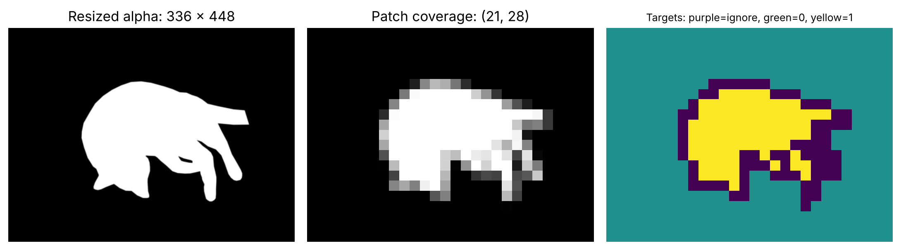

**I conti su tutto il dataset** (misurati da noi): 9 × 588 = 5292 patch; 3616 di sfondo, 1086 di primo piano, 590 di bordo ignorate. Restano 4702, il **23,1% di primo piano**. Nell'immagine 1 restano 519 patch su 588, 82 di primo piano.

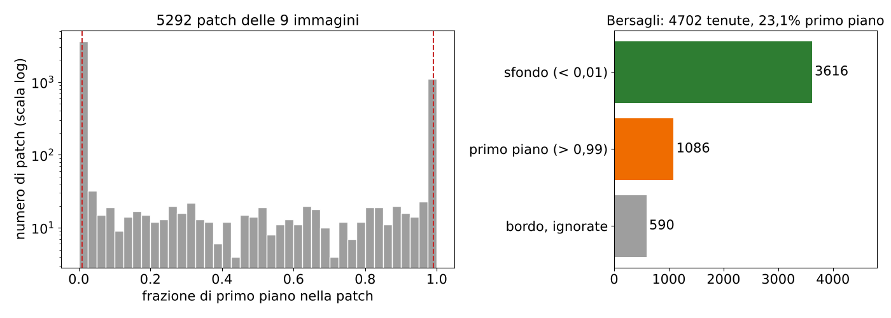

Ignorare i bordi semplifica il problema (niente etichette ambigue) ma ha un prezzo: **anche la validazione non guarda i bordi**, cioè proprio le patch più difficili. Il punteggio che otterremo è ottimista rispetto a una segmentazione vera.

> **Il punto**
> 
> Maschera → media per patch → 0, 1 o «ignora». Si lavora con 4702 patch etichettate, sbilanciate: **circa una su quattro è primo piano**.

### 13\. La regressione logistica come linear probe denso

**Il problema e l'idea.** Ogni patch ha un vettore h di 384 numeri e un bersaglio 0/1. Serve un linear probe come nella sezione 9, con due classi e applicato a ogni patch: una **regressione logistica**.

`p(primo piano | h) = σ(wᵀh + b),   σ(s) = 1 / (1 + e−s)`

w è un vettore di 384 pesi, b un numero, σ la sigmoide che schiaccia qualunque punteggio fra 0 e 1. In tutto **385 parametri**. **Gli stessi w e b valgono per ogni patch** di ogni immagine: **è un filtro 1×1 sulla griglia di feature**, l'equivalente denso del probe.

**Esempio.** Se wᵀh + b = 2 la probabilità è 1 / (1 + e−2) = 0,88; se vale −1 è 0,27; se vale 0 è esattamente 0,5, la soglia di decisione.

**La regolarizzazione C.** scikit-learn minimizza la cross-entropy più una penalità ‖w‖²/2 pesata con 1/C. **C piccolo = regolarizzazione forte** (pesi piccoli), C grande = regolarizzazione debole. Il notebook prova 8 valori, C = 10−7, 10−6, …, 100. Il rischio di overfitting è reale: **le patch della stessa immagine si somigliano**, quindi gli esempi davvero diversi sono pochi.

> **Il punto**
> 
> Una regressione logistica con 385 parametri, uguale per tutte le patch. **C regola quanto può crescere w**, e va scelto sulla validazione.

### 14\. Validare per immagine, non per patch

**Il problema.** Per scegliere C serve una validazione. La tentazione: mescolare le 4702 patch e tenerne da parte il 20%.

**Perché è sbagliato.** **Due patch vicine della stessa foto sono quasi uguali**: stesso gatto, stessa luce, stesso pelo. Se una sta nel training e la vicina nella validazione, il modello riconosce la vicina perché ha già visto la sua «gemella». Il numero esce **gonfiato**.

**L'idea.** Si tiene fuori un'**immagine intera** alla volta: *leave-one-image-out*. Si addestra sulle patch delle altre 8, si valuta sulle patch di quella esclusa, e si ripete per tutte e 9. **Ogni patch riceve così una predizione da un modello che non ha mai visto la sua immagine** (cella 21, con un `assert` che lo controlla).

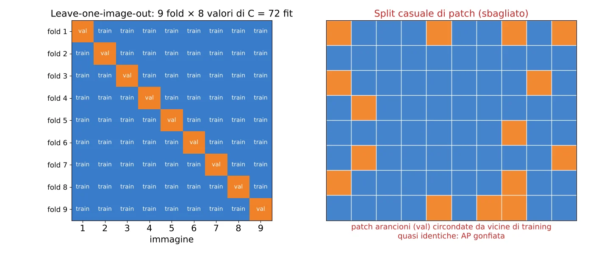

**Il punteggio.** Per ogni C si calcola l'AP (prossima sezione) su ciascuna immagine esclusa e poi la **media sulle 9 immagini**. Media per immagine, non per patch: un'immagine con molte patch tenute non pesa più di una con poche (cella 22).

Cautela (cella 23): **C è stato scelto su questi 9 fold, quindi la loro AP non è più una stima imparziale**. Servirebbe un'immagine annotata mai usata o una validazione annidata: lo stesso principio del test usato una volta sola.

> **Il punto**
> 
> Dati correlati si dividono per gruppo (qui l'immagine), **mai per singolo esempio**. Altrimenti la validazione premia la memoria.

### 15\. Average precision invece dell'accuratezza

**Il problema.** Il 77% delle patch tenute è sfondo. Un modello che risponde sempre «sfondo» ha accuratezza 0,77 e non trova nulla.

**L'idea.** Invece di contare quante risposte sono giuste a una soglia fissa, **si guarda se il modello** **mette le patch di primo piano in cima alla classifica**. Si ordinano le patch per punteggio decrescente e si scorre la lista. Il libro (§ 50.4.3) definisce, per una soglia β:

  - **precision**(β) = Σ 1(ŷi \> β) yi / Σ 1(ŷi \> β): fra le patch dichiarate primo piano, quante lo sono davvero;
  - **recall**(β) = Σ 1(ŷi \> β) yi / Σ yi: fra le patch di primo piano vere, quante ne ho trovate.

ŷi è il punteggio della patch i, yi il bersaglio (0 o 1), 1(·) vale 1 se la condizione è vera. L'**average precision** riassume tutta la curva in un numero, l'area sotto la curva precision-recall:

`AP = Σn (Rn − Rn−1) Pn`

dove Pn e Rn sono precision e recall alla soglia n-esima: ogni volta che la recall cresce, si aggiunge un rettangolo largo quanto il salto e alto quanto la precision in quel punto.

**Esempio svolto: 6 patch.** Punteggi 0,95, 0,85, 0,70, 0,60, 0,40, 0,10; i bersagli veri, nello stesso ordine, sono fg, fg, sf, fg, sf, sf (3 di primo piano). Scorrendo: dopo la 1ª P = 1, R = 1/3; dopo la 2ª P = 1, R = 2/3; la 3ª è sfondo, P = 2/3, R non cambia; dopo la 4ª P = 3/4, R = 1. Quindi AP = (1/3)·1 + (1/3)·1 + (1/3)·0,75 = **0,917**.

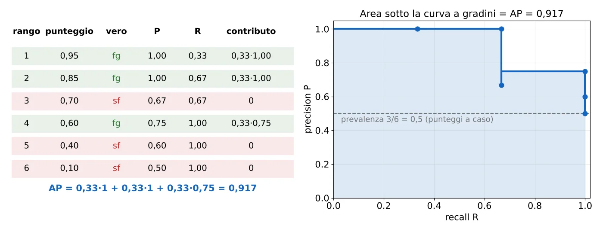

**La linea di base.** Con punteggi casuali, a qualunque soglia la precision è circa la frazione di positivi, la **prevalenza**. Per questo la cella 23 disegna la prevalenza come linea tratteggiata in ognuna delle 9 curve: **l'AP di un modello inutile vale circa la prevalenza** (0,23 su tutto il dataset, 82/519 ≈ 0,16 nell'immagine 1), non 0,5.

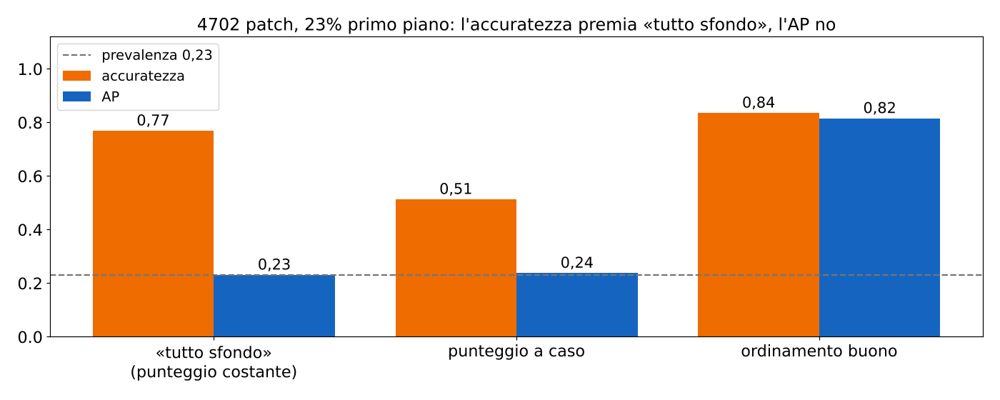

> **Il punto**
> 
> Con classi sbilanciate **l'accuratezza premia chi risponde sempre «sfondo»**. L'AP misura l'ordinamento a tutte le soglie e va confrontata con la prevalenza, non con 0,5.

### 16\. Scegliere C, rifare il fit, predire su una foto nuova

**Scelta di C** (cella 22): si prende il C con la media delle AP più alta; a parità vince il primo della lista, cioè il **più regolarizzato** (il modello più semplice). Poi (cella 25) si addestra un probe nuovo su **tutte** le 9 immagini con quel C: è il modello che si usa. **Il suo punteggio sulle immagini di training non è una prestazione.**

**Una trappola da conoscere.** L'AP dipende solo dall'ordine dei punteggi, non dalla loro scala. Con C molto piccolo i pesi w diventano minuscoli e tutte le probabilità si schiacciano vicino alla prevalenza: l'ordine può restare buono, ma **nessuna patch supera la soglia 0,5** e la maschera finale resta vuota. Non l'abbiamo potuto verificare su DINOv3; la figura lo mostra su un esempio giocattolo.

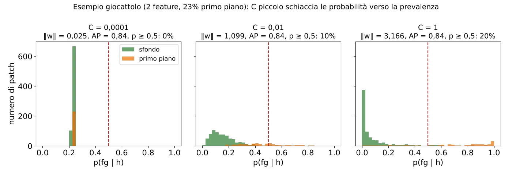

**La foto nuova** (celle 27–28): un gatto tigrato a pelo lungo su una coperta a righe blu, 1600×1200 → 448×336, griglia 21×28. Si estraggono le feature, si calcola la probabilità di ogni patch (anche quelle di bordo, che stavolta non si possono ignorare) e poi tre passi:

1.  **Filtro mediano 3×3 sulla griglia delle patch**: ogni valore diventa la mediana dei 9 vicini. **Una patch isolata ad alta probabilità in mezzo allo sfondo viene cancellata, i bordi netti restano.**
2.  **Upsampling bilineare** della griglia 21×28 alla taglia della foto.
3.  **Soglia 0,5** fissata in anticipo («do not tune it on the demo image») e sovrapposizione rossa semitrasparente.

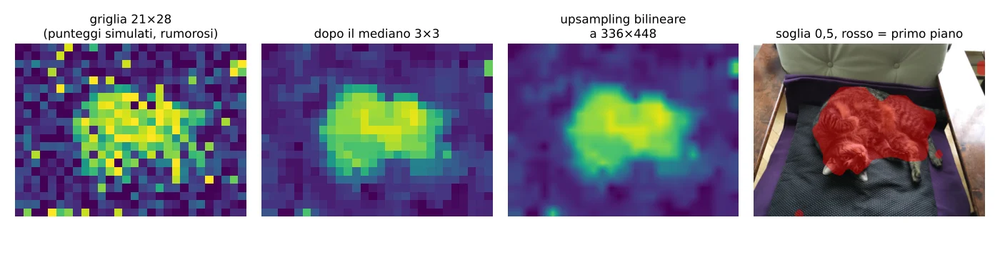

**Il limite di risoluzione.** L'upsampling non inventa dettagli: dentro una patch il modello ha un solo valore. Sulla foto originale una patch copre 1600 / 28 ≈ 57 pixel di lato, quindi **baffi, orecchie e contorni fini non possono uscire precisi**. La foto nuova non ha una maschera vera: **il risultato è solo qualitativo** (cella 28).

> **Il punto**
> 
> C scelto per AP media, refit su tutte le 9, poi griglia di probabilità → mediano → upsampling → soglia. **La risoluzione resta quella delle patch, 16 pixel** sull'immagine ridotta.

### 17\. Gli esercizi: SimCLR, BYOL, Barlow Twins

L'ultima cella del primo notebook chiede di riscrivere il modello con altri tre metodi della [L21](https://gabriele-marsili.github.io/appunti-magistrale-ai/anno-2/computer-vision/sito/#L21) e [L22](https://gabriele-marsili.github.io/appunti-magistrale-ai/anno-2/computer-vision/sito/#L22), lasciando uguali trasformazioni, loader, backbone e valutazione. Cosa cambia:

  - **SimCLR**: via il predictor; serve la loss contrastiva NT-Xent. Le 2B viste del batch si normalizzano, per ogni vista la sua gemella è il positivo e le altre 2B − 2 sono negativi, con una temperatura τ. **Funziona meglio con batch grandi** (l'articolo usa 4096).
  - **BYOL**: si aggiunge un teacher, copia di backbone *e projector*, che non riceve gradiente e si aggiorna come media mobile esponenziale dei pesi dello student *dopo* `optimizer.step()`. La loss è l'errore quadratico fra vettori normalizzati, uguale a 2 − 2 cos.
  - **Barlow Twins**: via il predictor; si standardizzano le due uscite lungo il batch e si calcola la matrice di correlazione incrociata C (qui 2048 × 2048). La loss spinge la diagonale a 1 (invarianza) e il resto a 0 (niente ridondanza): Σi(1 − Cii)² + λ Σi≠j Cij², con λ = 5·10−3 nell'articolo.

> **Il punto**
> 
> Stessa pipeline, cambia solo il modo di evitare il collasso: **negativi (SimCLR), teacher lento (BYOL), decorrelazione (Barlow Twins)**.

### I bug del notebook da non copiare

  - **SimSiam, epoche:** `SSL_EPOCHS = 1` contro le 10 promesse dal testo (sezione 7).
  - **SimSiam su macOS e Windows:** i worker del DataLoader partono con «spawn» e **non trovano `TwoViews` definita nel notebook** («Can't get attribute … on \_\_main\_\_»). Rimedio: `NUM_WORKERS = 0` o spostare la classe in un file .py.
  - **DINOv3:** il commento cita la variabile d'ambiente `DINOV3_WEIGHTS`, che però non viene mai letta: `WEIGHTS_LOCATION` va cambiato a mano.

Cella per cella sono nelle schede qui sotto.

### Il riassunto in 10 righe

1.  SSL in due fasi: feature senza etichette, poi un pezzo piccolo addestrato con poche etichette sopra il backbone congelato.
2.  Le augmentation decidono le invarianze: ciò che cambia fra le viste sparisce dalla rappresentazione (libro § 30.10.2).
3.  SimSiam: backbone ResNet-18 (h, 512) → projector (z, 2048) → predictor (p, 2048), stessi pesi sui due rami.
4.  Loss = −½\[cos(p1, sg(z2)) + cos(p2, sg(z1))\]; senza stop-gradient o senza predictor collassa.
5.  Il predictor ha learning rate costante; backbone e projector seguono un coseno. Il codice fa 1 epoca, l'articolo 800.
6.  Valutazione: feature congelate e normalizzate; 45 000 per adattare, 5 000 per scegliere, test da 10 000 una volta sola.
7.  Linear probe = 5130 parametri; k-NN = voto dei 20 vicini per coseno, zero parametri.
8.  DINOv3 ViT-S/16 congelato: 336×448 → griglia 21×28 = 588 patch, un vettore di 384 per patch.
9.  Bersagli per patch con bordi ignorati (4702 tenute, 23,1% primo piano); regressione logistica σ(wᵀh + b) uguale per ogni patch.
10. Validazione leave-one-image-out con AP media per immagine; refit, mediano 3×3, upsampling, soglia 0,5: risoluzione di 16 pixel.

### Verifica di aver capito

**Perché la loss di SimSiam vicina a −1 non basta a dire che il pretraining è riuscito?**

Perché anche una rete collassata, che dà lo stesso vettore a ogni immagine, allinea perfettamente le viste e ottiene −1. Per giudicare le feature serve un compito con etichette (probe o k-NN) o almeno un controllo sulla dispersione delle z normalizzate.

**Nell'esempio p = (1, 0), z = (0,6, 0,8), cosa cambia con e senza detach?**

Il coseno è 0,6 in entrambi i casi. Con `detach` si muove solo p, nella direzione (0, 0,8), verso z. Senza, anche z si muove verso p, nella direzione (0,64, −0,48): i due vettori si inseguono e la rete trova più facilmente la soluzione costante.

**Perché nel lab DINOv3 non si dividono le patch a caso fra training e validazione?**

Le patch vicine della stessa immagine sono quasi identiche: una nel training e la gemella nella validazione gonfiano il punteggio. Si tiene fuori un'immagine intera per volta (9 fold) e si fa la media dell'AP per immagine.

**Un probe che dice sempre «sfondo»: quanto vale la sua accuratezza e quanto la sua AP?**

Accuratezza 0,77 (le patch di sfondo sono il 77% delle 4702). AP pari alla prevalenza, circa 0,23: non ordina affatto le patch di primo piano sopra le altre.

**Calcola l'AP con punteggi in ordine e bersagli fg, sf, fg, sf.**

Dopo la 1ª P = 1, R = 1/2; la 2ª è sfondo; dopo la 3ª P = 2/3, R = 1. AP = (1/2)·1 + (1/2)·(2/3) = 0,833.

**Perché la maschera finale non segue bene i baffi del gatto?**

Il modello dà un solo valore per patch 16×16 dell'immagine ridotta, cioè circa 57×57 pixel della foto originale. Mediano e upsampling bilineare ammorbidiscono la griglia ma non aggiungono dettagli dentro le patch.

### Come proseguire

Libro: [cap. 30 Representation Learning](https://visionbook.mit.edu/representation_learning.html), § 30.4.1 (valutare con i vicini), § 30.10–30.10.2 (contrastivo, alignment e uniformity, esperimento sulle invarianze); [cap. 37 Transfer Learning](https://visionbook.mit.edu/transfer_learning.html), § 37.3.1 (moduli congelati, DINO come featurizer) e § 37.3.2 (heads and probes); [cap. 31](https://visionbook.mit.edu/perceptual_organization.html), § 31.3.2 (k-means sulle feature DINO); [cap. 50](https://visionbook.mit.edu/object_recognition_v3.html), § 50.4.3 (precision, recall, AP). Prince § 9.3.7 per il quadro generale. Poi apri le schede qui sotto, che seguono i due notebook cella per cella, e la sezione dei risultati. Ora ripassa con le schede qui sotto.
