# L24 · Vision-language model

*Lezione 24 · Donald Shenaj · 11 novembre 2026*

[Versione interattiva sul sito, con videolezione](https://gabriele-marsili.github.io/appunti-magistrale-ai/anno-2/computer-vision/sito/#L24) · [Indice della dispensa](README.md)

**In una frase:** un **vision-language model** (VLM) collega immagini e testo; la lezione segue tre idee in ordine: **allineare** immagini e frasi nello stesso spazio di vettori (CLIP, che classifica con classi scritte a parole senza riaddestrare nulla), **tradurre** un'immagine in testo con un decoder che la guarda tramite cross-attention (captioning, BLIP-2), e infine **dare l'immagine in pasto a un grande modello di linguaggio** che risponde a domande e istruzioni (VQA, LLaVA, Qwen-VL), fino a ragionare su due foto o indicare un oggetto con un box.

### Prima di iniziare

Slide di Donald Shenaj (11 novembre), 61 pagine; «n / 61» in basso è la pagina del PDF, e la 61 è solo la panoramica delle miniature. Ti servono:

  - dalla [L21](https://gabriele-marsili.github.io/appunti-magistrale-ai/anno-2/computer-vision/sito/#L21): la loss **InfoNCE**, SimCLR con coppie positive e negative nel batch, la **temperatura**, la projection head;
  - dalla [L22](https://gabriele-marsili.github.io/appunti-magistrale-ai/anno-2/computer-vision/sito/#L22) e dalla [L23](https://gabriele-marsili.github.io/appunti-magistrale-ai/anno-2/computer-vision/sito/#L23): i **foundation model**, il backbone **congelato** usato come estrattore di feature, il **linear probe**;
  - dalla [L17](https://gabriele-marsili.github.io/appunti-magistrale-ai/anno-2/computer-vision/sito/#L17) e dalla [L18](https://gabriele-marsili.github.io/appunti-magistrale-ai/anno-2/computer-vision/sito/#L18): il ViT, le patch come **token**, il token \[CLS\], la self-attention con Q, K, V;
  - dalla [L15](https://gabriele-marsili.github.io/appunti-magistrale-ai/anno-2/computer-vision/sito/#L15): softmax e cross-entropy; dalla [L19](https://gabriele-marsili.github.io/appunti-magistrale-ai/anno-2/computer-vision/sito/#L19): i bounding box e l'IoU (per il grounding).

Il libro di riferimento è il visionbook, [cap. 51 «Vision and Language»](https://visionbook.mit.edu/VLMs.html), breve e chiaro; per l'InfoNCE il [cap. 30](https://visionbook.mit.edu/representation_learning.html) (§ 30.10). ConVIRT, LiT, LAION, OpenCLIP, BLIP-2, LLaVA, Qwen-VL, NLVR2 e RefCOCO **non sono nei libri**: i numeri che trovi qui sono quelli delle slide, verificati sugli articoli.

### Guarda prima questi video

  - [OpenAI CLIP: ConnectingText and Images (Paper Explained)](https://www.youtube.com/watch?v=T9XSU0pKX2E) (Video). Yannic Kilcher. L'articolo di CLIP letto figura per figura: la matrice di similarità, lo zero-shot con i prompt, i risultati sui 27 dataset. Guardalo prima delle sezioni 4–10.
  - [Stanford CS231N Deep Learning for Computer Vision | Spring 2025 | Lecture 16: Vision and Language](https://www.youtube.com/watch?v=mQOK0Mfyrkk) (Video). Stanford Online. Lezione universitaria che copre lo stesso percorso: CLIP, captioning, modelli multimodali con LLM. Buon ripasso dopo aver letto tutta la dispensa.

### 1\. Perché unire visione e linguaggio

**Il problema.** Un classificatore addestrato su ImageNet sa dire 1000 nomi, sempre gli stessi. Se domani vuoi distinguere «monopattino elettrico» da «bicicletta», devi raccogliere immagini etichettate e riaddestrare la testa. E non può rispondere a «cosa c'è di strano in questa foto?». Intanto sul web ci sono miliardi di immagini con accanto un testo scritto da qualcuno: didascalie, *alt-text*, titoli.

**L'idea** (slide 3–5). Nella [L21](https://gabriele-marsili.github.io/appunti-magistrale-ai/anno-2/computer-vision/sito/#L21) le coppie positive di SimCLR erano due augmentation della stessa foto. Qui la «seconda vista» di un'immagine è **la frase che la descrive**. Il testo porta supervisione *semantica* (oggetti, attributi, azioni) senza che nessuno abbia annotato a mano, e soprattutto permette di **definire nuove categorie scrivendole, senza addestrare un classificatore per ogni insieme di etichette**.

**Due modi di usare l'encoder visivo** (slide 4). Un ViT produce una sequenza di feature, una per patch:

`Zv = fv(x) ∈ ℝN×Dv`

con N il numero di token e Dv la loro dimensione. Le architetture della lezione la usano in due modi: **un solo vettore globale** per immagine (il \[CLS\] o una media, proiettato in uno spazio condiviso: è CLIP), oppure **tutta la sequenza di token**, che un modello di linguaggio legge con la cross-attention (BLIP-2) o direttamente nella sua sequenza di ingresso (LLaVA). Questa distinzione è la chiave del confronto finale. I compiti (slide 6, riepilogati alla slide 57): zero-shot, captioning, VQA, chat che segue istruzioni.

> **Il punto**
> 
> Il testo sostituisce le etichette fisse: è supervisione gratuita e flessibile. L'encoder visivo può dare un vettore per immagine (allineamento) o una sequenza di token (generazione).

### 2\. Trasformare il testo in token: BPE

**Il problema.** Un transformer vuole vettori, non stringhe. Come si spezza «grosso» in pezzi da trasformare in vettori? Il libro (§ 51.2) confronta tre scelte: **un codice per parola** (oltre 100 000 in inglese, e **una parola mai vista non ha codice**), **un codice per carattere** (poche decine, ma sequenze lunghe) e, in mezzo, il **Byte-Pair Encoding**.

**L'idea** (slide 8). Il BPE parte dai caratteri e **fonde ripetutamente la coppia di simboli adiacenti più frequente in un simbolo nuovo**. Ogni fusione aggiunge una voce al vocabolario e accorcia le sequenze: il numero di fusioni serve a **bilanciare dimensione del vocabolario e lunghezza delle sequenze**. Le parole comuni diventano un token, quelle rare restano spezzate in pezzi noti. Lo usano GPT e CLIP.

**Esempio svolto.** Corpus: basso ×5, bassi ×3, rosso ×4, rossi ×2, grosso ×2: 82 caratteri, vocabolario di 7 lettere (b, a, s, o, i, r, g). La coppia più frequente è «s s» (16 volte): diventa «ss», e i token scendono a 66. Poi «ss o» (11 volte) → «sso», 55 token. Poi «b a» e «r o» (8 volte ciascuna, a pari merito), infine «ro sso» → «rosso». Dopo 5 fusioni: 33 token e 12 simboli nel vocabolario; «grosso», mai fuso intero, diventa «g + rosso».

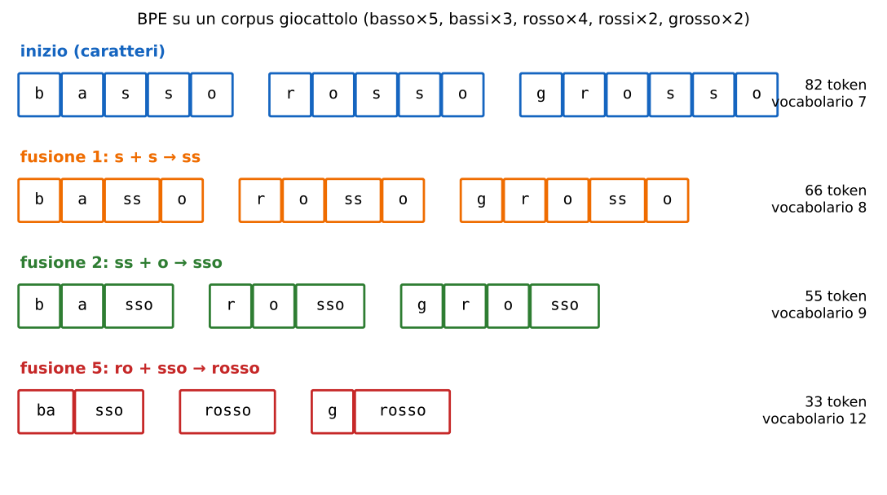

**Dai token ai vettori.** Ogni token ha un numero intero (ID). Una matrice di embedding E ∈ ℝV×d (V = dimensione del vocabolario, d = dimensione dei vettori) associa all'ID i la riga i di E. Il libro lo scrive come Wtokenize · one-hot: moltiplicare per un vettore one-hot *è* leggere una riga, cioè una tabella di lookup appresa. È lo stesso ruolo del patch embedding del ViT ([L17](https://gabriele-marsili.github.io/appunti-magistrale-ai/anno-2/computer-vision/sito/#L17)).

> **Il punto**
> 
> Testo → token BPE → ID → vettori tramite una tabella appresa. Da qui in poi testo e immagini sono entrambi **sequenze di token** che un transformer sa elaborare.

### 3\. Il linguaggio come supervisione: i precursori

**Il problema.** L'idea di imparare la visione dal testo è vecchia. Perché è esplosa solo nel 2021?

**La storia** (slide 9). I primi lavori (Mori et al. 1999, Im2Text di Ordonez et al. 2011, Joulin et al. 2016) imparavano rappresentazioni dal testo associato alle immagini; i *visual n-grams* (Li et al. 2017) arrivavano a **11,5% di accuratezza zero-shot su ImageNet**. Poi tre obiettivi diversi: **VirTex** (predire la didascalia parola per parola), **ICMLM** (predire parole mascherate) e **ConVIRT** (contrastivo). Il libro (§ 51.3) osserva che anche la classificazione è supervisione linguistica, povera: un nome fra K. Con dati e calcolo sufficienti conviene usare *tutto* il linguaggio libero.

**ConVIRT** (Zhang et al. 2020) applica l'apprendimento contrastivo a radiografie e referti medici, in entrambe le direzioni:

`LConVIRT = λ Lv→u + (1 − λ) Lu→v,   Lv→u = −log [ exp(sim(v, u)/τ) / ∑u′ exp(sim(v, u′)/τ) ]`

v è l'immagine, u il suo referto, u′ scorre su tutti i referti del batch, sim è la similarità coseno, τ la temperatura, λ pesa le due direzioni. È la InfoNCE della [L21](https://gabriele-marsili.github.io/appunti-magistrale-ai/anno-2/computer-vision/sito/#L21) con i negativi presi dall'*altra* modalità. **CLIP usa un obiettivo simmetrico simile, ma addestrato da zero su 400 milioni di coppie invece di circa 200 mila**: la differenza è soprattutto di scala.

> **Il punto**
> 
> Le idee c'erano già; CLIP ha preso l'obiettivo contrastivo bidirezionale di ConVIRT e lo ha portato alla scala del web.

### 4\. CLIP: due encoder, uno spazio comune

**Il problema.** Vogliamo un vettore per ogni immagine e un vettore per ogni frase, tali che una foto e la sua descrizione cadano vicine, e foto e frasi non correlate lontane.

**L'idea** (slide 10–12). CLIP (*Contrastive Language-Image Pre-training*, Radford et al. 2021) ha **due encoder separati**, addestrati insieme da zero:

  - **encoder di immagini** fv: una ResNet modificata (con *attention pooling* al posto del global average pooling) oppure un ViT;
  - **encoder di testo** ft: un transformer in stile decoder, con self-attention causale sui token BPE; il modello base ha 12 strati, larghezza 512 e 63 milioni di parametri. Come feature della frase si prende l'uscita del token finale \[EOS\], che grazie all'attenzione causale ha visto tutta la frase;
  - una **proiezione lineare** per ciascuno, verso uno spazio condiviso di dimensione dz. **Niente projection head non lineare come in SimCLR**: basta una matrice.

**La normalizzazione** (slide 13). Con hiv ∈ ℝDv e hit ∈ ℝDt le feature dei due encoder, Wv e Wt le proiezioni:

`vi = Wvhiv / ‖Wvhiv‖2,   ti = Wthit / ‖Wthit‖2,   vi⊤tj = cos θij`

Dopo la divisione per la norma, tutti i vettori hanno lunghezza 1 e stanno sulla **sfera unitaria**: il prodotto scalare è il **coseno dell'angolo** fra loro, un numero fra −1 e 1. Perché è importante? **Senza normalizzazione la rete potrebbe abbassare la loss solo allungando i vettori positivi e spingendo i negativi all'infinito**, senza imparare nulla sul contenuto (il libro lo dice in § 51.3). Con la normalizzazione **conta solo la direzione**.

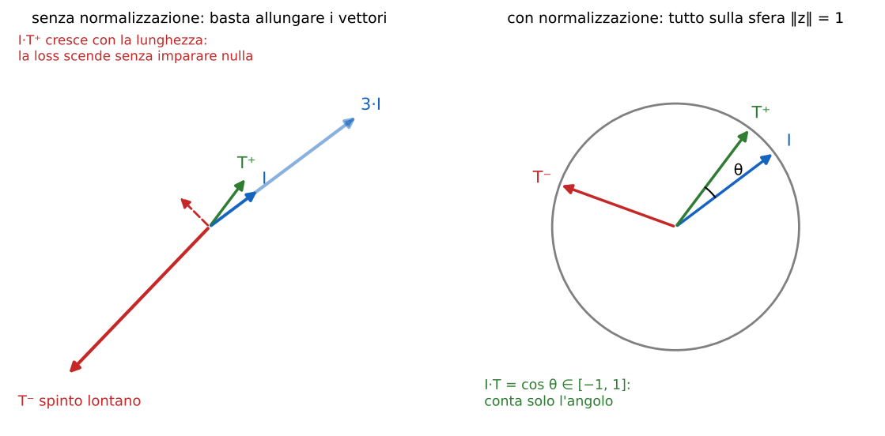

> **Attenzione: due imprecisioni del libro (§ 51.3)**
> 
> Il libro dice che il prodotto scalare fra vettori unitari è «proporzionale all'angolo»: è il **coseno** dell'angolo (decresce quando l'angolo cresce, ma non in modo proporzionale). E chiama Sdz la sfera dei vettori unitari di ℝdz, che nella notazione usuale è Sdz−1. La slide 15 chiama l'encoder fℓ (notazione del libro) invece di fv: è lo stesso oggetto.

> **Il punto**
> 
> CLIP = **due encoder + due proiezioni lineari + normalizzazione**: immagini e frasi diventano punti sulla stessa sfera, confrontati col coseno.

### 5\. La matrice N × N e la InfoNCE simmetrica

**Il problema.** Come si dice alla rete «questa foto va con questa frase e non con le altre»?

**L'idea** (slide 14–17). Si prende un batch di N coppie immagine-didascalia. Ogni immagine passa indipendentemente nell'encoder (I1, …, IN), ogni didascalia nel suo (T1, …, TN); poi si calcolano **tutte** le similarità:

`Sij = Ii⊤Tj,   i, j = 1, …, N`

Ne esce una matrice N × N. **Le N coppie vere stanno sulla diagonale; gli N² − N elementi fuori diagonale sono i negativi**, presi gratis dal batch (in-batch negatives, come in SimCLR). Nella fig. 51.2 del libro, N = 6: 6 positivi e 30 negativi. CLIP usava batch da 32 768 coppie.

**La matematica** (slide 18–19). Per ogni riga k (immagine Ik confrontata con tutte le didascalie) una softmax e una cross-entropy che vuole la massa sulla colonna k:

`LI→T = −∑k log [ exp(Ik·Tk/τ) / ∑j exp(Ik·Tj/τ) ],   LT→I = −∑k log [ exp(Ik·Tk/τ) / ∑j exp(Ij·Tk/τ) ]`

LT→I fa lo stesso per colonne: la didascalia Tk deve riconoscere la sua immagine fra tutte. La loss totale è L = LI→T + LT→I. Ciascun termine è una InfoNCE (libro, § 30.10, eq. 30.4); **CLIP ne usa la versione simmetrica**, perché vogliamo sia cercare testi da un'immagine sia immagini da un testo. Le slide scrivono somme su k, il codice fa la media su k e divide per 2 la somma delle due direzioni: cambia solo un fattore di scala (lo dice la slide 19).

**Esempio svolto** (verificato in Python). N = 3: un cane, un gatto, un'auto, e le loro didascalie. Similarità coseno:

`S = [[0.30, 0.10, 0.05], [0.12, 0.28, 0.08], [0.02, 0.15, 0.25]],   τ = 0.07 (cioè ×14,29)`

  - Riga 1: logit 0.30/0.07 = 4.29, 1.43, 0.71; softmax 0.921, 0.053, 0.026; loss −ln 0.921 = 0.082.
  - Righe 2 e 3: probabilità corrette 0.863 e 0.783, loss 0.148 e 0.245. Media LI→T = 0.158.
  - Colonne: probabilità corrette 0.913, 0.811, 0.873, loss 0.091, 0.209, 0.136, media LT→I = 0.145.
  - Loss come nel codice: (0.158 + 0.145)/2 = **0.152**.

Le due direzioni vedono errori diversi: l'auto (riga 3) è l'immagine più confusa, la didascalia del gatto (colonna 2) il testo più confuso.

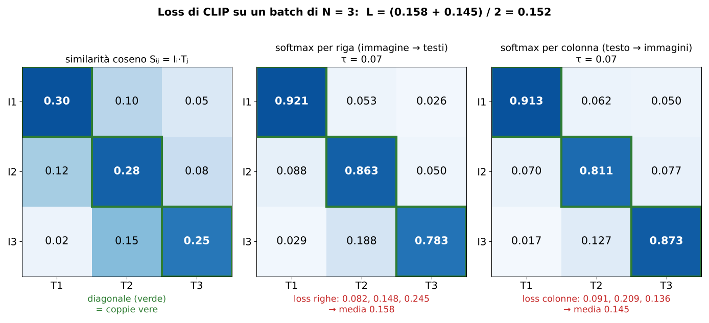

> **Il punto**
> 
> Un batch di N coppie dà una matrice N × N: **softmax per righe e per colonne, cross-entropy verso la diagonale**. È la InfoNCE della L21 resa simmetrica, con i negativi presi dall'altra modalità.

### 6\. La temperatura e lo pseudocodice

**Il problema.** I coseni stanno fra −1 e 1. Se li dai così alla softmax, la differenza fra 0.30 e 0.10 è minuscola e le probabilità sono quasi uniformi.

**L'idea.** Si divide per una **temperatura** τ piccola ([L15](https://gabriele-marsili.github.io/appunti-magistrale-ai/anno-2/computer-vision/sito/#L15), [L21](https://gabriele-marsili.github.io/appunti-magistrale-ai/anno-2/computer-vision/sito/#L21)), cioè si moltiplica per 1/τ. Con τ = 1 la riga 1 dell'esempio dà 0.38, 0.32, 0.30 e la loss del batch è 0.977, quasi ln 3 = 1.10 (il valore «a caso»): **la rete non riceverebbe quasi segnale per separare meglio i positivi**. Con τ = 0.07 la stessa riga diventa 0.92, 0.05, 0.03. Con τ troppo piccolo la softmax diventa un argmax e la loss satura. In CLIP **τ è un parametro appreso**: inizializzato a 0,07 e con il fattore 1/τ limitato a 100 per stabilità. Il libro non mette la temperatura nella formula; CLIP la usa.

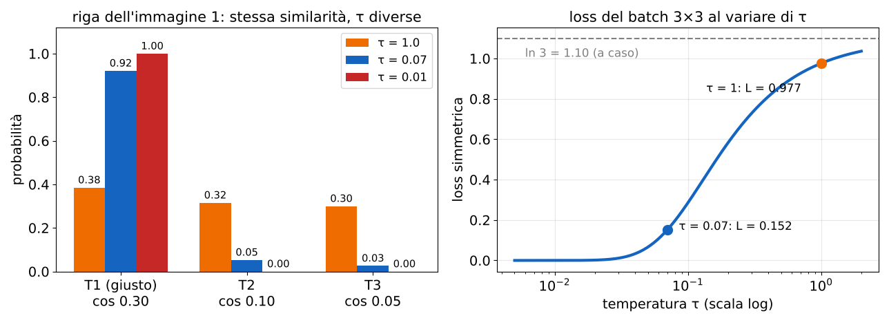

**Lo pseudocodice** (slide 20, dall'articolo). In poche righe c'è tutto CLIP:

    I_f = image_encoder(I)          # [n, d_i]
    T_f = text_encoder(T)           # [n, d_t]
    I_e = l2_normalize(np.dot(I_f, W_i), axis=1)   # [n, d_e]
    T_e = l2_normalize(np.dot(T_f, W_t), axis=1)   # [n, d_e]
    logits = np.dot(I_e, T_e.T) * np.exp(t)        # [n, n]
    labels = np.arange(n)
    loss_i = cross_entropy_loss(logits, labels, axis=0)
    loss_t = cross_entropy_loss(logits, labels, axis=1)
    loss = (loss_i + loss_t)/2

**t** è log(1/τ): moltiplicare per exp(t) tiene il fattore sempre positivo. **labels = arange(n)** dice che la classe giusta della riga k è la colonna k, la diagonale. **axis** sceglie la direzione della softmax; de del codice è il dz delle slide 12–13.

> **Il punto**
> 
> La temperatura trasforma coseni piccoli in logit separati; in CLIP **si impara da sola** (come log 1/τ). Il codice: proietta, normalizza, matrice dei logit, cross-entropy con etichette arange(n) nelle due direzioni.

### 7\. LiT: congelare l'encoder delle immagini

**Il problema.** Esistono già ottimi encoder di immagini (preaddestrati su enormi dataset etichettati o con SSL, [L22](https://gabriele-marsili.github.io/appunti-magistrale-ai/anno-2/computer-vision/sito/#L22)). Serve davvero addestrare tutto da zero come CLIP?

**L'idea** (slide 21). **LiT** (*Locked-image Text Tuning*, Zhai et al. 2022) **blocca un encoder di immagini preaddestrato e addestra solo l'encoder di testo** con la stessa loss contrastiva:

`v = fv(x),   tθ = ft,θ(c),   minθ Lcontrastive(v, tθ)`

Solo θ (il testo) si muove: il testo impara a «leggere» uno spazio visivo già buono. Nella tabella della slide, zero-shot su ImageNet: **Lu** (immagine bloccata e preaddestrata, testo libero) 70,1%; **Uu** (entrambi addestrati, immagine inizializzata da preaddestramento) 57,2%; **uu** (entrambi da zero) 50,6%. **Bloccare l'immagine vince** negli esperimenti riportati: è l'idea del featurizer congelato della [L23](https://gabriele-marsili.github.io/appunti-magistrale-ai/anno-2/computer-vision/sito/#L23) applicata all'allineamento. Intuizione: i dati del web sono rumorosi e aggiornare l'encoder visivo su di essi può rovinare feature imparate su dati più puliti.

> **Il punto**
> 
> Non serve addestrare tutto: con un buon encoder visivo congelato basta **insegnare al testo a puntare nello spazio esistente**.

### 8\. Cosa impara CLIP: profondità e spazio congiunto

**Rappresentazioni a diverse profondità** (slide 22, fig. 51.3 del libro). Si prende un dataset giocattolo di forme colorate con le loro descrizioni e si visualizzano con t-SNE (libro, cap. 13) le feature degli strati intermedi di ciascun encoder. Nell'encoder di immagini gli strati iniziali **raggruppano per colore, quelli finali per forma**; nell'encoder di testo succede il contrario. Il libro lo spiega così: nei pixel il colore è in superficie e la forma richiede elaborazione; nel testo «rosso» e «triangolo» sono parole ugualmente facili. La loss agisce solo sugli embedding finali; è un'osservazione qualitativa.

**Lo spazio congiunto** (slide 23, fig. 51.4). Dopo la normalizzazione immagini e frasi stanno sulla stessa ipersfera; il libro la mostra proiettando gli embedding a 768 dimensioni in 2D con *kernel PCA* (kernel coseno). Ogni descrizione cade vicino alle icone che descrive, non perfettamente. Un dettaglio: per il disegno il libro toglie la prima componente principale, che codifica **uno scostamento globale fra embedding di immagini e di testi** (il cosiddetto *modality gap*: le due modalità occupano zone diverse della sfera).

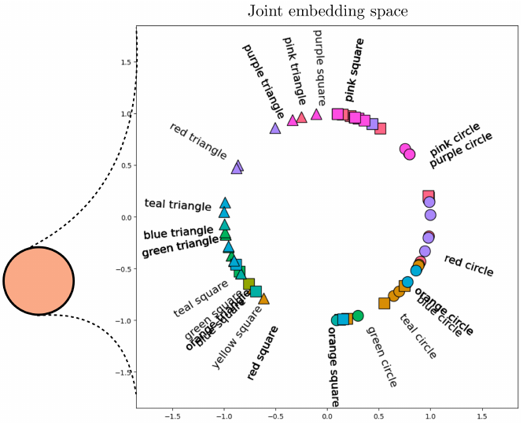

Attenzione a cosa garantisce la loss (slide 23): **aumenta cos θii *rispetto* a cos θij, senza un valore assoluto da raggiungere**. Per questo le similarità di CLIP fra coppie giuste sono spesso intorno a 0,3: conta l'ordine, non il numero.

> **Il punto**
> 
> Le immagini passano da colore a forma lungo la profondità, il testo no. Alla fine tutto sta su una sfera dove **ogni frase è vicina alle immagini che descrive**, in senso relativo.

### 9\. I dati: 400 milioni di coppie, LAION-5B, OpenCLIP

**Il problema.** Un modello così vive di dati. CLIP è stato addestrato su **400 milioni** di coppie raccolte dal web, mai rese pubbliche (slide 24). Dalla slide (Bordes et al. 2024): **Qualità, filtraggio e varietà contano quanto la quantità.**

**LAION-5B** (Schuhmann et al. 2022, slide 25): **5,85 miliardi** di coppie da Common Crawl, di cui 2,32 miliardi in inglese, 2,26 multilingue e 1,27 di lingua non determinata. Si pubblicano metadati e URL, non le immagini. Le coppie sono filtrate tenendo quelle con similarità CLIP alta fra immagine e testo. Ma **l'alt-text del web è rumoroso**: titoli di prodotti, nomi di file, descrizioni a metà (negli esempi della slide, «BMW-M2-M-Performance-Dekor-Long-Beach-Blue-05»). **Il filtro CLIP migliora l'allineamento ma non elimina il rumore**.

**OpenCLIP** (Cherti et al. 2023, slide 26): implementazione open-source di CLIP, addestrata su dataset pubblici (LAION-80M/400M/2B) con modelli rilasciati di varie taglie. Gli esperimenti di scala mostrano **andamenti diversi per OpenAI CLIP e OpenCLIP pur con architetture e procedure simili**: a parità di ricetta, i dati cambiano il risultato.

> **Il punto**
> 
> CLIP = metodo semplice + dati enormi. LAION e OpenCLIP rendono la ricetta riproducibile, e mostrano che **i dati sono un ingrediente del modello**.

### 10\. Classificare senza addestrare: lo zero-shot

**Il problema.** Hai CLIP già addestrato e vuoi distinguere cani, gatti e auto. Nessuna immagine etichettata, nessun addestramento.

**L'idea** (slide 27). Scrivi una frase per classe («a photo of a dog.», «a photo of a cat.», «a photo of a car.»), codificala con l'encoder di testo: i vettori ztc sono **i pesi di un classificatore lineare costruito dal testo**. Poi:

`p(y = k | x, C) = exp(zvx·ztck/τ) / ∑j exp(zvx·ztcj/τ),   ĉ = argmaxc∈C zvx·ztc`

zvx è l'embedding dell'immagine x, C = {c1, …, cK} l'insieme delle classi candidate. È esattamente una riga della matrice di addestramento, con le frasi-classe al posto delle didascalie. Confronta col **linear probe** della [L23](https://gabriele-marsili.github.io/appunti-magistrale-ai/anno-2/computer-vision/sito/#L23): lì i pesi del classificatore si imparano da esempi etichettati, qui si *scrivono*.

**Esempio svolto.** Coseni fra la foto di un cane e i tre prompt: 0.31, 0.26, 0.12. Con il fattore 1/τ = 100 di CLIP: logit 31, 26, 12; softmax 0.993, 0.007, circa 0. Previsione: cane. Ora aggiungi una quarta classe «a photo of a wolf.» con coseno 0.30: le probabilità diventano cane 0.727, lupo 0.268. L'argmax non cambia, ma **le probabilità dipendono dall'insieme C scelto e non sono calibrate** (slide 27): 99% non vuol dire «sicuro al 99%».

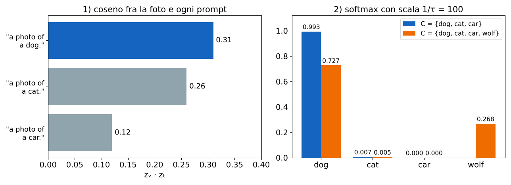

**Classificatori su misura** (slide 28, fig. 51.6 del libro). Le stesse immagini, con CLIP congelato, si possono dividere in modi diversi solo cambiando le frasi: triangolo contro cerchio (forma), viola contro verde acqua (colore), punta di freccia contro palla (oggetto). **Cambiare i testi candidati sposta il confine di decisione senza toccare un parametro**; con K frasi si sceglie quella con coseno massimo.

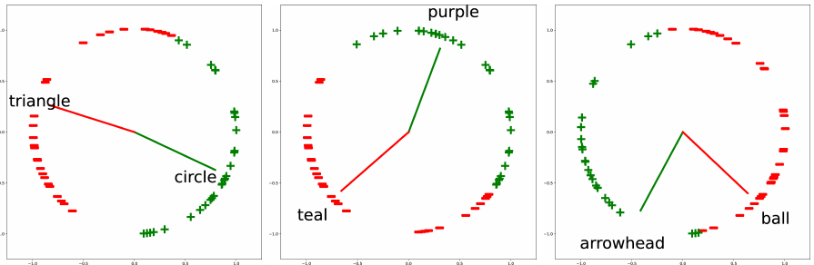

> **Attenzione: refuso nel libro (§ 51.3)**
> 
> Nella ricetta del classificatore il libro scrive ztb = ft(ta): va letto ztb = ft(tb), ogni classe con la sua frase.

> **Il punto**
> 
> Zero-shot = **una frase per classe, coseno con l'immagine, argmax**. Le classi si cambiano al momento dell'uso; le probabilità dipendono da quali classi metti.

### 11\. Quanto funziona: risultati, retrieval, prompt

**Risultati** (slide 29). CLIP zero-shot è confrontato con un classificatore lineare *addestrato* sulle feature di una ResNet-50, su 27 dataset. **CLIP vince in 16 su 27, compreso ImageNet**, con grandi margini su auto (StanfordCars +28,9), cibo, azioni nei video. **Perde molto nei domini specialistici**: immagini satellitari (EuroSAT −37,1), distanze nella guida (KITTI −34,0), istologia (PatchCamelyon −19,5), conteggio (CLEVRCounts −18,2), cifre (MNIST −10,0). Sono concetti rari nelle didascalie del web.

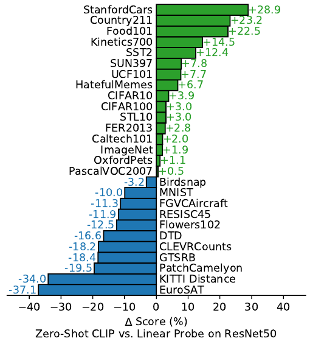

**Retrieval** (slide 30). Data una frase q, si ordinano M immagini per coseno: î = argmaxi ztq·zvxi. **Gli embedding delle immagini si calcolano una volta sola**: cercare costa un prodotto matrice-vettore (M prodotti scalari). Al contrario, da un'immagine si cercano testi. La metrica è il **Recall@K: la frazione di query per cui un risultato giusto compare fra i primi K**. Esempio: 4 query con la risposta giusta ai ranghi 1, 3, 1, 6. Recall@1 = 2/4 = 50%, Recall@5 = 3/4 = 75%, Recall@10 = 100%.

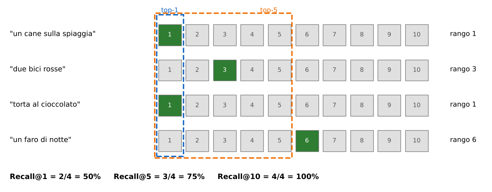

**Prompt testuali** (slide 31). «a photo of a dog» invece di «dog» dà **+1,3 punti** su ImageNet: le didascalie del web sono frasi, e una parola sola è ambigua («boxer»: cane o pugile?). Il **prompt ensembling** media gli embedding normalizzati di molti template per classe (80 nell'articolo): altri **+3,5 punti**, come un modello 4 volte più costoso. **Gli embedding delle classi si precalcolano**: l'ensemble non costa nulla per immagine.

**Prompt visivi** (slide 32). Si può anche modificare l'*immagine*: disegnare un **cerchio rosso** attorno a un oggetto guida CLIP verso di esso, conservando il contesto (Shtedritski et al. 2023). Per il grounding si cerchia a turno ogni regione candidata e si sceglie quella con similarità più alta con la frase («the cub on the right»). Nessun parametro aggiornato.

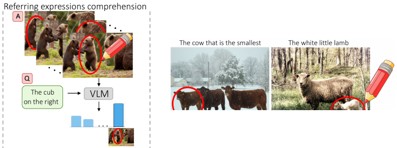

> **Il punto**
> 
> Zero-shot competitivo sulle immagini «da web», debole nei domini rari. Il retrieval si misura con Recall@K. **Prompt testuali (template, ensemble) e visivi (cerchi rossi) migliorano i risultati senza addestrare**.

### 12\. I limiti: contare e capire le relazioni

**Contare** (slide 33). La loss contrastiva non supervisiona esplicitamente il numero di oggetti: una didascalia raramente dice «tre». Nella valutazione di Paiss et al. (2023) **CLIP confonde spesso conteggi diversi** (cercando «quattro cani» trova foto con due o sei cani), e le mappe di attenzione non coprono tutte le istanze ripetute.

**Relazioni e ordine delle parole** (slide 34). «the horse is eating the grass» e «the grass is eating the horse» hanno le stesse parole e significati opposti; nell'esempio di Yuksekgonul et al. (2023) BLIP dà loro punteggi simili. **L'allineamento può basarsi sull'identità degli oggetti più che sulla sintassi**: il modello si comporta come un *bag-of-words*.

> **Il punto**
> 
> CLIP sa *cosa* c'è, molto meno *quanti* e *in che relazione*: **la loss premia ciò che distingue le didascalie del batch, e conteggi e ordine raramente lo fanno**.

### 13\. Dall'immagine al testo: captioning autoregressivo

**Il problema.** CLIP sa scegliere fra frasi date, ma non sa *scrivere* una frase. Per descrivere un'immagine serve un generatore di testo.

**L'idea: tradurre fra modalità** (slide 36, fig. 51.11 e § 51.4). Un **encoder** f: X → Z porta l'ingresso in uno spazio di rappresentazione, un **decoder** g: Z → Y produce l'uscita in un'altra modalità; il traduttore è g∘f. Se sono preaddestrati separatamente, **l'uscita dell'uno può non essere un ingresso adatto all'altro**: serve un **connettore** appreso. Per immagine → testo il decoder genera parola per parola; per testo → immagine si usa piuttosto la diffusione (cap. 34 del libro).

**La matematica** (slide 37). Una didascalia y1, …, yT si fattorizza con la regola della catena:

`pθ(y | x) = ∏t=1T pθ(yt | y<t, x),   Lcaption = −∑t=1T log pθ(yt | y<t, x)`

Ogni fattore è una softmax sul vocabolario: la loss è una cross-entropy per posizione, una classificazione ripetuta T volte. Il decoder usa l'**attenzione causale** ([L18](https://gabriele-marsili.github.io/appunti-magistrale-ai/anno-2/computer-vision/sito/#L18), libro § 26.10): la posizione t non vede le parole future.

**Teacher forcing.** In addestramento, al posto delle parole generate dal modello, si danno in ingresso **le parole precedenti della didascalia vera**: tutte le posizioni si calcolano in parallelo in un solo passaggio. In inferenza non c'è didascalia vera: si genera un token, lo si riappende all'ingresso, si genera il successivo, fino a \<EOS\>. **Un errore all'inizio si propaga**, perché il modello in inferenza vede le proprie uscite e non quelle corrette.

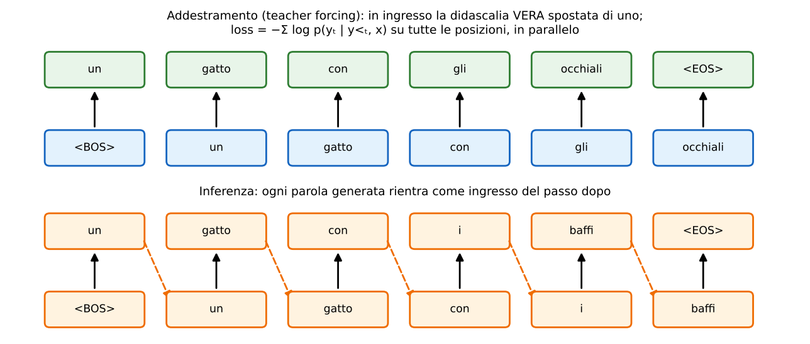

> **Il punto**
> 
> Captioning = encoder visivo + decoder di testo autoregressivo, **cross-entropy sul token successivo**. In addestramento teacher forcing (parallelo), in inferenza un token alla volta.

### 14\. Come il decoder guarda l'immagine: la cross-attention

**Il problema.** Il decoder di testo deve sapere cosa c'è nell'immagine mentre sceglie la parola successiva, e parole diverse hanno bisogno di regioni diverse («gatto» guarda il muso, «occhiali» guarda gli occhi).

**L'idea** (slide 38, eq. del § 51.4.2). La self-attention della [L18](https://gabriele-marsili.github.io/appunti-magistrale-ai/anno-2/computer-vision/sito/#L18) prende Q, K, V dalla stessa sequenza. Nella **cross-attention** **le query vengono dal testo, chiavi e valori dall'immagine**:

`Q = H WQ,   K = Zv WK,   V = Zv WV,   C = softmax(Q K⊤ / √dk) V`

H ∈ ℝT×Dt sono gli stati del decoder (T posizioni di testo), Zv ∈ ℝN×Dv i token dell'immagine, dk la dimensione delle chiavi. QK⊤ è T × N: **ogni posizione del testo distribuisce la sua attenzione sugli N token dell'immagine** e ne riceve una media pesata dei valori. Self-attention causale e cross-attention sono **due sottostrati separati** del decoder (il libro combina le due uscite con pesi wcross, wself).

**Esempio svolto: le dimensioni.** Usiamo i numeri del Q-Former di BLIP-2 (sezione 15), dove al posto delle posizioni di testo ci sono 32 query apprese da 768 dimensioni, e un ViT-L/14 a 224 × 224:

  - token immagine: (224/14)² = 16 × 16 = 256 patch + \[CLS\] = **257**, ciascuno da 1024: Zv è 257 × 1024;
  - Q = H WQ: (32 × 768)(768 × 768) = **32 × 768**;
  - K = ZvWK e V = ZvWV: (257 × 1024)(1024 × 768) = **257 × 768**; WK e WV insieme hanno 2 · 1024 · 768 ≈ 1,57 milioni di pesi: sono loro a **tradurre le dimensioni dell'immagine in quelle del testo**;
  - A = softmax(QK⊤/√dk): **32 × 257**, ogni riga somma 1;
  - uscita AV: **32 × 768**. Con 12 teste, ciascuna lavora su dk = 768/12 = 64.

Nota l'effetto: **l'uscita ha tante righe quante le query**, qualunque sia il numero di token immagine. 257 token entrano, 32 vettori escono.

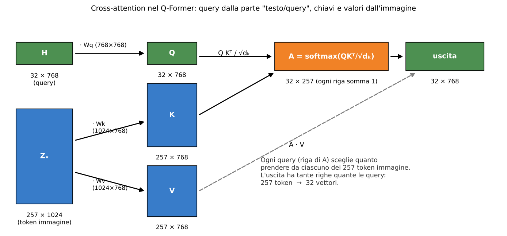

> **Attenzione: due imprecisioni del libro (§ 51.4.2)**
> 
> Nel testo e nella didascalia della fig. 51.11 il libro parla di «text encoder» dove intende il **decoder** di testo che genera la didascalia. Nella formula dell'attenzione compare √m, ma m non è mai definito: è la dimensione delle chiavi, il dk della slide 38.

> **Il punto**
> 
> Cross-attention: **query dal testo, chiavi e valori dall'immagine**. La matrice di attenzione è (posizioni di testo) × (token immagine) e l'uscita ha la lunghezza delle query.

### 15\. BLIP-2: un Q-Former fra due modelli congelati

**Il problema.** Esistono ottimi encoder di immagini (CLIP, EVA-CLIP) e ottimi modelli di linguaggio (LLM) già addestrati. Riaddestrarli insieme costa moltissimo e rischia di rovinarli. Come collegarli spendendo poco?

**L'idea** (slide 39). **BLIP-2** (Li et al. 2023) **tiene congelati sia l'encoder visivo sia l'LLM** (OPT o FlanT5) e addestra solo un piccolo ponte, il **Q-Former** (*Querying Transformer*, 188 milioni di parametri). Il Q-Former contiene **32 query apprese da 768 dimensioni** che, con la cross-attention della sezione 14, interrogano le feature congelate dell'immagine e ne estraggono 32 vettori: un riassunto di lunghezza fissa, scelto in modo da servire al testo. I suoi strati sono inizializzati da BERT-base.

**Due fasi.**

1.  **Rappresentazione** (encoder visivo congelato, niente LLM): il Q-Former impara con tre loss insieme, LITC + LITM + LITG.
2.  **Generazione** (encoder e LLM congelati): le 32 uscite passano per uno strato fully connected che le porta alla dimensione degli embedding dell'LLM, e vengono messe davanti al testo come **«prompt visivi morbidi»**. Si addestrano solo Q-Former e proiezione, con la loss di generazione.

**Dentro il Q-Former** (slide 40). Due sottomoduli condividono la self-attention: uno elabora le query (con cross-attention all'immagine, un blocco sì e uno no), l'altro il testo. Le tre loss usano **maschere di attenzione** diverse, cioè regole su chi può guardare chi:

  - **ITC** (image-text contrastive): **query e testo non si vedono** (maschera unimodale); si confrontano le 32 uscite delle query con il \[CLS\] del testo, si prende la similarità massima fra le 32 e si applica una loss contrastiva come in CLIP;
  - **ITM** (image-text matching): **tutti vedono tutti** (bidirezionale); un classificatore binario decide se immagine e testo vanno insieme, allenato anche su negativi difficili (coppie che la ITC confonde);
  - **ITG** (image-grounded text generation): **il testo vede le query e i token di testo precedenti; le query non vedono il testo** (maschera causale multimodale); il testo va generato, quindi tutta l'informazione dell'immagine deve passare attraverso le query.

**Perché funziona.** La fase 1 insegna alle query a estrarre **l'informazione visiva più rilevante per il testo**, così l'LLM congelato riceve pochi vettori già «linguistici». Nell'articolo BLIP-2 batte Flamingo-80B nel VQA zero-shot (VQAv2) di 8,7 punti con 54 volte meno parametri addestrabili.

> **Il punto**
> 
> BLIP-2 = encoder visivo congelato + **Q-Former (32 query × 768, ITC + ITM + ITG con tre maschere)** + LLM congelato. Si addestra solo il ponte.

### 16\. Il testo come rappresentazione e il VQA

**Il testo come rappresentazione** (slide 42, § 51.5). Un modello immagine → testo è un altro modo di *rappresentare* un'immagine, accanto a pixel, spettro di Fourier, mappa di profondità e feature DINO (fig. 51.12: un gatto grigio con gli occhi verdi visto in cinque modi, l'ultimo è la frase «a grey cat with green eyes standing on a chair»). Il testo ha due pregi: è compatto e **si collega direttamente ai modelli di linguaggio, che possono ragionare sul contenuto e usare conoscenza del mondo**. E un difetto: **non conserva tutta l'informazione visiva** (la posizione esatta, la sfumatura di colore).

**Il VQA** (slide 43–44). **Visual Question Answering**: **data un'immagine x e una domanda q, predire la risposta a**. A differenza del captioning, **l'informazione da estrarre dipende dalla domanda**. Il dataset VQA (Antol et al. 2015) ha domande scritte da persone che richiedono riconoscimento («di che colore sono i suoi occhi?»), relazioni spaziali («cosa c'è sotto l'albero?») e buon senso («questa persona aspetta ospiti?», «è una pizza vegetariana?»).

**Due formulazioni** (slide 45).

  - **Classificazione della risposta**: pθ(a | x, q) con a ∈ {a1, …, aK}, le K risposte più frequenti nel training set. Semplice, ma **una risposta fuori dal vocabolario non si può predire**.
  - **VQA generativo**: la risposta si genera token per token, come una didascalia condizionata anche alla domanda:

`pθ(a | x, q) = ∏t pθ(at | a<t, x, q),   LVQA = −∑t log pθ(at | a<t, x, q)`

È la loss del captioning (sezione 13) con q in più fra le condizioni: **il VQA estende il captioning condizionando la generazione su una domanda** (slide 47).

**BLIP-2 per il VQA** (slide 46). Nel fine-tuning per il VQA si aggiornano encoder visivo e Q-Former, **l'LLM resta congelato**. La domanda entra due volte: nel Q-Former, dove i token della domanda **guidano la cross-attention delle query verso le regioni rilevanti** (per «cosa indossa il gatto?» gli occhiali), e nell'LLM, che riceve query proiettate più domanda e genera la risposta («sunglasses»).

> **Il punto**
> 
> Il testo è una rappresentazione dell'immagine che un LLM sa usare. Il VQA è **captioning condizionato da una domanda**: classificazione su risposte fisse oppure generazione libera.

### 17\. LLaVA: token visivi direttamente nell'LLM

**Il problema.** Vogliamo un assistente con cui chiacchierare di un'immagine: «cosa c'è di strano qui?», «scrivi una ricetta con questi ingredienti». Serve un LLM che *segua istruzioni* e veda l'immagine.

**L'idea** (slide 49). **LLaVA** (Liu et al. 2023) è quasi la soluzione più semplice possibile: prendi i token di un encoder CLIP ViT-L/14, **proiettali con una matrice W nello spazio degli embedding di parola dell'LLM** (Vicuna) e mettili nella sequenza insieme ai token dell'istruzione:

`Zv = fv(x) ∈ ℝN×Dv,   Hv = ZvW ∈ ℝN×DLLM,   LLLaVA = −∑t log pθ(yt | y<t, Hv, Xq)`

Xq è l'istruzione, y la risposta. Niente cross-attention: l'LLM tratta i token visivi come parole speciali, con la sua self-attention causale; la loss è il solito next-token sulla risposta. **LLaVA-1.5** sostituisce W con un MLP a due strati (e usa CLIP a 336 pixel).

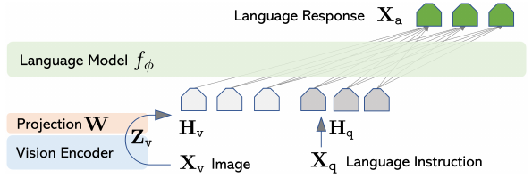

**Esempio svolto: quanti token?** CLIP ViT-L/14 a 224 pixel: (224/14)² = 16 × 16 = **256** token visivi (LLaVA usa la griglia delle patch). Ognuno diventa una «parola» per l'LLM. Con BLIP-2 ne entrano solo **32**. LLaVA-1.5 a 336 pixel: 24 × 24 = 576. Il costo dell'attenzione nell'LLM cresce col quadrato della lunghezza: con 50 token di testo, (256 + 50)² / (32 + 50)² ≈ **13,9** volte BLIP-2; con 576 token ≈ 58. **Più token visivi = più dettaglio ma più calcolo**.

**Due fasi** (slide 50).

1.  **Allineamento delle feature**: 595 mila coppie immagine-didascalia filtrate da CC3M, trasformate in istruzioni del tipo «descrivi brevemente l'immagine» → didascalia. **Si addestra solo W**; CLIP e Vicuna congelati. W impara a tradurre i token visivi nella «lingua» dell'LLM.
2.  **Instruction tuning**: 158 mila esempi (58 mila conversazioni, 23 mila descrizioni dettagliate, 77 mila ragionamenti complessi). **Si addestrano W e Vicuna**; CLIP resta congelato.

> **Precisazione sulla slide 50: chi ha «visto» le immagini**
> 
> La slide dice «158K GPT-4-generated image-grounded instructions». Va precisato che GPT-4 era **solo testuale**: per generare i dati riceveva le didascalie e i bounding box degli oggetti di immagini COCO, **non l'immagine**. Le istruzioni sono «ancorate all'immagine» tramite questa descrizione simbolica.

> **Il punto**
> 
> LLaVA = CLIP congelato + **proiezione per token** + LLM. Fase 1 addestra solo W (allineamento), fase 2 anche l'LLM (istruzioni). Semplice, ma passa all'LLM tutti i 256 token.

### 18\. Qwen-VL e il confronto fra architetture

**Il problema.** Più risoluzione vuol dire più dettagli (testo piccolo, oggetti lontani) ma più token: a 448 pixel un ViT con patch 14 produce (448/14)² = 1024 token. Darli tutti all'LLM costa troppo.

**L'idea** (slide 51). **Qwen-VL** (Bai et al. 2023) usa un ViT-bigG/14 di OpenCLIP e l'LLM Qwen-7B, collegati da un **adattatore**: **256 query apprese che fanno cross-attention sulle feature del ViT**, con un solo strato e codifiche posizionali 2D per non perdere dove si trovava ogni cosa. 1024 token diventano sempre 256. **Diversamente da LLaVA comprime; diversamente da BLIP-2 non usa un Q-Former a molti strati.**

**Tre fasi** (slide 52).

1.  **Preaddestramento**: 1,4 miliardi di coppie immagine-testo ripulite, a 224 × 224; si addestrano ViT e adattatore, LLM congelato.
2.  **Multi-task**: tutto addestrabile, a 448 × 448, su sette compiti fra cui captioning, VQA, grounding, OCR e generazione di testo.
3.  **Instruction tuning**: 350 mila dialoghi, ViT congelato, adattatore e LLM addestrati. Ne esce Qwen-VL-Chat.

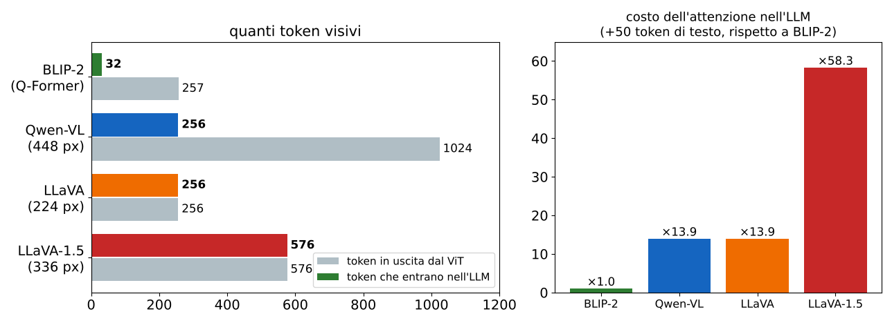

**Il confronto** (slide 53).

  - **CLIP**: un embedding globale per immagine, proiezioni lineari, encoder di testo. Allinea, non genera.
  - **BLIP-2**: token visivi compressi da un Q-Former più proiezione, LLM preaddestrato **congelato**.
  - **LLaVA-1.5**: token CLIP, MLP a due strati, LLM **rifinito**.
  - **Qwen-VL**: feature del ViT, adattatore a cross-attention (256 query), LLM Qwen-7B congelato nella fase 1 e addestrato nelle fasi 2 e 3.

Le due scelte da guardare sono **come si collega l'immagine all'LLM** (proiezione per token oppure query che comprimono) e **cosa si congela in ogni fase**.

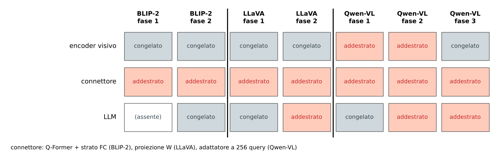

> **Il punto**
> 
> Tutti i VLM generativi sono «encoder visivo + connettore + LLM». Cambiano **il connettore (proiezione o query) e cosa si congela**: compromesso fra dettaglio, costo e rischio di rovinare i modelli preaddestrati.

### 19\. Altri compiti: ragionare su due foto e indicare un oggetto

**Ragionamento visivo: NLVR2** (slide 55, Suhr et al. 2019). Data una coppia di fotografie e una frase s, dire se la frase è vera: «Un'immagine mostra esattamente due ghiande marroni con i cappucci schiena contro schiena su fogliame verde». Nell'esempio della slide la risposta è **falso**: una foto ha un mucchio di ghiande, l'altra una sola. Per rispondere bisogna guardare entrambe le immagini e contare.

`pθ(y | x1, x2, s),   y ∈ {Vero, Falso},   LNLVR2 = −log pθ(y | x1, x2, s)`

È una classificazione binaria con cross-entropy, ma **richiede proprio ciò in cui CLIP è debole**: confrontare due immagini, contare, capire relazioni (sezione 12).

**Grounding: espressioni referenziali** (slide 56). Data un'immagine x e un'espressione r («la giraffa a sinistra»), **predire il bounding box dell'oggetto indicato**. Due strade:

`b̂ = fθ(x, r)   oppure   k̂ = argmaxk sθ(bk, r, x)`

La prima **regredisce direttamente il box** (come le teste di regressione della [L19](https://gabriele-marsili.github.io/appunti-magistrale-ai/anno-2/computer-vision/sito/#L19)); la seconda **sceglie fra regioni candidate** {bk} (per esempio le proposte di un detector) con un punteggio di compatibilità, come i cerchi rossi della sezione 11. I benchmark sono **RefCOCO, RefCOCO+ e RefCOCOg**, immagini COCO annotate con protocolli diversi: in RefCOCO+ sono vietate le parole di posizione («giraffa con la testa abbassata» invece di «a sinistra»), in RefCOCOg le frasi sono più lunghe e descrittive. Di solito una predizione conta come corretta se l'IoU con il box vero supera 0,5. I VLM come Qwen-VL scrivono le coordinate del box *come testo*, normalizzate fra 0 e 1000: anche il grounding diventa generazione.

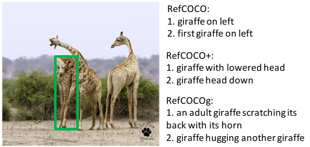

> **Il punto**
> 
> NLVR2 verifica il ragionamento su due immagini con una risposta binaria; il grounding **trasforma una frase in un box**, per regressione o per scelta fra candidati.

### Il riassunto in 10 righe

1.  I VLM usano il testo come supervisione: le didascalie del web sostituiscono le etichette fisse e permettono classi scritte a parole.
2.  Il testo diventa token con il BPE (fusioni della coppia più frequente), poi vettori con una tabella di embedding.
3.  CLIP: due encoder, proiezioni lineari, normalizzazione L2; immagini e frasi sulla stessa sfera, confrontate col coseno.
4.  Loss: matrice N × N, InfoNCE simmetrica (righe e colonne) verso la diagonale, temperatura appresa (0,07, fattore massimo 100); nell'esempio 3 × 3 vale 0,152.
5.  LiT: encoder visivo congelato e solo il testo addestrato: 70,1% contro 50,6% da zero.
6.  Zero-shot: una frase per classe, argmax del coseno; le probabilità dipendono dall'insieme di classi. Prompt e ensemble: +1,3 e +3,5 punti.
7.  CLIP vince su 16 dataset su 27 contro un linear probe su ResNet-50, perde nei domini rari; fatica a contare e con l'ordine delle parole.
8.  Captioning: decoder autoregressivo con teacher forcing e cross-attention (query dal testo, chiavi e valori dall'immagine).
9.  BLIP-2: Q-Former con 32 query fra encoder e LLM congelati, loss ITC + ITM + ITG con maschere diverse; VQA = captioning condizionato da una domanda.
10. LLaVA proietta 256 token CLIP nell'LLM (fase 1 solo W, fase 2 anche l'LLM); Qwen-VL comprime 1024 token in 256 con un adattatore, in tre fasi; NLVR2 e RefCOCO valutano ragionamento e grounding.

### Verifica di aver capito

**1. Perché CLIP normalizza gli embedding e a cosa serve la temperatura?**

Senza normalizzazione la rete potrebbe abbassare la loss allungando i vettori positivi e allontanando i negativi, senza imparare nulla; con ‖z‖ = 1 il prodotto scalare è il coseno e conta solo la direzione. I coseni stanno in \[−1, 1\]: dividendo per τ = 0,07 le differenze diventano abbastanza grandi perché la softmax separi il positivo (nell'esempio 0,92 invece di 0,38). In CLIP τ si apprende come log(1/τ).

**2. Batch di 3 coppie con coseni diagonali 0,30, 0,28, 0,25. Da dove vengono LI→T = 0,158 e LT→I = 0,145? Perché sono diverse?**

Similarità divise per τ = 0,07, softmax per riga (immagine → didascalie) e per colonna (didascalia → immagini), −log della probabilità diagonale, media: righe 0,082, 0,148, 0,245; colonne 0,091, 0,209, 0,136. Cambiano i negativi: una riga confronta un'immagine con testi diversi, una colonna un testo con immagini diverse. Loss finale 0,152.

**3. Come si costruisce un classificatore zero-shot per {cane, gatto, auto}? Cosa cambia aggiungendo «lupo»?**

Si codificano le frasi «a photo of a dog.» ecc. con l'encoder di testo, si codifica l'immagine e si sceglie la frase con coseno massimo. Con coseni 0,31, 0,26, 0,12 e fattore 100 la probabilità di «cane» è 0,993; aggiungendo «lupo» con coseno 0,30 scende a 0,727 (lupo 0,268). L'argmax resta, ma le probabilità dipendono dall'insieme C e non sono calibrate.

**4. Nella cross-attention del Q-Former con 32 query da 768 e un ViT-L/14 a 224 pixel, che forme hanno Q, K, V, la matrice di attenzione e l'uscita?**

Token immagine: 16 × 16 + \[CLS\] = 257, da 1024. Q = 32 × 768; K e V = 257 × 768 (proiettati con matrici 1024 × 768); A = softmax(QK⊤/√dk) = 32 × 257, righe che sommano 1; uscita AV = 32 × 768. L'uscita ha tante righe quante le query.

**5. Che differenza c'è fra teacher forcing e generazione in inferenza? E fra VQA a classificazione e generativo?**

In addestramento il decoder riceve le parole vere precedenti (tutte le posizioni in parallelo); in inferenza le proprie uscite, una alla volta, e gli errori si propagano. Il VQA a classificazione sceglie fra K risposte frequenti; quello generativo scrive la risposta token per token.

**6. Confronta BLIP-2, LLaVA e Qwen-VL: quanti token visivi arrivano all'LLM e cosa si congela?**

BLIP-2: 32 query; encoder e LLM congelati (nel fine-tuning VQA si sbloccano encoder e Q-Former). LLaVA: 256 token proiettati con W (576 in LLaVA-1.5); fase 1 solo W, fase 2 W e LLM. Qwen-VL: 1024 token a 448 pixel compressi in 256; fase 1 ViT e adattatore, fase 2 tutto, fase 3 adattatore e LLM.

### Come proseguire

Leggi nel visionbook il [cap. 51](https://visionbook.mit.edu/VLMs.html) per intero (è breve): § 51.2 token, § 51.3 CLIP con le figure 51.2–51.6, § 51.4 traduzione fra modalità con la cross-attention, § 51.5–51.6 testo come rappresentazione e VQA; ricordati dei refusi segnalati sopra. Poi ripassa la InfoNCE nel [cap. 30](https://visionbook.mit.edu/representation_learning.html) (§ 30.10), l'attenzione causale nel [cap. 26](https://visionbook.mit.edu/transformers.html) (§ 26.10), i modelli autoregressivi nel [cap. 32](https://visionbook.mit.edu/generative_models.html) (§ 32.7) e i moduli congelati e i probe nel [cap. 37](https://visionbook.mit.edu/transfer_learning.html) (§ 37.3). Per il testo → immagine, solo accennato a lezione, il [cap. 34](https://visionbook.mit.edu/conditional_generative_models.html). Lo Szeliski (2a ed.) tratta captioning, VQA e CLIP nel § 6.6 «Vision and language». Le prossime lezioni (slide 59) sono sul **parameter-efficient fine-tuning** (PEFT: adattare modelli enormi addestrando pochi parametri, il passo naturale dopo «congelare quasi tutto») e un **laboratorio su VLM e PEFT**. Ora **ripassa con le schede qui sotto**, slide per slide.
