# L25 · PEFT e LoRA

*Lezione 25 · Donald Shenaj · 12 novembre 2026*

[Versione interattiva sul sito, con videolezione](https://gabriele-marsili.github.io/appunti-magistrale-ai/anno-2/computer-vision/sito/#L25) · [Indice della dispensa](README.md)

**In una frase:** invece di riaddestrare tutti i pesi di un modello enorme per ogni compito nuovo, si **congela il modello e si addestra solo un pezzetto piccolissimo** (i bias, un modulo aggiunto, qualche vettore di prompt); il metodo più usato, **LoRA**, impara un **aggiornamento a basso rango ΔW = BA** delle matrici esistenti, che a fine addestramento si somma ai pesi e non costa nulla in inferenza.

### Prima di iniziare

Slide di Donald Shenaj (12 novembre), 48 pagine; «n / 48» in basso è la pagina del PDF e la 48 è solo la panoramica delle miniature. Ti servono:

  - dalla [L22](https://gabriele-marsili.github.io/appunti-magistrale-ai/anno-2/computer-vision/sito/#L22) e dalla [L23](https://gabriele-marsili.github.io/appunti-magistrale-ai/anno-2/computer-vision/sito/#L23): il **foundation model** preaddestrato, il backbone **congelato**, il **linear probe**;
  - dalla [L17](https://gabriele-marsili.github.io/appunti-magistrale-ai/anno-2/computer-vision/sito/#L17)–[L18](https://gabriele-marsili.github.io/appunti-magistrale-ai/anno-2/computer-vision/sito/#L18): il ViT e la self-attention con le proiezioni WQ, WK, WV, WO;
  - dalla [L24](https://gabriele-marsili.github.io/appunti-magistrale-ai/anno-2/computer-vision/sito/#L24): CLIP e la classificazione zero-shot con prompt di testo;
  - dalla [L16](https://gabriele-marsili.github.io/appunti-magistrale-ai/anno-2/computer-vision/sito/#L16): l'ottimizzatore Adam, che tiene due medie mobili per ogni parametro;
  - un po' di algebra lineare: il **rango** di una matrice (quante colonne linearmente indipendenti ha) e la SVD.

Il libro (visionbook) **non ha un capitolo sul PEFT**: il [cap. 37 «Transfer Learning and Adaptation»](https://visionbook.mit.edu/transfer_learning.html) dà la cornice (fine-tuning, moduli congelati, prompting, distillazione) e cita in una frase l'aggiornamento a basso rango. LoRA e varianti si studiano dagli articoli; i numeri qui sotto sono quelli delle slide, verificati sugli articoli.

### Guarda prima questi video

  - [What is Low-Rank Adaptation (LoRA) | explained by the inventor](https://www.youtube.com/watch?v=DhRoTONcyZE) (Video). Edward Hu, primo autore di LoRA. Perché è nato (adattare GPT-3 a tanti clienti), cos'è, come scegliere il rango. Guardalo prima di tutto.
  - [LoRA: Low-Rank Adaptation of Large Language Models - Explained visually + PyTorch code from scratch](https://www.youtube.com/watch?v=PXWYUTMt-AU) (Video · 27 min). Umar Jamil. Rango e SVD spiegati con un esempio, poi LoRA scritto da zero in PyTorch su MNIST. Utile prima delle sezioni 4–6 e prima del lab.

### 1\. Il problema: adattare un modello gigante costa troppo

**Il problema.** Oggi quasi nessuno addestra da zero: si parte da un modello preaddestrato (un ViT, CLIP, SAM, un LLM) e lo si adatta. La mappa della slide 5 mostra migliaia di varianti nate da pochi modelli base su Hugging Face, e la maggior parte sono adapter e fine-tuning. Ma il **fine-tuning completo** di un modello grande costa tantissimo, soprattutto in memoria.

**Il conto** (slide 6). Con Adam in FP32 per ogni parametro servono 4 byte per il peso, 4 per il gradiente e 8 per i due momenti di Adam:

`4|θ0| + 4|θ0| + 8|θ0| = 16|θ0| byte`

|θ0| è il numero di parametri. Per un modello da 7 miliardi fanno 112 GB, e **le attivazioni non sono ancora contate**: non entra in una GPU da 80 GB. E se hai dieci compiti, devi salvare dieci copie intere del modello.

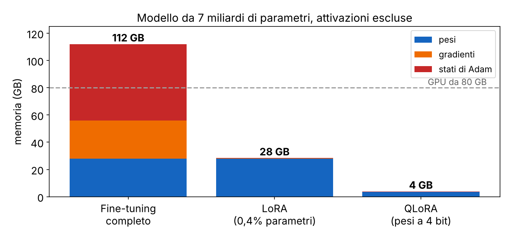

**L'idea del PEFT** (slide 3). Tieni i parametri preaddestrati θ0 **congelati** e addestra un insieme piccolo di parametri nuovi ϕ, con **|ϕ| ≪ |θ0|**. I gradienti e gli stati di Adam servono solo per ϕ, e per ogni compito salvi solo ϕ. È una via di mezzo fra il **linear probe** (solo la testa: economico ma rigido) e il fine-tuning completo (flessibile ma caro).

C'è anche un vantaggio meno ovvio: con pochi dati, aggiornare centinaia di milioni di parametri porta a **overfitting e a dimenticare** ciò che il modello sapeva. Tenere il backbone fermo è una forma di **regolarizzazione**. Il libro (§ 37.3.1) lo dice così: si congela una parte del grafo per non perdere la conoscenza precedente.

> **Il punto**
> 
> Il fine-tuning completo costa 16 byte per parametro più le attivazioni, e un modello intero per compito. Il PEFT congela il modello e addestra pochissimi parametri: si risparmiano gradienti, stati dell'ottimizzatore e checkpoint.

### 2\. Dove si può intervenire: bias, adapter, prompt

**Il problema.** Se il modello è congelato, cosa addestriamo? Ci sono quattro posti possibili in un blocco transformer, e la prima parte della lezione li passa in rassegna.

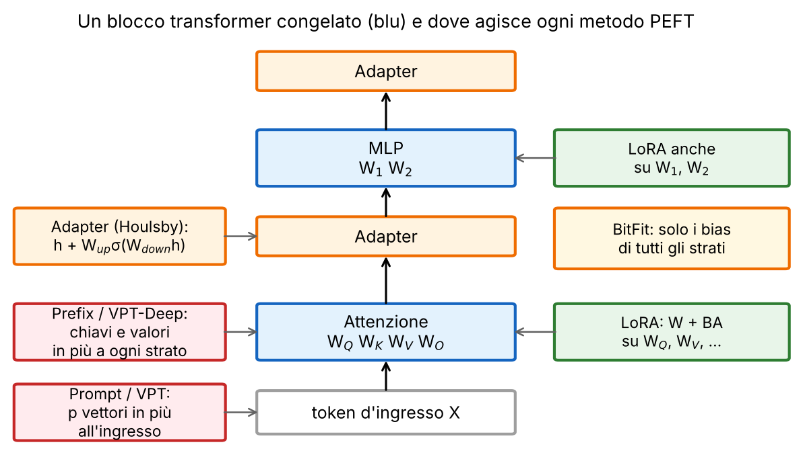

**BitFit: solo i bias** (slide 7). In h = σ(Wx + b) si congela W e si addestra solo b. Nessun modulo nuovo; su BERT si addestra lo 0,08–0,09% dei parametri, e su vari compiti di linguaggio le prestazioni sono vicine al fine-tuning completo. Ma un bias **può solo spostare le feature, non ruotarle né scalarle**: è il metodo più vincolato. Conto per un ViT-B: in ogni blocco i bias sono 11d (Q, K, V, O, i due strati dell'MLP da 4d e d, due LayerNorm), cioè 12 × 11 × 768 ≈ 101 mila su 86 milioni, lo 0,12%.

**Adapter** (slide 8–10). Si inserisce un piccolo modulo **residuo**. In visione Rebuffi et al. usano h′ = h + αd ∗ h con αd una convoluzione 1×1 per dominio. Nei transformer l'adapter di Houlsby è un **collo di bottiglia**:

`h′ = h + Wup σ(Wdown h),  Wdown ∈ ℝr×d, Wup ∈ ℝd×r, r ≪ d`

Wdown comprime da d a r dimensioni, σ è una non linearità, Wup riporta a d. I pesi sono 2dr per adapter, e se ne mettono due per blocco (dopo l'attenzione e dopo l'MLP).

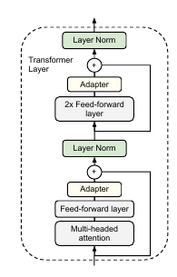

La struttura residua è importante: se Wup parte da zero l'adapter non cambia nulla, quindi **si parte esattamente dal modello preaddestrato** e si impara solo la correzione, come nelle ResNet ([L15](https://gabriele-marsili.github.io/appunti-magistrale-ai/anno-2/computer-vision/sito/#L15)). Il difetto: sono **strati in più da eseguire in sequenza**, quindi aumentano la latenza (sezione 4). Gli adapter servono anche a cambiare tipo di dato: 3DSAM-adapter (slide 10) mette convoluzioni 3D dentro SAM per segmentare volumi medici, mescolando fette vicine; CLIP-Adapter (slide 11–12) mette un MLP dopo l'encoder di CLIP e combina f⋆ = (1 − α)f + αAv(f), dove α piccolo protegge dall'overfitting quando hai 5 immagini per classe.

**Prompt e prefix** (slide 13–15). Invece di toccare il modello, si cambia ciò che il modello *vede*. Il **prompt tuning** antepone p vettori appresi ai token d'ingresso, X′ = \[P; X\]: sono «parole virtuali» che non corrispondono a nessuna parola vera. Il **prefix tuning** aggiunge p chiavi e valori appresi all'attenzione di ogni strato, K′ = \[PK; K\], V′ = \[PV; V\]: ogni token può ora «guardare» anche questi elementi in più. **VPT** porta l'idea ai ViT: VPT-Shallow mette i prompt solo all'ingresso, VPT-Deep ne mette di nuovi a ogni strato.

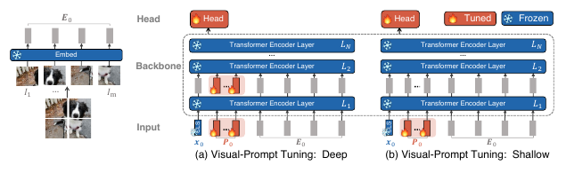

Su VTAB-1k (19 compiti con 1000 immagini ciascuno) **VPT-Deep supera il fine-tuning completo** su Natural e Structured per diversi ViT (slide 15): con pochi dati, meno libertà vuol dire meno overfitting.

> **Il punto**
> 
> BitFit sblocca i bias, gli adapter aggiungono un modulo residuo a collo di bottiglia, prompt e prefix aggiungono vettori all'ingresso o all'attenzione. Tutti partono dal modello originale e addestrano poco, ma gli adapter rallentano l'inferenza e i prompt occupano posti nella sequenza.

### 3\. LoRA: l'idea del basso rango

**Il problema.** Il fine-tuning completo impara W′ = W0 + ΔW con ΔW piena: dout × din numeri per ogni matrice. Ma serve davvero tutta quella libertà per adattare un modello che sa già moltissimo?

**L'idea** (slide 17, 20). L'ipotesi di Hu et al. (2022) è che **l'aggiornamento utile abbia rango intrinseco basso**: si muove lungo poche direzioni. Allora lo si scrive come prodotto di due matrici sottili:

`h = W0x + (α/r) BAx,   B ∈ ℝdout×r,  A ∈ ℝr×din`

Simbolo per simbolo: W0 è la matrice preaddestrata, **congelata**; A **comprime** l'ingresso x da din numeri a r; B li **riespande** a dout; r è il **rango**, piccolo (1–64); α è una costante e α/r scala l'aggiornamento. Si addestrano solo A e B.

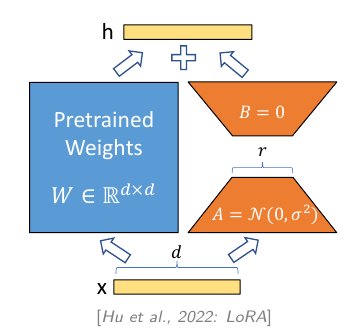

**Cosa vuol dire «rango ≤ r».** Ogni colonna di BA è una combinazione lineare delle r colonne di B, quindi tutte le colonne di ΔW stanno in uno spazio di dimensione r. Attenzione: **non vuol dire che si modificano pochi pesi**. In genere BA ha tutte le entrate diverse da zero: si toccano tutti i pesi, ma in modo «coordinato», lungo poche direzioni.

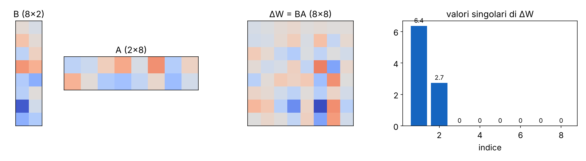

**Quanti parametri** (slide 21). LoRA addestra |A| + |B| = r din + dout r invece di dout din:

`(|A| + |B|) / |W0| = r (1/dout + 1/din)`

**Esempio svolto.** Una proiezione di un ViT-B, 768 × 768 = 589 824 pesi. Con r = 4: 4 × (768 + 768) = 6144 parametri, cioè 4 × 2/768 ≈ 1,04%. Su WQ e WV dei 12 blocchi: 24 × 6144 = 147 456 parametri, circa lo 0,17% dell'encoder visivo di CLIP. Più la matrice è grande, più la frazione scende.

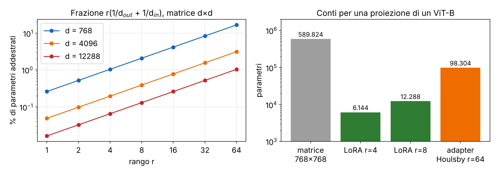

Il libro (§ 24.2.4) usa la stessa idea per i **filtri separabili**: un filtro k × k di rango 1 è un filtro verticale per uno orizzontale, 2k numeri invece di k².

> **Il punto**
> 
> LoRA scrive l'aggiornamento come ΔW = (α/r)BA, di rango al massimo r: tocca tutti i pesi ma lungo poche direzioni, con r(din + dout) parametri invece di dindout.

### 4\. Inizializzazione e gradienti: perché B parte da zero

**Il problema.** All'inizio dell'addestramento il modello adattato dovrebbe essere identico a quello preaddestrato; altrimenti si parte da un modello «rovinato».

**L'idea** (slide 22). Si inizializza **A ∼ 𝒩(0, σ²) e B = 0**. Allora ΔW = (α/r)BA = 0 e il primo passo in avanti è esattamente quello del modello originale. Perché non entrambe zero? Perché allora nulla si muoverebbe mai (lo vediamo fra poco). Perché non entrambe casuali? Perché ΔW sarebbe subito una perturbazione casuale dei pesi.

**La matematica** (slide 23). Scriviamo l'uscita per componenti (i uscita, j rango, k ingresso): hi = (W0x)i + (α/r) ∑j Bij (Ax)j. La regola della catena dà:

`∂ℒ/∂B = (α/r) (∂ℒ/∂h) (Ax)T,   ∂ℒ/∂A = (α/r) BT (∂ℒ/∂h) xT`

Sono la regola dello strato lineare (gradiente = gradiente in uscita per ingresso trasposto) applicata due volte: B vede come ingresso Ax, A riceve il gradiente filtrato da BT. Controlla le dimensioni: dout×1 per 1×r dà dout×r come B; r×dout per dout×1 per 1×din dà r×din come A.

Con B = 0 la seconda formula dà **∂ℒ/∂A = 0: al primo passo si muove solo B**. ∂ℒ/∂B invece non è nullo, perché A è casuale e quindi Ax ≠ 0. Dal secondo passo B ≠ 0 e anche A comincia a ricevere gradiente. Se anche A fosse zero, Ax = 0 e il gradiente di B sarebbe nullo: **tutto resterebbe fermo per sempre**.

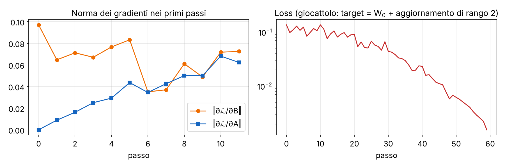

> **Il punto**
> 
> A gaussiana e B = 0 garantiscono di partire dal modello preaddestrato senza bloccare l'apprendimento: al primo passo si aggiorna solo B, poi anche A.

### 5\. Dove mettere LoRA e con che rango

**Il problema.** Un transformer ha tante matrici: quali adattare? E quanto deve essere grande r?

**Dove** (slide 24, 37). Nell'attenzione Q = XWQT, K = XWKT, V = XWVT e la proiezione d'uscita WO: si può mettere una coppia A, B su ciascuna, e anche sulle matrici dell'MLP. Adattare WQ e WK cambia *chi guarda chi* (le mappe di attenzione); adattare WV e WO cambia *cosa viene trasportato*. In un ViT è identico: il lab mette LoRA su `q_proj` e `v_proj` dell'encoder di CLIP.

**Cosa dicono gli esperimenti** (slide 25–26, GPT-3 175B). Con un budget fisso di parametri, **adattare più matrici con rango basso batte una matrice sola con rango alto**: WQ e WV con r = 4 o tutte e quattro con r = 2 vanno meglio di WQ da sola con r = 8. E il rango conta poco:

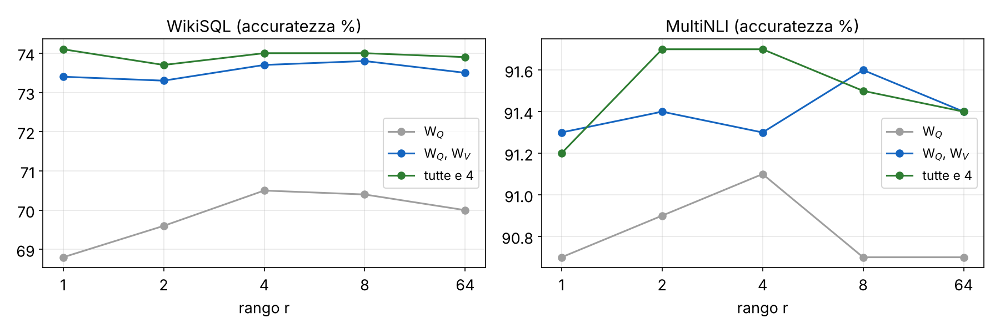

Una curiosità della tabella della slide 25: **la riga WV riporta 91,5 su MultiNLI, ma nell'articolo è 91,0** (vedi il riquadro Attenzione della scheda 25).

> **Il punto**
> 
> Meglio distribuire il budget su più matrici (Q e V, o tutte e quattro) con rango basso; già r = 1–8 basta. Questo conferma l'ipotesi del rango intrinseco basso.

### 6\. Merge, latenza e memoria: i vantaggi pratici

**Il merge** (slide 27). Finito il training si calcola **Wmerged = W0 + (α/r)BA** e si usa h = Wmergedx. Il modello ha esattamente la forma e la velocità dell'originale: **zero operazioni in più in inferenza**. Oppure si tengono gli adapter separati: lo stesso backbone, tanti piccoli A, B, uno per compito, da sommare o togliere al volo.

**Perché un adapter di Houlsby non si fonde.** h + Wupσ(Wdownh) non è della forma Mh per nessuna matrice M, a causa della non linearità σ. LoRA invece è lineare: W0x + (α/r)BAx = (W0 + (α/r)BA)x per ogni x.

**Quanto pesa la latenza** (slide 18). Su GPT-2 medium, con batch 1 l'adapter di Houlsby è più lento del 30% (25,8 contro 19,8 ms), con batch 32 solo del 3%: **con poco lavoro parallelo gli strati in sequenza pesano di più**. Nell'articolo le colonne hanno anche sequenze di lunghezza diversa (512, 256, 128), cosa che la slide non dice.

**La memoria** (slide 28). Con LoRA restano i pesi preaddestrati (4 byte per parametro), mentre gradienti e stati di Adam si tengono solo per A e B. Ma **le attivazioni servono comunque**: per calcolare il gradiente di A e B nei primi strati bisogna propagarlo attraverso tutti gli strati congelati sopra. Il checkpoint per compito scende da centinaia di GB a pochi MB.

**Il risultato** (slide 29). Su GPT-3 175B, LoRA con 4,7 milioni di parametri addestrati (lo 0,003%) è al livello del fine-tuning completo: 73,4 contro 73,8 su WikiSQL, 91,7 contro 89,5 su MNLI, meglio su SAMSum.

> **Il punto**
> 
> LoRA si fonde nei pesi perché è lineare: niente latenza in più, checkpoint piccolissimi, un backbone per tanti compiti. Risparmia gradienti e stati dell'ottimizzatore, non le attivazioni.

### 7\. Le varianti: QLoRA, DoRA, AdaLoRA, VeRA

Ognuna cambia un pezzo di LoRA. Conviene ricordarle per «cosa cambiano».

**QLoRA: comprimere anche i pesi congelati** (slide 30–31). LoRA lascia i 4 byte per parametro dei pesi congelati. QLoRA li salva in **4 bit**:

`h = dequant(WNF4) x + (α/r) BAx`

A ogni moltiplicazione i pesi vengono riportati a 16 bit (dequantizzati) e il ramo LoRA si addestra normalmente. Tre trucchi: **NF4**, un formato a 16 livelli pensato per pesi distribuiti come una gaussiana; la **double quantization**, che quantizza anche le costanti di scala di ogni blocco; i **paged optimizers**, che spostano gli stati di Adam in memoria CPU nei picchi. Il risultato famoso: fine-tuning di un modello da 65 miliardi su una sola GPU da 48 GB.

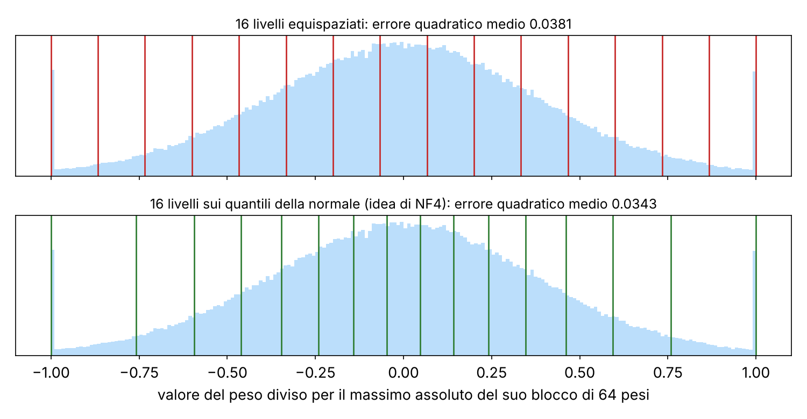

**DoRA: separare lunghezza e direzione** (slide 32–33). Ogni colonna di una matrice ha una lunghezza e una direzione. DoRA scrive

`W′ = V diag(m / ‖V‖col),   V = W0 + (α/r) BA`

V dà le direzioni delle colonne (con un aggiornamento LoRA), m ∈ ℝdin le lunghezze, apprese direttamente; dividere per ‖V‖col rende ogni colonna lunga 1 prima di moltiplicarla per mj. All'inizio B = 0 e m = ‖W0‖col, quindi W′ = W0. Gli autori osservano che **LoRA tende a cambiare lunghezza e direzione insieme**, mentre il fine-tuning completo le cambia in modo più indipendente; separarle avvicina DoRA al fine-tuning completo.

**AdaLoRA: rango diverso per ogni matrice** (slide 34). Scrive ΔW = PΛQ con Λ = diag(λ1, …, λr), come una SVD; durante il training stima l'importanza di ogni componente e **pota quelle inutili azzerando i loro λ**. Il rango finale cambia da strato a strato: nella mappa della slide 34 le matrici dell'MLP Wf1 e gli strati alti ottengono rango alto, Wq e i primi strati rango basso.

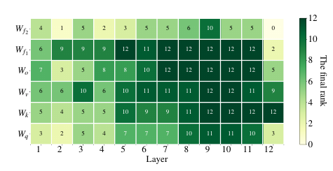

**VeRA: matrici casuali condivise** (slide 35). A e B sono **casuali, congelate e condivise da tutti gli strati**; si imparano solo due vettori di scala per strato: ΔW = diag(b) B diag(d) A, con b ∈ ℝdout e d ∈ ℝr. Per una matrice d × d LoRA addestra 2rd numeri, VeRA d + r. Per questo VeRA può usare un rango molto più alto: le direzioni non si imparano, si scelgono pesando tante direzioni casuali.

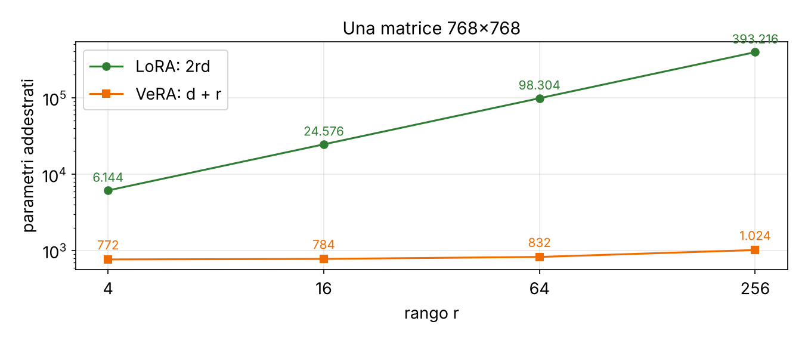

> **Il punto**
> 
> QLoRA comprime il backbone a 4 bit, DoRA separa moduli e direzioni, AdaLoRA distribuisce il rango fra gli strati, VeRA condivide matrici casuali e impara solo scale. Tutte partono da ΔW = 0.

### 8\. LoRA in computer vision

**ViT** (slide 37–38). Un ViT è un transformer su token di patch, quindi LoRA si applica identico: Wi′ = Wi + (α/r)BiAi su Q, K, V, O, backbone congelato. Su VTAB-1k con ViT-B/16, LoRA supera VPT e gli adapter in tutti e tre i gruppi (per esempio 60,5 contro 55,0 di VPT su Structured); NOAH, che combina adapter, LoRA e VPT con una ricerca automatica, fa ancora un po' meglio.

**Segmentazione medica: SAMed** (slide 39). SAM è addestrato su foto naturali; per usarlo su TAC e risonanze si mette LoRA su query e value del suo encoder e si addestrano anche il piccolo prompt encoder e il mask decoder. L'encoder resta congelato.

**Conv-LoRA** (slide 40). LoRA lavora token per token, quindi **non sa nulla dei vicini spaziali**, che invece servono per segmentare bordi e dettagli. Conv-LoRA mette convoluzioni nel mezzo: h = W0x + (α/r)B·MoEConv(Ax). Nello spazio piccolo di dimensione r i token vengono rimessi a griglia e passano per una «mixture of experts»: un selettore sceglie fra esperti che lavorano a scale diverse (ridimensionano la mappa, applicano una conv 3×3, tornano alla risoluzione originale). Il costo resta piccolo perché le convoluzioni lavorano su r canali.

**SemLA: una biblioteca di LoRA** (slide 41–42). Il compito è segmentare scene stradali con pioggia, nebbia o di notte (*domain shift*). Si addestra un LoRA per ogni dominio di training e si salva con il **centroide** degli embedding CLIP delle sue immagini. Al test:

1.  embedding CLIP dell'immagine;
2.  i k domini con il centroide più vicino;
3.  la fusione **ΔW(x) = ∑i wi(x) BiAi**, con wi(x) dalle similarità.

L'aggiornamento è **su misura per l'immagine**, e **non serve nessun gradiente al test**: sono solo somme pesate di matrici già addestrate.

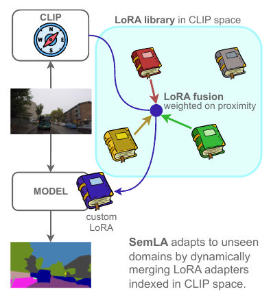

**VoRA** (slide 43–44). Nei VLM della [L24](https://gabriele-marsili.github.io/appunti-magistrale-ai/anno-2/computer-vision/sito/#L24) (LLaVA) l'immagine passa per un ViT e un connettore prima dell'LLM. VoRA **toglie il ViT**: le patch entrano direttamente nell'LLM, a cui si aggiungono LoRA dedicati alla visione. Per insegnargli a vedere si allineano le sue rappresentazioni intermedie a quelle di un ViT insegnante con una loss 1 − coseno, token per token e blocco per blocco, insieme al solito obiettivo di predire il testo. Il libro (§ 37.4) chiama questo imparare dalle *attivazioni* dell'insegnante, non solo dalle sue uscite.

> **Il punto**
> 
> In visione LoRA si usa su ViT e SAM esattamente come negli LLM; le varianti aggiungono ciò che manca (convoluzioni per lo spazio in Conv-LoRA, recupero e fusione per i domini in SemLA, distillazione da un ViT in VoRA).

### 9\. Il quadro d'insieme

La slide 45 riassume. Per classificare un metodo PEFT bastano tre domande:

  - **Dove interviene?** Sui pesi esistenti (BitFit, LoRA e varianti), sulle feature con un modulo (adapter), sull'ingresso o sul contesto (prompt, prefix, VPT).
  - **Si fonde nel modello?** Sì per BitFit e la famiglia LoRA; no per gli adapter (non linearità) e per prompt e prefix (allungano la sequenza).
  - **Cosa risparmia?** Tutti risparmiano gradienti, stati dell'ottimizzatore e checkpoint; solo QLoRA riduce anche i pesi congelati; nessuno elimina le attivazioni.

### Il riassunto in 10 righe

1.  Il fine-tuning completo con Adam costa 16 byte per parametro più le attivazioni, e un modello intero per compito.
2.  Il PEFT congela i pesi preaddestrati e addestra |ϕ| ≪ |θ0| parametri; con pochi dati regolarizza.
3.  BitFit addestra solo i bias; gli adapter aggiungono h + Wupσ(Wdownh), 2dr pesi, ma rallentano l'inferenza.
4.  Prompt tuning e VPT aggiungono vettori all'ingresso, prefix tuning chiavi e valori in ogni strato.
5.  LoRA: h = W0x + (α/r)BAx, rango ≤ r, r(din + dout) parametri; tocca tutti i pesi ma lungo poche direzioni.
6.  A gaussiana e B = 0: si parte dal modello preaddestrato e al primo passo si muove solo B.
7.  Meglio più matrici con rango basso che una con rango alto; r = 1–8 basta.
8.  LoRA si fonde in W0 perché è lineare: zero latenza in più, checkpoint di pochi MB.
9.  QLoRA: backbone in NF4; DoRA: moduli e direzioni separati; AdaLoRA: rango variabile; VeRA: matrici casuali condivise e solo scale.
10. In visione: LoRA su ViT e SAM, Conv-LoRA per il contesto spaziale, SemLA per fondere LoRA di dominio senza gradienti, VoRA per mettere la visione dentro un LLM.

### Verifica di aver capito

**1. Un ViT-B ha 86 milioni di parametri. Quanta memoria servono pesi, gradienti e Adam in FP32? E con LoRA allo 0,2%?**

16 × 86·106 ≈ 1,38 GB. Con LoRA: 4 × 86·106 ≈ 344 MB di pesi, più 16 byte × 0,172·106 ≈ 2,8 MB per i parametri LoRA: circa 347 MB. Le attivazioni restano.

**2. Quanti parametri addestra LoRA con r = 8 su WQ, WK, WV, WO di un ViT-B (d = 768, 12 blocchi)?**

Per matrice 8 × (768 + 768) = 12 288; quattro matrici per blocco, 12 blocchi: 48 × 12 288 = 589 824, cioè quanto una sola matrice 768 × 768 piena.

**3. Perché con B = 0 il gradiente di A è nullo, e perché non si inizializzano entrambe a zero?**

∂ℒ/∂A = (α/r)BT(∂ℒ/∂h)xT contiene B, quindi è zero. Se anche A fosse zero, Ax = 0 e quindi anche ∂ℒ/∂B = (α/r)(∂ℒ/∂h)(Ax)T = 0: nessun parametro si muoverebbe mai.

**4. Un collega dice: «LoRA con r = 4 modifica solo una piccola parte dei pesi». Ha ragione?**

No. BA ha in genere tutte le entrate diverse da zero. Ciò che è limitato è il rango: le colonne dell'aggiornamento stanno in uno spazio di dimensione 4. Sono pochi i parametri liberi, non i pesi toccati.

**5. Perché LoRA non aggiunge latenza e un adapter di Houlsby sì?**

LoRA è lineare: W0x + (α/r)BAx = (W0 + (α/r)BA)x, quindi si fonde in una matrice sola. L'adapter contiene una non linearità σ, quindi non si può scrivere come Mh e resta uno strato in più da eseguire in sequenza.

**6. In SemLA, cosa succede a un'immagine con nebbia e un po' di buio, e servono gradienti?**

Il suo embedding CLIP è vicino ai centroidi «nebbia» e «notte»: si recuperano quei due LoRA e si sommano pesati con wi(x) dalle similarità. È solo una combinazione di matrici già addestrate: nessun gradiente, nessuna ottimizzazione al test.

### Come proseguire

Leggi il [cap. 37](https://visionbook.mit.edu/transfer_learning.html) del visionbook (§ 37.1–37.5) per la cornice, poi l'articolo di LoRA (arXiv 2106.09685, sezioni 4 e 7: le tabelle delle slide sono lì). Il [lab L26](https://gabriele-marsili.github.io/appunti-magistrale-ai/anno-2/computer-vision/sito/#L26) mette tutto in pratica su CLIP: zero-shot, linear probe, BitFit, LoRA, DoRA, AdaLoRA, VeRA con la libreria `peft`, e una piccola SemLA. Ora ripassa con le schede qui sotto, slide per slide; la guida allo studio in fondo ha le domande tipo orale.
