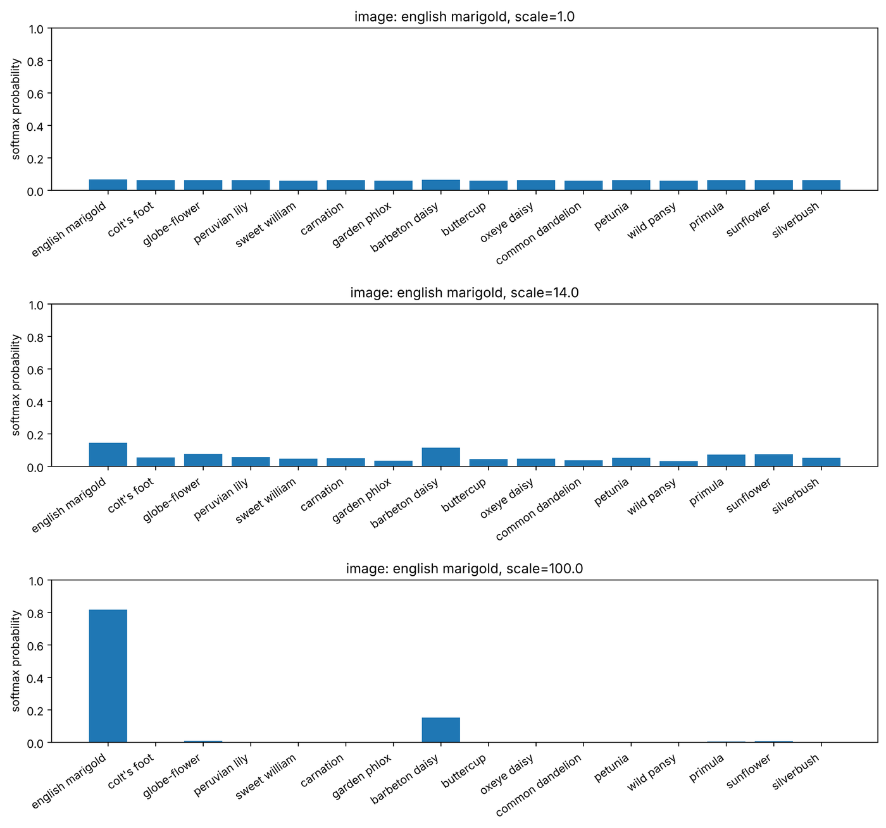
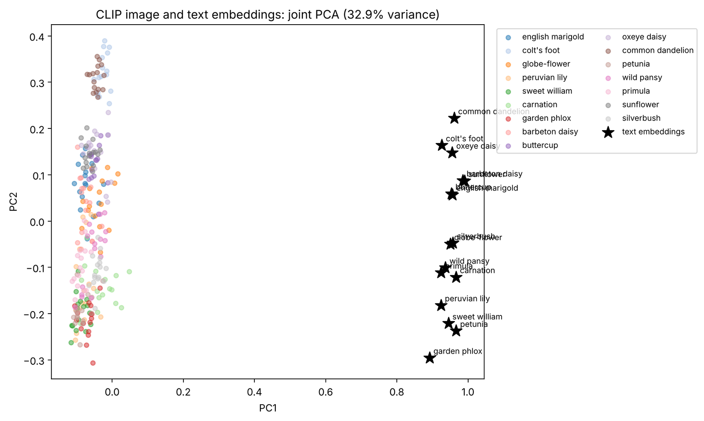
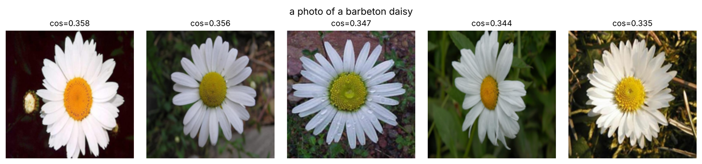
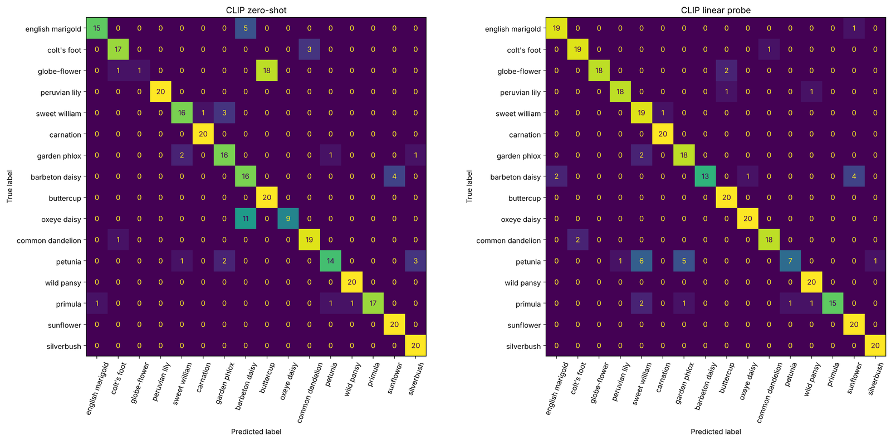
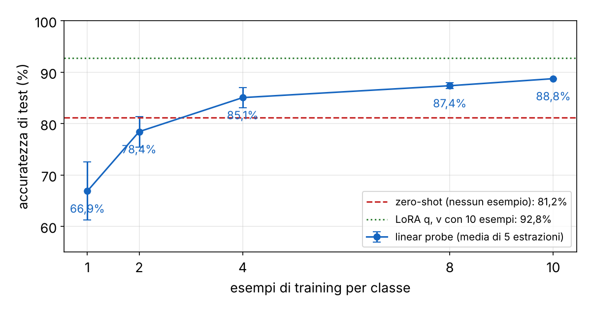
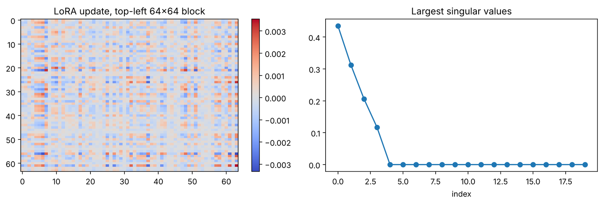
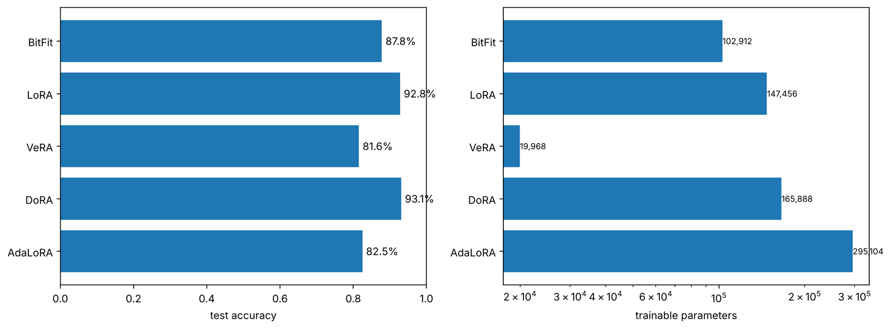
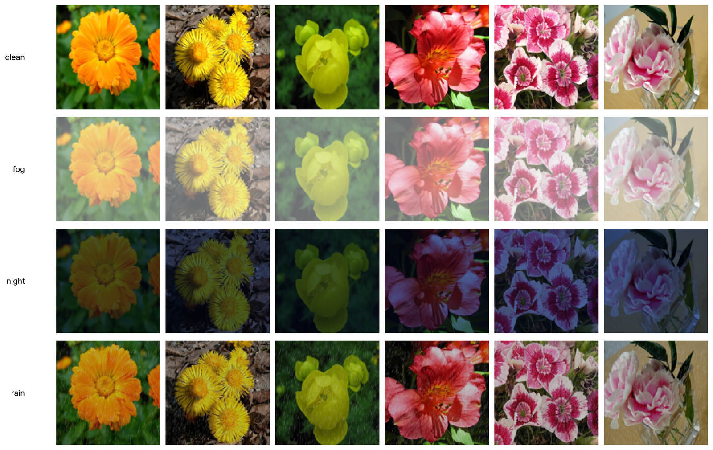
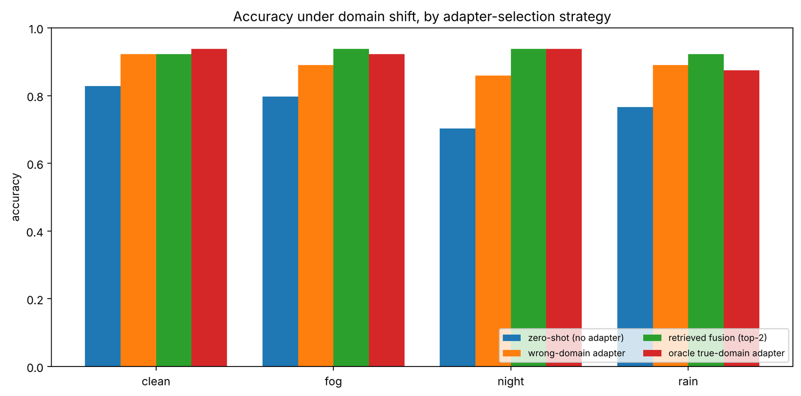
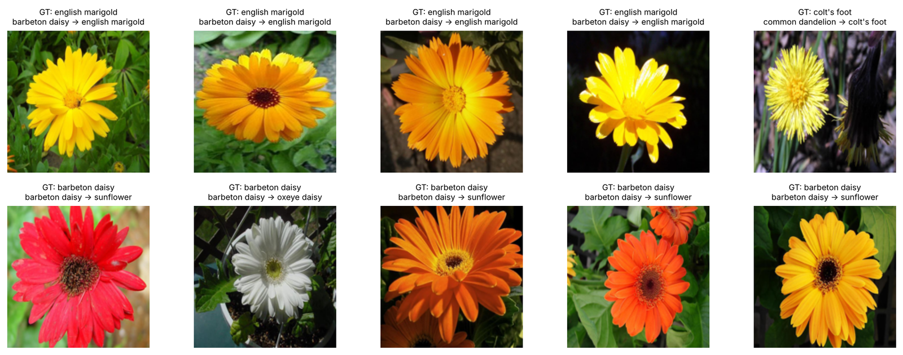

# L26 · Lab VLM e PEFT

*Lezione 26 · laboratorio · novembre 2026*

[Versione interattiva sul sito, con videolezione](https://gabriele-marsili.github.io/appunti-magistrale-ai/anno-2/computer-vision/sito/#L26) · [Indice della dispensa](README.md)

**In una frase:** il lab prende **CLIP** e un problema concreto, riconoscere **16 specie di fiori con 10 foto etichettate per specie**, e confronta tutti i modi visti nelle ultime due lezioni: lo **zero-shot** con i soli nomi (81%), il **linear probe** sulle feature congelate (89%), e il fine-tuning efficiente dell'encoder con **BitFit, LoRA e varianti** (fino al 94% con lo 0,25% dei parametri), più una piccola **SemLA** che fonde LoRA di dominio per foto con nebbia, pioggia o di notte.

### Prima di iniziare

Il materiale è un solo notebook, `lab_vlm_peft.ipynb`, senza slide. Le figure di questa dispensa e delle schede vengono dalla **nostra esecuzione completa su CPU** (con la LoRA forzata anche senza GPU). Ti servono:

  - dalla [L24](https://gabriele-marsili.github.io/appunti-magistrale-ai/anno-2/computer-vision/sito/#L24): CLIP, la loss contrastiva simmetrica, la temperatura, lo zero-shot con i prompt, i VLM generativi;
  - dalla [L25](https://gabriele-marsili.github.io/appunti-magistrale-ai/anno-2/computer-vision/sito/#L25): BitFit, LoRA (ΔW = (α/r)BA, B = 0 all'inizio, conteggio dei parametri), DoRA, AdaLoRA, VeRA, QLoRA, SemLA;
  - dalla [L23](https://gabriele-marsili.github.io/appunti-magistrale-ai/anno-2/computer-vision/sito/#L23): il linear probe su un backbone congelato;
  - dalla [L17](https://gabriele-marsili.github.io/appunti-magistrale-ai/anno-2/computer-vision/sito/#L17): il ViT con patch, \[CLS\] e proiezioni Q, K, V, O.

### Guarda prima questi video

  - [OpenAI CLIP: ConnectingText and Images (Paper Explained)](https://www.youtube.com/watch?v=T9XSU0pKX2E) (Video). Yannic Kilcher. Ripasso di CLIP, in particolare lo zero-shot con i prompt e il confronto con il linear probe: sono gli esperimenti delle parti 2–4 del lab.
  - [LoRA: Low-Rank Adaptation of Large Language Models - Explained visually + PyTorch code from scratch](https://www.youtube.com/watch?v=PXWYUTMt-AU) (Video · 27 min). Umar Jamil. LoRA scritto da zero in PyTorch: dopo averlo visto, le poche righe di peft della parte 6 non hanno segreti.

### 1\. Il problema del lab

**Il problema.** Hai un modello enorme preaddestrato su 400 milioni di coppie immagine-testo, e vuoi riconoscere 16 specie di fiori. Hai solo **10 foto etichettate per specie**, e le specie sono scelte apposta difficili: due tipi di margherita (oxeye e barbeton daisy), due fiori gialli tondi (globe-flower e buttercup), due gialli a raggi (colt's foot e tarassaco), due garofani (carnation e sweet william). Che cosa conviene fare?

Il lab prova tutte le strade, dalla più economica alla più costosa:

1.  **Zero-shot**: nessuna etichetta, solo i nomi delle specie scritti in un prompt.
2.  **Linear probe**: l'encoder resta congelato, si addestra un classificatore lineare sulle sue feature.
3.  **PEFT**: si adatta l'encoder visivo stesso, addestrando pochissimi parametri (BitFit, LoRA, DoRA, AdaLoRA, VeRA).

Il dataset è **Oxford Flowers102**: 102 specie, con split ufficiali di 10 immagini di training e 10 di validazione per specie. Il lab usa 160 immagini di training, 160 di validazione e 320 di test (20 per specie). Il modello è **CLIP ViT-B/32**: immagini 224 × 224 divise in patch 32 × 32, cioè 49 token più il \[CLS\], dimensione 768, proiettata in uno spazio comune a 512 dimensioni.

> **Il punto**
> 
> Stesso modello, stesse immagini di test, tre livelli di adattamento: zero (nomi), testa lineare (probe), encoder (PEFT). Il lab misura quanto vale ogni livello.

### 2\. CLIP visto da dentro: similarità, loss e temperatura

**L'idea.** CLIP trasforma un'immagine e una frase in due vettori di lunghezza 1 nello stesso spazio, e misura quanto si somigliano con il coseno:

`Sij = viT tj,  vi = immagine i normalizzata, tj = testo j normalizzato`

Con 16 immagini e 16 prompt S è una matrice 16 × 16; con 4 prompt in più diventa 16 × 20. Nella nostra esecuzione **i coseni giusti sono intorno a 0,3 e quelli sbagliati intorno a 0,2–0,3**: le differenze sono di pochi centesimi (vedremo perché nella sezione 3). Già qui 14 immagini su 16 trovano il proprio prompt; le due che sbagliano sono colt's foot (presa per tarassaco) e globe-flower (presa per buttercup), cioè due coppie «gemelle».

**La loss.** CLIP è addestrato con una cross-entropy **nei due sensi**: per ogni immagine si fa una softmax sulla sua riga (quale testo è il suo), per ogni testo sulla sua colonna (quale immagine è la sua). Sulle 16 coppie del lab: **immagine→testo 0,626, testo→immagine 1,163**. Sono diverse perché righe e colonne contengono numeri diversi: un'immagine può vincere bene la sua riga, mentre nella colonna del suo testo c'è un'altra immagine molto simile che rende la softmax incerta.

**La temperatura.** I coseni vengono moltiplicati per una scala 1/τ prima della softmax. CLIP ha imparato **1/τ = 100**, il massimo consentito.

Dividere tutto per lo stesso τ **non cambia quale coseno è il più grande**, quindi non cambia la predizione. Cambia solo quanto è «sicura» la softmax. Una probabilità alta **non è una misura di affidabilità**: è la stessa piccola differenza fra coseni amplificata da un numero scelto in addestramento.

> **Il punto**
> 
> CLIP decide con coseni che differiscono di pochi centesimi; la temperatura (scala 100) li trasforma in probabilità nette senza cambiare la classifica.

### 3\. Lo spazio comune non è davvero comune: il modality gap

**Il problema.** Se immagini e testi vivono nello stesso spazio, perché il coseno fra una foto e la sua didascalia è solo 0,3?

**Cosa mostra il lab.** Si proiettano in 2 dimensioni con la PCA 256 immagini di test e i 16 testi.

È il **modality gap**: le immagini occupano una «calotta» della sfera e i testi un'altra. La loss contrastiva chiede solo che la coppia giusta sia *più vicina* delle altre, non che le due nuvole coincidano. Per questo i coseni immagine-testo stanno intorno a 0,3, mentre fra due foto simili il coseno arriva a 0,9 (il retrieval immagine → immagine del lab dà 0,91–0,94). Conseguenza pratica: **in un grafico PCA la stella più vicina non è sempre la classe predetta**, perché la direzione più importante della PCA è proprio quella che separa le modalità e non serve a distinguere le specie.

**Retrieval.** Con un testo si possono ordinare tutte le immagini. «a close-up of a common dandelion» trova 5 tarassachi su 5. Ma «a photo of a barbeton daisy» trova **5 margherite bianche comuni**: CLIP associa la parola «daisy» alla margherita, mentre la barbeton daisy è una gerbera colorata.

Il testo libero permette anche query per attributi («a purple flower with a dark center» trova petunie e viole del pensiero) o per stile («a flower drawn by a child» trova margherite dalla forma stilizzata).

> **Il punto**
> 
> Immagini e testi stanno in due regioni diverse della sfera; CLIP funziona perché conta il confronto relativo. Il retrieval rivela cosa CLIP associa a una parola, anche quando è sbagliato.

### 4\. Zero-shot contro linear probe: quante foto vale un nome?

**Zero-shot.** La classe predetta è il prompt più simile: `ŷ(x) = argmaxc v(x)T tc` È un **classificatore lineare i cui pesi sono scritti in inglese**: i 16 vettori tc. Risultato: **81,2%** sulle 320 immagini di test.

**Linear probe.** Stessi embedding, ma un classificatore lineare (regressione logistica) imparato dalle 160 foto di training: **88,7%**.

Gli errori dello zero-shot sono **sistematici, non casuali**: nascono da nomi poco noti a CLIP («globe-flower flower») o ambigui («daisy» in due classi). Il probe non ha bisogno del nome: guarda dove cadono le foto. Peggiora solo su petunia (da 14 a 7 giuste su 20), che confonde con garofani e phlox.

**Quanti esempi vale un nome?** Rifacendo il probe con meno esempi per classe (media di 5 estrazioni):

**I prompt contano.** Cambiando solo il template cambiano i risultati: «a beautiful {} flower.» circa 84%, «a close-up photo of a {} flower.» circa 79%. La media di 4 template (*prompt ensembling*: si mediano gli embedding e si rinormalizza) dà 82,8%, meglio del prompt base ma non del template migliore: **un template cattivo sposta la media nella direzione sbagliata**.

**Tutte le 102 specie.** Lo zero-shot scende a **65,3%**. Le confusioni più frequenti sono coppie con nomi quasi uguali o sinonimi: geranium → pelargonium, marigold → english marigold. Non è confrontabile con l'81%: più candidati, classi diverse, immagini diverse.

**Dove nasce l'informazione.** Facendo un probe sul \[CLS\] dopo ogni blocco del ViT:

![Accuratezza del probe sul \[CLS\] dopo ogni blocco. Quasi tutta l'informazione che separa le specie compare negli ultimi tre blocchi; l'ultimo (circa 91%) batte perfino gli embedding proiettati (linea tratteggiata, 88,7%).](../sito-src/L26/img/n45_profondita.png)

I primi blocchi codificano colori e texture e il \[CLS\] non ha ancora raccolto l'informazione delle patch; i concetti di «specie» emergono alla fine. Che l'ultimo blocco batta la proiezione a 512 dimensioni non sorprende: **la proiezione è addestrata per allinearsi al testo**, non per separare queste 16 specie, e perde qualcosa.

> **Il punto**
> 
> Lo zero-shot (81%) vale circa tre foto per classe; il probe con 10 foto arriva a 89% correggendo gli errori sistematici dovuti ai nomi. L'informazione utile è negli ultimi strati dell'encoder.

### 5\. Un VLM che genera: Qwen2.5-VL

CLIP sceglie fra frasi date; **Qwen2.5-VL-3B** genera testo. Un encoder visivo trasforma l'immagine in token che, insieme all'istruzione, condizionano un modello di linguaggio che produce la risposta un token alla volta: p(a | x, q) = ∏t p(at | a\<t, x, q). Con la stessa macchina si fa captioning («Describe this image in one sentence.») e VQA («How many flowers are visible?»). Il modello è caricato in 4 bit NF4, la stessa quantizzazione di QLoRA. Questa parte richiede una GPU ed è disattivata di default: non l'abbiamo eseguita. Dalla [L24](https://gabriele-marsili.github.io/appunti-magistrale-ai/anno-2/computer-vision/sito/#L24) sai cosa aspettarti: risposte fluide, ma **errori su conteggio e relazioni spaziali e dettagli inventati**.

### 6\. Il PEFT nel codice: lo schema comune

**L'impostazione.** Il classificatore resta quello zero-shot: i 16 embedding di testo sono pesi fissi. Si adatta **solo l'encoder visivo**, partendo ogni volta da una copia fresca di CLIP, con lo stesso budget per tutti: 120 passi da 16 immagini, AdamW, learning rate 2·10−4.

: nel lab BitFit sblocca i bias di tutti i blocchi dell'encoder di CLIP, LoRA e DoRA agiscono su WQ e WV (e nel nostro esercizio anche su WO).](../sito-src/L26/img/d_dove.png)

Un dettaglio che conta: per l'addestramento i logit usano **scala 10, non la scala 100 di CLIP**. La softmax è quindi molto più piatta e la loss iniziale alta (circa 2,15), e i gradienti spingono a cambiare molto gli embedding. Per l'accuratezza non cambia nulla (l'argmax è lo stesso), ma spiega lo spostamento enorme della sezione 9.

### 7\. BitFit e LoRA: i numeri tornano

**BitFit.** Si sbloccano solo i bias: **102 912** parametri (0,118%). Il conto della [L25](https://gabriele-marsili.github.io/appunti-magistrale-ai/anno-2/computer-vision/sito/#L25) torna esatto: 11d = 8448 per blocco, 12 blocchi = 101 376, più le due LayerNorm esterne (2 × 768). Accuratezza **87,8%**: **BitFit arriva al livello del linear probe**.

**LoRA.** Con `LoraConfig(r=4, lora_alpha=8, target_modules=['q_proj','v_proj'])` e `inject_adapter_in_model`, ognuna delle 24 matrici 768 × 768 riceve un A (4 × 768) e un B (768 × 4): **147 456** parametri (0,168%), cioè 24 × 4 × 1536.

  - **Il controllo dell'inizializzazione**: prima del training le predizioni con LoRA sono **identiche a quelle zero-shot** (le prime 8: \[0, 0, 7, 0, 0, 0, 7, 0\] in entrambi i casi). È B = 0: ΔW = 0.
  - **Dopo il training**: **da 81,2% a 92,8%**, quattro punti sopra il probe. La loss scende da 2,15 a 0,70 in 20 epoche e sta ancora scendendo.

**Com'è fatta la ΔW appresa.** Per la prima matrice adattata il notebook calcola ΔW = (α/r)BA e i suoi valori singolari.

È la verifica sperimentale della [L25](https://gabriele-marsili.github.io/appunti-magistrale-ai/anno-2/computer-vision/sito/#L25): **un aggiornamento di rango 4 tocca tutti i 589 824 pesi, ma lungo sole 4 direzioni**. Le strisce si vedono perché ogni riga di ΔW è una combinazione delle stesse 4 righe di A.

**Aggiungere una matrice.** Mettendo LoRA anche su `out_proj` (esercizio della cella 81): 221 184 parametri e **94,4%**, il risultato migliore del lab. Come diceva la tabella di GPT-3, **adattare più proiezioni conviene**.

> **Il punto**
> 
> LoRA su q e v con lo 0,17% dei parametri porta CLIP dall'81% al 93%; parte esattamente dallo zero-shot e impara un aggiornamento pieno ma di rango 4.

### 8\. Le varianti e un confronto da leggere con attenzione

  - **DoRA**: LoRA più un vettore di moduli per matrice (147 456 + 24 × 768 = 165 888). **93,1%**, appena sopra LoRA.
  - **AdaLoRA**: parte con rango 8 (P, Λ, Q: 12 296 per matrice, 295 104 in tutto). **82,5%**.
  - **VeRA** con r = 64: solo due vettori di scala per matrice (64 + 768), 19 968 in tutto. **81,6%**, praticamente lo zero-shot.
  - **QLoRA**: CLIP ricaricato con pesi NF4, LoRA sopra. Richiede bitsandbytes con CUDA: non eseguito.

Attenzione a non concludere che AdaLoRA e VeRA «non funzionano». **Il confronto non è equo**: tutti usano lo stesso learning rate e gli stessi 120 passi. VeRA parte con il vettore b a zero e, per costruzione, ha bisogno di learning rate molto più alti; AdaLoRA parte con Λ = 0 e P, Q piccoli, e il notebook non chiama mai `update_and_allocate`, quindi la potatura dei ranghi che lo caratterizza non avviene. Il risultato corretto da riportare è: *con questo budget non si muovono*. Allo stesso modo, più parametri non vuol dire più accuratezza: AdaLoRA ne ha il doppio di LoRA e va peggio.

> **Il punto**
> 
> DoRA ≈ LoRA \> BitFit ≈ probe; AdaLoRA e VeRA andrebbero tarati a parte. Confrontare metodi con gli stessi iperparametri è comodo ma può essere ingiusto.

### 9\. SemLA in piccolo: un LoRA per ogni condizione

**Il problema.** Un modello adattato a foto normali peggiora con nebbia, pioggia o di notte (*domain shift*). Riaddestrare per ogni condizione al volo non si può.

**Il setup del lab.** Tre domini sintetici costruiti sulle stesse foto: **fog** (sfocatura e velo grigio), **night** (canali scuriti, dominante blu), **rain** (più scuro, strisce chiare), più **clean**.

Si addestra un LoRA per dominio (accuratezze nel proprio dominio: clean 93,1%, fog 91,9%, night 92,5%, rain 89,1%) e si salva con il **centroide** degli embedding CLIP delle immagini di training. Al test, per ogni foto:

1.  embedding CLIP della foto (modello congelato);
2.  coseno con i 4 centroidi e scelta dei 2 più vicini;
3.  pesi wi(x) con una softmax dei coseni, e `ΔW(x) = ∑i wi(x) (α/r) BiAi` sommato ai pesi solo per quella predizione.

Cosa si legge: **la fusione arriva al 92–94% in tutti i domini, al livello dell'oracolo, senza nessun gradiente al test**. Ma c'è un dettaglio istruttivo: anche l'adapter *sbagliato* va molto meglio dello zero-shot (86–92%). Tutti gli adapter hanno imparato le 16 specie, quindi **gran parte del guadagno viene dal compito, non dal dominio**; il recupero del dominio giusto aggiunge qualche punto, soprattutto di notte. Con 64 foto per dominio un'immagine vale 1,6 punti: differenze di una o due immagini (come la fusione sopra l'oracolo su fog e rain) sono rumore.

L'esercizio finale aggiunge un quinto dominio «sepia», che il recupero riconosce (peso 0,60, poi night 0,40). Ma la trasformazione del notebook **produce immagini quasi in bianco e nero, non color seppia** (vedi la scheda 30).

> **Il punto**
> 
> Una libreria di LoRA indicizzata con i centroidi CLIP permette di adattarsi a ogni foto senza ottimizzazione al test. In questo esperimento però il beneficio principale viene dall'adattamento al compito.

### 10\. Quanto cambia lo spazio dopo LoRA

**La misura.** Per ogni foto di test la distanza coseno fra embedding prima e dopo LoRA, Δi = 1 − vibase · viLoRA. Media: **0,65**, cioè in media l'embedding ruota di circa 70 gradi. Le classi si spostano tutte in modo simile (da 0,59 per sunflower a 0,77 per english marigold).

Due lezioni. Primo, **uno spostamento grande non vuol dire una classificazione migliore**: le immagini peggiorate si sono spostate quanto le altre; conta la direzione rispetto ai prototipi di testo. Secondo, 147 mila parametri bastano a rivoluzionare la geometria dello spazio: LoRA non «ritocca» CLIP, lo riorienta sul compito, aiutato anche dalla scala 10 della loss. Il prezzo è che l'encoder adattato è meno «CLIP»: per altri compiti zero-shot andrebbe usato il modello originale (o tolto l'adapter, che è il vantaggio di tenerlo separato).

### I bug del notebook da non copiare

  - **Su CPU la parte PEFT salta** (`RUN_LORA = torch.cuda.is_available()`) e poi la cella 80 va in `KeyError` su `peft_results["BitFit"]`. Basta `RUN_LORA = True`: su CPU ogni addestramento dura pochi minuti.
  - **Scala dei logit**: 10 nell'addestramento PEFT, 100 nello zero-shot. Non è un errore, ma cambia la loss e spiega lo spostamento enorme degli embedding.
  - **Confronto delle varianti**: stesso learning rate per tutti; AdaLoRA senza `update_and_allocate` e senza penalità di ortogonalità; VeRA con un learning rate troppo basso per i suoi vettori di scala.
  - **«exactly undo the patch»**: sommare e sottrarre ΔW in virgola mobile non ripristina i pesi esattamente; meglio salvarne una copia.
  - **«sepia»**: `ColorJitter(saturation=(0.1, 0.1), hue=(0.08, 0.08))` dà immagini quasi grigie; e rieseguire la cella aggiunge «sepia» due volte a `DOMAINS`.
  - **Pioggia**: il generatore casuale è reinizializzato per ogni foto, quindi le strisce sono identiche in tutte le immagini della stessa dimensione.
  - Minori: il commento su `_labels` contraddice il codice; `features_5` contiene 16 immagini; la heatmap della cella 12 usa una scala di colori troppo ampia; due legende coprono i grafici (celle 90 e 96).

### Il riassunto in 10 righe

1.  CLIP confronta immagini e testi con il coseno di vettori normalizzati; la coppia giusta vince di pochi centesimi.
2.  La loss è una cross-entropy nei due sensi; immagine→testo (0,63) e testo→immagine (1,16) differiscono perché righe e colonne sono diverse.
3.  La temperatura (scala 100) rende la softmax appuntita senza cambiare la classifica.
4.  Immagini e testi occupano regioni diverse della sfera (modality gap), visibile nella PCA congiunta.
5.  Zero-shot 81,2% sulle 16 specie, 65,3% sulle 102; gli errori seguono i nomi ambigui o poco noti.
6.  Linear probe 88,7% con 10 foto per classe; lo zero-shot vale circa 3 foto per classe.
7.  L'informazione sulle specie emerge negli ultimi blocchi del ViT.
8.  BitFit (103 mila parametri) 87,8%; LoRA q, v (147 mila) 92,8%; LoRA q, v, o 94,4%; DoRA 93,1%.
9.  LoRA parte esattamente dallo zero-shot (B = 0) e impara una ΔW piena con esattamente 4 valori singolari non nulli.
10. La fusione alla SemLA di LoRA di dominio recuperati con CLIP arriva al livello dell'oracolo senza gradienti al test.

### Verifica di aver capito

**1. Perché lo zero-shot di CLIP è un classificatore lineare, e in cosa differisce dal linear probe?**

La predizione è argmaxc v(x)Ttc: una matrice di pesi con righe tc applicata all'embedding. Nello zero-shot le righe vengono dai prompt di testo; nel probe una matrice W (più un bias) si impara dalle foto etichettate. Stessa forma, origine diversa dei pesi.

**2. Moltiplichi tutti i coseni per 100 invece che per 10: cambia l'accuratezza? Cambia la loss?**

L'accuratezza no, perché l'argmax non cambia. La loss sì: con 100 la softmax è più appuntita, la probabilità della classe giusta (quando è giusta) è più alta e la cross-entropy più bassa; anche i gradienti cambiano.

**3. Conta i parametri di LoRA con r = 8 su q, v, o dell'encoder di CLIP ViT-B/32.**

Per matrice 8 × (768 + 768) = 12 288; 3 matrici per 12 blocchi = 36 matrici: 442 368 parametri, il doppio dei 221 184 con r = 4.

**4. Come fai a sapere, senza addestrare, che LoRA è stato iniettato bene?**

Con B = 0 ΔW è nulla: il modello con LoRA appena iniettato deve dare esattamente le stesse uscite del modello originale. Si confrontano le predizioni (o i logit) su qualche immagine.

**5. Perché nella fusione alla SemLA anche l'adapter del dominio sbagliato migliora tanto lo zero-shot?**

Perché ogni adapter è stato addestrato a riconoscere le stesse 16 specie: ha imparato il compito, oltre al dominio. Il guadagno principale (dal 70–83% a circa il 90%) viene da lì; il dominio giusto aggiunge qualche punto.

**6. LoRA sposta gli embedding in media di 0,65 in distanza coseno. Significa che ha migliorato tutte le immagini?**

No: corregge 49 immagini ma ne peggiora 12, e lo spostamento è simile per tutte. Conta la direzione rispetto ai prototipi delle classi, non la quantità di spostamento.

### Come proseguire

Riapri il notebook e prova le modifiche suggerite: LoRA solo su Q o solo su V, rango 2 e 8, VeRA con learning rate 10−2, un vero filtro seppia. Per la teoria torna alla [L24](https://gabriele-marsili.github.io/appunti-magistrale-ai/anno-2/computer-vision/sito/#L24) (CLIP, VLM) e alla [L25](https://gabriele-marsili.github.io/appunti-magistrale-ai/anno-2/computer-vision/sito/#L25) (PEFT); dal libro il [cap. 51](https://visionbook.mit.edu/VLMs.html) e il [cap. 37](https://visionbook.mit.edu/transfer_learning.html). Poi passa alle schede qui sotto, una per blocco del notebook, con il codice e i numeri della nostra esecuzione; in fondo ci sono le soluzioni delle domande finali.
