# L27 · Modelli di diffusione

*Lezione 27 · Donald Shenaj · 18 novembre 2026*

[Versione interattiva sul sito, con videolezione](https://gabriele-marsili.github.io/appunti-magistrale-ai/anno-2/computer-vision/sito/#L27) · [Indice della dispensa](README.md)

**In una frase:** un modello di diffusione impara a **prevedere il rumore che è stato aggiunto a un'immagine**; per generare, parte da **rumore gaussiano puro e lo toglie un poco alla volta**, eventualmente guidato da un testo, e tutti i modelli moderni (Stable Diffusion, FLUX, Sora) sono variazioni su questo schema per renderlo più veloce e più controllabile.

### Prima di iniziare

Slide di Donald Shenaj (18 novembre), 59 pagine; «n / 59» in basso è la pagina del PDF, e la 59 è solo la panoramica delle miniature. Ti servono:

  - la **gaussiana** 𝒩(μ, σ2) e un fatto solo: la somma di due gaussiane indipendenti a media zero è una gaussiana con **varianza somma** delle varianze (non deviazione standard somma: stesso errore visto nella [L6](https://gabriele-marsili.github.io/appunti-magistrale-ai/anno-2/computer-vision/sito/#L6));
  - dalla [L17](https://gabriele-marsili.github.io/appunti-magistrale-ai/anno-2/computer-vision/sito/#L17): la **U-Net** (encoder, decoder, skip) e il **ViT** con patch e codifica posizionale; dalla [L18](https://gabriele-marsili.github.io/appunti-magistrale-ai/anno-2/computer-vision/sito/#L18) la self-attention con Q, K, V;
  - dalla [L24](https://gabriele-marsili.github.io/appunti-magistrale-ai/anno-2/computer-vision/sito/#L24): **CLIP** e il suo encoder di testo; dalla [L22](https://gabriele-marsili.github.io/appunti-magistrale-ai/anno-2/computer-vision/sito/#L22) la distillazione insegnante-studente;
  - dalla [L25](https://gabriele-marsili.github.io/appunti-magistrale-ai/anno-2/computer-vision/sito/#L25): l'idea di partire da un blocco identità (B = 0 in LoRA), che qui torna nell'adaLN-Zero.

Il libro principale (visionbook) dedica alla diffusione un paragrafo breve, il [§ 32.8](https://visionbook.mit.edu/generative_models.html), utile per l'intuizione. La matematica di DDPM è spiegata molto bene nel **cap. 18 di Prince**, *Understanding Deep Learning* (nella cartella materiale); attenzione che Prince chiama **αt quello che le slide chiamano ᾱt**. Flow matching, DiT, SD3, FLUX e video sono solo negli articoli.

### Guarda prima questi video

  - [How AI Image Generators Work (Stable Diffusion / Dall-E) - Computerphile](https://www.youtube.com/watch?v=1CIpzeNxIhU) (Video · 18 min). Mike Pound. L'idea senza formule: aggiungere rumore, insegnare a una rete a toglierlo, ripetere; e cos'è la guida col testo. Guardalo per primo, tutto.
  - [But how do AI images and videos actually work? | Guest video by Welch Labs](https://www.youtube.com/watch?v=iv-5mZ_9CPY) (Video · 37 min). Stephen Welch sul canale di 3Blue1Brown. CLIP, DDPM, perché si riaggiunge rumore, DDIM, la classifier-free guidance, con animazioni bellissime. Il migliore per le sezioni 2–8.
  - [Stable Diffusion in Code (AI Image Generation) - Computerphile](https://www.youtube.com/watch?v=-lz30by8-sU) (Video · 17 min). Mike Pound fa girare Stable Diffusion in codice: encoder di testo, latente, ciclo di denoising, guida. Guardalo dopo la sezione 11.
  - [MIT 6.S184: Introduction to Flow Matching and Diffusion Models](https://diffusion.csail.mit.edu/) (Corso). Peter Holderrieth e colleghi: dispense, slide e registrazioni. Facoltativo, per chi vuole il flow matching e lo score in modo rigoroso (sezioni 5 e 9).

### 1\. Il problema: generare immagini nuove

**Il problema.** Hai milioni di foto. Vuoi un programma che produca foto *nuove*, che non stanno nel dataset ma sembrano vere, magari descritte da una frase («un gatto arancione su una spiaggia»). In termini statistici: dati campioni di una distribuzione sconosciuta pdata(x), costruire un modello pθ(x) da cui estrarre campioni (slide 9). Il libro aggiunge un requisito: il modello **non deve limitarsi a memorizzare** il training set, deve generalizzare.

**La soluzione di prima: le GAN** (slide 8). Un generatore trasforma rumore in immagini, un discriminatore cerca di smascherarle; si addestrano uno contro l'altro. All'equilibrio la distribuzione generata coincide con quella vera e il discriminatore risponde 0,5 ovunque.

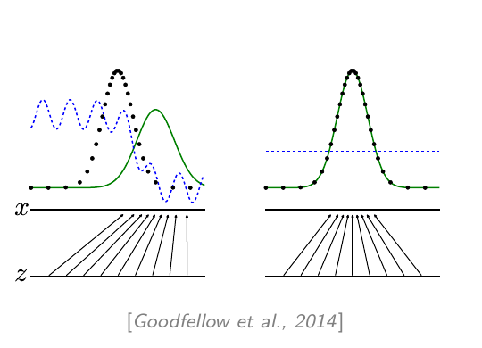

Ma le GAN hanno due difetti noti: un addestramento **instabile** (è un gioco min-max, non una minimizzazione) e il **mode collapse**, cioè il generatore produce sempre le stesse poche immagini.

**L'idea della diffusione.** Distruggere un'immagine è facile: basta aggiungere rumore. Se lo fai a piccoli passi, ogni passo all'indietro (togliere un po' di rumore) è un problema di **regressione semplice**, che una rete impara in modo stabile. Allora si genera così: si parte da rumore puro e si applica il passo all'indietro tante volte. È la frase della slide 2: *creare rumore dai dati è facile; creare dati dal rumore è modellazione generativa.*

> **Il punto**
> 
> La diffusione sostituisce il gioco avversario delle GAN con una regressione stabile, al prezzo di generare in molti passi invece che in uno.

### 2\. Il processo in avanti: distruggere l'immagine col rumore

**Il problema.** Ci serve un modo preciso e senza parametri per trasformare un'immagine in rumore, che ci dica anche, per ogni livello di rumore, com'è fatta l'immagine rumorosa.

**L'idea** (slide 10). A ogni passo t si rimpicciolisce un poco l'immagine e si aggiunge un po' di rumore gaussiano:

`xt = √(1 − βt) · xt−1 + √βt · εt,   εt ∼ 𝒩(0, I)`

x0 è l'immagine pulita (pixel scalati in \[−1, 1\]), xt quella al passo t, βt un numero piccolo (da 0,0001 a 0,02 in DDPM) che dice quanto rumore aggiungere, εt un'immagine di rumore puro, un numero gaussiano indipendente per ogni pixel. Il fattore √(1 − βt) \< 1 serve a non far crescere la varianza: se l'immagine ha varianza 1, dopo il passo ha varianza (1 − βt) + βt = 1. Per questo lo schedule si dice **variance preserving**.

**La scorciatoia.** Non serve simulare t passi uno dopo l'altro. Con αt = 1 − βt e ᾱt = α1α2⋯αt (il prodotto di tutti i fattori fino a t):

`xt = √ᾱt · x0 + √(1 − ᾱt) · ε,   ε ∼ 𝒩(0, I)`

Leggila così: xt è una **miscela di immagine e rumore**, con peso √ᾱt per l'immagine e √(1 − ᾱt) per il rumore. All'inizio ᾱ0 = 1 (solo immagine); alla fine ᾱT ≈ 0 (solo rumore).

**Da dove viene.** Fai due passi. x1 = √α1 x0 + √(1 − α1) ε1, poi x2 = √α2 x1 + √(1 − α2) ε2. Sostituendo: x2 = √(α1α2) x0 + \[√(α2(1 − α1)) ε1 + √(1 − α2) ε2\]. La parentesi è somma di due gaussiane indipendenti: una gaussiana con varianza α2 − α1α2 + 1 − α2 = 1 − α1α2. Quindi x2 = √ᾱ2 x0 + √(1 − ᾱ2) ε, e così via per induzione (Prince, eq. 18.4–18.7).

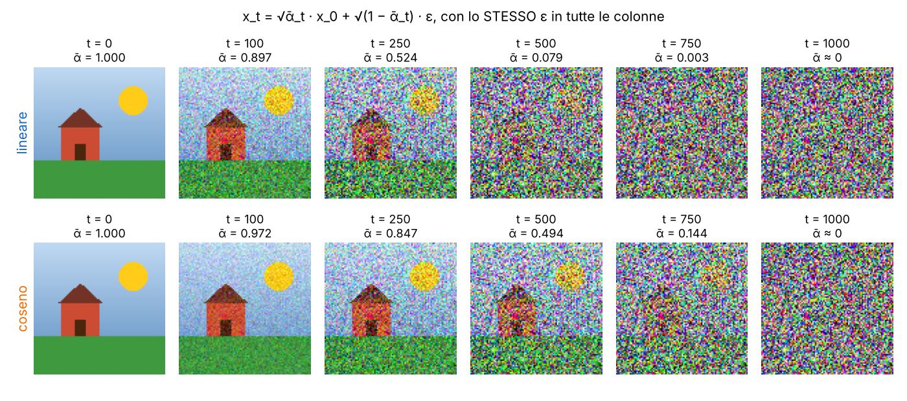

**Esempio con numeri.** Un pixel vale x0 = 0,8 e al passo t lo schedule dà ᾱt = 0,52. Allora √0,52 = 0,721 e √0,48 = 0,693. Se il rumore estratto per quel pixel è ε = −1,2: xt = 0,721 · 0,8 + 0,693 · (−1,2) = 0,577 − 0,831 = −0,254. Il pixel chiaro è diventato scuro: segnale e rumore pesano quasi uguale.

**Cosa succede alla distribuzione.** Non applichiamo il rumore a un'immagine sola ma a tutte. La figura usa dati in una dimensione con tre «tipi» di valori (tre picchi): man mano che t cresce i picchi si avvicinano a zero, si allargano e si fondono, e alla fine resta una sola gaussiana standard. Ogni singolo percorso (le linee colorate) è un cammino casuale che dimentica da dove è partito.

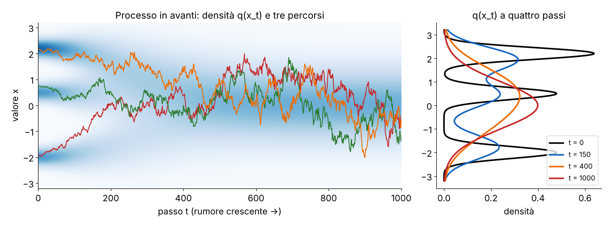

Tre proprietà da ricordare (slide 10): il processo in avanti **non ha parametri da imparare**; se ᾱT ≈ 0 la fine è rumore gaussiano puro, indipendente dall'immagine di partenza; e per il training **non serve calcolare gli stati intermedi**, si salta a xt con una moltiplicazione.

> **Il punto**
> 
> xt = √ᾱt x0 + √(1 − ᾱt) ε: una miscela di immagine e rumore, ottenibile in un colpo per qualunque t perché le varianze di gaussiane indipendenti si sommano.

### 3\. Quanto rumore e quando: lo schedule

**Il problema.** Come scegliere i βt? Se il rumore cresce troppo in fretta, metà dei passi vede solo rumore e non insegna nulla; se cresce troppo piano, alla fine xT non è rumore puro.

**La misura giusta** (slide 11) è il rapporto segnale-rumore:

`SNR(t) = ᾱt / (1 − ᾱt)`

la varianza della parte «immagine» divisa la varianza della parte «rumore». SNR = 1 vuol dire che pesano uguale.

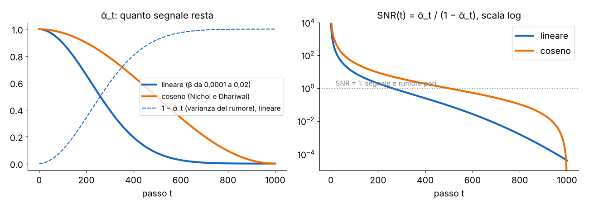

Con lo schedule **lineare** di DDPM ᾱ vale 0,52 a t = 250, 0,08 a t = 500, 0,003 a t = 750: **da metà in poi l'immagine è quasi solo rumore**, quindi gli ultimi passi sono sprecati. Lo schedule a **coseno** (Nichol e Dhariwal, 2021) dà 0,85, 0,49, 0,14 agli stessi passi: **distrugge l'informazione in modo più uniforme**. Sono esattamente i numeri sotto le foto del gatto nella slide 11 (li abbiamo ricalcolati).

Stessa idea, ripresa più avanti: Stable Diffusion 3 nel training **campiona più spesso i livelli di rumore intermedi**, dove prevedere è più difficile e utile (slide 11 e 40).

> **Il punto**
> 
> Lo schedule decide quanta informazione resta a ogni passo, misurata dall'SNR. Quello lineare spreca i passi finali; quello a coseno li distribuisce meglio.

### 4\. Tornare indietro: il denoiser e la loss più semplice del mondo

**Il problema.** Ora vogliamo il film al contrario: da xt ottenere xt−1, un'immagine un po' meno rumorosa. Ma il vero passo all'indietro q(xt−1 | xt) dipende da tutte le immagini possibili: da un'immagine rumorosa non si sa da quale immagine pulita venga.

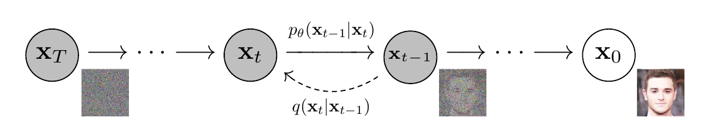

**L'idea** (slide 12–13). Due osservazioni salvano tutto. Prima: se i passi sono piccoli, il vero passo all'indietro è **quasi gaussiano**, quindi basta imparare una gaussiana pθ(xt−1 | xt) = 𝒩(μθ(xt, t), σt2 I), con la media data da una rete. Seconda: durante il training x0 lo conosciamo, e il passo all'indietro *sapendo anche x0*, q(xt−1 | xt, x0), è una gaussiana **nota in forma chiusa**. Si addestra la rete a imitarla.

**La matematica, il minimo.** DDPM nasce massimizzando un limite inferiore (ELBO) della log-verosimiglianza, come nei VAE; il limite si spezza in tanti confronti fra la gaussiana nota e quella della rete, e fra due gaussiane con la stessa varianza il confronto è la distanza quadratica fra le medie. L'ultimo trucco: dalla formula chiusa, x0 = (xt − √(1 − ᾱt) ε)/√ᾱt, quindi conoscere il rumore ε equivale a conoscere x0, e quindi la media. La rete allora **prevede il rumore**, εθ(xt, t), e la media si ricava così:

`μθ(xt, t) = (1/√αt) · (xt − βt/√(1 − ᾱt) · εθ(xt, t))`

Togliendo i pesi che dipendono da t (Ho et al. 2020 hanno visto che funziona meglio), la loss diventa:

`ℒsimple = 𝔼x0, t, ε ‖ε − εθ(xt, t)‖2`

In parole: *prendi un'immagine, sporcala con un rumore che conosci, chiedi alla rete quale rumore hai usato.* È una regressione come quelle della [L16](https://gabriele-marsili.github.io/appunti-magistrale-ai/anno-2/computer-vision/sito/#L16).

**I due algoritmi** (slide 14). Addestramento: un'immagine x0, un passo t a caso fra 1 e T, un rumore ε, xt con la formula chiusa, un passo di gradiente su ‖ε − εθ(xt, t)‖2. Campionamento: xT rumore puro; per t = T, …, 1 prevedi il rumore, calcola μθ, poi xt−1 = μθ + σt z con z rumore fresco (tranne all'ultimo passo). L'asimmetria è il cuore del costo: il training valuta la rete **una volta per immagine**, il campionamento **T volte in sequenza**.

**Esempio con numeri.** Riprendi il pixel della sezione 2: xt = −0,254 con ᾱt = 0,52. Se la rete indovina esattamente il rumore, εθ = −1,2, la stima dell'immagine pulita è x̂0 = (−0,254 − 0,693 · (−1,2))/0,721 = (−0,254 + 0,832)/0,721 = 0,80. Ritrovi lo 0,8 di partenza. Nella realtà la rete non sa qual era il rumore: stima la sua *media* dato xt, e x̂0 è una media di tutte le immagini compatibili, cioè un'immagine sfocata. Per questo si fa un passo piccolo verso di lei, non un salto.

**Perché si riaggiunge rumore.** Sembra controintuitivo. Ma se si seguissero solo le medie si finirebbe su una «media» delle immagini possibili: **immagini sfocate e poco varie**. Il rumore fresco σt z mantiene il campionamento stocastico e lo fa arrivare su campioni nitidi e diversi. La slide sceglie σt2 = βt; Improved DDPM impara anche le varianze.

> **Il punto**
> 
> La rete prevede il rumore; da lì si ricavano la media del passo all'indietro e una stima dell'immagine pulita. Training: un t a caso e una regressione. Generazione: T passi, ognuno toglie un po' di rumore e ne rimette un po'.

### 5\. Il rumore previsto è lo score

**Il problema.** La slide 2 parla di equazioni differenziali stocastiche e di «score». Che c'entra con DDPM?

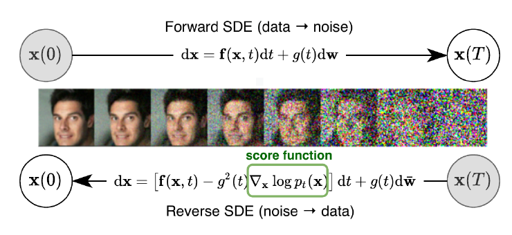

**L'idea.** Lo **score** è il gradiente del logaritmo della densità, **∇x log q(xt)**: in ogni punto è una freccia che punta verso dove le immagini rumorose sono più probabili. Se conosci lo score a ogni livello di rumore puoi «risalire» verso i dati. DDPM, scritto con passi infinitamente piccoli, diventa esattamente la SDE della slide 2.

**La matematica** (slide 15). Per una gaussiana 𝒩(m, s2) il gradiente del logaritmo è −(x − m)/s2. Per q(xt | x0) la media è √ᾱt x0, la varianza 1 − ᾱt, e xt − media = √(1 − ᾱt) ε. Quindi il gradiente è −ε/√(1 − ᾱt). Per la distribuzione di tutte le immagini rumorose si dimostra che vale lo stesso con il rumore *previsto*:

`∇xt log q(xt) ≈ −εθ(xt, t) / √(1 − ᾱt)`

**Prevedere il rumore e prevedere la direzione che lo toglie sono la stessa cosa**, a meno di segno e scala.

**Un regalo per dopo.** Se c'è un condizionamento c (il prompt), Bayes dà ∇ log q(xt | c) = ∇ log q(xt) + ∇ log q(c | xt): lo score condizionato è lo score normale più il gradiente di un «classificatore» che dice quanto xt è compatibile con c. È la base della guida (sezione 7). Precisazione, segnalata nella scheda 15: questa formula è letteralmente la *classifier guidance*, che usa un classificatore vero; la classifier-free guidance ne ricava il termine senza classificatore.

> **Il punto**
> 
> Lo score ∇ log q(xt) è il rumore previsto, cambiato di segno e diviso per √(1 − ᾱt). DDPM è una versione a passi discreti della SDE inversa.

### 6\. La rete: una U-Net che sa il passo e legge il testo

**Il problema.** Il denoiser εθ deve prendere un'immagine e restituire un'immagine della stessa forma (il rumore): serve una rete immagine → immagine. Deve funzionare a tutti i livelli di rumore e, per il testo-immagine, deve seguire il prompt.

**La U-Net** (slide 16). È la stessa architettura della segmentazione ([L17](https://gabriele-marsili.github.io/appunti-magistrale-ai/anno-2/computer-vision/sito/#L17)): encoder che riduce la risoluzione, decoder che la ricostruisce, skip connection fra livelli corrispondenti, più blocchi residui e strati di attenzione. Cambiano ingresso (xt), uscita (il rumore previsto) e condizionamento. E soprattutto: **una sola rete per tutti i passi**, non mille.

**Il passo t** (slide 17). Una rete sola deve sapere quanto rumore c'è: il libro lo spiega bene, un'immagine granulosa può essere una scena normale molto rumorosa (t grande) o una scena davvero piena di texture (t piccolo). Il passo si codifica con la stessa codifica sinusoidale delle posizioni nei transformer e un piccolo MLP, et = MLP(PE(t)); poi in ogni blocco residuo una proiezione lineare lo porta a C numeri, uno per canale, che si **sommano a tutte le posizioni**: h̃ = h + P(et). In alternativa et predice una scala e uno spostamento delle feature normalizzate.

**Il testo** (slide 18–20). Il prompt passa dall'encoder di testo di CLIP (in Stable Diffusion v1: 77 token da 768 numeri). Nella U-Net si inseriscono, a varie risoluzioni, strati di **cross-attention**:

`Q = ZWQ,  K = CWK,  V = CWV,  CrossAttn(Z, C) = softmax(QK⊤/√dk) V`

Z sono i token dell'immagine (N posizioni), C i token del testo (M = 77). Le **query vengono dall'immagine, chiavi e valori dal testo**: ogni posizione dell'immagine chiede «quali parole riguardano me?» e riceve una combinazione dei loro valori.

Perché la sequenza dei token e non un vettore solo per tutta la frase? Perché **pixel diversi possono guardare parole diverse**: la zona del gatto guarda «gatto», lo sfondo guarda «spiaggia». Il testo si codifica una volta sola e serve a tutti i passi.

> **Il punto**
> 
> Il denoiser è una U-Net condivisa fra tutti i passi: il passo entra come vettore sommato ai canali, il testo come chiavi e valori di una cross-attention con query dall'immagine.

### 7\. Classifier-free guidance: seguire davvero il prompt

**Il problema.** Un modello condizionato tende a seguire il testo «poco»: le immagini sono plausibili ma il prompt è rispettato vagamente.

**L'idea** (slide 21). Nel training si **toglie il prompt a caso** (circa una volta su dieci), così la stessa rete impara sia εθ(xt, t, c) con il testo sia εθ(xt, t, ∅) senza. Nel campionamento si calcolano entrambe e si va oltre la versione condizionata, nella direzione in cui il testo sposta la previsione:

`ε̂ = εθ(xt, t, ∅) + w · [εθ(xt, t, c) − εθ(xt, t, ∅)]`

w = 0 ignora il prompt, w = 1 è la previsione condizionata normale, w \> 1 la esagera (Stable Diffusion usa di default 7,5). Con numeri per un pixel: ε(∅) = 0,30, ε(c) = 0,50, w = 7,5: ε̂ = 0,30 + 7,5 · 0,20 = 1,80. La differenza «cosa cambia aggiungendo il testo» viene amplificata.

**Perché funziona.** Passando agli score (sezione 5), la differenza ε(c) − ε(∅) è proporzionale a ∇ log q(c | xt), il gradiente di un **classificatore implicito** che il modello contiene senza averlo addestrato a parte. Usare w vuol dire campionare da q(x) · q(c | x)w: per w grande contano soprattutto le immagini in cui il prompt è *molto* probabile.

La figura mostra il prezzo: con w grande aumenta l'aderenza alla classe, ma **cala la diversità** e i campioni vengono spinti in zone esagerate (nelle immagini: colori saturi, artefatti). E ogni passo costa **due valutazioni della rete**. Attenzione alla convenzione: nell'articolo di Ho e Salimans la formula è scritta con (1 + w), quindi i loro w sono spostati di 1 rispetto alle slide.

> **Il punto**
> 
> La CFG estrapola dalla previsione senza testo a quella con testo, di un fattore w: più aderenza al prompt, meno diversità, doppio costo per passo.

### 8\. Meno passi: DDIM, le tre previsioni, la distillazione

**Il problema.** Mille passi di U-Net per un'immagine sono troppi. Si può riusare la stessa rete con meno passi?

**DDIM** (slide 22). Sì, senza riaddestrare. A ogni passo si stima l'immagine pulita con la formula chiusa invertita, x̂0 = (xt − √(1 − ᾱt) εθ)/√ᾱt, e poi si ricostruisce direttamente xs per un passo s \< t anche lontano, rimettendo la parte di rumore appena stimata:

`xs = √ᾱs x̂0(xt) + √(1 − ᾱs − σt→s2) εθ(xt, t) + σt→s z`

Con σt→s = 0 il campionamento è **deterministico**: ogni rumore iniziale porta sempre alla stessa immagine, lungo una traiettoria regolare che si può percorrere a grandi salti (20–50 passi su 1000). È possibile perché la loss di DDPM dipende solo dalla formula chiusa: lo stesso modello è compatibile con un'intera famiglia di processi (Prince § 18.6.2).

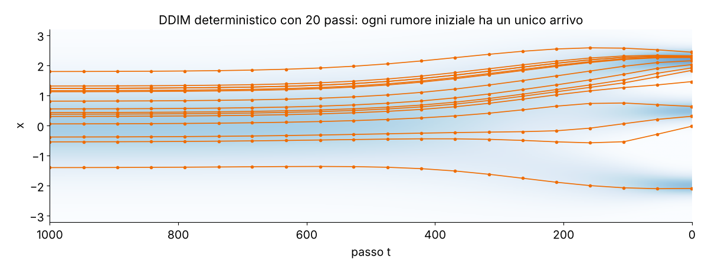

**Che cosa prevedere** (slide 23–24). Scrivendo xt = at x0 + bt ε, con at = √ᾱt e bt = √(1 − ᾱt), la rete può prevedere il rumore ε, l'immagine x0 o la **velocità** v = at ε − bt x0. Sono **la stessa informazione in tre forme**: dati xt e una delle tre, le altre si ricavano. Per v: x0 = at xt − bt v ed ε = bt xt + at v, perché a2 + b2 = 1.

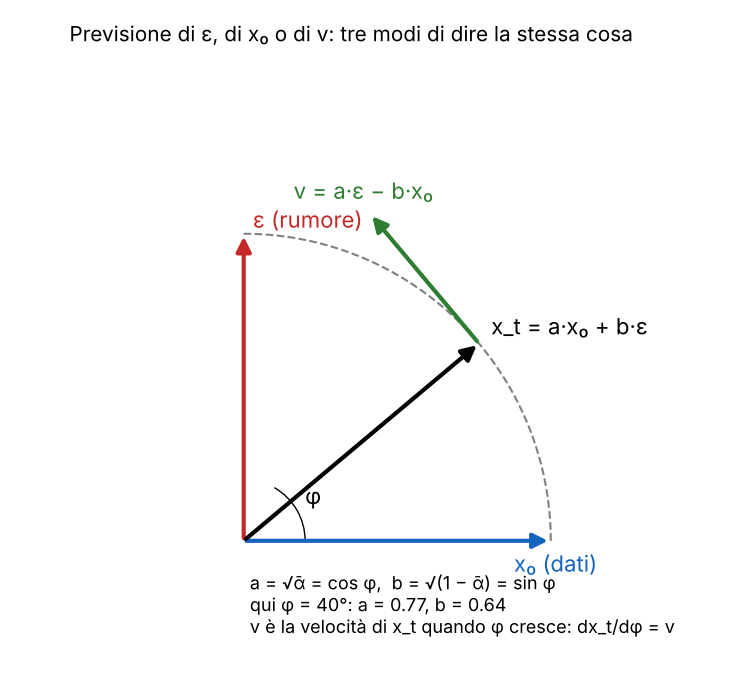

Perché cambiare? Con target ε, a rumore altissimo si stima x̂0 dividendo per a ≈ 0: **piccoli errori su ε diventano enormi su x̂0**. v si comporta bene a tutti i livelli. Attenzione però (slide 26): la «velocità» di DDPM e quella del flow matching della prossima sezione **non sono la stessa cosa**.

**Distillazione** (slide 27). Il costo si conta in NFE, valutazioni della rete. I campionatori migliori arrivano a 20–50; per scendere a 1–8 si **addestra uno studente**: la progressive distillation insegna a fare in 1 passo ciò che l'insegnante fa in 2 e ripete; i consistency model (LCM) mappano qualunque punto della traiettoria direttamente su x0; la distillazione avversaria (SDXL-Turbo, FLUX \[schnell\]) aggiunge una loss da GAN per avere immagini nitide in 1–4 passi; la guidance distillation (FLUX \[dev\]) incorpora la CFG in un passaggio solo, dimezzando il costo.

> **Il punto**
> 
> Il campionatore è separato dal training: DDIM riusa lo stesso modello con 20–50 passi deterministici. Prevedere ε, x0 o v è equivalente ma numericamente diverso. Sotto i 10 passi serve distillare.

### 9\. Flow matching: andare dritti dal rumore ai dati

**Il problema.** Le traiettorie di DDPM seguono un arco (la figura sopra); se fossero *dritte*, basterebbero pochissimi passi per percorrerle. Si può addestrare direttamente un movimento in linea retta?

**L'idea** (slide 25). Prendi un dato x0 e un rumore x1, e collegali con un **segmento**:

`xt = (1 − t) x0 + t x1,   t ∈ [0, 1]`

La velocità lungo il segmento è costante: dxt/dt = x1 − x0. Si addestra una rete vθ(xt, t) a prevederla:

`ℒCFM = 𝔼x0, x1, t ‖vθ(xt, t) − (x1 − x0)‖2`

Stessa ricetta di DDPM: un dato, un rumore, un tempo a caso, una regressione. Per generare si parte da rumore a t = 1 e si **integra il campo** fino a t = 0, per esempio con il metodo di Eulero: x ← x − h · vθ(x, t). Qui t = 0 sono i dati (convenzione di SD3); Lipman et al. usano il contrario.

**Il dettaglio sottile.** Le coppie (dato, rumore) sono scelte a caso, quindi i segmenti si incrociano e uno stesso punto xt sta su tanti segmenti con velocità diverse. La regressione quadratica impara allora la loro **media**: un campo di velocità ben definito che sposta la nuvola del rumore sulla nuvola dei dati. Le sue traiettorie non sono più esattamente dritte, ma lo sono quasi.

**DDPM e flow matching a confronto** (slide 24 e 26). Hanno la stessa forma xt = at x0 + bt ε: DDPM con a = √ᾱ, b = √(1 − ᾱ) (un arco), il **rectified flow** con a = 1 − t, b = t (un segmento). Differiscono per schedule e target. DDPM è usato da LDM e SDXL; il flow matching da **SD3, FLUX, Wan, Movie Gen**, cioè da quasi tutti i modelli recenti.

> **Il punto**
> 
> Il flow matching collega rumore e dati con segmenti e addestra la velocità x1 − x0; la rete impara il campo medio, che si integra in pochi passi perché le traiettorie sono quasi dritte.

### 10\. Come si valuta un generatore

**Il problema.** Non c'è un'etichetta giusta: come si misura se le immagini sono buone?

**FID** (slide 28): si passano immagini vere e generate in una rete Inception, si adatta una gaussiana alle feature di ciascun gruppo e si misura la distanza fra le due gaussiane. Più bassa è meglio. Misura **qualità e diversità insieme**: un modello che genera sempre la stessa bella immagine ha una nuvola di feature troppo stretta e una FID cattiva. **CLIP score**: similarità coseno fra l'embedding CLIP del prompt e quello dell'immagine; più alto è meglio; misura l'**aderenza al prompt**.

Le due metriche tirano in direzioni opposte, come nella figura della CFG: alzando w il CLIP score sale, ma prima o poi **la FID peggiora** perché cala la diversità. Per questo si usano anche giudizi umani e benchmark che controllano conteggi, colori e posizioni (GenEval, T2I-CompBench).

> **Il punto**
> 
> FID per qualità e diversità, CLIP score per l'aderenza al testo; la scala della guida le scambia l'una con l'altra.

### 11\. Latent diffusion: lavorare in piccolo

**Il problema.** Una U-Net su 512 × 512 × 3 pixel, eseguita 100 volte, costa troppo. E gran parte di quei pixel codifica dettagli che non cambiano il contenuto.

**L'idea** (slide 32). Un autoencoder preaddestrato **comprime l'immagine in un latente** piccolo, z0 = ℰ(x0), e la ricostruisce, x̂0 = 𝒟(z0). La diffusione si fa sui latenti: la rete diventa εθ(zt, t, c), il testo entra con la cross-attention, e solo alla fine il decoder trasforma z0 in immagine. È **Latent Diffusion** (Rombach et al., 2022), cioè Stable Diffusion.

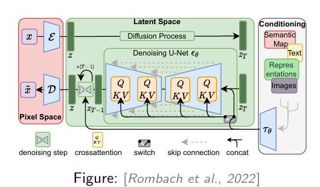

**Il conto** (slide 33). Con un fattore di compressione f = 8 le posizioni scendono di 82 = 64 volte. In Stable Diffusion v1: prompt → CLIP, 77 × 768; rumore iniziale 4 × 64 × 64; la U-Net lavora su 4 × 64 × 64; 50 passi con CFG fanno 100 valutazioni; il decoder restituisce 3 × 512 × 512. Il latente ha 4 · 642 = 16 384 valori, l'immagine 786 432: **48 volte meno** (anche se il calcolo non scende proprio di 48 volte, per i canali interni della rete).

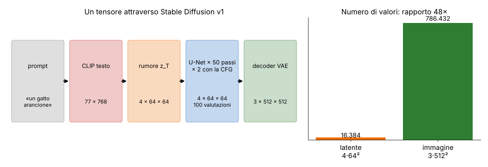

**SDXL e KOALA** (slide 34–36). SDXL ingrandisce la U-Net (2,6 miliardi di parametri), usa due encoder di testo, condiziona sulle dimensioni e sul ritaglio delle immagini di training e aggiunge un refiner per la fase a basso rumore. KOALA fa il contrario: **distilla SDXL in U-Net più piccole** (1,16 e 0,78 miliardi, cioè il 54% e il 69% in meno; nella slide 36 questa frase è troncata in «Up to 69», vedi la scheda), imitando soprattutto le feature di self-attention dell'insegnante, e così genera 1024 × 1024 anche su GPU da 8 GB.

> **Il punto**
> 
> La latent diffusion fa la diffusione in uno spazio compresso 48 volte più piccolo; autoencoder e encoder di testo girano una volta, il denoiser decine di volte.

### 12\. Dalla U-Net al transformer: DiT, SD3, FLUX, SANA

**Il problema.** Nel riconoscimento il ViT ha sostituito le CNN quando dati e calcolo sono cresciuti ([L17](https://gabriele-marsili.github.io/appunti-magistrale-ai/anno-2/computer-vision/sito/#L17)). Vale anche per il denoiser?

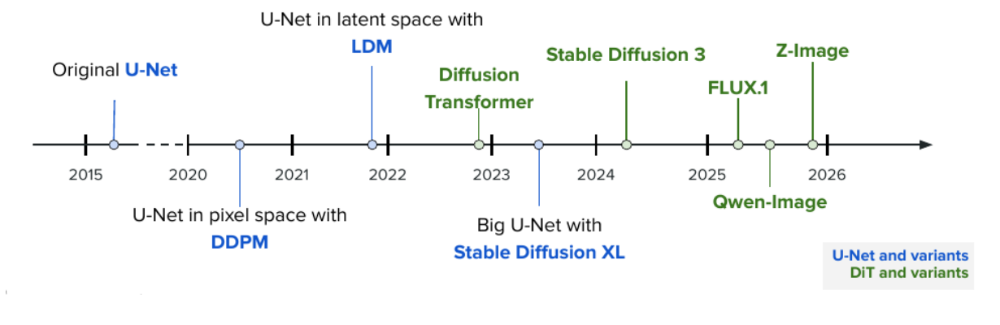

**DiT** (slide 37–38). Il Diffusion Transformer di Peebles e Xie divide il latente in patch p × p, come un ViT: **N = HW/p2** token. Per un latente 32 × 32 (immagine 256 × 256) con p = 2, N = 256. Passo e classe entrano con **adaLN-Zero**: un MLP predice scala, spostamento e una porta α per ogni LayerNorm, con α inizializzata a zero, così **ogni blocco parte come identità** (la stessa idea di B = 0 in LoRA, [L25](https://gabriele-marsili.github.io/appunti-magistrale-ai/anno-2/computer-vision/sito/#L25)).

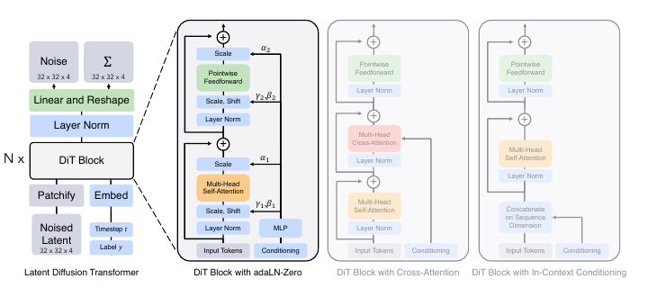

Il risultato dell'articolo (slide 38) è una legge di scala pulita: più profondità, larghezza o token, **FID migliore**; DiT-XL/2 (675 milioni di parametri) arriva a FID 2,27 su ImageNet 256 × 256. Patch più piccole non aggiungono parametri ma moltiplicano i token, e conta il calcolo totale. Il rovescio: l'attenzione costa come N2.

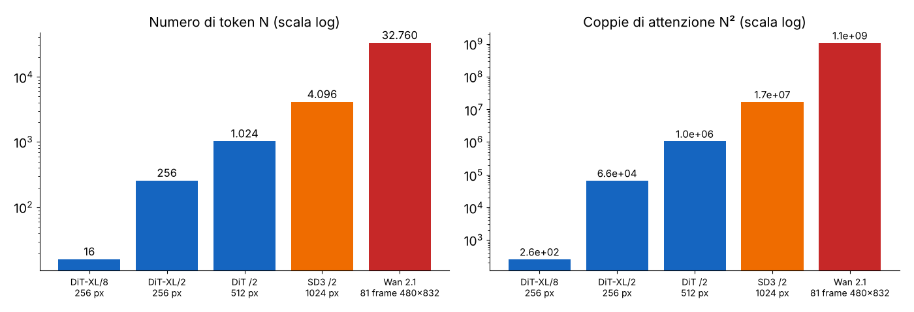

**SD3 e FLUX** (slide 40–42). Stable Diffusion 3 usa un **MM-DiT**: i token di testo (da CLIP-L, OpenCLIP-bigG e il modello linguistico T5-XXL) e quelli dell'immagine si concatenano e passano in una **attenzione congiunta**, con proiezioni separate per le due modalità. Rispetto alla cross-attention **anche il testo viene aggiornato** in ogni blocco, guardando l'immagine che si forma. È addestrato con il rectified flow della sezione 9.

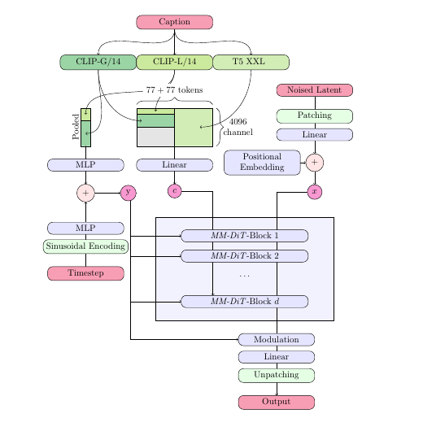

FLUX.1 (12 miliardi di parametri) combina 19 blocchi «double-stream» come MM-DiT e 38 «single-stream» in cui testo e immagine sono una sola sequenza con gli stessi pesi, usa RoPE per le posizioni e il rectified flow; le sue varianti \[dev\] e \[schnell\] sono distillate (sezione 8). SANA punta sull'efficienza: **attenzione lineare** invece che quadratica e un autoencoder che comprime 32 volte invece di 8 (16 volte meno token), e con 0,6 miliardi di parametri gli autori lo dicono competitivo con FLUX da 12.

**Gli encoder di testo** (slide 43). CLIP sa bene *che cosa* c'è, ma **conta male, confonde le relazioni spaziali e non sa scrivere** (i limiti visti nella [L24](https://gabriele-marsili.github.io/appunti-magistrale-ai/anno-2/computer-vision/sito/#L24)). La tendenza è usare veri modelli linguistici: T5 in SD3, Gemma-2 in SANA, Qwen2.5-VL in Qwen-Image, Mistral Small 3 in FLUX.2, fino a un'unica sequenza di token testo-immagine in Z-Image. Il testo leggibile nelle immagini della slide 5 viene da qui.

> **Il punto**
> 
> Il DiT tratta il latente come un ViT tratta l'immagine, con N = HW/p2 token e adaLN-Zero per il condizionamento; SD3 e FLUX aggiungono l'attenzione congiunta testo-immagine e il flow matching; i modelli linguistici sostituiscono CLIP come encoder di testo.

### 13\. I video: aggiungere il tempo

**Il problema.** Un video è una pila di fotogrammi: bisogna generare sia l'**aspetto** di ogni frame sia un **movimento** coerente. E i token esplodono.

**Due tempi da non confondere** (slide 47). Il video pulito X0 ∈ ℝF×C×H×W si sporca con la solita formula; **t è il passo di diffusione** (quanto è rumoroso il video), **f è l'indice del frame** (dove siamo nel video). A un dato t tutti i frame hanno lo stesso rumore e vengono elaborati insieme.

**Strati spaziali e temporali** (slide 46, 48). Si estende la rete di immagini con **strati temporali** che collegano i frame. L'attenzione si scompone: quella **spaziale** rimodella il tensore in (B·F, H·W, C), cioè ogni frame per conto suo; quella **temporale** in (B·H·W, F, C), cioè ogni posizione attraverso i frame. Il risparmio è grande: con F = 16 e H·W = 1024, l'attenzione su tutto costerebbe (16 384)2 ≈ 2,7·108 coppie, quella scomposta circa 1,7·107, **16 volte meno**.

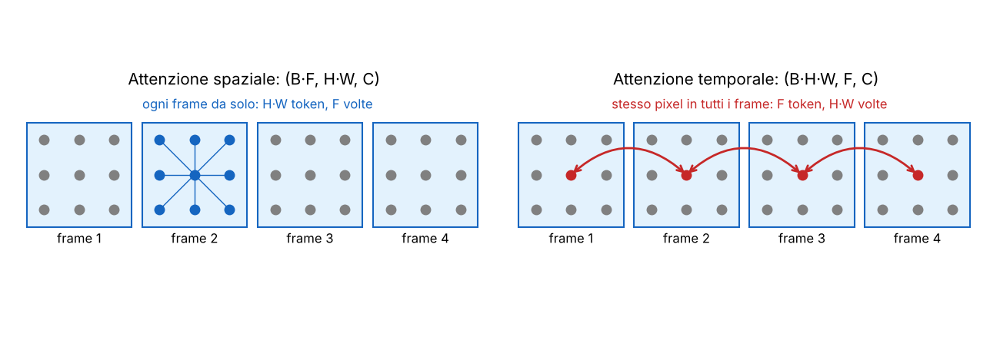

**Due strade.** *Partire da un modello di immagini*: Stable Video Diffusion (slide 49) prende i pesi spaziali preaddestrati, aggiunge strati temporali e addestra su video, prima tanti poi pochi ma di qualità; si possono mescolare immagini e video nel training. *Video DiT* (slide 50): un VAE video comprime nello spazio e nel tempo, il latente si taglia in patch 3D e un transformer lo elabora. Esempio di Wan 2.1: 81 frame 480 × 832 diventano un latente 21 × 60 × 104 (4 volte nel tempo tenendo a parte il primo frame, 8 nello spazio), e con patch 1 × 2 × 2 fanno 21 · 30 · 52 = **32 760 token**, otto volte un'immagine di SD3.

**I modelli** (slide 51–55). CogVideoX: VAE 3D causale e attenzione congiunta testo-video con modulazioni separate. Wan 2.2: **due esperti**, uno per i livelli di rumore alti (composizione e movimento), uno per quelli bassi (dettagli), uno solo attivo per passo. Movie Gen: 30 miliardi di parametri, flow matching, pesi non rilasciati. Sora e Veo 3.1 sono proprietari (patch spazio-temporali, audio sincronizzato). Nota della slide 51: **pesi aperti non vuol dire dati o codice di training aperti**.

> **Il punto**
> 
> Per i video si aggiunge l'asse dei frame: stesso passo di rumore per tutti, attenzione scomposta in spaziale e temporale oppure token 3D in un video DiT; il problema principale diventa il numero di token.

### Il riassunto in 10 righe

1.  Le GAN generano in un passo ma si addestrano male; la diffusione si addestra con una regressione e genera in molti passi.
2.  Processo in avanti fisso: xt = √ᾱt x0 + √(1 − ᾱt) ε, in un colpo per qualunque t; lo schedule (lineare, coseno) decide l'SNR.
3.  La rete prevede il rumore: ℒ = ‖ε − εθ(xt, t)‖2 con t a caso; da ε si ricavano la media del passo inverso e x̂0.
4.  Campionamento DDPM: da rumore puro, T passi che tolgono rumore e ne rimettono un po'.
5.  Il rumore previsto è lo score cambiato di segno e riscalato: DDPM discretizza la SDE inversa.
6.  Denoiser: una U-Net condivisa; il passo entra come vettore sommato ai canali, il testo con la cross-attention (query immagine, chiavi e valori testo).
7.  CFG: ε(∅) + w\[ε(c) − ε(∅)\]; più aderenza, meno diversità, due valutazioni per passo.
8.  DDIM: stesso modello, campionamento deterministico in 20–50 passi; target ε, x0, v equivalenti; distillazione per 1–8 passi.
9.  Flow matching: segmenti fra rumore e dati, target x1 − x0, integrazione del campo; lo usano SD3, FLUX, Wan.
10. Latent diffusion (48 volte meno valori), DiT su patch latenti, attenzione congiunta testo-immagine, encoder linguistici; per i video attenzione spaziale e temporale e token 3D.

### Verifica di aver capito

**1. Con lo schedule lineare ᾱ500 = 0,079. Quanto pesano immagine e rumore in x500, e qual è l'SNR?**

Peso dell'immagine √0,079 ≈ 0,28, del rumore √0,921 ≈ 0,96. SNR = 0,079/0,921 ≈ 0,086: la varianza del rumore è più di dieci volte quella del segnale, l'immagine è quasi irriconoscibile.

**2. Perché nel training non bisogna simulare i passi 1, …, t − 1?**

Perché le varianze di gaussiane indipendenti si sommano e la composizione di tutti i passi dà la formula chiusa xt = √ᾱt x0 + √(1 − ᾱt) ε. Con un t a caso e un ε a caso si costruisce xt con una moltiplicazione e una somma.

**3. xt = 0,1, ᾱt = 0,36, la rete prevede εθ = 0,5. Quanto vale x̂0?**

√0,36 = 0,6 e √0,64 = 0,8. x̂0 = (0,1 − 0,8 · 0,5)/0,6 = (0,1 − 0,4)/0,6 = −0,5.

**4. Con w = 1 la CFG cosa fa? E con w = 0? Perché si usa w ≈ 7?**

w = 1: ε̂ = ε(c), la previsione condizionata normale. w = 0: ε̂ = ε(∅), il prompt è ignorato. w ≈ 7 amplifica la differenza dovuta al testo: equivale a campionare da q(x) q(c | x)w, immagini in cui il prompt è molto probabile; prezzo, meno diversità e due valutazioni per passo.

**5. Un collega dice che per usare DDIM bisogna riaddestrare il modello. Ha ragione?**

No. DDIM usa lo stesso εθ: la loss di DDPM dipende solo dalla formula chiusa q(xt | x0), che è comune a una famiglia di processi, e DDIM è uno di questi, deterministico e percorribile a salti. Riaddestrare serve per la distillazione (1–8 passi), non per DDIM.

**6. Quanti token ha un DiT con latente 64 × 64 e patch 2? E perché SANA usa compressione 32?**

N = 64 · 64/4 = 1024 (immagine 512 × 512 con f = 8). Con compressione 32 invece di 8 il latente ha lato 4 volte più piccolo, quindi 16 volte meno token e circa 256 volte meno coppie di attenzione quadratica; SANA usa in più un'attenzione lineare.

### Come proseguire

Leggi il [§ 32.8 del visionbook](https://visionbook.mit.edu/generative_models.html) per l'intuizione e il [§ 34.4.4](https://visionbook.mit.edu/conditional_generative_models.html) per il condizionamento; poi il **cap. 18 di Prince** (§ 18.1–18.6, saltando le derivazioni del § 18.4.2) per la matematica di DDPM, DDIM e della guida. Per flow matching e architetture recenti le fonti sono gli articoli, elencati nella sezione Studia dal libro qui sotto. La prossima lezione riprende la [L25](https://gabriele-marsili.github.io/appunti-magistrale-ai/anno-2/computer-vision/sito/#L25): come insegnare a un modello di diffusione un soggetto nuovo da poche foto. Ora ripassa con le schede qui sotto, slide per slide; la guida allo studio in fondo ha le domande tipo orale.
