# L28 · Diffusione personalizzata

*Lezione 28 · Donald Shenaj · 19 novembre 2026*

[Versione interattiva sul sito, con videolezione](https://gabriele-marsili.github.io/appunti-magistrale-ai/anno-2/computer-vision/sito/#L28) · [Indice della dispensa](README.md)

**In una frase:** per far generare a un modello di diffusione **proprio il tuo soggetto** si può ottimizzare qualcosa per ogni soggetto (un vettore di testo, tutti i pesi, oppure solo un LoRA) o addestrare una volta un modulo che legge una foto di riferimento; il nodo è sempre **fedeltà al soggetto contro libertà del prompt**, senza rovinare ciò che il modello sapeva.

### Prima di iniziare

Slide di Donald Shenaj (19 novembre), 62 pagine; «n / 62» in basso è la pagina del PDF, e la 62 è solo la panoramica delle miniature. È il seguito diretto della lezione precedente. Ti servono:

  - dalla [L27](https://gabriele-marsili.github.io/appunti-magistrale-ai/anno-2/computer-vision/sito/#L27): la loss di diffusione ‖ε − εθ(zt, t, c)‖2, la U-Net con la cross-attention sul testo (query dall'immagine, chiavi e valori dal testo), il latente di Stable Diffusion, FLUX e il flow matching;
  - dalla [L25](https://gabriele-marsili.github.io/appunti-magistrale-ai/anno-2/computer-vision/sito/#L25): LoRA, W = W0 + (α/r)BA con A gaussiana e B = 0, e VeRA (basi casuali condivise e pochi coefficienti);
  - dalla [L24](https://gabriele-marsili.github.io/appunti-magistrale-ai/anno-2/computer-vision/sito/#L24): CLIP e i suoi due encoder; dalla [L21](https://gabriele-marsili.github.io/appunti-magistrale-ai/anno-2/computer-vision/sito/#L21)–[L22](https://gabriele-marsili.github.io/appunti-magistrale-ai/anno-2/computer-vision/sito/#L22): DINO e la distillazione.

Il libro **non tratta la personalizzazione**: il [cap. 37](https://visionbook.mit.edu/transfer_learning.html) (fine-tuning, moduli congelati, prompting) e il [cap. 34](https://visionbook.mit.edu/conditional_generative_models.html) (generazione condizionata, traduzione immagine-immagine) danno la cornice; i metodi si studiano dagli articoli. I numeri qui sotto sono quelli delle slide, controllati sugli articoli dove possibile.

### Guarda prima questi video e pagine

  - [But how do AI images and videos actually work? | Guest video by Welch Labs](https://www.youtube.com/watch?v=iv-5mZ_9CPY) (Video · 37 min). Lo stesso della lezione precedente: se non l'hai visto, guardalo prima, perché questa lezione dà per scontati CLIP, il denoising e la guida.
  - [DreamBooth: Fine Tuning Text-to-Image Diffusion Models for Subject-Driven Generation](https://dreambooth.github.io/) (Pagina del progetto). Ruiz et al. La pagina del progetto con le figure dell'articolo (ricontestualizzazione, viste nuove, rifacimenti artistici, modifiche di proprietà): guardale per capire cosa vuol dire fedeltà ed editabilità.
  - [Adding Conditional Control to Text-to-Image Diffusion Models (ControlNet)](https://arxiv.org/abs/2302.05543) (Articolo). Zhang, Rao, Agrawala. Leggi l'abstract e la sezione sul metodo con la figura delle zero convolution, per la sezione 9.
  - [LoRA training scripts of the world, unite\! (Hugging Face)](https://huggingface.co/blog/sdxl_lora_advanced_script) (Guida pratica). Lo script avanzato di DreamBooth + LoRA per SDXL, con il token identificatore e il pivotal tuning: la versione reale della slide 59.

### 1\. Il problema: il tuo cane, non un cane

**Il problema.** Chiedi a Stable Diffusion «un corgi sull'Acropoli»: ottieni *un* corgi. Tu vuoi *il tuo*, con quella macchia sul muso. Il modello non l'ha mai visto, e nessuna parola lo descrive: **le parole indicano classi, non individui** (slide 4).

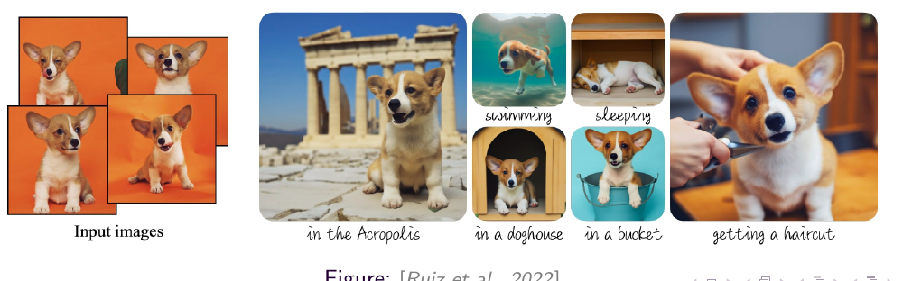

**L'idea.** Da 3–10 foto bisogna **iniettare l'identità nuova senza distruggere la conoscenza generale**. Le due cose tirano in direzioni opposte (slide 5): se ti adatti poco, perdi il soggetto; se ti adatti troppo, il modello rifà sempre la posa e lo sfondo delle foto e smette di seguire il prompt. Sono le due proprietà da misurare: **fedeltà al soggetto** ed **editabilità del prompt**. Si misurano su prompt che non erano nel training, come un test set.

**Dove si può intervenire.** Il modello preaddestrato è fatto di tre pezzi: encoder del testo, denoiser, rumore iniziale. Ogni metodo della lezione tocca uno di questi pezzi, o aggiunge un ramo accanto.

> **Il punto**
> 
> Personalizzare vuol dire far generare un individuo, non una classe, da poche foto, tenendo insieme fedeltà ed editabilità; i metodi si distinguono per dove intervengono nel modello.

### 2\. Textual Inversion: una parola nuova

**Il problema.** Si può insegnare il soggetto senza toccare il modello?

**L'idea** (slide 6, Gal et al.). Se manca la parola, inventala. Si aggiunge al vocabolario un token S\* e si cerca il suo vettore di embedding v\* (768 numeri in Stable Diffusion v1) tale che il modello congelato, con il prompt «a photo of S\*», ricostruisca bene le foto. È la loss della [L27](https://gabriele-marsili.github.io/appunti-magistrale-ai/anno-2/computer-vision/sito/#L27), ma l'unica cosa che si muove è v\*:

`v* = arg minv 𝔼x0, t, ε ‖ε − εθ0(zt, t, c(v))‖2`

c(v) è l'uscita dell'encoder di testo quando il prompt contiene S\*; θ0 sono i pesi congelati. Il gradiente attraversa U-Net ed encoder e arriva a un solo vettore. È un **prompt ottimizzato**: il libro (§ 37.5) chiama prompting proprio questo, cambiare l'ingresso invece del modello.

**Pro e contro.** Il risultato pesa **pochi KB e si condivide facilmente**. Ma un vettore può solo indicare un punto dello spazio dei testi che il modello sa già interpretare: **la capacità è limitata**.

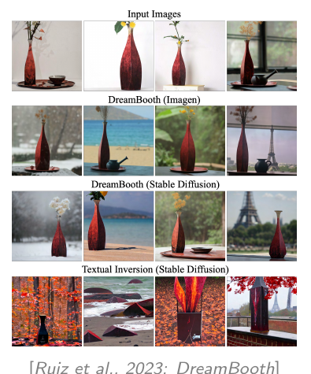

> **Il punto**
> 
> Textual Inversion impara solo un vettore di embedding con il modello congelato: leggerissimo, ma può esprimere solo ciò che il modello sa già disegnare.

### 3\. DreamBooth e la prior preservation

**Il problema.** Per più capacità bisogna cambiare i pesi. Ma cambiare i pesi su 4 foto è pericoloso.

**L'idea** (slide 7–9, Ruiz et al.). Si fa il **fine-tuning del denoiser sulle foto** con un prompt come «a \[V\] dog», dove \[V\] è un token raro (in pratica «sks»), che non ha un significato forte da sovrascrivere. La parola di classe «dog» resta nel prompt apposta: così il modello parte da ciò che sa sui cani e deve imparare solo cosa rende speciale questo.

**Cosa va storto senza correttivi.** I pesi che generano «a \[V\] dog» sono gli stessi che generano «a dog». Allenandoli solo sul corgi, il modello impara anche che **«dog» vuol dire quel corgi**: è il **language drift**. La slide 10 lo mostra.

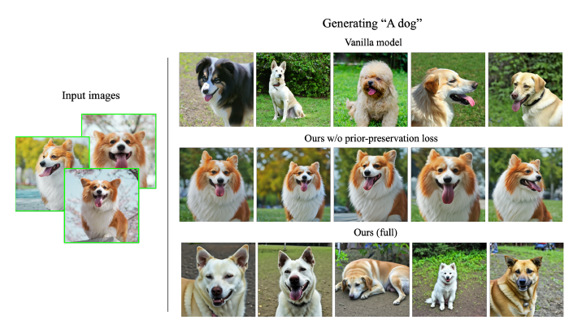

**La correzione.** Prima del fine-tuning si generano con il modello originale molte immagini «a dog», x̃. Poi si allena su due cose insieme:

`ℒDB = 𝔼 ‖ε − εθ(zt, t, cinst)‖2 + λ 𝔼 ‖ε − εθ(z̃t, t, cclass)‖2`

Il primo termine (istanza) usa le foto vere con «a \[V\] dog»; il secondo (prior) usa le immagini generate con «a dog». In parole: *impara il soggetto, ma continua a fare la classe come la facevi prima*. È un'**autodistillazione verso il modello di partenza**.

![Un giocattolo calcolato davvero: «dog» e «\[V\] dog» condividono un parametro (la posizione della classe) e \[V\] ne ha uno suo. Senza prior (centro) l'intera classe blu si sposta di 1,80 verso il soggetto. Con la prior (destra) si sposta di 0,25, mentre i campioni di «\[V\] dog» (arancioni) stanno comunque sulle foto.](../sito-src/L28/disp2_drift.png)

**Cosa si ottiene** (slide 11–13): viste nuove mai fotografate, stili artistici, proprietà cambiate (il chow chow «panda»), accessori, ambientazioni; perfino un personaggio coerente in tutte le vignette di un fumetto. **Cosa resta difficile** (slide 15): contesti rari che il modello originale genera male, colore del soggetto che cambia con lo sfondo, e overfitting quando il contesto somiglia alle foto.

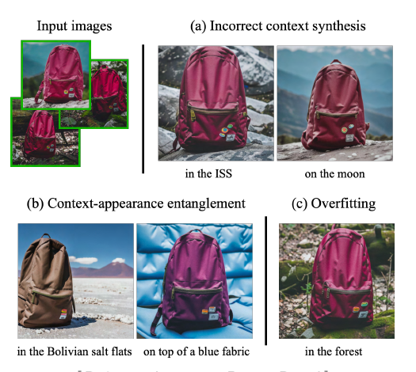

> **Il punto**
> 
> DreamBooth fa il fine-tuning del denoiser con un identificatore raro; la loss di prior, su immagini di classe generate dal modello originale, impedisce che la parola di classe venga riscritta.

### 4\. LoRA: DreamBooth leggero

**Il problema.** DreamBooth salva una copia intera del modello per ogni soggetto: per la U-Net di Stable Diffusion 1.5, 860 milioni di parametri, circa 1,7 GB in mezza precisione.

**L'idea** (slide 16–17). La stessa loss di DreamBooth, ma si addestrano solo i fattori di un **aggiornamento a basso rango** delle proiezioni dell'attenzione (WQ, WK, WV, WO), esattamente il LoRA della [L25](https://gabriele-marsili.github.io/appunti-magistrale-ai/anno-2/computer-vision/sito/#L25):

`W = W0 + (α/r) BA,   B = 0 all'inizio`

Fedeltà quasi uguale, ma un adattatore di pochi MB, che si carica e si scarica sullo stesso modello base e si può **combinare con altri adattatori**. È la ricetta standard di oggi: **DreamBooth + LoRA**.

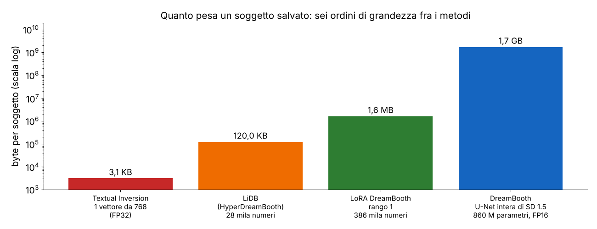

Le tre ottimizzazioni affiancate (slide 17): Textual Inversion minimizza su v\*, DreamBooth su tutto θ, DreamBooth + LoRA su A e B. In tutti e tre i casi **serve un'ottimizzazione per ogni soggetto nuovo**, di solito minuti su una GPU.

> **Il punto**
> 
> DreamBooth + LoRA usa l'obiettivo di DreamBooth ma addestra solo un ramo a basso rango: quasi la stessa fedeltà, mille volte meno spazio.

### 5\. HyperDreamBooth: prevedere i pesi invece di cercarli

**Il problema.** Anche con LoRA, ogni volto nuovo richiede minuti di ottimizzazione. Si può fare in un colpo, da una foto sola?

**L'idea** (slide 18–20). Si risolve il problema di ottimizzazione per migliaia di persone offline, e si addestra un'**iperrete** che impara a prevedere la soluzione da una foto del viso. Per renderlo possibile si rende il bersaglio piccolissimo: **LiDB**, un aggiornamento di rango 1 espresso con basi casuali fisse,

`ΔW = U b̃ ã⊤ V⊤`

U e V sono matrici casuali, fisse e uguali per tutti; b̃ e ã sono pochi coefficienti propri del soggetto (la stessa idea di VeRA). Così il soggetto passa da 386 mila numeri (LoRA di rango 1) a 28 mila.

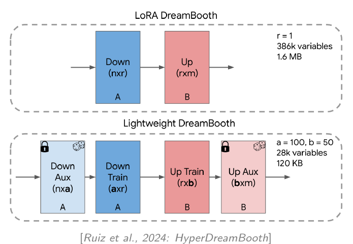

L'iperrete si addestra con ℒrecon + λ‖ϕ̂ − ϕ\*‖2: i pesi previsti ϕ̂ devono far ricostruire la foto ed essere vicini a quelli ottimizzati ϕ\*. Al test: un passaggio per avere ϕ(0), poi una rifinitura breve (circa 40 passi) per i dettagli. Il principio è **ammortizzare l'ottimizzazione**: lo ritroverai nella sezione 11. Il limite: è pensato per i **visi**, perché l'iperrete è addestrata su un dataset di volti.

> **Il punto**
> 
> HyperDreamBooth sostituisce l'ottimizzazione per soggetto con una rete che prevede un adattatore minuscolo (LiDB) da una foto, seguita da una breve rifinitura.

### 6\. Senza fine-tuning: prendere in prestito l'attenzione

**Il problema.** Tutto quello che abbiamo visto richiede training per ogni soggetto. Si può personalizzare con un solo passaggio?

**Cross-Image Attention** (slide 22–24). Le feature di attenzione dei modelli di diffusione contengono **corrispondenze semantiche**: la testa di una giraffa e quella di una zebra hanno feature simili, anche se l'aspetto è diverso. Allora, durante il denoising, si prendono le query dall'immagine di **struttura** e chiavi e valori dall'immagine di **aspetto**:

`softmax(Qstr (Kapp)⊤ / √d) Vapp`

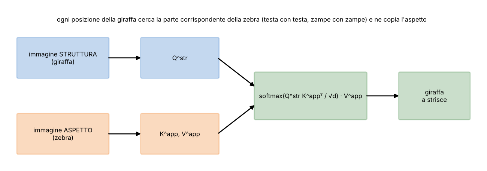

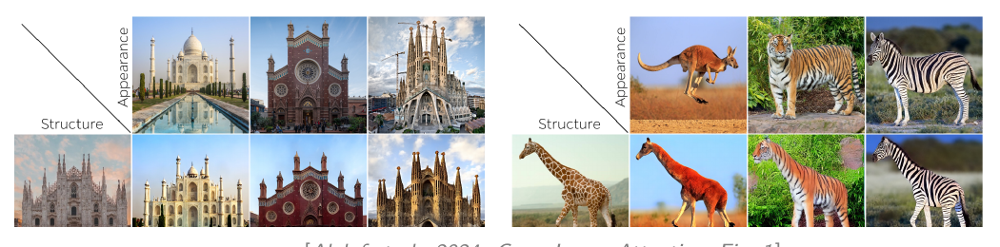

**IP-Adapter** (slide 25–26). Un modulo addestrato *una volta* che permette di usare un'immagine come prompt. Accanto alla cross-attention sul testo se ne aggiunge una seconda sulle feature CLIP dell'immagine di riferimento, con la stessa query:

`Z = Attn(Q, Kt, Vt) + λ Attn(Q, Ki, Vi)`

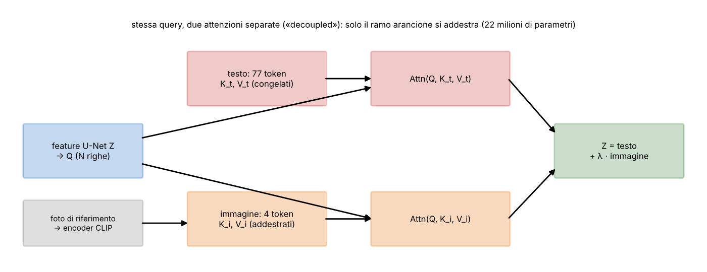

Perché separate e non concatenate? Perché nella stessa attenzione **parole e token d'immagine si farebbero concorrenza nel softmax**, e le proiezioni del testo non sanno leggere feature d'immagine. Con due attenzioni il ramo del testo resta intatto. Vantaggi: **nessun training per soggetto**, e funziona anche sui modelli derivati dallo stesso backbone (slide 26). Limite: **fedeltà all'identità inferiore** a DreamBooth.

> **Il punto**
> 
> Senza fine-tuning si personalizza cambiando da dove vengono chiavi e valori dell'attenzione: da un'altra immagine (Cross-Image Attention) o da un ramo apposito addestrato una volta (IP-Adapter).

### 7\. Misurare: identità, testo, e le metriche che si possono ingannare

**Il problema.** Come si dice che un metodo è migliore di un altro?

**Le metriche** (slide 28). Tre similarità coseno: **DINO** e **CLIP-I** fra le feature dell'immagine generata e del riferimento (fedeltà al soggetto), **CLIP-T** fra immagine generata e prompt (aderenza). DINO è preferito per l'identità perché è addestrato senza testo a distinguere ogni immagine dalle altre, mentre CLIP tende a vedere soprattutto la classe. Più FID e valutazioni umane per la qualità.

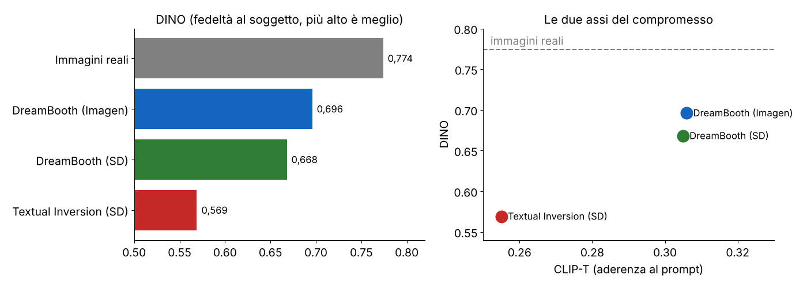

La riga «immagini reali» va letta bene: è la similarità fra due foto vere diverse dello stesso soggetto, cioè il **massimo ragionevole**. DreamBooth con Imagen (0,696) ha recuperato buona parte dello spazio fra Textual Inversion (0,569) e il tetto (0,774).

**Il problema delle metriche** (slide 37). Ognuna guarda una cosa sola. Nell'esempio di LoRA.rar un'immagine con il *contenuto sbagliato* prende CLIP-I 0,817, e un'immagine *senza lo stile* prende DINO 0,801. **Una sola similarità non vede tutti i fallimenti**: per questo si usano anche giudici multimodali come LLaVA-Critic (slide 38), che danno un voto e una spiegazione.

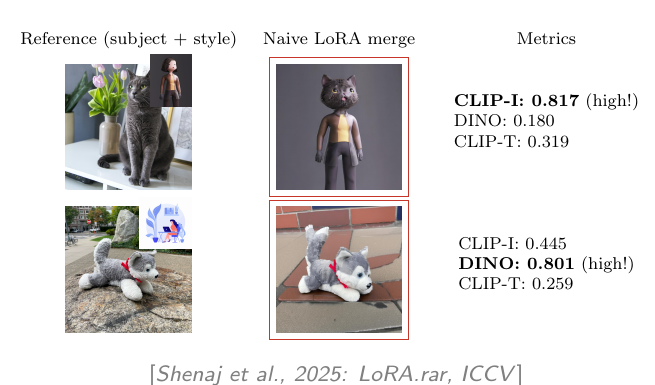

> **Il punto**
> 
> DINO e CLIP-I misurano l'identità, CLIP-T l'aderenza al prompt; vanno lette insieme, perché ciascuna da sola si lascia ingannare.

### 8\. Combinare soggetto e stile

**Il problema.** Hai un LoRA del tuo cane e un LoRA di uno stile ad acquerello. Vuoi il cane ad acquerello.

**La somma ingenua** (slide 30): W′ = W0 + λsBsAs + λcBcAc. Funziona sul piano tecnico, ma **sommare i parametri non separa i significati**: le due correzioni agiscono sulle stesse colonne delle stesse matrici e si disturbano.

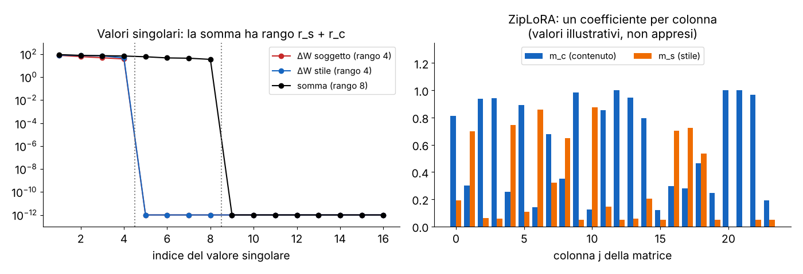

**ZipLoRA** (slide 31–32) impara un coefficiente **per ogni colonna**: (ΔWm):,j = mc(j)(ΔWc):,j + ms(j)(ΔWs):,j. Si ottimizzano solo i vettori m (pochissimi parametri), con tre termini: il modello fuso col prompt del soggetto deve comportarsi come il LoRA del soggetto, col prompt dello stile come quello dello stile, e una penalità ∑|mc(i)ms(i)| scoraggia l'uso della stessa colonna per entrambi. **B-LoRA** (slide 34–35) sfrutta invece l'architettura: in SDXL due blocchi controllano rispettivamente contenuto e stile, quindi un LoRA su quei due blocchi, addestrato **da una sola immagine**, si divide in due pezzi da ricombinare.

> **Il punto**
> 
> Due LoRA si sommano facilmente ma interferiscono; ZipLoRA impara come fonderli colonna per colonna, B-LoRA separa contenuto e stile usando blocchi diversi.

### 9\. Controllare la struttura: ControlNet e OminiControl

**Il problema.** Il testo decide *cosa* c'è, ma non *dove*: non puoi dire «con questa posa» o «con questi contorni».

**L'idea** (slide 40–44). ControlNet condiziona su una mappa spaziale: bordi, posa, profondità, segmentazione. Si **copiano** encoder e blocco centrale della U-Net in un ramo addestrabile che riceve la mappa; la U-Net originale resta congelata; le uscite della copia si sommano al decoder originale tramite **zero convolution**, convoluzioni 1 × 1 con pesi e bias inizializzati a zero.

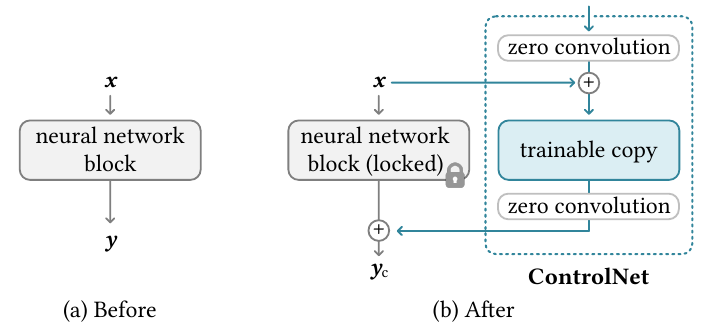

**Perché a zero.** All'inizio il ramo nuovo aggiunge esattamente zero, quindi il modello è **identico a quello preaddestrato**: l'addestramento non può peggiorarlo nei primi passi. E il gradiente non è nullo: per y = Wx + b vale ∂ℒ/∂W = (∂ℒ/∂y) x⊤, con x l'uscita della copia (che parte dai pesi preaddestrati, quindi non è zero). È lo stesso trucco di B = 0 in LoRA.

**La loss** (slide 44) è la solita previsione del rumore con un ingresso in più, ‖ε − εθ0,ϕ(zt, t, ctext, cspatial)‖2, ottimizzata solo su ϕ. Le coppie di training sono gratis: la mappa si **estrae automaticamente** dall'immagine con un rilevatore di bordi di Canny o un estimatore di profondità. Si combina con tutto il resto (slide 43): il LoRA del tuo cane, un ControlNet di posa e un prompt.

**OminiControl** (slide 45–47) è la stessa idea per FLUX, che ha l'attenzione congiunta: niente ramo copiato, la condizione viene codificata con il VAE e diventa **altri token nella stessa sequenza**, \[Xt; CT; CI\], con un LoRA per tipo di condizione e la loss di flow matching. Un dettaglio elegante: le posizioni dei token di condizione sono **condivise** con l'immagine (allineamento pixel per pixel, per bordi e profondità) o **spostate** (il soggetto può comparire altrove, per la generazione guidata da un soggetto).

> **Il punto**
> 
> ControlNet aggiunge una copia addestrabile dell'encoder collegata con zero convolution: parte dal modello originale e impara a seguire bordi, pose o profondità; OminiControl ottiene lo stesso in un DiT mettendo la condizione nella sequenza di token.

### 10\. Animare: AnimateDiff e MotionLoRA

**Il problema.** Hai un modello d'immagine personalizzato (il tuo personaggio). Vuoi un video, senza riaddestrare tutto.

**L'idea** (slide 48–49). AnimateDiff inserisce **moduli di moto** (transformer lungo l'asse dei frame, con la proiezione d'uscita a zero) dentro un denoiser d'immagine congelato e li addestra sui video con la solita loss. Prima un piccolo adattatore assorbe le differenze di qualità dei fotogrammi del dataset video, così il modulo impara solo il movimento.

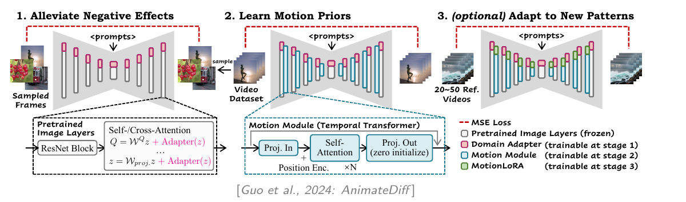

Il modulo di moto, addestrato una volta, **si inserisce in qualunque derivato dello stesso modello**, compresi DreamBooth e LoRA personali. **MotionLoRA** aggiunge un LoRA solo alle proiezioni dell'attenzione temporale, per un movimento specifico (zoom, panoramica) da 20–50 video. Aspetto e moto restano separati perché toccano strati diversi: spaziali il primo, temporali il secondo.

> **Il punto**
> 
> AnimateDiff impara il moto in moduli temporali inseriti in un modello d'immagine congelato, riusabili con qualunque personalizzazione; MotionLoRA adatta il moto con un LoRA sugli strati temporali.

### 11\. Cambiare il rumore, non il modello

**Il problema.** A volte non vuoi un soggetto, vuoi immagini *migliori* secondo un criterio (estetica, aderenza a prompt complicati). Si può ottenere senza toccare il generatore?

**L'idea** (slide 54). Con un generatore congelato a pochi passi x = Gθ(z, c) e una ricompensa R(x, c), si **ottimizza il rumore di partenza** con la salita del gradiente, z ← z + η∇zR(Gθ(z, c), c). Funziona, ma costa: ogni immagine richiede tanti passaggi in avanti e all'indietro nel generatore.

**Noise Hypernetworks** (slide 55–56). Si **ammortizza**, come in HyperDreamBooth: una rete Hϕ, addestrata una volta, sposta il rumore, z̃ = z + Hϕ(z, c). La loss è

`ℒ(ϕ) = 𝔼 [ (λ/2) ‖Hϕ(z, c)‖2 − R(Gθ0(z + Hϕ(z, c), c), c) ]`

Il secondo termine alza la ricompensa; il primo tiene ogni rumore **vicino a dove partiva**, un sostituto calcolabile del termine KL che mantiene la distribuzione vicina alla gaussiana. Senza il primo termine succede il disastro, e il giocattolo qui sotto lo mostra con numeri veri.

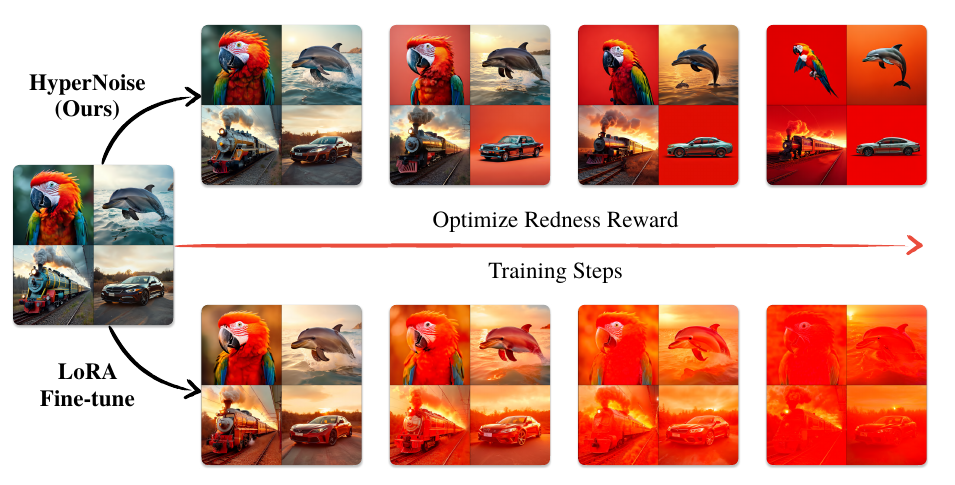

> **Il punto**
> 
> Si può migliorare la generazione spostando solo il rumore iniziale; una iperrete lo fa in un passaggio, e la penalità sullo spostamento evita il collasso e il reward hacking.

### Il riassunto in 10 righe

1.  Personalizzare: generare un individuo da poche foto, bilanciando fedeltà al soggetto ed editabilità del prompt, senza rovinare il modello.
2.  Textual Inversion: si ottimizza solo l'embedding v\* di un token nuovo con il modello congelato; pochi KB, capacità limitata.
3.  DreamBooth: fine-tuning del denoiser con «a \[V\] class»; la prior preservation (immagini di classe del modello originale) evita il language drift.
4.  DreamBooth + LoRA: stessa loss, solo A e B; adattatori di MB componibili.
5.  HyperDreamBooth: un'iperrete prevede un adattatore LiDB minuscolo da una foto del viso, poi una breve rifinitura.
6.  Cross-Image Attention e IP-Adapter: personalizzare senza training per soggetto, cambiando da dove vengono chiavi e valori.
7.  Metriche: DINO e CLIP-I per l'identità, CLIP-T per il testo; da sole si lasciano ingannare, servono anche giudizi umani o MLLM.
8.  Fondere LoRA: la somma interferisce; ZipLoRA impara pesi per colonna, B-LoRA separa contenuto e stile per blocchi.
9.  ControlNet: copia addestrabile collegata con zero convolution per seguire bordi, pose, profondità; OminiControl lo fa con token in FLUX; AnimateDiff e MotionLoRA aggiungono il moto.
10. Noise Hypernetworks: si sposta solo il rumore iniziale verso una ricompensa, con una penalità che impedisce il collasso.

### Verifica di aver capito

**1. Perché DreamBooth usa «a \[V\] dog» e non solo «\[V\]» o «a dog»?**

«a dog» farebbe riscrivere direttamente la classe. «\[V\]» da solo costringerebbe a imparare tutto da zero. «a \[V\] dog» sfrutta ciò che il modello sa dei cani e chiede di imparare solo la differenza; \[V\] è raro, quindi ha poco significato da sovrascrivere.

**2. Da dove vengono le immagini della loss di prior, e perché non si usano foto vere di cani?**

Si generano con il modello originale, prima del fine-tuning, con il prompt di classe. Lo scopo non è insegnare «cane» ma conservare ciò che il modello faceva: le sue stesse uscite sono il bersaglio giusto (autodistillazione). Foto vere andrebbero bene come dati, ma spingerebbero verso una distribuzione diversa da quella del modello.

**3. Quanti numeri si addestrano con Textual Inversion, con un LoRA di rango 1 su una matrice 768 × 768 e con LiDB con a = 100, b = 50?**

768; 768 + 768 = 1536 per matrice; 100 + 50 = 150 per matrice, indipendentemente dalla dimensione.

**4. IP-Adapter: perché due attenzioni separate invece di aggiungere i token dell'immagine a quelli del testo?**

Nella stessa attenzione parole e token d'immagine si contenderebbero il softmax e verrebbero proiettati con matrici addestrate solo sul testo. Separando, il ramo del testo resta identico all'originale e il nuovo ramo impara le sue proiezioni; λ regola quanto conta l'immagine.

**5. Una zero convolution ha pesi e bias a zero. Perché il gradiente non è zero al primo passo?**

Per y = Wx + b, ∂ℒ/∂W = (∂ℒ/∂y)x⊤. L'ingresso x è l'uscita della copia addestrabile, che parte dai pesi preaddestrati e non è zero. Quindi W cambia subito; dal passo successivo anche la copia riceve gradiente.

**6. Un'immagine generata ha DINO 0,80 ma è sbagliata. Come è possibile?**

DINO misura solo quanto l'immagine somiglia al riferimento nell'identità. Se il soggetto è giusto ma lo stile richiesto non è arrivato, o il prompt è ignorato, DINO resta alto. Serve guardare anche CLIP-T e una valutazione umana o con un MLLM (slide 37).

### Come proseguire

Leggi il [cap. 37](https://visionbook.mit.edu/transfer_learning.html) del visionbook (§ 37.3–37.5) e il [§ 34.4.4 e il § 34.6 del cap. 34](https://visionbook.mit.edu/conditional_generative_models.html) per la cornice, poi gli articoli di DreamBooth (sezioni 3 e 4) e ControlNet (sezione 3), elencati nella sezione Studia dal libro. Se vuoi provare: lo script DreamBooth + LoRA di Hugging Face con 4 foto di un tuo oggetto. Ora ripassa con le schede qui sotto, slide per slide; la guida allo studio in fondo ha le domande tipo orale.
